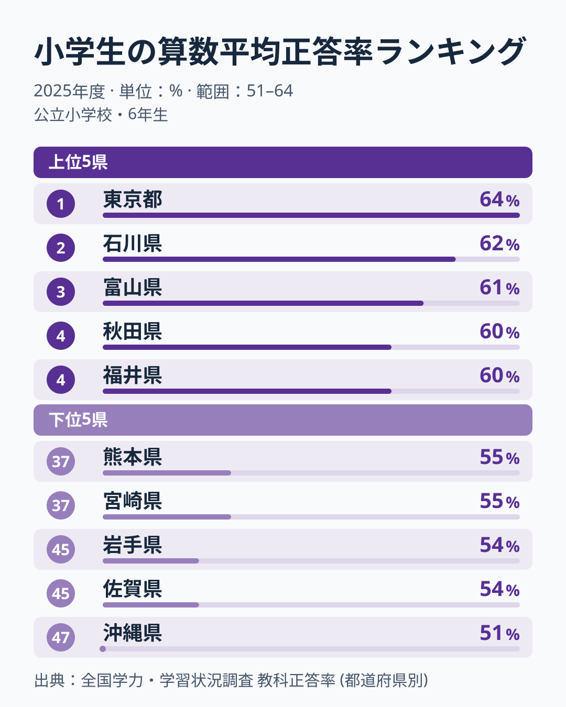
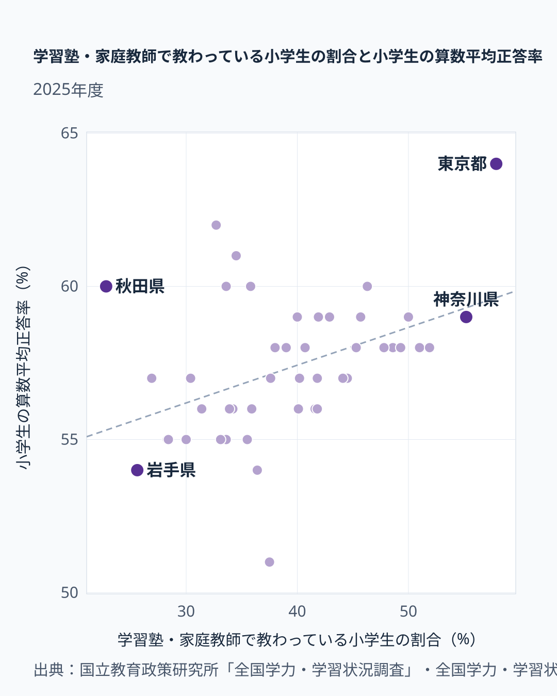
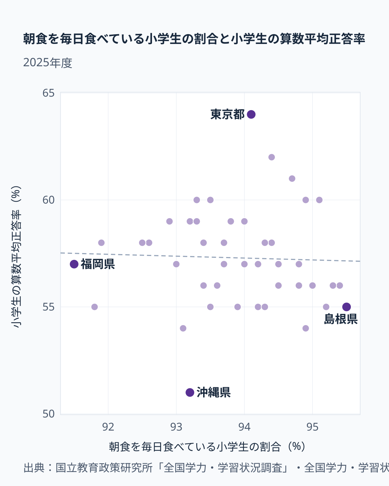
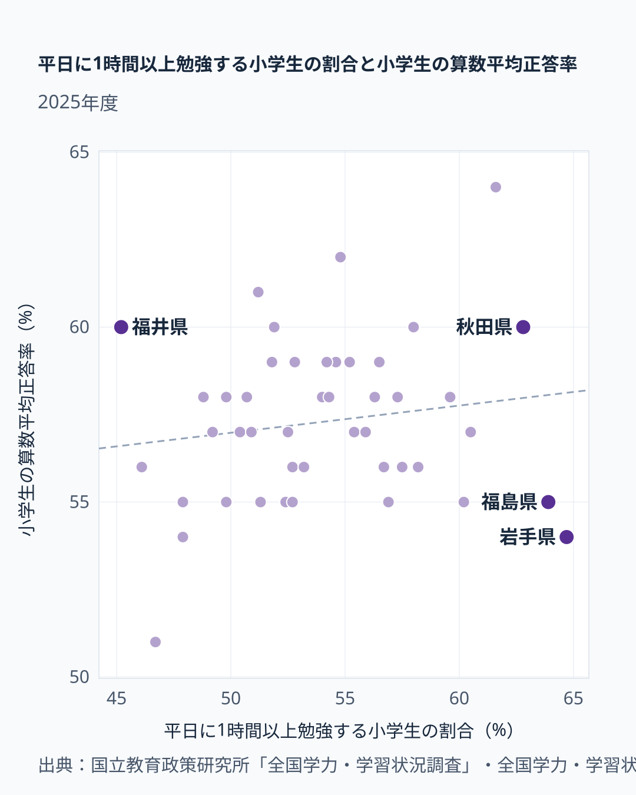

学力が高い県の子どもは、朝食をきちんと食べ、本をよく読み、家でも長く勉強している。そう考える人は多いはずです。2025年度の全国学力・学習状況調査で47都道府県を並べると、この見立てはほとんど当たりませんでした。小学6年生の算数の正答率と生活習慣の回答を県ごとに重ねたところ、相関係数は朝食でマイナス0.04、読書が好きでマイナス0.05、平日に1時間以上勉強する割合でプラス0.15にとどまりました。正答率と並んで動いたのは、学習塾・家庭教師で教わっている児童の割合だけで、相関係数は0.42です。

ただし、その通塾率の関係も外す県で値が動きます。東京都や通塾率の上位5都府県を外すと、ピアソンの相関では0.26まで下がり、順位の相関（スピアマン）では0.39が残ります。強さは確定できません。この記事では、生活習慣のどれが県の学力差と並び、どれが並ばないのかを散布図で確かめます。扱うのは県の平均どうしの関係であり、個々の子どもに当てはまる話ではありません。使うデータはすべて2025年度（令和7年度、調査日は2025年4月）の公立校の値で、年はそろっています。

## 算数の正答率は13ポイントの幅に収まる

基準にするのは、公立小学校6年生の算数の平均正答率です。まず上位と下位を確認します。

<source-link href="/ranking/national-assessment-elementary-mathematics-correct-rate">小学生の算数平均正答率ランキングをもっと見る</source-link>

1位は東京都の64％、2位は石川県の62％、3位は富山県の61％です。4位には秋田県、福井県、京都府、大分県の4県が60％で並びます。下位は沖縄県の51％が47位で、岩手県と佐賀県が54％で45位に並びます。1位から47位までの幅は13ポイントで、その中に47県が詰まっています。

この指標は公表された整数の％を使っているため、同じ値で並ぶ県が多く、順位の差はそのまま実力差を表しません。58％には埼玉県、千葉県、愛知県、大阪府など複数の県が入っています。順位ではなく値の離れ方で読むと、目立つのは東京都が2位の石川県より2ポイント高いことと、沖縄県が次に低い県より3ポイント低いことの2点です。

対象は公立校だけで、国立・私立の児童は含まれません。東京都の64％は、私立に進む児童を除いた集団の値であることを頭に置いておく必要があります。順位や地域の傾向そのものは、[学力トップは東京｜なぜ都市部と北陸が並ぶ?](/blog/academic-achievement-test-prefecture-ranking)で詳しく扱っています。この記事は順位ではなく、生活習慣との関係に絞ります。

## 通塾率だけは、正答率と一緒に動く

最初に、学習塾・家庭教師で教わっている小学生の割合（以下、通塾率）を算数の正答率と重ねます。

<source-link href="/ranking/national-assessment-elementary-tutoring-rate">学習塾・家庭教師で教わっている小学生の割合ランキングをもっと見る</source-link>

通塾率が高い県ほど、算数の正答率も高い傾向があります。相関係数は0.42で、47県を使った相関としては偶然とは区別できる大きさです。右上には東京都が入ります。通塾率は57.9％で全国1位、算数の正答率も64％で1位です。神奈川県も通塾率55.2％で2位、正答率は59％で8位に位置します。回帰直線の傾きは0.12で、通塾率が10ポイント高い県は、正答率が平均して1.2ポイントほど高いという読み方になります。

ただし、この関係の強さは外す県で変わります。ピアソンの相関係数は、東京都を除くと0.32（46県）、通塾率の上位5都府県（東京都、神奈川県、奈良県、大阪府、兵庫県）をまとめて除くと0.26（42県）に下がります。42県で偶然と区別できる目安はおよそ0.30なので、0.26はそれを下回ります。一方、順位の相関（スピアマン）では、全47県の0.46に対し、東京都を除いて0.42、上位5都府県を除いても0.39が残り、いずれも目安を超えています。外す県によって0.26〜0.32（ピアソン）、0.39〜0.42（スピアマン）と値が動くため、通塾率との関係は、あるとも、一部の県だけの見かけとも、言い切れません。

そして、通塾率の低い側にも高得点の県があります。秋田県の通塾率は22.8％で47位、全国で最も低い水準ですが、算数の正答率は60％で4位です。岩手県は通塾率が25.6％で46位、正答率は54％で45位と低く、同じ低通塾率でも秋田県と岩手県で結果が分かれます。通塾率だけで説明できる県は一部にとどまります。

> [!NOTE]
> この指標は塾に通う割合そのものではありません。質問は、学習塾や家庭教師の先生に教わっているか（オンライン授業を含む）で、「教わっていない」以外を選んだ割合です。家庭教師やオンライン授業も入るため、通塾の実態より広い範囲を数えています。

## 朝食の割合は県差が小さく、点数との関係は見えない

次は、朝食を食べている小学生の割合と算数の正答率です。指標名は「朝食を毎日食べている小学生の割合」ですが、中身は質問への回答「している」と「どちらかといえば、している」の合計で、「毎日食べている」割合そのものではありません。

<source-link href="/ranking/national-assessment-elementary-breakfast-rate">朝食を毎日食べている小学生の割合ランキングをもっと見る</source-link>

点は左右に広がらず、右下がりにも右上がりにもなっていません。相関係数はマイナス0.04で、ほぼ0です。朝食の割合が最も高いのは島根県の95.5％、最も低いのは福岡県の91.5％で、47県すべてが4ポイントの幅に収まっています。朝食の割合が全国で最も高い島根県は、算数の正答率が55％で37位です。反対に朝食の割合が最も低い福岡県は、正答率が57％で23位に入ります。

この合算指標は、どの県も9割を超えているのが特徴です。2つの選択肢を合わせた値は上限に近づきやすく、県のあいだの差がもともと小さいので、点数の差と結びつきにくくなります。つまり、この合算指標では県差が小さく、相関は見えなかったということです。朝食の大切さを否定するデータではなく、「毎日」だけの割合なら県の幅は別になる可能性があります。

> [!TIP]
> 「している」と「どちらかといえば、している」を合算した質問は、県の差が数ポイントしか出ません。47県の相関を取っても、差の小ささのために関係が見えにくくなります。読書や自己肯定感のように県の幅が大きい指標とは、読み方を分けるのが安全です。

## 家庭学習が長い県も、点数が高いとは限らない

平日に1時間以上勉強する小学生の割合も重ねます。

<source-link href="/ranking/national-assessment-elementary-study-1h-plus-rate">平日に1時間以上勉強する小学生の割合ランキングをもっと見る</source-link>

相関係数はプラス0.15で、勉強時間の長い県ほどやや正答率が高い向きですが、偶然と区別できる目安のおよそ0.29には届きません。割合が最も高いのは岩手県の64.7％、次いで福島県の63.9％、秋田県の62.8％です。この3県のうち、算数の正答率が高いのは秋田県だけで60％の4位、福島県は55％で37位、岩手県は54％で45位です。勉強時間が上位でも、正答率は大きく分かれます。

逆の例もあります。福井県は1時間以上勉強する児童が45.2％と全国で最も低いのに、算数の正答率は60％で4位に入ります。東京都は割合が61.6％と高く、正答率は64％で1位と、勉強時間と点数がそろっている県もあります。県によって事情が違うため、全体として直線に乗らないのです。

この質問は、学習塾や家庭教師、インターネットを使った学習の時間も含めて答える形です。通塾率と近い内容を測っているように見えますが、2つの指標の相関係数はマイナス0.17で、偶然と区別できる目安のおよそ0.29に届きません。通塾率の高い県が家庭学習も長いとは言えず、逆向きに動くとも言えません。個別の事例として秋田県を見ると、通塾率は全国最低でありながら、勉強時間の割合は全国3番目に高く、正答率も4位です。なお回答は児童の自己申告で、時間の長さを実測した値ではありません。

## 読書の好き嫌いも、自己肯定感も並ばない

ここまでの3つ以外の質問でも、同じ形でした。読書が好きな小学生の割合と算数の正答率の相関係数はマイナス0.05です。割合が最も高いのは長野県の76.3％で、算数の正答率は56％の30位でした。反対に、割合が低い側には福井県の64.9％と島根県の63.3％が並びますが、福井県の正答率は60％で4位に入ります。この質問は読書の時間や冊数ではなく好き嫌いを尋ねたものなので、読書の量との関係までは分かりません。

自己肯定感は、中学3年生の質問「自分には、よいところがあると思いますか」への肯定回答の割合で、同じ学年の数学の正答率と重ねました。相関係数は0.05です。最も高いのは秋田県の89.3％で、山梨県の89.0％、沖縄県の88.2％が続きます。沖縄県は自己肯定感が上位ですが、中学校数学の正答率は38％で47位と最下位でした。自己肯定感の高さと学力は、県の単位では別のものとして動いています。

ここからは、生活習慣は小学6年生の回答、数学は中学3年生の正答率という組み合わせで見ます。小学6年生の通塾率との相関係数は0.37、朝食は0.12、読書が好きはマイナス0.20、家庭学習は0.03です。2025年の中学3年生は3年前の小学6年生にあたり、回答した児童が異なるため、同じ子どもを追った結果ではありません。ただ、小学校の算数と中学校の数学の正答率どうしの相関係数は0.75と高く、学力の高い県は学年が変わっても高い位置にいます。朝食と家庭学習も中学3年生の数学とは正の向きですが、小学6年生の算数でも中学3年生の数学でも、偶然と区別できる目安のおよそ0.29を超えたのは通塾率だけでした。2学年で同じ向きの結果になっている、という程度に読めます。

あわせて見る: [自分によいところがあると思う中学生の割合ランキング](/ranking/national-assessment-junior-high-self-esteem-rate) / [読書が好きな小学生の割合ランキング](/ranking/national-assessment-elementary-reading-like-rate) / [中学生の数学平均正答率ランキング](/ranking/national-assessment-junior-high-mathematics-correct-rate)

## この相関をどこまで読んでよいか

通塾率の0.42をどう読むかには、慎重さが要ります。

> [!WARNING]
> この記事の相関は、県の平均どうしの関係です。県の通塾率が高いことは、その県の個々の子どもが塾に通うと点数が上がることを意味しません。県の単位で見える関係が、個人の単位でも成り立つとは限りません。

まず、通塾率が高いから学力が高いとは言えません。学力の低い子が塾に通う逆の流れも考えられ、どちらの向きの関係もこのデータからは区別できません。[仮説] 都市部では中学受験などの学習需要が通塾率を押し上げ、同じ都市部の学力の高さと並んで見えている可能性があります。検証するには、世帯の所得や進学行動など、この記事の指標にない要因を加える必要があります。通塾の費用と進学率の関係は、[塾代は最下位級でも京都の進学率はトップ級](/blog/tutoring-cost-university-advancement-gap)が扱っています。

次に、通塾率が低い県でも結果が良い例があります。通塾率の低さと高い正答率が並ぶ秋田県の背景は、このデータだけでは断定できません。通塾率が低い農業県の傾向は、[食料自給率が高い県は学習塾が少ないのか?](/blog/food-self-sufficiency-rate-calorie-vs-national-assessment)で別の角度から見ています。

最後に、データ上の限界です。回答は児童が質問紙に答えた自己申告で、実際の行動を測った値ではありません。朝食や自己肯定感のように「そう思う」と「どちらかといえば、そう思う」を合わせた指標では、答え方の違いが県の差に混じります。調査は公立校だけが対象です。47県の相関は、絶対値がおよそ0.29を下回ると偶然のばらつきと区別できないため、朝食、読書、家庭学習、自己肯定感の相関は、点数との関係が「ない」と証明されたのではなく、「見えなかった」と読むのが正確です。通塾率の0.42も、外す県で0.26〜0.32（ピアソン）と動くため、強さは確定できません。

## まとめ

- 小学6年生の算数の正答率は、東京都の64％から沖縄県の51％まで13ポイントの幅で、同じ値で並ぶ県が多くなっています。
- 生活習慣のうち、正答率と並んで動いたのは通塾率だけで、相関係数は0.42です。ピアソンでは東京都を除くと0.32、上位5都府県を除くと0.26（42県の目安はおよそ0.30）まで下がりますが、順位の相関では0.46、0.42、0.39と残り、外す県で値が動くため強さは確定できません。
- 朝食（マイナス0.04）、読書が好き（マイナス0.05）、家庭学習1時間以上（プラス0.15）は、偶然と区別できる目安のおよそ0.29に届かず、県の学力差とは並んで見えませんでした。朝食は2つの選択肢の合算で県差が小さい指標です。
- 秋田県は通塾率が全国最低でも算数の正答率が4位、福井県は家庭学習も読書の好きも下位で正答率が4位と、生活習慣の順位と学力が逆になる県があります。
- 県の平均どうしの相関は個人には当てはまらず、因果も示しません。通塾率との関係も、学力の低い子が塾に通う逆向きの流れと区別できません。

## データについて

使った指標は、いずれも全国学力・学習状況調査の公立校の値で、2025年度（令和7年度）に統一されています。小学生の指標は6年生、中学生の指標は3年生を対象にしています。算数・数学の正答率は公表された整数の％、生活習慣の質問は「当てはまる」と「どちらかといえば、当てはまる」の公表割合を合計した値です。

相関係数はピアソンの積率相関係数で、47都道府県の値を同じ年で組み合わせて計算しました。同じ値で並ぶ県が多いため、順位の相関（スピアマン）も確認しています。小学6年生の算数との値は、通塾率が0.46、朝食がマイナス0.13、読書が好きがマイナス0.09、家庭学習が0.11で、ピアソンと同じ向きと大きさの関係でした。偶然と区別できる目安のおよそ0.29は、47県を使った相関の両側5％水準にあたります。東京都を除いた値（46県・目安およそ0.29）と通塾率の上位5都府県を除いた値（42県・目安およそ0.30）は、該当する県を外して同じ方法で計算し直したものです。ここで使った相関係数の一覧（指標のペア、除外した県、県の数、ピアソンとスピアマンの係数、目安の値）は、同じ記事の `data/derived-correlations.json` に記録しています。
