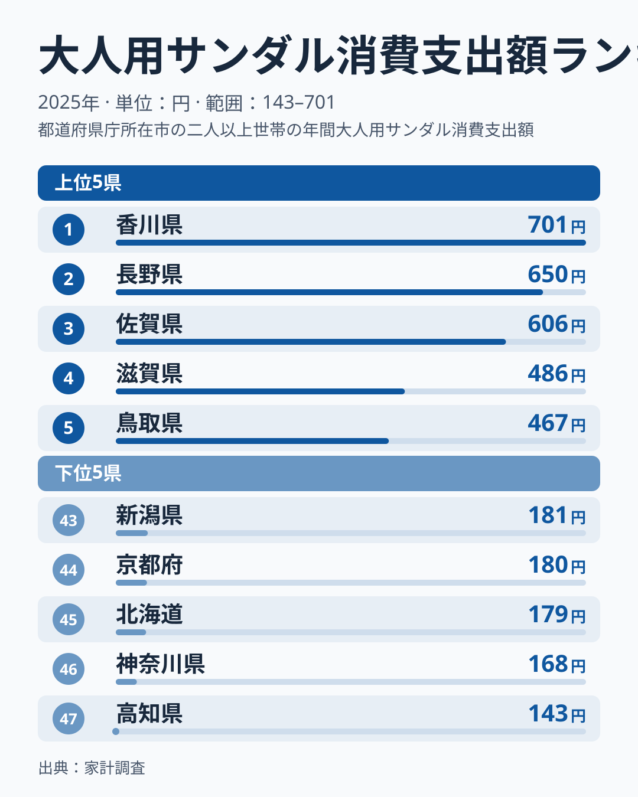
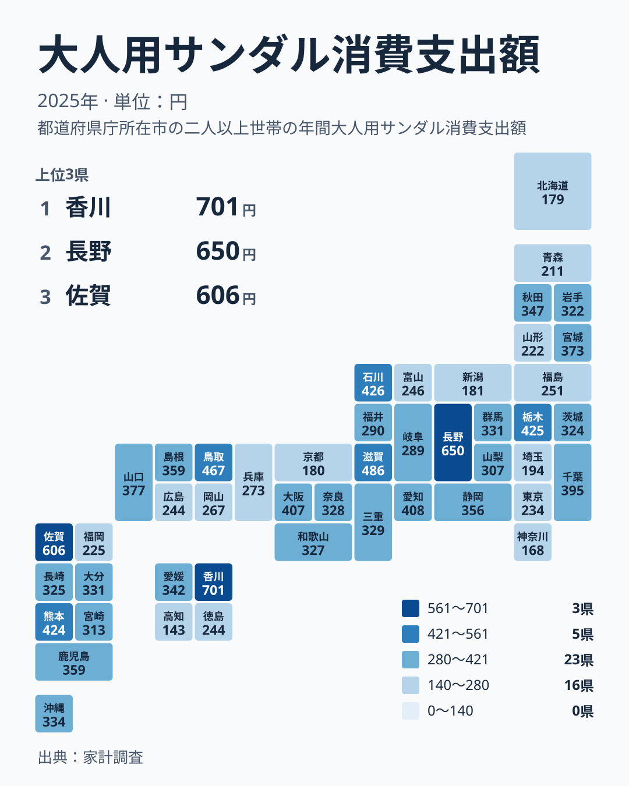

## サンダルへの支出に表れる暮らしの差

サンダルは、衣料品の中でも地味な買い物です。ところが家計調査の2025年の結果を並べると、大人用サンダルへの支出は県によって大きく違っていました。最も多い香川県は701円で1位です。最も少ない高知県は143円で47位です。どちらも四国にある県で、順位表の両端に位置しています。

701円と143円の比は、約5倍です。日用品に近い小さな買い物でも、県によってここまで開きが出ます。この記事では、順位表の読み上げにとどまらず、上位と下位のかたまり方、同じ地方の中での開き、そしてこの指標を読むときの注意点を整理します。暮らしの違いにどうつながるのかも、データの範囲で考えていきます。

> [!NOTE]
> ここで扱う指標は、家計調査の「大人用サンダル消費支出額」です。2025年の値で、単位は円です。子ども用は含まれていません。数百円という小さな規模の金額で、1世帯あたりの支出として集計されています。

## 上位と下位の間隔を読む

まず、上位と下位の顔ぶれを図で確認します。

<source-link href="/ranking/adult-sandals-consumption-expenditure">大人用サンダルへの支出ランキングをもっと見る</source-link>

図で注目したいのは、順位ごとの金額の間隔です。上位では、1位の香川県が701円、2位の長野県が650円、3位の佐賀県が606円と、1位から3位までは50円前後ずつ下がっています。そのあと4位の滋賀県が486円、5位の鳥取県が467円と続きます。3位から4位は606円から486円への下がりで、上位5県の中ではここが最も大きな段差です。一方、4位から5位は486円から467円と小さな差にとどまります。ただし、この図だけで「上位の県が飛び抜けている」とまでは言えません。

下位は、金額が密集しています。43位の新潟県が181円、44位の京都府が180円、45位の北海道が179円で、ほぼ並んでいます。46位の神奈川県は168円、47位の高知県は143円です。下位5県の中では、最下位の高知県と神奈川県との間が比較的大きく開いています。ただし、上位の段差と比べると目立つほどの大きさではありません。

上位5県は、四国、中部、九州・沖縄、近畿、中国と、5つの地方に1県ずつ分かれています。10位前後まで広げても、関東の栃木県が7位の425円、愛知県が9位の408円、大阪府が10位の407円と、さまざまな地方の県が入ります。上位は特定の地方に偏っているというより、散らばっています。香川県の詳しい数字は[香川県のデータ](/areas/37000)、長野県の数字は[長野県のデータ](/areas/20000)で確認できます。

> [!WARNING]
> 家計調査は標本調査で、県ごとの対象世帯数は多くありません。サンダルのように金額の小さい品目は、数世帯が買っただけで平均が動くことがあります。順位が1つ2つ違うだけの県どうしは、実質的に同じ水準と見たほうが安全です。

## 同じ地方の中で、これだけ開く

次に、地図で地理的な広がりを見ます。

この地図から読み取れる大事な点は、地方のくくりでは説明しにくいことです。典型は四国です。香川県が1位の701円、愛媛県が18位の342円、徳島県が37位の244円、高知県が47位の143円と、四国の4県が順位表のほぼ全域に散らばっています。1位と47位が同じ地方に同居しているわけです。

ほかの地方でも似た傾向があります。九州・沖縄では佐賀県が3位、福岡県が39位です。近畿では滋賀県が4位、京都府が44位です。中部では長野県が2位、新潟県が43位です。どの地方にも、上位の県と下位の県が混ざっています。

つまり、この表の範囲では、「この地方は多い」「この地方は少ない」という括り方は難しいと言えます。同じ地方に住んでいても、サンダルへの支出は県によって大きく違います。地方の平均で語るより、県ごとの値を見たほうが実態に近づける場面が多そうです。

> [!TIP]
> 順位表を読むときは、地方でひとまとめにせず、同じ地方の中の最高と最低を見比べてください。四国なら香川県の701円と高知県の143円です。地方内の開きに気づくと、地方の特徴だけで説明しようとする読み方の限界が見えてきます。

## 原因はデータからは言い切れない

ここまでの数字から、暮らしのどんな違いが読めるでしょうか。正直なところ、この実データには、各県の値と順位しかありません。気候、移動手段、住まいの形といった情報は含まれていないため、なぜ差が出たのかを数字から断定することはできません。

たとえば「車での移動が多い地域ほど、近所で履くサンダルの出番が多いのでは」という仮説は考えられます。しかし、これはあくまで仮説です。上位の香川県、長野県、佐賀県にどんな共通点があるのかは、この実データからは示せません。四国の例のように、近い地域でも結果が大きく分かれることを考えると、一つの要因で説明するのは難しそうです。

大都市圏を見ても、単純ではありません。東京都は38位の234円、埼玉県は42位の194円、神奈川県は46位の168円と下位に寄っています。一方、大阪府は10位の407円、愛知県は9位の408円で、上位に入っています。都市部かどうかだけでは分けられないことが分かります。

読者の暮らしにとって大切なのは、「自分の県は平均的か」を気にしすぎないことかもしれません。サンダルは、買う世帯と買わない世帯で差が出やすい品目です。県の順位は暮らしぶりの優劣ではなく、その年の買い方の傾向を映した一場面として受け止めるのがよいでしょう。

## この数字を読み違えないために

この指標で一番気をつけたいのは、金額が小さいことです。数百円という規模は、サンダルを買えば大きく動き、買わなければゼロに近くなる水準です。そのため、ある県の支出が多いことは、住民全員がサンダルをよく買っているというより、その年に購入した世帯が一定数あったことを反映している可能性があります。

特に順位が中位に集まっている県では、22位の三重県が329円、25位の長崎県が325円というように、数円の違いで順位が入れ替わります。この範囲の順位差には意味を持たせすぎないほうがよいでしょう。

見るべきなのは、上位と下位という大きなまとまりです。701円の香川県と143円の高知県のような両端の差は、サンプルのぶれだけとは言い切れない大きさです。ただし、ぶれの影響を数字で確かめる材料はこのデータにはありません。ほかの家計の指標と合わせて読みたい場合は、[同じカテゴリの統計一覧](/category/economy)から探せます。

## データについて

この記事で使ったのは、家計調査における大人用サンダル消費支出額です。2025年の値で、単位は円です。順位は金額の大きい順に付けています。

家計調査は、調査対象となった世帯の支出をもとにした調査です。そのため、県の値は県全体を完全に代表するというより、調査世帯の支出を反映したものです。県同士の差は目安として受け取ってください。

記事中の金額と順位は、掲載したデータの値をそのまま用いています。独自の推計は加えていません。
