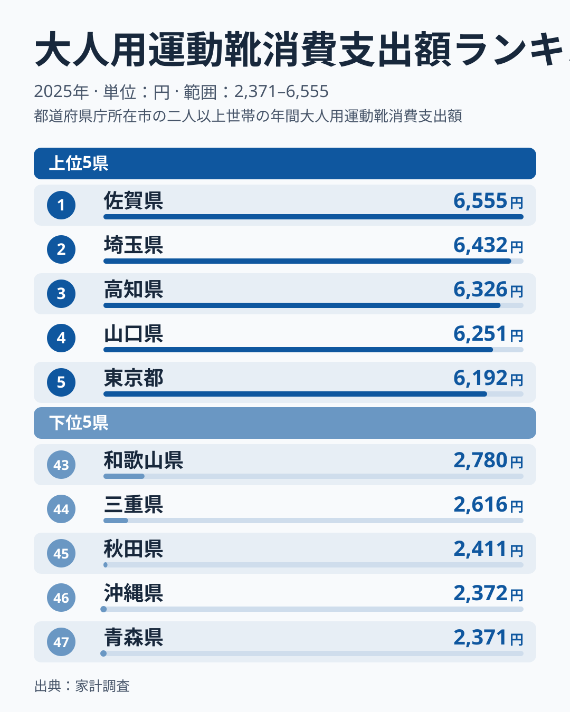
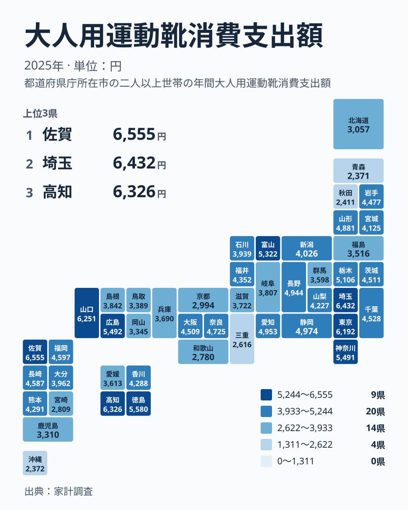

運動靴は、通勤や散歩、子どもの学校行事、趣味の運動まで、暮らしのさまざまな場面で履かれます。その大人用運動靴にいくら使っているかを都道府県別に並べると、意外な顔ぶれが上位に現れます。2025年の家計調査では、1位は佐賀県で6,555円でした。一方、最下位の47位は青森県で2,371円でした。

この記事では、上位と下位の顔ぶれ、地方ごとの傾向、数字を読むときの注意点を順に見ていきます。

## 運動靴への支出が多いのはどこか

まず、上位5県と下位5県を図で確認します。

<source-link href="/ranking/adult-sneakers-consumption-expenditure">大人用運動靴への支出ランキングをもっと見る</source-link>

1位は佐賀県で6,555円です。2位は埼玉県で6,432円、3位は高知県で6,326円、4位は山口県で6,251円、5位は東京都で6,192円と続きます。上位5位までの差は363円にとどまらず、顔ぶれを見ると、大都市圏と地方県が入り混じっているのが特徴です。東京都や埼玉県のような首都圏の都県だけでなく、九州の佐賀県、四国の高知県、中国の山口県が並んでいます。

下位側を見ると、47位は青森県で2,371円です。46位は沖縄県で2,372円で、青森県とはわずか1円の差です。45位は秋田県で2,411円、44位は三重県で2,616円、43位は和歌山県で2,780円です。下位5県のうち、北海道・東北に入るのは青森県と秋田県の2県です。

最大と最小の比を見ると、佐賀県の6,555円は青森県の2,371円の約2.8倍にあたります。同じ「大人用の運動靴」という品目でも、年間の支出額には県によって大きな開きがあります。

## 地方ごとに見ると何が見えるか

次に、地理的な分布を図で見てみましょう。

分布を眺めると、特定の地方だけが高いわけではないことが分かります。関東では埼玉県が2位の6,432円、東京都が5位の6,192円、神奈川県が8位の5,491円、栃木県が10位の5,106円と、上位10位以内に4都県が入っています。一方で同じ関東でも、群馬県は35位の3,598円で、地方の中でもばらつきがあります。

中国では山口県が4位の6,251円、広島県が7位の5,492円と上位に入ります。ただし岡山県は38位の3,345円、鳥取県は37位の3,389円で、同じ地方でも順位は大きく異なります。四国も、高知県が3位の6,326円、徳島県が6位の5,580円と上位に入る一方、香川県は24位の4,288円、愛媛県は34位の3,613円です。

九州・沖縄では、佐賀県が1位の6,555円ですが、福岡県は16位の4,597円、長崎県は17位の4,587円、熊本県は23位の4,291円です。鹿児島県は39位の3,310円、宮崎県は42位の2,809円、沖縄県は46位の2,372円と、地方内で上位から下位まで広がっています。

北海道・東北は全体に低めです。山形県が14位の4,881円、岩手県が21位の4,477円と中位に入る一方、北海道は40位の3,057円、秋田県は45位の2,411円、青森県は47位の2,371円です。

> [!NOTE]
> この指標は家計調査にもとづく、大人用運動靴の1世帯あたり年間支出額です。1人あたりの金額でも、履いた足数でもありません。世帯の人数や年齢構成が違えば、同じ生活でも金額は変わります。

## 数字を生活に翻訳すると

6,555円という金額は、運動靴を1足買えばほぼ使い切る水準です。2,371円では、1足分の価格に届かない世帯も多いはずです。ここから、上位の県では買い替えの頻度が高いか、1足あたりの価格が高めの靴を選んでいる可能性があると考えられます。逆に下位の県では、買い替えの間隔が長いか、安価な靴を選んでいる可能性があります。ただし、これは金額からの推測であり、家計調査だけで確かめることはできません。

もう一つ見逃せないのは、移動手段との関係です。東京都は5位の6,192円、埼玉県は2位の6,432円で、日常的に歩く機会の多い首都圏の暮らしと合っているように見えます。ところが1位の佐賀県や3位の高知県は、必ずしも大都市ではありません。そのため、歩く距離だけでは説明できず、通学や仕事、地域の運動習慣、買い物先の違いなど複数の要因が重なっていると見るのが自然です。

また、近畿を見ると、奈良県が15位の4,725円、大阪府が20位の4,509円、兵庫県が33位の3,690円、滋賀県が32位の3,722円、京都府が41位の2,994円、三重県が44位の2,616円、和歌山県が43位の2,780円です。同じ近畿でも、順位は15位から44位まで開いています。「都市部だから多い」「地方だから少ない」と単純には言えません。

> [!WARNING]
> 家計調査は標本調査で、都道府県単位では対象世帯の数が限られます。運動靴のように毎月は買わない品目は、たまたま購入した世帯がいたかどうかで年間の金額が動きやすくなります。46位の沖縄県と47位の青森県の差が1円しかないように、順位の細かな違いは偶然の揺れの範囲に収まる場合があります。

## 順位を読み解くコツ

中位から下位にかけては、金額の差が小さく、順位だけが大きく動きます。たとえば、20位の大阪府は4,509円、19位の茨城県は4,511円、18位の千葉県は4,528円です。3県の差はごくわずかで、順位が1つ違っても暮らしの実態に差があるとは言いにくい水準です。

一方、上位5県と下位の県を比べると、差ははっきりします。5位の東京都は6,192円、10位の栃木県は5,106円、20位の大阪府は4,509円、30位の島根県は3,842円、40位の北海道は3,057円です。10位刻みで見ると、順位が下がるごとに金額も着実に減っており、全体としては緩やかな傾斜になっています。

中位には、静岡県が11位の4,974円、愛知県が12位の4,953円、長野県が13位の4,944円と、近い金額の県が固まっています。この帯では、数百円の違いで順位が10以上動くこともあります。順位を見るときは、金額の差とあわせて確認するのが安全です。

> [!TIP]
> 順位だけで県を比べず、前後の県との金額差を確認してください。上位と下位では差が大きい一方、中位は数円から数十円の差で順位が入れ替わります。単年のデータなので、1年だけの結果で県民の傾向を決めつけず、他の年のデータや隣県の数字もあわせて見るのが確実です。

## データについて

ここで使った数値は、家計調査の2025年の「大人用運動靴消費支出額」で、単位は円です。対象は大人用の運動靴への支出で、子ども用の靴や、革靴など他の種類の靴は含まれません。

地域ごとの傾向をさらに調べたい場合は、[同じカテゴリの統計一覧](/category/economy)から、衣料や身の回り品に関する別の指標も見られます。1位の[佐賀県のデータ](/areas/41000)や2位の[埼玉県のデータ](/areas/11000)も、あわせて確認してみてください。

## まとめ

2025年の大人用運動靴への支出は、佐賀県が6,555円で1位、埼玉県が6,432円で2位、高知県が6,326円で3位でした。反対に、青森県は2,371円で47位、沖縄県は2,372円で46位、秋田県は2,411円で45位でした。最大と最小の比は約2.8倍です。

上位には首都圏と地方の県が混在し、同じ地方の中でも順位が大きく分かれていました。運動靴への支出は、都会か地方かだけでは説明できず、暮らし方や買い方の違いが重なって決まっていると考えられます。順位を読むときは、金額の差や調査の特性とあわせて見ることが大切です。
