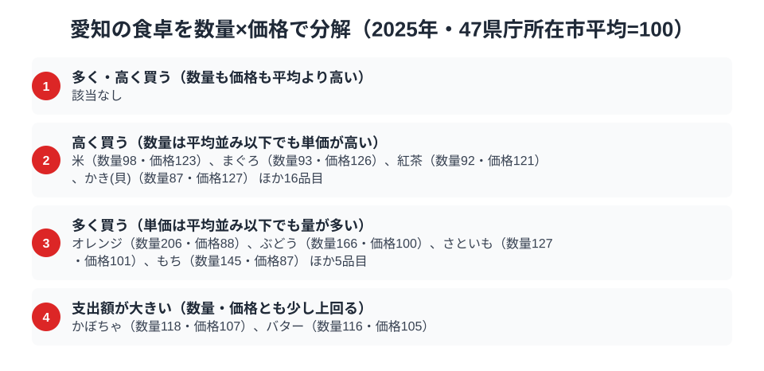

愛知県は「名古屋めし」で知られる独自の食文化圏です。味噌カツ・味噌煮込みうどん・きしめんといった濃厚な味わいの料理が全国的な知名度を持ち、豆味噌（八丁味噌）の産地としても有名です。ところが総務省の家計調査で品目別の支出額を見ると、この「味噌の国」のイメージとは少し異なる順位が浮かび上がります。

家計調査（品目別）2025年のデータでは、愛知県の生うどん・そば消費支出額は全国9位と上位に入っています。一方でみそ消費支出額は全国20位で、名古屋めしの主役級食材でありながら中位にとどまります。名古屋めしとは直接結びつかないウイスキー消費支出額は全国38位で、下位に近い位置です。この記事では、麺・みそという名古屋めし関連の2品目に、ウイスキーを加えた3品目を通じて、愛知県民の食卓の実像を数字から読み解きます。

> [!NOTE]
> 本記事のデータは総務省統計局「家計調査（品目別）」2025年、都道府県庁所在市（愛知県は名古屋市）の二人以上世帯の年間支出額（円）です。県全体の値ではなく、また消費「量」ではなく「支出額」であり、価格差・購入頻度・世帯構成の影響も含みます。単年の順位はぶれが大きいため、構造を断定せず傾向として読んでください。

## 生うどん・そば消費支出額 — 愛知は4,328円で上位に入る

<source-link href="/ranking/fresh-udon-soba-consumption-expenditure">生うどん・そば消費支出額ランキングをもっと見る</source-link>

生うどん・そば消費支出額では、愛知県は年間4,328円で全国9位につけています。1位は香川県の6,450円で、愛知県との差は2,122円です。

同額の4,412円で並ぶ秋田県と長野県が6位と7位、8位の埼玉県が4,363円で、愛知県はその次です。47都道府県の単純平均は約3,816円なので、愛知県は平均の約1.13倍にあたります。10位の大阪府は4,175円で、9位から10位までは150円ほどしか離れていません。上位10位に入ってはいますが、1位の香川県が突き抜けている一方で、2位から10位の9県は、山形県の5,251円から大阪府の4,175円までの狭い範囲に密集している構図です。

支出額だけでなく購入数量でも、愛知県は10,535gで全国14位と上位です。数量が平均の約1.06倍、単価にあたる価格指数が約1.07倍なので、量と単価がともに少しずつ平均を上回って支出額の上位を支えています。

愛知が上位に入る理由として、[仮説] 味噌煮込みうどんやきしめんという郷土料理の存在が考えられます。家庭で生麺を購入して調理する場面があるのかもしれず、乾麺中心の地域とは異なる購入パターンが支出額に表れている可能性があります。ただし、この要因を確かめるデータは本記事にはありません。

## みそ消費支出額 — 愛知は2,316円で20位、豆味噌の産地でも中位

<source-link href="/ranking/miso-consumption-expenditure">みそ消費支出額ランキングをもっと見る</source-link>

みそ消費支出額で、愛知県は年間2,316円で全国20位でした。1位は長野県の3,152円で、愛知県との差は836円です。

愛知は八丁味噌をはじめとする豆味噌の一大産地です。それでも家計調査の「みそ」支出額では、上位ではなく中位に位置しています。

この結果には複数の理由が考えられます。[仮説] 家計調査の「みそ」は購入した味噌そのものの支出です。味噌煮込みうどんや味噌カツのように外食・中食で味噌を使う場合は、この品目に計上されません。名古屋圏では味噌料理を外食で楽しむ機会が多く、家庭内でみそを直接購入する頻度が相対的に低い可能性があります。ただし、これを確かめるデータは本記事にはありません。

> [!WARNING]
> 愛知のみそ消費支出額が20位だからといって、愛知の人がみそを食べていないとは言えません。この統計に含まれるのは家庭で購入したみそだけで、味噌煮込みうどんや味噌カツなど、店で食べる味噌料理は入っていません。また支出額は購入量そのものではなく、価格帯や購入頻度の影響も受けます。

## ウイスキー消費支出額 — 愛知の1,533円はなぜ伸びないのか

<source-link href="/ranking/whisky-consumption-expenditure">ウイスキー消費支出額ランキングをもっと見る</source-link>

ウイスキーは名古屋めしとは別枠の品目ですが、愛知の食卓の別の側面として見てみます。家計調査2025年によると、愛知県のウイスキー消費支出額は年間1,533円で、全国38位でした。

2025年の1位は秋田県の6,391円で、愛知県の1,533円はこの約4分の1の水準です。上位は秋田県・宮城県・青森県・北海道と東北・北海道の道県が占め、愛知県は47都道府県の単純平均約2,702円の6割弱にとどまります。同じ中部でも岐阜県は5位の4,267円で、愛知県の約2.8倍です。ウイスキーは、隣県と並べても「中部だから」では括れない差が出る品目です。

この順位の背景は、このデータだけでは判断できません。[仮説] ウイスキーは1回あたりの購入単価が高く、購入の有無や銘柄の選び方で年間の支出額が大きく動きやすい品目です。名古屋市の二人以上世帯という限られた標本では、その年の購入のばらつきが順位に出やすいのかもしれません。喫茶店文化や所得水準など、愛知らしい要因を結びつけて語りたくなりますが、1年分の順位だけでは裏付けられません。

## 愛知の食卓を貫くもの

3つの品目を並べると、愛知の食卓には品目ごとに違う顔があります。生うどん・そばは全国9位の上位、みそは全国20位の中位、ウイスキーは全国38位の下位です。

名古屋めしの代表である麺類は、支出額にもその存在感が表れています。一方で、原材料のみそは、郷土料理の知名度ほどには家計の購入額に現れていません。この食い違いは、外食や中食での消費が家計調査の「購入支出額」に含まれにくいことで説明できるかもしれません。[仮説] ただし1年分の順位だけで、その構造を断定することはできません。

みそ消費支出額で全国1位の[長野の食卓](/blog/nagano-food-culture)や、お茶という単一品目が目立つ[静岡の食卓](/blog/shizuoka-food-culture)と比べると、愛知は郷土料理の知名度と家計統計の順位が一致しにくい例として読めます。ウイスキーについては別の切り口から[ウイスキー消費量の都道府県格差](/blog/whisky-consumption-prefecture-gap)でも取り上げているので、あわせて確認すると消費量ベースとの違いも見えてきます。

## 支出額の順位は数量と単価のどちらが決めているか

ここまでの3品目は「支出額」という一つの物差しで比べました。家計調査では支出額を購入数量と単価に分けられるため、47都道府県庁所在市の単純平均を100とした指数で、3品目の順位の中身を確かめます。

- 生うどん・そば：数量106・価格107で、量も単価も平均をわずかに上回り、支出指数は113です。
- みそ：数量91・価格110で、買う量は平均より1割ほど少ない一方、単価が上回って支出指数は101と平均並みになっています。購入数量の順位は35位で、支出額の20位は単価が押し上げた形です。
- ウイスキー：購入数量（ウイスキー消費量）の指数は45、価格は127で、支出指数は57です。量が平均の半分以下なので、単価が高めでも支出額を押し上げきれていません。

みそとウイスキーに共通するのは、価格指数が100を超えているのに数量が大きく下回る点です。愛知県の順位の低さは「高いものを買わない」ためではなく、そもそも買う量が少ないことに由来します。ただし、価格指数は支出額を数量で割った1単位あたり金額の相対値で、銘柄・品種・グレードの違いを含みます。質にお金をかけていると言い切ることはできません。

<source-link href="/ranking/whisky-consumption-quantity">ウイスキー消費量ランキングをもっと見る</source-link>

同じ分解を愛知県の2025年の全品目に広げると、数量も価格も平均より高い「多く・高く買う」品目は該当なしでした。代わりに目立つのは、数量は平均並み以下でも単価が高い「高く買う」品目で、米は数量98・価格123、まぐろは数量93・価格126です。一方、「多く買う」側ではオレンジが数量206・価格88と、量が突出しています。区分の基準は指数120以上を「高い・多い」とするもので、ウイスキーは価格指数127なので「高く買う」の基準を超えますが、図には各区分の上位4品目だけを載せているため並びません。麺とみそは価格・数量とも基準に届かず、図には出てきません。

米やまぐろで価格指数が高く出ていることについて、[仮説] 銘柄や品種の選び方の違いが表れているのかもしれません。確かめるには別の切り口のデータが必要です。

> [!NOTE]
> ここでの指数は総務省統計局「家計調査（品目別）」の47都道府県庁所在市（二人以上世帯）平均を100とした相対値で、家計調査の全国値そのものとは基準が異なります。数値はいずれも2025年の年間値です。

## まとめ

- 生うどん・そば消費支出額は愛知県が4,328円で全国9位、味噌煮込みうどん・きしめん文化が背景にあると考えられる
- みそ消費支出額は2,316円で全国20位、八丁味噌の産地でも家計購入額は中位
- ウイスキー消費支出額は1,533円で全国38位、数量指数が45と低く、量の少なさが順位の低さにつながっている
- 数量×価格では、麺は量・単価とも平均超、みそ・ウイスキーは単価が高めでも量が少なく、全品目では米・まぐろの価格指数とオレンジの数量指数が目立つ
- 郷土料理の存在感と原材料の家計消費額は必ずしも一致しない。単年の順位はぶれが大きく、理由は仮説にとどまる

愛知県の地域全体の統計は[愛知県の地域プロフィール](/areas/23000)、他の経済指標は[経済カテゴリ一覧](/category/economy)からも確認できます。
