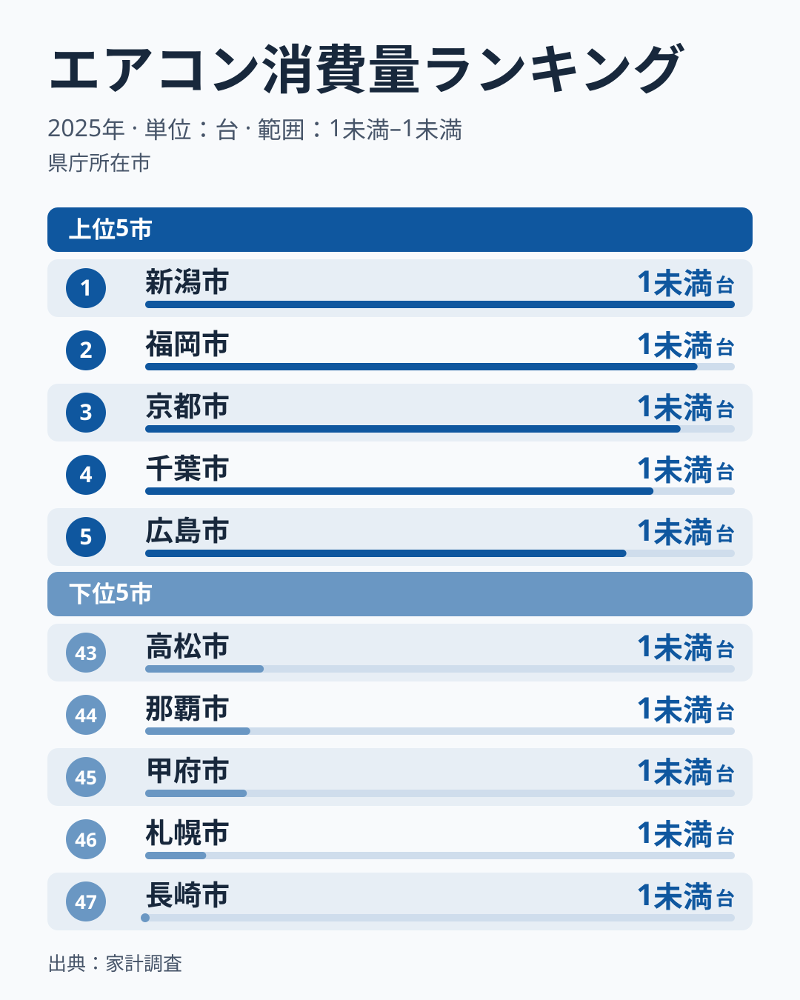
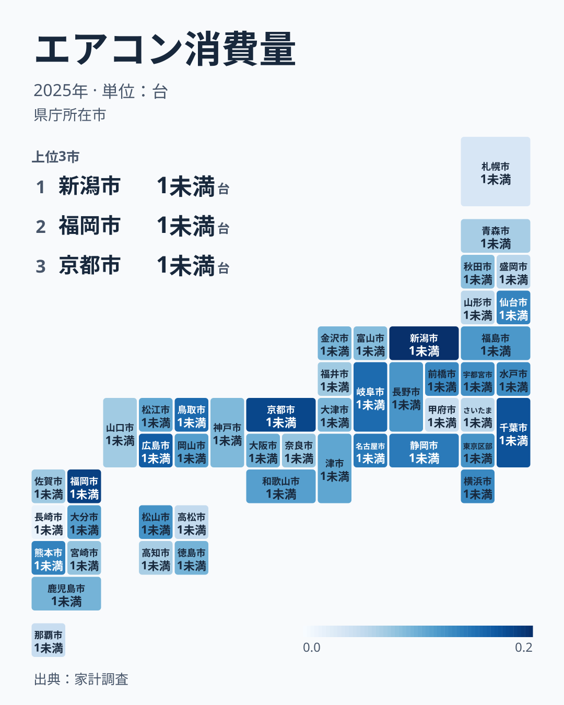

1世帯あたり何台のエアコンを買っているか、という数字にも地域差があります。家計調査の2025年のデータで最も多かったのは新潟県で0.186台、最も少なかったのは長崎県で0.012台でした。ところが2024年に最も多かった香川県は、2025年は0.047台で43位です。1年でここまで順位が動く指標を、どう読めばよいのでしょうか。

この記事では2025年の順位を確かめたうえで、2007年からの19年分を並べ、入れ替わる上位と、下位に残り続ける県を見比べます。

> [!NOTE]
> この指標は普及台数ではなく、家計調査が集計した二人以上世帯の1世帯あたりの年間購入数量です。すでに設置済みのエアコンの保有状況ではなく、その年に新たに購入した台数を表しています。値は都道府県庁所在市のもので、本文の県名はその県の県庁所在市を指します。

## エアコン購入量が多い県、少ない県

<source-link href="/ranking/air-conditioner-consumption-quantity">エアコン消費量ランキングをもっと見る</source-link>

2025年のエアコン購入数量は、新潟県が0.186台で1位でした。2位は福岡県で0.175台、3位は京都府で0.17台、4位は千葉県で0.162台、5位は広島県で0.154台と続きます。雪の多い新潟県と、夏の暑さが厳しい福岡県・京都府が上位に並んでおり、暑い地域ほど多いという単純な形にはなっていません。

下位は、長崎県が0.012台で47位、北海道が0.03台で46位、山梨県が0.042台で45位、沖縄県が0.043台で44位、香川県が0.047台で43位です。最も暑い地域の一つである沖縄県が下位に入っている点は目を引きますが、後で見るとおりこの指標は1年の順位が大きく揺れるため、2025年だけで気温との関係を判断することはできません。

1位と47位の差は15.5倍で、2024年の9.1倍より大きく開きました。ただ、47位の長崎県の値は0.012台で、100世帯あたり1台ほどしか買っていない計算です。値が小さい県どうしでは、わずかな差でも倍率が大きく動きます。倍率の大きさを、そのまま地域差の大きさと読むのは避けたほうがよいでしょう。

## 前年1位が43位に下がる指標

地図で見ると、購入量の多い県は新潟県・千葉県・京都府・広島県・福岡県と各地に散らばっており、ひとつの地域に固まってはいません。

順位の動きはさらに大きくなります。2024年の1位だった香川県は、2025年は43位でした。逆に2024年に46位だった広島県は、2025年は5位に上がっています。新潟県は2020年に45位でしたが、2021年に4位、2025年に1位になりました。19年間で最も多かった県は、同じ値で並んだ年（2009年の岡山県と香川県、2022年の長野県と京都府）を含めると14の県に分かれ、同じ県が2年続けて最多になった年は一度もありません。

前の年と次の年の順位がどれだけそろうかを順位相関係数（1なら全く同じ順位、0なら無関係）で見ると、2024年と2025年の間は0.14でした。2008年以降の隣り合う年どうしでも、-0.11から0.39の間にとどまります。前の年の順位は、次の年の順位をほとんど予想できないということです。2024年から2025年にかけて、47都道府県の順位の動きの幅は中央値で14位あり、20位以上動いた県が14県ありました。

[仮説] エアコンは数年に一度しか買わない品目なので、調査に選ばれた世帯がその年に買い替えたかどうかで、県の値が大きく揺れるのかもしれません。家計調査は全世帯を調べる調査ではなく、抽出した世帯の家計簿を集計する調査です。香川県の順位が1年で大きく下がったのも、暮らしの変化より、こうした標本の揺れで説明できる可能性があります。

> [!WARNING]
> 購入数量が小さい品目では、単年の順位は標本の世帯がたまたま買ったかどうかに左右されやすくなります。県の特徴を読むときは、1年の順位ではなく、何年も同じ位置にいるかを確かめてください。

## 下位に残り続ける北海道・青森・岩手

上位が入れ替わる一方で、下位には毎年のように名前が出る県があります。最も目立つのは北海道です。2007年から2025年までの19年間のうち、北海道が47都道府県で最も少ない値だった年（同じ値の県がある年を含む）は10年、2番目に少なかった年は5年で、合わせて15年は最も少ない側の2番目までにいました。北海道の値は2007年・2009年・2012年・2014年・2023年には0台で、標本の世帯がその年にエアコンを1台も買っていません。

北海道が最も少ない側の2番目までに入らなかったのは2017年・2021年・2022年・2024年の4年です。とくに2024年は、北海道の購入量が2025年の約4倍あり、47市の平均を上回りました。この1年だけを見ると「北海道でもエアコンが売れた年」と読めますが、2025年は再び0.03台に戻っています。

下位に残り続けるのは北海道だけではありません。同じ値の県は上の順位にそろえて数えると、19年のうち少ないほうから10県の中に入った年数は、北海道が16年、青森県が14年、岩手県が12年、沖縄県が11年でした。北日本の3道県が上位に並び、そこに沖縄県が続きます。

[仮説] 北海道・青森県・岩手県が毎年のように少ないのは、夏が比較的涼しく冷房の必要が小さい地域だからかもしれません。冬の暖房をエアコン以外の機器で賄う家庭が多いことも、購入量が少ない一因かもしれません。ただし家計調査からは、家庭がエアコンを何台持っているかや、暖房に何を使っているかはわかりません。暑い沖縄県も下位に多いことは、気温だけでは説明できない点として残ります。

> [!TIP]
> 購入量は買い替えのタイミングに左右される指標です。地域の暮らしの違いを読むなら、北海道や青森県のように何年も同じ位置にいる県に注目し、1年だけ上位や下位に出た県は「その年の標本の結果」と受け止めるのが安全です。

## まとめ

2025年のエアコン購入量は新潟県が0.186台で最も多く、長崎県が0.012台で最も少なくなりました。ただしこの指標は1位が毎年入れ替わり、2024年に1位だった香川県は2025年に43位まで下がっています。隣り合う年の順位相関係数は高くても0.39で、1年の順位から地域の性質を読み取るのは難しい指標です。

その中で、北海道は19年のうち15年で最も少ないか2番目に少ない位置にいました。青森県と岩手県も少ないほうの10県の常連で、北日本が下位に多いことは、1年ごとの揺れを超えて見える傾向です。家計の支出全体を見るなら[同じカテゴリの統計一覧](/category/economy)も参考になります。1位の[新潟県のデータ](/areas/15000)と、下位に残り続ける[北海道のデータ](/areas/01000)もあわせて確認してみてください。
