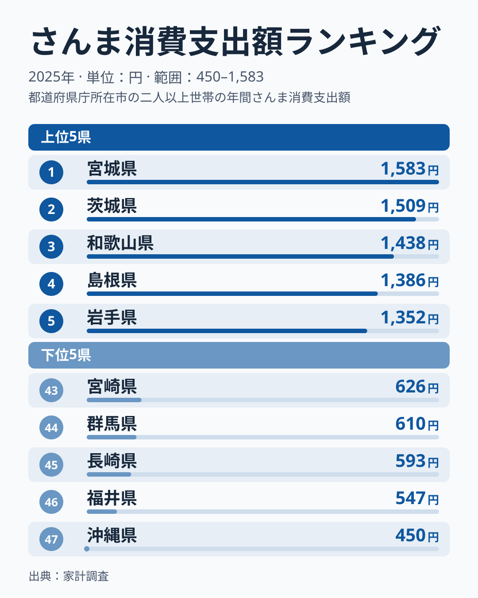
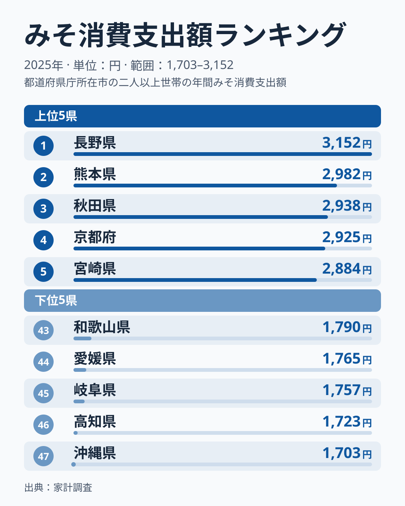
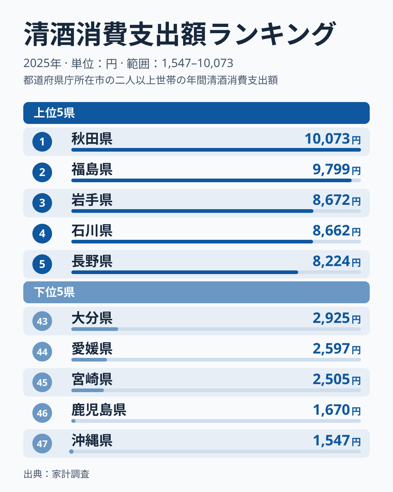
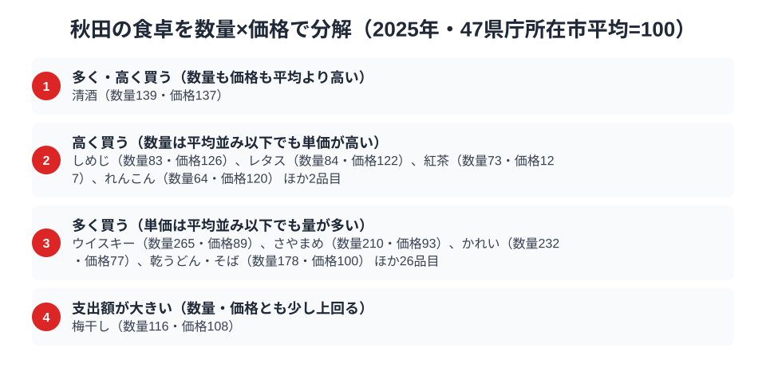

米どころとして知られる秋田県。その食卓は、発酵と醸造の文化に彩られています。総務省の家計調査（品目別、2025年）で秋田市の二人以上世帯を見ると、日本酒は全国1位、みそは3位、さんまも7位と、醸造品と発酵食、北の海の幸が全国上位に並びます。この3品目で日本一に立つのは日本酒だけで、みそとさんまは首位に届きません。

北の秋を告げるさんま、きりたんぽ鍋にも欠かせないみそ、そして米どころならではの日本酒。この記事では、さんま・みそ・日本酒という3つの品目を横断しながら、秋田県民の食卓を読み解きます。

> [!NOTE]
> 家計調査の都道府県データは、県庁所在市（秋田県は秋田市）の二人以上世帯を対象にした年間支出額です。県全体ではなく秋田市在住世帯の家計簿から見た傾向であり、支出「金額」であって消費「量」そのものではない点にご注意ください。また、市別の家計調査は単年の値のぶれが大きく、順位は年によって入れ替わりやすい点も前提にしてください。

## さんま — 全国7位1,254円、北の秋の味覚

<source-link href="/ranking/saury-consumption-expenditure">さんま消費支出額ランキングをもっと見る</source-link>

秋田県のさんま消費支出額は1,254円で全国7位です。1位は宮城県の1,583円、2位は茨城県の1,509円で、秋田はどちらも下回ります。さんまは秋に北の海から南下する回遊魚で、東北・北日本で秋の味覚として親しまれています。秋田では、塩焼きのさんまを大根おろしと一緒に食べるのが秋の定番です。

3位は和歌山県の1,438円、4位は島根県の1,386円、5位は岩手県の1,352円、6位は北海道の1,328円と続きます。8位は青森県の1,251円で、秋田とは3円差です。さんまの回遊ルートに近く旬のさんまが手に入りやすいことが東北・北海道の県の順位に関わっているという見方がありますが、これは[仮説]です。市別の単年の順位だけでは確かめられません。

上位10県を見ると、宮城・岩手・秋田・青森の東北4県と北海道の合わせて5道県が入っており、さんまの消費が北日本に偏っていることが読み取れます。47県の平均は982円で、秋田の1,254円は平均の約1.3倍です。最下位の沖縄県は450円なので、1位の宮城県とは約3.5倍の開きがあります。秋田は首位との差が329円と小さくないものの、平均を大きく上回る水準で、北日本の「さんまを食べる県」の一角に位置づけられます。家計調査は家庭での購入額を集計するため、さんまのように家庭で焼いて食べる習慣のある魚は、順位に表れやすい品目です。

## みそ — 全国3位2,938円、発酵食の底力

<source-link href="/ranking/miso-consumption-expenditure">みそ消費支出額ランキングをもっと見る</source-link>

みその消費支出額は秋田県が2,938円で全国3位です。1位は長野県の3,152円、2位は熊本県の2,982円で、秋田は上位2県に近い水準にあります。4位の京都府は2,925円、5位の宮崎県は2,884円と続き、1位長野県との差は214円、率にして約7%（3,152円と2,938円）で、単年の値のぶれ次第で順位が入れ替わる範囲に収まっています。

秋田は寒冷な気候が発酵食文化を育んできた土地といわれます。秋田の郷土料理「きりたんぽ鍋」や「だまこ鍋」にはみそや味噌だれが使われ、みそ漬けの保存食も豊富です。寒く長い冬を越すための発酵食文化がみその消費を支えている、というのが[仮説]で、検証には複数年の推移が必要です。

みその47県平均は2,298円で、秋田の2,938円は平均の約1.3倍にあたります。最下位の沖縄県は1,703円で、1位の長野県との差は約1.9倍と、さんまや日本酒に比べて地域差はなだらかです。みそは日常の調味料として県を問わず使われるため、差が縮まりやすい品目だというのが[仮説]です。そうした中で秋田が上位3県に入っていることは、みそが家庭の味つけに広く使われていることを示唆します。

## 日本酒 — 全国1位10,073円、東北の酒どころ

<source-link href="/ranking/sake-consumption-expenditure">日本酒消費支出額ランキングをもっと見る</source-link>

3つの品目で秋田が首位に立つのは日本酒（清酒）です。消費支出額は10,073円で全国1位。2位は福島県の9,799円、3位は岩手県の8,672円で、秋田はどちらも上回っています。秋田は良質な米と清らかな水に恵まれた「美酒王国」で、県内各地に多くの酒蔵があります。

米どころ秋田では、日本酒造りが盛んで、晩酌や会食で地元の日本酒を楽しむ文化が根づいています（2位の福島も同じ酒どころで、[福島県の食卓](/blog/fukushima-food-culture)でも日本酒が上位に並びます）。ただし1位と2位は値が近く、単年の順位が逆転してもおかしくない差です。

1位と2位の差は274円、約2.8%にとどまります。一方で47県の平均は5,284円なので、秋田の10,073円は平均の約1.9倍という際立った水準です。最下位の沖縄県は1,547円で、1位の秋田とは約6.5倍の開きがあり、3品目の中で地域差が最も大きい品目です。上位は秋田・福島・岩手と東北の県が3位までを占め、4位の石川県、5位の長野県も有数の酒どころです。

> [!WARNING]
> 家計調査は支出金額の調査であり、消費量そのものではありません。物価や単価の違いも金額に影響します。また秋田名産のいぶりがっこやしょっつるの一部は、家計調査の主要品目として個別に集計されないため、順位だけでは秋田の食文化の全体像は測れない点にご注意ください。

## 秋田の食卓を貫くもの

秋田県民の食卓を貫くのは、「寒冷な気候が育んだ発酵・醸造の文化」です。北の海のさんま、きりたんぽのみそ、米どころの日本酒。寒く長い冬を越すための発酵食と、米を生かした醸造文化が、秋田の食卓の骨格をなしている、というのがこの記事の読みです（[仮説]。市別の単年の値だけでは確かめきれません）。

日本酒の上位に東北の県が並ぶ背景についても、米どころや寒冷な気候が関わっているかもしれませんが、これも[仮説]で、単年の市別データからは確かめられません。

> [!TIP]
> 支出額の1位は、「量が多いから」なのか「単価が高いから」なのかを区別できません。日本酒の10,073円という首位も、次の節の数量×価格の分解を見て初めて、量と価格のどちらが押し上げているかが分かります。

## 数量×価格で分解する秋田市の食卓

さんま・みそ・日本酒はいずれも支出額で全国上位ですが、支出額だけを見ても「たくさん買っているのか」「高いものを買っているのか」までは分かりません。家計調査には支出額とあわせて数量を集計している品目が多く、支出額を数量と価格に分解すると、県ごとの食卓の性格の違いが見えてきます。ここでの指数は家計調査の全国平均ではなく、47都道府県庁所在市の単純平均を100とした値です。なお、この図に載っている品目の中に、さんまとみそは含まれていません。

日本酒（清酒）は数量指数139・価格指数137と、量・価格の両方で平均を上回ります。支出額が全国1位になったのは、量も単価も高いためと読めます。図の分類基準（47県庁所在市の平均を100として120以上を「多い・高い」とする）で数量と価格がともに高い品目は、この図では清酒だけです。ただし価格指数は銘柄や等級の違いも反映するため、「高い酒を選んでいる」と断定はできません。

「量は平均並み以下でも単価が高い」側の代表は紅茶（数量73・価格127）で、少ない量を比較的高いものに替えて楽しむ買い方と読めます。逆に「単価は平均並み以下でも量が多い」側の代表はかれい（数量232・価格77）とウイスキー（数量265・価格89）で、かれいは量の多さが単価の低さと並んでおり、魚を手頃な値段で数多く食べる秋田市の食卓がうかがえます。この側は全部で30品目に及び、秋田市の食卓は「高いものを少し」より「手頃なものをたくさん」の品目が多いことが分かります。なお梅干しは数量116・価格108と、数量・価格とも平均を少し上回りますが、いずれも120には届かないため、清酒と同じ区分には入りません。

> [!TIP]
> 支出額の順位だけでは「たくさん食べている」のか「高いものを買っている」のかが分かりません。数量指数と価格指数に分解すると、日本酒は「量と質の両方」、かれいやウイスキーは「量の文化」、しめじや紅茶は「質の側」と、秋田市の食卓の性格の違いが見えてきます。

なお、価格指数は「支出額÷数量」の相対値で、選んでいる品種・銘柄・グレードの違いも反映するため、純粋な物価水準を示すものではありません。対象は秋田市の二人以上世帯の年間データです。

## まとめ

- 日本酒の消費支出額は秋田県が全国1位で10,073円、米どころの美酒王国
- みそは秋田県が全国3位で2,938円、きりたんぽなど発酵食文化の底力
- さんまは秋田県が全国7位で1,254円、首位には届かない
- 数量×価格の分解では、基準（平均を100として120以上）で量・価格がともに高いのは清酒（数量139・価格137）だけ
- 寒冷な気候が育んだ発酵・醸造の食文化が秋田の食卓を支えている（[仮説]、単年の値のぶれに注意）

秋田県の他の統計は[秋田県の地域プロフィール](/areas/05000)、食品・家計消費の地域差は[経済カテゴリ一覧](/category/economy)からご覧いただけます。
