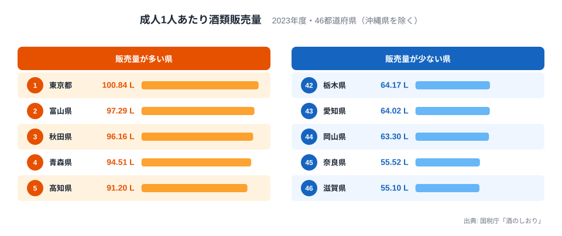
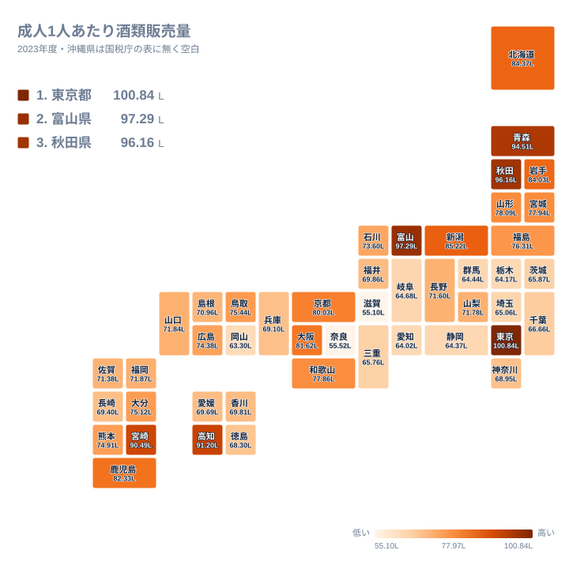
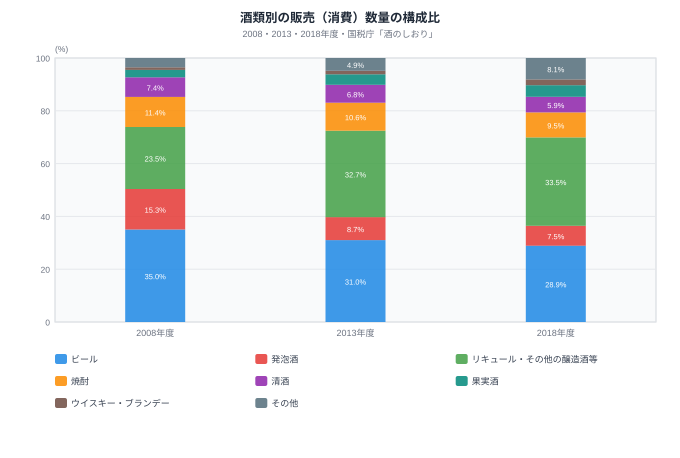
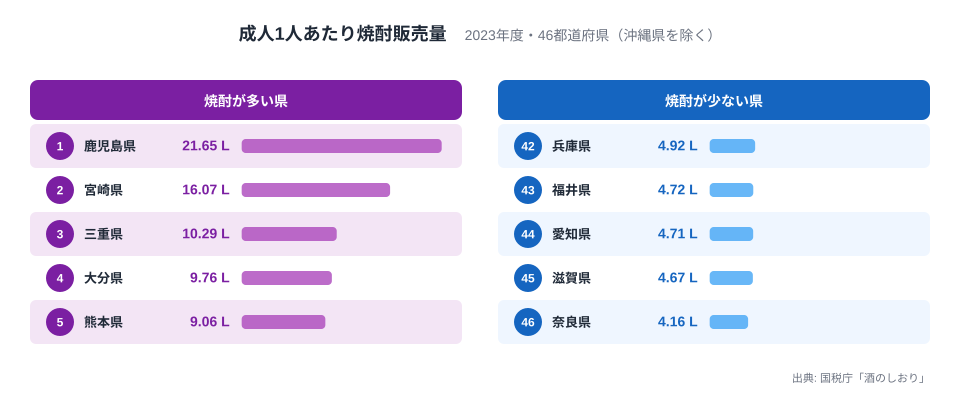
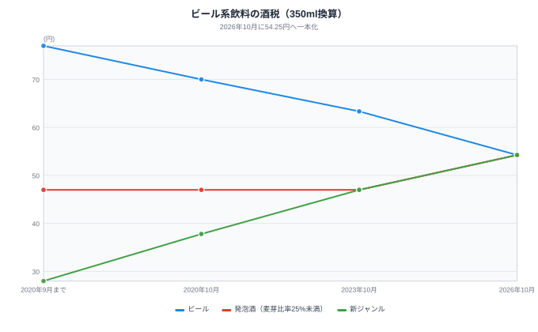

「成人1人あたりの酒の消費量は東京が日本一」──国税庁の都道府県別の表では、確かに東京都が1位です。ただしこの統計は、酒が**売られた県**で数えられます。都内の飲食店や酒販店で通勤者・観光客が買った分も東京に含まれうるため、数字が「都民の飲酒量」を表すとは限りません。

では、東京都の1位はどこまで「購入地で数える統計の癖」で、どこからが飲酒習慣の違いなのか。この記事では、都道府県別の販売量、昼夜間人口比率、酒類の種類別の販売量を重ねて検討します。

> [!NOTE]
> 数値は国税庁「酒のしおり」の「成人1人当たりの酒類販売（消費）数量」（2023年度）です。20歳以上の人口で割った値で、年度は4月から翌年3月です。沖縄県は国税庁の都道府県別の表に含まれないため、この記事のランキングは46都道府県です。沖縄国税事務所が別に公表する販売数量から概算すると約108Lで東京都を超えますが、同じ表としての公表ではないため、順位には入れていません。

## 成人1人あたり酒類販売量ランキング

**1位は東京都**で100.8Lです。2位の富山県は97.3Lで、3位は秋田県の96.2L、4位は青森県の94.5L、5位は高知県の91.2Lと続きます。東京都を除く上位4県は、富山県が北陸、秋田県と青森県が東北、高知県が四国と、大都市ではない地方の県です。

反対に**最下位は滋賀県**で55.1L、45位は奈良県の55.5Lです。この2県は突出して低く、その上の44位の岡山県でも63.3Lあります。下位にはほかに愛知県の64.0L、栃木県の64.2Lも並びます。1位の東京都と最下位の滋賀県の差は約1.8倍です。

滋賀県と奈良県は、大阪・京都の通勤圏にあります。住民が大阪や京都の飲食店で飲んで帰宅すれば、その購入は大阪府や京都府の数字に入り、滋賀県や奈良県には入りません。[仮説] 購入地で数える統計では、通勤先で飲む人が多い県ほど数値が低く出る。検証の1つとして、次の節で昼夜間人口比率と照らし合わせます。飲食店での購入と家庭での購入を分けた統計があれば、より直接に確かめられます。

<source-link href="/ranking/alcohol-sales-per-adult-total">成人1人あたり酒類販売量ランキングをもっと見る</source-link>

## 全国マップ──昼間人口だけでは説明できない

マップで見ると、濃い色（販売量が多い）は東京都を除くと富山県、秋田県、青森県などの日本海側から東北と、高知県・宮崎県などの南の地方県に集まります。首都圏の埼玉県、千葉県、神奈川県や、愛知県、岡山県は淡い色です。

「購入地で数えるから昼間人口が多い東京が高い」という見立てを、昼夜間人口比率（2020年国勢調査、47都道府県）と並べて確かめます。東京都は昼夜間人口比率が116.1%で全国1位、酒類販売量も1位で、見立てと合います。奈良県は昼夜間人口比率が91.1%で、47都道府県中45位と低く、酒類販売量も下位です。

一方で、見立てが合わない県も目立ちます。埼玉県は昼夜間人口比率が89.6%で最も低いのに、酒類販売量は38位です。千葉県も昼夜間人口比率が90.3%、酒類販売量は35位と中位です。最下位の滋賀県は昼夜間人口比率が96.9%で41位にとどまり、埼玉県や千葉県、神奈川県より高い比率なのに販売量は最も低くなっています。逆に愛知県は昼夜間人口比率が101.2%で4位と高いのに、酒類販売量は43位です。大阪府も比率は103.9%で2位ですが、酒類販売量は11位にとどまります。

つまり、昼間人口の多さは東京都の突出を説明する材料の1つですが、全国の並びを説明するものではありません。特に滋賀県の低さは、通勤流出の大きさだけでは説明できません。

> [!TIP]
> 昼夜間人口比率は通勤・通学の純流入を表す指標で、観光客や出張者の購入は含みません。比率が100%前後の県でも販売量は大きく異なり、比率だけでは居住者の飲酒量は分かりません。

## 何を飲んでいるのか──ビールからリキュール等へ

全国の構成を見るために、2008年度、2013年度、2018年度の酒類別の販売（消費）数量を比べます。この図は2018年度までの全国の構成比で、都道府県別の値ではありません。以下、都道府県別の値は2023年度、全国の構成比は2018年度と、年が異なる点に注意してください。

2018年度は**リキュール・その他の醸造酒等が全体の33.5%（2,760千kL）**で最大のシェアを占め、次いでビールが28.9%、焼酎が9.5%でした。2008年度にはビールが35.0%で最大、リキュール・その他の醸造酒等は23.5%でした。10年間でビールは6.1ポイント下がり、リキュール・その他の醸造酒等は10.0ポイント上がっています。発泡酒も15.3%から7.5%へ半分以下に縮みました。

税率が低い方向へ消費者が移った結果と読むのが自然ですが、リキュール・その他の醸造酒等には新ジャンルだけでなくチューハイなども含まれるため、この図だけで新ジャンルの伸びだったとは言い切れません。

2023年度の都道府県別に見ると、酒類の種類には明確な偏りがあります。ビールは東京都が35.9Lで1位、次いで北海道が26.9L、京都府が25.1L、大阪府が25.0Lです。清酒は新潟県が8.1Lで1位、秋田県が7.1L、山形県が6.2Lと、米どころの日本海側の県が続きます。ワインは東京都が7.9Lで1位、山梨県が5.7Lです。

あわせて見る: [ビール販売量ランキング](/ranking/alcohol-sales-per-adult-beer) / [清酒販売量ランキング](/ranking/alcohol-sales-per-adult-sake) / [ワイン販売量ランキング](/ranking/alcohol-sales-per-adult-wine)

## 焼酎は南九州に集中する

酒類の種類のなかでも、地域差が最も極端なのが焼酎です。**1位は鹿児島県で21.6L**、2位は宮崎県の16.1Lで、3位の三重県の10.3L、4位の大分県の9.8L、5位の熊本県の9.1Lを大きく引き離します。鹿児島県は最下位の奈良県の4.2Lの約5.2倍です。

上位は三重県を除いてすべて九州で、芋焼酎や麦焼酎の産地と重なります。三重県が3位に入る理由は、このデータだけでは分かりません。国税庁の表は焼酎を連続式蒸留と単式蒸留に分けているため、どちらが多いかを見れば手がかりが得られます。下位は奈良県の4.2L、滋賀県の4.7L、愛知県の4.7L、福井県の4.7L、兵庫県の4.9Lで、近畿・中部の県が並びます。

では、総量の上位はこうした酒の種類で説明できるでしょうか。県ごとに見ると、答えは一様ではありません。宮崎県は焼酎が2位で総量6位を押し上げていますが、清酒は下から2番目の2.0Lです。秋田県は清酒が2位、ビールが6位、焼酎が7位と、どの種類も高く、総量3位に素直に結びつきます。青森県は焼酎が6位、清酒が11位、ビールが10位で、複数の種類が少しずつ高い県です。高知県は総量5位ですが、焼酎は19位、清酒は16位と中位で、ビールが7位の23.5Lと高いものの、種類別の順位だけでは総量の高さを説明しきれません。

つまり、「土地の酒」で説明できる県もあれば、できない県もあります。高知県のように、このデータの範囲では理由が分からない県も残ります。

<source-link href="/ranking/alcohol-sales-per-adult-shochu">焼酎販売量ランキングをもっと見る</source-link>

## 2026年10月、ビール系飲料の酒税が一本化された

2018年の酒税法改正に基づき、ビール・発泡酒・新ジャンルの税率は、2020年10月、2023年10月、2026年10月の3段階で見直されました。2026年10月にはビール系飲料の税率が**1kLあたり155,000円（350ml缶で54.25円）**に統一されています。

350ml缶あたりの税額を、図に描いた各段階で見ると次のとおりです。

- ビール：77.00円から70.00円、63.35円を経て、54.25円に下がりました。改正前から約22.75円の減税です
- 発泡酒（麦芽比率25%未満）：46.99円で据え置かれたあと、2026年10月に54.25円へ上がりました。約7.26円の増税です
- 新ジャンル：28.00円から37.80円、46.99円と段階的に上がり、54.25円になりました。改正前から約26.25円の増税です

2023年10月に新ジャンルの多くは酒税法上の発泡酒に区分され、税率が発泡酒と同じ46.99円になったため、図では2023年10月以降の2本の線が重なっています。なお、図の横軸は段階の区切りで、期間の長さは等間隔ではありません。2020年9月までから2020年10月の間は1か月、2020年10月から2023年10月の間は3年です。

同じ2026年10月には、ホップ等を原料としないチューハイなどの「その他の発泡性酒類」も、1kLあたり80,000円から100,000円（350ml換算で28.00円から35.00円）へ上がりました。ビール系飲料の一本化だけでなく、チューハイ類の増税も同時に起きた点は押さえておく必要があります。

> [!WARNING]
> 税額の変化がそのまま店頭価格の変化になるとは限りません。メーカーの価格設定や商品の入れ替えで変わるため、この記事では税率だけを示しています。また、新ジャンルの都道府県別の販売量は国税庁の表に無く、どの県で影響が大きいかはこのデータでは測れません。

全国では、新ジャンルを含むリキュール等が2018年度時点ですでに最大のシェアを占めていました。2026年10月には新ジャンルの税額がビールと同額になり、税額上の差はなくなりました。地域ごとの消費の変化は、今後の統計を待つ必要があります。

## まとめ：3つの発見

日本の飲酒地図から読み取れる構造を整理します。

**1. 東京1位は、購入地で数える統計の影響を受けうる数字です。** 東京都は100.8L、最下位の滋賀県は55.1Lで約1.8倍差ですが、昼夜間人口比率では滋賀県の低さや愛知県の低さを説明できず、集計方法だけでは1.8倍の差を説明しきれません。

**2. 酒類の種類に地域差があります。** ビールとワインは東京都、清酒は日本海側、焼酎は南九州に偏っています。種類別の順位で総量の高さを説明できる県もあれば、高知県のように説明できない県もあります。

**3. 2026年10月にビール系飲料の酒税が一本化されました。** ビールは約22.75円の減税、新ジャンルは約26.25円の増税で、同時にチューハイ類も増税されました。消費への影響は今後の統計で確かめる必要があります。
