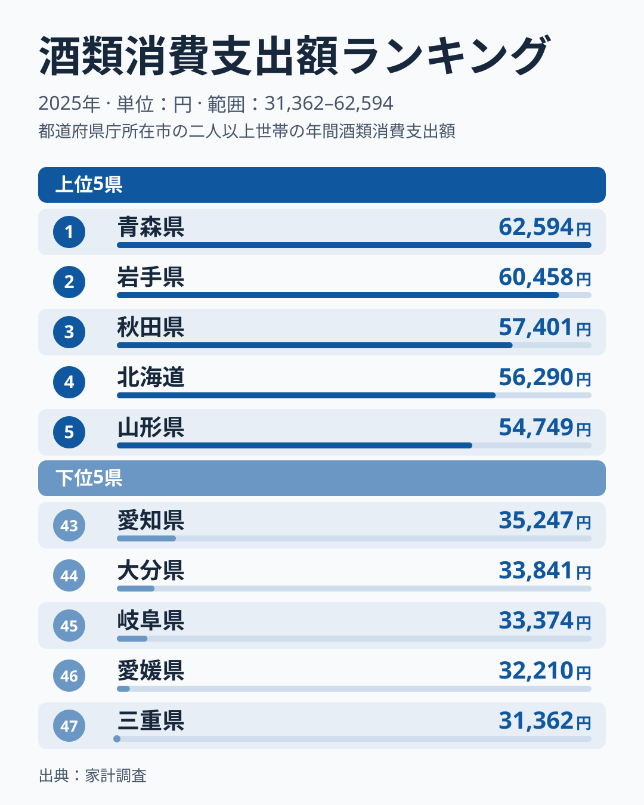
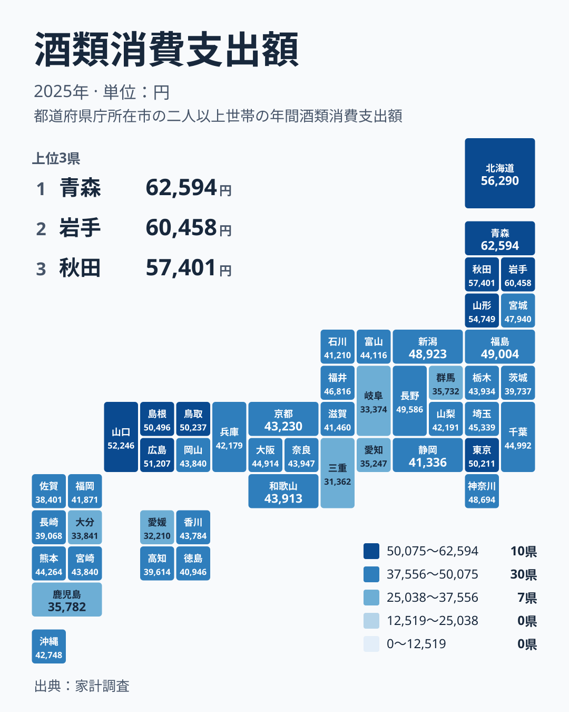

お酒にいくら使うかは、住んでいる県によって大きく変わります。家計調査の2025年のデータで酒類への支出を見ると、最も多いのは青森県の62,594円です。最も少ない三重県は31,362円で、同じ日本の中でも使い方にはっきりした開きがあります。

この記事では、都道府県ごとの酒類への支出を並べ、食文化、気候、産地との結びつきから差の理由を考えます。ただし、使っているのは支出額だけです。理由として挙げるものは、あくまで仮説として読んでください。

## 上位と下位の顔ぶれを読む

まずは、上位5県と下位5県を並べた図で全体の形をつかみましょう。

<source-link href="/ranking/alcoholic-beverages-group-consumption-expenditure">酒類への支出ランキングをもっと見る</source-link>

上位5位は、青森県、岩手県、秋田県、北海道、山形県の順です。すべて北海道・東北に属しており、上位がこの地方に偏っていることが第一の特徴です。1位の青森県と最下位の三重県を比べると、金額は2倍弱の開きになります。

下位5位は、三重県、愛媛県、岐阜県、大分県、愛知県です。近畿、四国、中部、九州に分かれていて、上位のような地方のまとまりは見えません。つまり「高い県」には地域の偏りがあり、「低い県」には偏りが見えにくい、という非対称な形になっています。

この非対称は、酒をたくさん買う理由は地域の暮らしと結びつきやすい一方、あまり買わない理由は県ごとにまちまちなのかもしれない、という見方を促します。ただ、これも統計から確かめられることではなく、読み解きの入口にすぎません。

> [!NOTE]
> この数値は、家計調査で集計された酒類への年間支出額で、1世帯あたりの金額です。飲んだ量ではなく、買うためにかけた金額を表します。高価な酒を少量楽しむ世帯と、手ごろな酒を多く飲む世帯とでは、同じ金額でも中身が違います。

## 北海道・東北が上位に並ぶ背景

青森県の62,594円、岩手県の60,458円、秋田県の57,401円と、東北の県が上位を占めます。山形県は5位の54,749円、北海道は4位の56,290円です。冬の寒さが厳しい地域であり、長い冬に家で過ごす時間が晩酌につながっている可能性があります。ただし、寒さとの関係を示す指標は今回使っていないので、あくまで可能性にとどまります。

もうひとつの手がかりは産地です。東北は米どころとして知られ、各地に酒蔵があります。地元の酒が身近にあれば、贈答やもてなしで酒を買う機会も増えるでしょう。これも仮説ですが、食文化と産地が支出に結びつくという見方は、上位の並びと矛盾しません。

北海道は、ビールや洋酒も親しまれていると言われますが、この統計は酒類全体の合計です。清酒が中心の東北との品目の違いは、数字からは読み取れません。

詳しく見たい方は、[青森県のデータ](/areas/02000)や[岩手県のデータ](/areas/03000)から、ほかの項目も確認できます。酒類以外の支出と並べると、暮らし方の輪郭が見えてきます。

> [!TIP]
> 金額の間隔にも注目してください。1位の青森県と2位の岩手県の差は2,136円、2位の岩手県と3位の秋田県の差は3,057円です。1位と2位の差のほうが小さいので、上位3県はなだらかに下がっていく並びだとわかります。

## 中国地方と東京都にも高い層がある

北海道・東北以外で目立つのが中国地方です。6位の山口県が52,246円、7位の広島県が51,207円、8位の島根県が50,496円、9位の鳥取県が50,237円と、6位から9位までを中国地方の5県のうち4県が占めます。岡山県は25位の43,840円で、同じ中国地方でも位置づけは大きく違います。

この高さの背景に何らかの文化的な要因があるのかもしれませんが、この統計からは判断できません。寒さだけでは説明しにくい並びだ、という点を指摘するにとどめます。

10位は東京都で50,211円です。東京都の高さの理由も、この統計だけでは分かりません。続く11位の長野県は49,586円で、北海道・東北と中国地方のあいだに、関東や中部の県が入り込んでいます。

## 地図で見る地理分布

次に、47都道府県の位置関係を地図で確認します。

地図では、北海道・東北の濃い色のかたまりがまず目に入ります。西へ視線を移すと、中国地方にも高い水準が続いています。一方、関東では東京都が10位、神奈川県が14位の48,694円と高めですが、群馬県は42位の35,732円で、同じ関東でも大きく違います。

中部も県ごとの差が大きい地方です。新潟県は13位の48,923円、長野県は11位の49,586円と上位に入る一方、岐阜県は45位、愛知県は43位です。九州・沖縄では、福岡県が32位、沖縄県が29位で、大分県が44位、鹿児島県が41位と、県ごとに位置が分かれます。地方という大きなくくりだけでは、傾向を説明しきれません。

> [!WARNING]
> 中位の県は金額がごく近く、順位が入れ替わりやすい点に注意してください。たとえば岡山県と宮崎県は、どちらも43,840円で同じ25位です。その前後にも、24位の和歌山県が43,913円、27位の香川県が43,784円と並んでいます。中位では、数十円から百円程度の差で順位が動くため、順位だけで優劣を語るのは避けてください。

## 焼酎の産地と、関連品目との対比

酒類は、清酒、焼酎、ビール、ワイン、ウイスキーなどの総称です。この記事で使っているのは、その合計額だけです。東北で高いのは、米の酒である清酒の存在感が大きいからかもしれませんが、品目別のデータがないので確かめられません。

九州・沖縄に目を向けると、大分県は44位の33,841円、鹿児島県は41位の35,782円で、いずれも下位に入ります。焼酎は一般に価格が手ごろな酒として知られ、飲む量が多くても支出額が高くなりにくい可能性はあります。ただし、これも仮説です。酒類への支出が少ないことは、飲まないことを意味しません。

ここで大事なのは、支出額と飲酒量を同じものとして扱わないことです。家庭で飲む習慣が弱いのか、外で飲む比率が高いのか、データだけでは判断できません。外食の支出と合わせて見るなど、別の角度からの確認が必要です。

ほかの家計項目との比較には、[同じカテゴリの統計一覧](/category/economy)が役立ちます。食料品や外食など、酒の周辺にある支出を並べると、各県の暮らしの個性がより見えやすくなります。

## データについて

この記事で使った統計は、家計調査の「酒類消費支出額」です。対象は2025年で、単位は円です。1世帯あたりの年間支出額を都道府県別に並べています。

家計調査は標本調査であり、県全体の実態とずれる場合があります。また、同額の県は同順位として扱われます。今回は岡山県と宮崎県が25位で並び、次は27位の香川県になります。順位表記を読むときは、この点に気をつけてください。

## まとめ

酒類への支出は、最も多い青森県の62,594円から最も少ない三重県の31,362円まで、2倍弱の開きがあります。上位5位は北海道・東北の道県で占められ、寒冷な気候や米どころという条件が関わっている可能性があります。ただし、この統計だけで理由を断定することはできません。

中国地方の4県が6位から9位に入り、東京都が10位に入ることも注目点です。一方で、下位は地方がばらばらで、大分県や鹿児島県のような九州の県も含まれます。金額の差は飲む量の差ではなく、酒の種類や価格、家庭で飲むか外で飲むかといった習慣の違いも含んでいます。数字の裏にある暮らしを想像しながら、ランキングを眺めてみてください。
