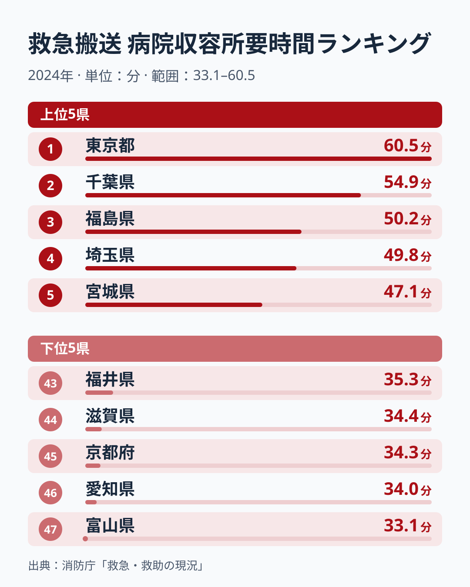
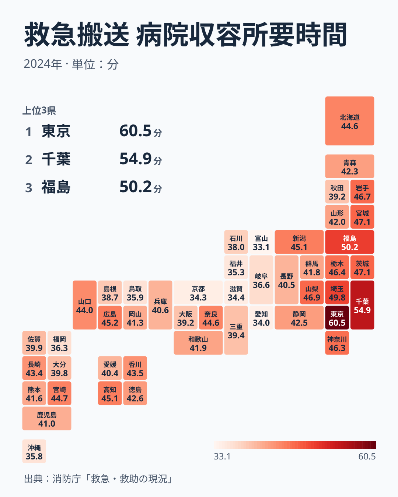

救急車を呼べば、日本のどこでも同じくらいの時間で病院に着くと考えている人は多いかもしれません。ところが消防庁の集計では、119番の入電から病院に収容されるまでの平均時間は、2024年に最も長い東京で60.5分、最も短い富山で33.1分でした。東京は富山の1.83倍の時間がかかっており、差は27.4分にのぼります。

目を引くのは、首都圏の都県が上位にそろって並ぶ一方で、同じ大都市を抱える愛知や大阪は短い側にいることです。人口が多いから長くなる、という単純な話ではなさそうです。この記事では、上位と下位の顔ぶれと地図の偏りから、時間の差がどの段階で生まれているのかを仮説として考えます。

## 病院収容所要時間は何を測った数字か

この数字は「救急車が現場に着くまで」の時間ではありません。119番の通報を受けてから、搬送先の医師に患者を引き継ぐまでの全体の時間です。通報の受付、出動、現場への移動、現場での観察と応急処置、搬送先の選定と受け入れの照会、病院への移動、医師への引き継ぎという段階をすべて含んでいます。

> [!NOTE]
> 消防庁「救急・救助の現況」の別表にある、入電から医師引継ぎまでの平均所要時間。1件ごとの時間を県単位で平均した値で、傷病の種類や重さは区別していない。

段階が多いぶん、県の差がどこから来ているのかは、この1つの数字だけでは切り分けられません。消防庁は現場に到着するまでの時間も別に公表していますが、このサイトのランキングが持っているのは全体の平均だけです。そのため、ここでは段階の内訳ではなく、順位の並び方と地図の上での偏りを手がかりにします。現場までの距離が遠い県でも、受け入れ先がすぐ決まれば全体は短くなりますし、現場が近くても搬送先が決まらなければ長くなります。以下の解釈は、その前提に立った仮説として読んでください。

47都道府県を並べたときの中央値は41.9分です。最も短い富山から中央値までの幅に比べて、中央値から東京までの幅のほうが大きく、長い側に少数の県が飛び出している分布になっています。

## 長い県は首都圏と東北の太平洋側に集まる

最も長いのは東京の60.5分で、2位の千葉は54.9分でした。1位と2位の間にも5.6分の開きがあり、東京だけが突出しています。3位は福島の50.2分、4位は埼玉の49.8分、5位は宮城と茨城が47.1分で並びました。神奈川も46.3分で10位に入りました。首都圏の4都県は、すべてが長い側の上位10県に含まれていることになります。

首都圏の4都県がそろって長いことから、移動の距離よりも搬送先が決まるまでの時間が効いている可能性があります。救急の要請が多い地域では、受け入れを照会しても病院がすぐに応じられず、何度も照会を重ねる事案が起こりやすくなります。同じように大きな都市を抱えていても、大阪は39.2分で35位、愛知は34分で46位と短い側にあります。都市の規模そのものより、要請の件数と受け入れ側の体制の釣り合いが県によって違うと考えると、この食い違いを説明しやすくなります。首都圏では県境を越えて病院を探すことも珍しくなく、搬送先の選定が1つの県の中で完結しにくいことも、時間を押し上げる要因になっているかもしれません。

もう1つのまとまりは東北です。福島が3位、宮城が5位、岩手が46.7分で8位と、太平洋側の3県が上位10位に入りました。一方で秋田は39.2分で35位、山形は42分で23位です。同じ東北でも県によって差があるため、寒さや雪のような地方共通の条件だけで説明するのは難しく、病院の配置や搬送先の選び方の違いが表れている可能性があります。

<source-link href="/ranking/ambulance-hospital-arrival-time">救急搬送病院収容所要時間ランキングをもっと見る</source-link>

## 短い県は富山から京都にかけての帯に並ぶ

地図で見ると、短い県が日本海側の富山から内陸の岐阜を経て、愛知・滋賀・京都へと連なっていることがわかります。最も短い富山は33.1分、46位の愛知は34分、45位の京都は34.3分、44位の滋賀は34.4分、43位の福井は35.3分でした。石川も38分で38位、岐阜も36.6分で39位と、隣り合う県がそろって短い側の10県に入っています。

これらの県は、県の中心となる都市と主な病院の位置が比較的まとまっている点で共通していると考えられます。搬送先の候補が限られていても、どの病院がどの患者を受け入れるかの取り決めが地域で共有されていれば、照会の回数は少なくて済みます。短い県が地図の上で連なっているのは、こうした運用の近さを反映しているのかもしれません。

面積の広さだけでは順位は決まりません。最も面積の広い北海道は44.6分で15位と、中央値より長いものの上位10位には入っていません。反対に、面積が小さい東京が最も長くなっています。距離が効くのは主に現場への移動と病院への移動の部分で、全体の差を左右しているのは、それ以外の段階である可能性があります。

南の端の沖縄も35.8分で42位と短い側にあり、九州では福岡が36.3分で40位でした。ただし同じ九州でも宮崎は44.7分で14位、長崎は43.4分で19位と、県ごとの開きは小さくありません。地方単位でくくるより、県ごとの救急医療の体制の違いとして見るほうが実態に近いでしょう。

> [!WARNING]
> 2024年の1年分の平均値で、年ごとの変動は含まない。平均は搬送先がなかなか決まらない一部の長時間の事案に引っ張られやすく、半分の搬送がこの時間より短いとは限らない。

## 自分の県の数字をどう読むか

自分の住む県の時間が長いとわかっても、それがすぐに「救急医療が遅れている」ことを意味するわけではありません。この数字には、搬送される人の年齢構成や、どの程度の重さの傷病が多いかといった違いも混ざっています。高齢者の多い県では、受け入れ先の調整に時間がかかる事案が増えている可能性もあり、県の差の一部はこうした構成の違いから来ているかもしれません。

> [!TIP]
> 中央値の41.9分より長いか短いかを最初に見ると、県の位置がつかみやすい。そのうえで隣の県と比べると、同じ地方の中での体制の違いが見えてくる。

東京や千葉のように長い側にある県のデータは、[東京のデータ](/areas/13000)や[千葉のデータ](/areas/12000)で人口や医療に関するほかの指標と並べて見ることができます。救急の受け皿となる病院の数や、消防や防災に関わる統計は[同じカテゴリの統計一覧](/category/safetyenvironment)にまとめています。

119番から病院収容までの時間は、救急車の速さよりも、地域の病院と消防がどう連携しているかを映す数字だといえます。首都圏の4都県が長く、富山から京都にかけての県が短いという地図の偏りは、その連携の形が県ごとに違うことを示している可能性があります。
