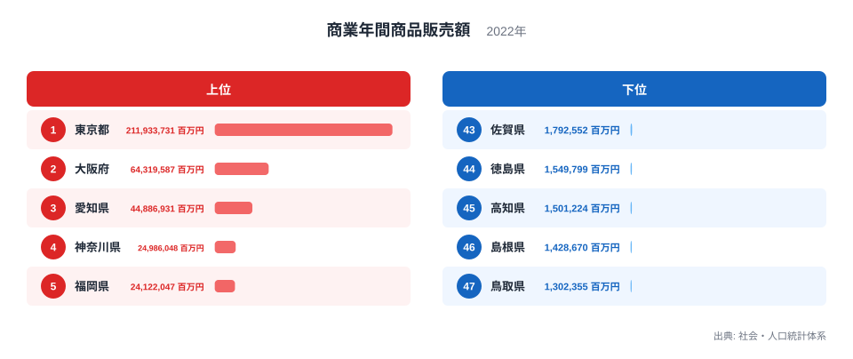
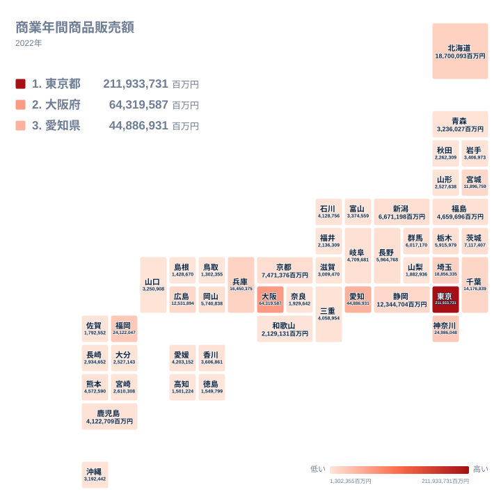

## 東京都だけが桁違いに大きい商業の姿

商業年間商品販売額が最も多い都道府県はどこでしょうか。答えは東京都で、2022年の値は 211,933,731百万円でした。二位の大阪府は 64,319,587百万円で、この二つの間には、ほかの隣り合う順位では見られない大きな開きがあります。

この指標は、卸売業と小売業が一年間に販売した商品の金額を合計したものです。人口や面積に比例して決まる数字ではなく、どの地域に商取引を担う事業所が置かれているかが反映される指標です。順位を見ると、「人が多く住む県」とは少し違う顔ぶれが浮かび上がります。

この記事では、まず上位と下位の顔ぶれから、データそのものが示す差の大きさを確認します。そのうえで、なぜその順になるのかについて、データだけでは検証できない部分を「考えられる背景」として分けて整理します。商業の統計は[同じカテゴリの統計一覧](/category/commercial)でも確認できます。

> [!NOTE]
> 商業年間商品販売額は、卸売業と小売業の販売額を合わせた金額です。卸売業は、メーカーや別の卸売業者から仕入れた商品を小売業者や事業者へ売る取引を含みます。同じ商品が卸売を何段階か経ると、段階ごとに販売額に数えられる可能性があるため、消費者が最終的に支払った金額だけを示す数字ではありません。

## 上位と下位の顔ぶれを確かめる

まず、上位五つと下位五つを図で確認します。

<source-link href="/ranking/annual-sales-amount">商業年間商品販売額ランキングをもっと見る</source-link>

上位には東京都、大阪府、愛知県、神奈川県、福岡県が並びます。注目したいのは、順位の並びよりも値の落差です。東京都の値は二位の大阪府を何倍も上回り、大阪府の値を重ねても東京都には届きません。さらに大阪府と三位の愛知県の間にも、はっきりした差があります。

一方で、四位の神奈川県と五位の福岡県は、24,986,048百万円と 24,122,047百万円で近い水準です。上位五県は一様に高いのではなく、頂点だけが極端に高く、四位あたりから先は水準が横に並び始める分布だと読み取れます。

下位は、四十七位の鳥取県から四十三位の佐賀県まで、値が狭い範囲に収まっています。下位五県の中で最も大きい佐賀県と最も小さい鳥取県の差は、東京都と大阪府の差に比べればごくわずかです。上位は桁が違うほど離れ、下位は互いに接近しているという非対称が、この指標の大きな特徴です。

> [!TIP]
> この指標は、事業所が所在する都道府県に販売額が計上されます。そのため、本社機能や販売の窓口を置く県に値が集まりやすい性質があります。順位は「その県の住民がどれだけ買ったか」ではなく、「その県の事業所がどれだけ売ったか」を表しています。住民の暮らしの豊かさと直接結びつけて読まないことが、読み違えを避けるコツです。

## 地理分布が示す、商業の拠点と中枢都市

次に、都道府県の位置関係を保ったタイルマップで、地理的な広がりを見ます。

地図にすると、販売額の大きい地域が大都市圏とその周辺にまとまっている様子がわかります。関東では東京都に加え、神奈川県が四位、埼玉県が六位で 18,856,335百万円、千葉県が九位で 14,176,839百万円と、東京都を取り囲む県がそろって上位十位前後に入っています。

関西では大阪府が二位、兵庫県が八位で 16,450,375百万円、京都府が十三位で 7,471,376百万円です。東海では愛知県が三位、静岡県が十一位で 12,344,704百万円でした。大都市圏の中心とその周辺県が連なり、太平洋側に販売額の大きい地域が帯のように広がっています。

地方では、北海道が七位で 18,700,093百万円、広島県が十位で 12,531,894百万円、宮城県が十二位で 11,896,759百万円です。福岡県も五位にあります。それぞれの地方の中心的な都市を持つ県が、周辺の県より上位に並ぶ傾向が読み取れます。ただし、なぜそうなるのかまでは、この一つの指標だけでは確かめられません。

> [!WARNING]
> ここで比べているのは都道府県ごとの総額です。人口や事業所数、面積で割った値ではないため、県の規模の違いがそのまま順位に混ざっています。また、2022年という一年分の値であり、年ごとの変動や長期の推移はこの記事では確認できません。単年の順位だけで、地域の商業の強さを断定することは避けてください。

## データから言えること

ここまでの確認で、データそのものから言えることは三つあります。

一つ目は、東京都が他の都道府県から大きく離れた一位であることです。二位の大阪府を何倍も上回る値で、全国の販売額の分布の中でも飛び抜けています。

二つ目は、上位十位前後に、東京都、大阪府、愛知県を軸とした大都市圏の県がまとまって入っていることです。神奈川県、埼玉県、千葉県、兵庫県、静岡県などが該当します。北海道、広島県、宮城県、福岡県のように、地方の中心的な都市を抱える県も上位に見られます。

三つ目は、下位が鳥取県、島根県、高知県、徳島県、佐賀県と、中国・四国・九州の県で占められ、互いの差が小さいことです。上位との落差に比べて、下位の県同士の違いは小さく、順位のわずかな入れ替わりを重く見る必要はありません。

## 考えられる背景(仮説)

次に、こうした分布の背景として指摘されている要因を整理します。以下はこの記事のデータだけでは確認できない仮説であり、断定ではありません。

東京都については、大企業の本社や商社が集まり、全国規模の取引が東京都の事業所で計上されていることが背景にあると考えられます。工場が他県にあっても、販売を担う拠点が東京都にあれば、その取引は東京都の値に入るためです。[東京都のデータ](/areas/13000)も合わせて見ると、経済の中心としての姿を確かめやすくなります。

大阪府は、江戸時代に「天下の台所」と呼ばれた商都としての歴史があり、問屋街を中心に卸売業が発達してきたと言われます。二位という順位は、そうした商業の蓄積が影響している可能性があります。詳しくは[大阪府のデータ](/areas/27000)をご覧ください。

愛知県は、製造業の集積が厚く、部品や素材の取引を支える卸売業も大きいことが、三位の背景として考えられます。福岡県については、九州の他県への販売の窓口として機能している可能性が指摘されます。北海道、宮城県、広島県も、支店や支社が集まる地方の拠点として、周辺地域への販売を担っているのではないかと考えられます。

下位の県については、人口規模が小さく、卸売の拠点が近隣の大都市に置かれている場合があるのではないか、という見方があります。ただし、各県の仕入れ構造は実データから確かめられないため、あくまで仮説です。数字が小さいことは、商店が少ないことや地域経済の衰えを直接意味するものではなく、商取引の計上先が別の地域にある可能性も含んでいます。

## 数字を読み違えないために

商業年間商品販売額の順位は、人口の多さだけでは説明しきれない指標です。データから確実に言えるのは、東京都が突出し、大都市圏とその周辺の県が上位に集まり、下位の県同士の差は小さいという分布の形です。その理由として、本社や卸売業の集積、物流の拠点、歴史的な商都としての蓄積が考えられますが、いずれも別の統計で裏づけを取る必要があります。

地方を比べるときは、中枢都市を持つ県かどうかに目を向けると、順位の違いが読みやすくなります。ただし、それも傾向の話であり、一つ一つの県の事情までは説明しません。下位の県の値が小さくても、その地域の暮らしを支える商業が成り立っていないとは言えません。

## データについて

ここで使った数値は、社会・人口統計体系に収録された商業年間商品販売額の2022年の値で、単位は百万円です。全四十七都道府県の値を比べています。金額は事業所の所在地ごとに集計されているため、本社や販売拠点が置かれた都道府県に値が集まりやすい点に注意してください。個別の都道府県の詳しい数字は、各都道府県のページで確認できます。
