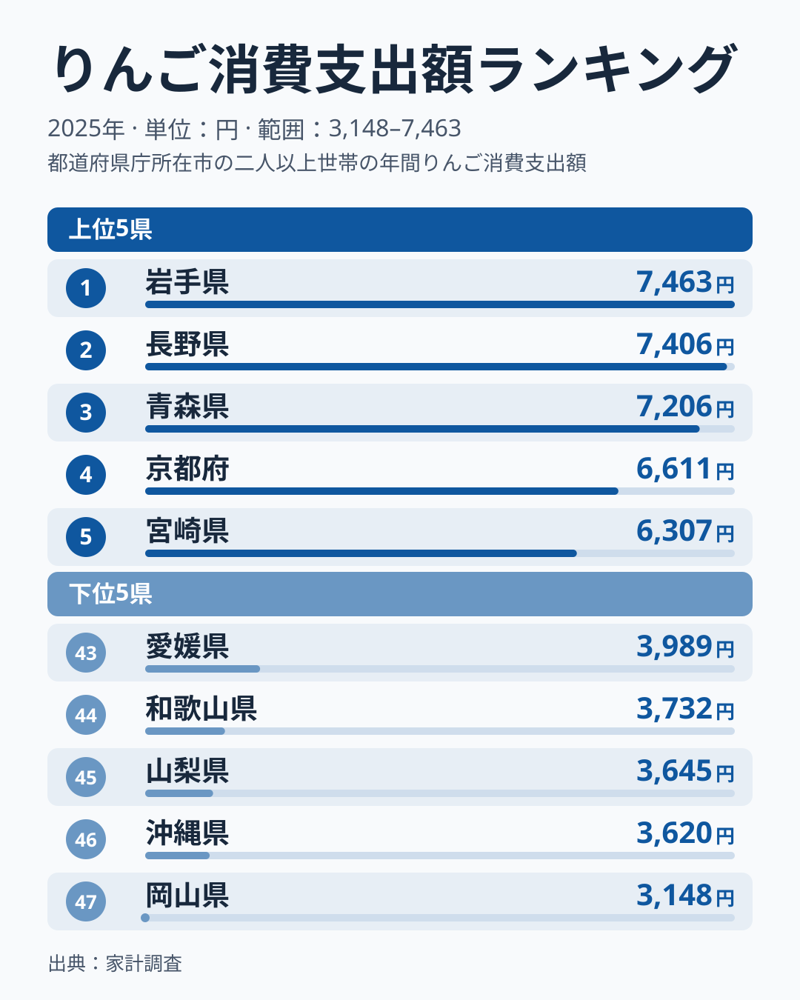

「りんごへの支出が一番多いのはやっぱり青森でしょう」——多くの人がそう予想するはずです。青森県は日本最大のりんご産地であり、「りんご県」を名乗る自治体もあります。ところが総務省の家計調査（二人以上世帯・都道府県庁所在市）でりんごの年間消費支出額を見ると、トップの座には別の県が入っていました。

2025年の家計調査によると、りんご消費支出額の1位は岩手県で7,463円。2位は長野県で7,406円、青森県は7,206円で3位にとどまります。最下位は岡山県の3,148円で、1位との差は約2.4倍です。この記事では、なぜ「りんご県」青森が首位ではないのかを確かめます。上位には岩手・長野・青森の産地県が並びますが、同じ東北でも順位は大きく分かれており、産地との近さだけでは説明できません。単年のぶれも含めて掘り下げます。

> [!NOTE]
> りんご消費支出額は総務省「家計調査（品目別）」の都道府県庁所在市データです。実際に住む都道府県全体の消費傾向ではなく、県庁所在市（盛岡市・長野市・青森市など）の二人以上世帯が対象である点に注意してください。

## 上位と下位

図で目を引くのは、3位の青森と4位の京都の間にある段差です。1位の岩手から3位の青森までは257円差に収まっており、この3県は実質的に横並びと見るのが妥当です。4位の京都は6,611円で、3位との間に600円近い開きがあり、4位以降は別の水準に入ります。5位には宮崎が6,307円で入り、上位5県のうち京都と宮崎はりんごの主要産地とは言い難い府県です。

東北6県で見ると、岩手が1位、青森が3位、秋田が8位、福島が12位、山形が15位に対し、宮城は33位です。東北であれば自動的に上位になるわけではありません。

<source-link href="/ranking/apple-consumption-expenditure">りんご消費支出額ランキングをもっと見る</source-link>

## 下位グループ

下位5県は、最下位の岡山が3,148円、続いて沖縄が3,620円、山梨が3,645円、和歌山が3,732円、愛媛が3,989円です。中国、九州・沖縄、中部、近畿、四国と地域がばらけており、地理的なまとまりは弱くなっています。

[仮説] 岡山や山梨は桃やぶどう、和歌山や愛媛はみかんが地元の主力果物で、りんごの出番が相対的に少ないのかもしれません。県庁所在市の世帯が買う果物の内訳を見なければ確かめられません。

## 青森が首位でない理由

生産量で圧倒的な青森県は、2025年の消費支出額では岩手と長野に次ぐ3位でした。最大の理由は、この順位差が小さいことです。1位の岩手7,463円、2位の長野7,406円、3位の青森7,206円は近い水準にあり、標本の小さい県庁所在市の調査では、年によって順位が入れ替わっても不思議ではありません。「青森が首位でない」のは2025年の姿であって、青森の消費が少ないことを示すわけではありません。

[仮説] 青森県産りんごは県外・海外への出荷比率が高く、地元消費に回る割合が生産量に比例しないのかもしれません。贈答や直売所経由で入手したりんごは、家計の購入額に表れにくい可能性もあります。検証には家計調査の品目別購入数量や青森県の産直販売統計との突き合わせが必要です。詳しい県別の数値は[りんご消費支出額ランキング](/ranking/apple-consumption-expenditure)のページで確認できます。

## 京都と宮崎が上位に入る理由

もう一つ目を引くのは、4位の京都と5位の宮崎が、りんごの主要産地ではないことです。[仮説] 京都は贈答や果物店での購入が多い都市部の消費傾向、宮崎は果物全体の購入の多さが影響している可能性があります。確かめるには、果物全体の消費支出や世帯属性とあわせた分析が要ります。

> [!TIP]
> 生産量ランキングと並べて見ると、産地の県が地元でどれだけ買っているかが見えてきます。複数年を並べれば、常連の県かどうかも区別できます。

購入金額と購入量の違いにも注意が必要です。

> [!WARNING]
> 家計調査は購入金額ベースの支出額であり、購入量（重量）とは異なります。りんごの価格は品種や時期によって変動するため、支出額が高い＝消費量が多いとは限らない点に留意してください。

## まとめ

- **1位**: 岩手県（盛岡市の二人以上世帯）は7,463円
- **47位**: 最下位は岡山県の3,148円
- **倍率**: 約2.4倍
- **地域パターン**: 1位から3位は岩手・長野・青森が並びます。同じ東北でも宮城は33位と離れます
- **特筆点**: 生産量日本一の青森は2025年の消費支出額で3位。上位3県は257円差の横並びです

家計消費に関するその他の統計は[経済カテゴリ](/category/economy)でまとめて確認できます。

## データについて

総務省統計局「家計調査（品目別）」都道府県庁所在市の二人以上世帯データ（2025年）を基に集計しています。e-Stat経由で整備した統計データを使用しました。
