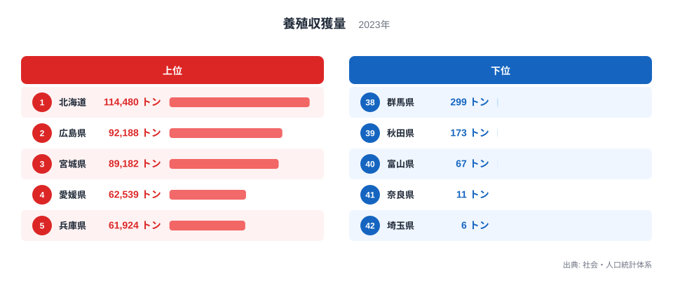
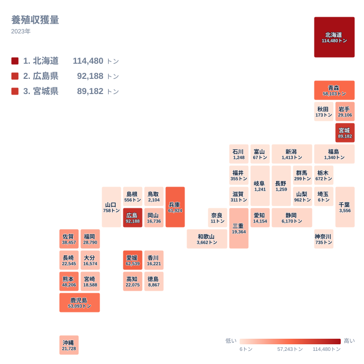

## 養殖収獲量が最も多い県は北海道

養殖収獲量が最も多い都道府県はどこでしょうか。2023年のデータでは、1位が北海道で114,480トンでした。2位は広島県で92,188トン、3位は宮城県で89,182トンと続きます。

一方、最下位の埼玉県は6トンにとどまります。41位の奈良県は11トン、40位の富山県は67トンです。1位の北海道と42位の埼玉県を比べると、収獲量には大きな開きがあります。

この記事では、上位と下位がどのような顔ぶれになっているのかを、図で確かめながら読み解きます。理由については、実データだけでは断定できないため、考えられる背景を仮説として添えます。農林水産業の他の統計は[同じカテゴリの統計一覧](/category/agriculture)で確認できます。

> [!NOTE]
> ここでの養殖収獲量は、養殖によって収獲された水産物の重量をトンで表した値です。重さの合計なので、金額ではありません。単価の高い品目が多い県が上位に来るとは限らず、同じ重さでも経済的な価値が異なる点に注意が必要です。

## 上位と下位を並べて見る

<source-link href="/ranking/aquaculture-harvest">養殖収獲量ランキングをもっと見る</source-link>

上位5位は、北海道、広島県、宮城県、愛媛県、兵庫県です。4位の愛媛県は62,539トン、5位の兵庫県は61,924トンで、この二県は値が近く、並んで上位集団の下端を形づくっています。一方で1位の北海道は114,480トンと、2位以下から離れています。

下位5位は、埼玉県、奈良県、富山県、秋田県、群馬県です。42位の埼玉県は6トン、41位の奈良県は11トン、40位の富山県は67トン、39位の秋田県は173トン、38位の群馬県は299トンです。いずれも上位とは桁が違います。

実データにある最大と最小の比を取ると、北海道の114,480トンは埼玉県の6トンの約19,000倍にあたります。ただし、これは海に面した県と内陸の県が同じ一覧に並んでいることの影響が大きいと考えられます。埼玉県、奈良県、群馬県は海に面していないため、海面での養殖は行われないはずです。

> [!TIP]
> 下位に並ぶ県には、海に面していない県と、海に面していても値が小さい県が混ざっています。富山県や秋田県は海を持ちながら下位です。順位の低さを「海がないから」と一括りにせず、県ごとに状況を分けて読むことが、この指標の読み違いを防ぎます。

## 上位に集まる地域の特徴

地図で全体の分布を確かめます。

地図を見ると、色の濃い県は北海道・東北、中国・四国、九州・沖縄に目立ちます。関東と中部には、上位10位以内に入る県がありません。上位10位は、北海道、広島県、宮城県、愛媛県、兵庫県、青森県、鹿児島県、熊本県、佐賀県、岩手県の顔ぶれです。

この分布は、海岸線や水域の広さと関係している可能性があります。たとえば、広い海域や穏やかな内海を持つ地域で養殖が営まれやすいと一般に言われます。北海道が1位に立つ背景にも、広い海域を持つことが関わっているかもしれません。ただし、今回のデータには海域の広さを示す数値が含まれないため、因果としては言い切れません。

注目したいのは、同じ地方の中で順位が大きく割れることです。北海道・東北では、北海道が1位、宮城県が3位、青森県が6位、岩手県が10位に入る一方、秋田県は39位です。同じ地方に属しながら、上位10位以内の県と39位の県が並びます。

地方でひとくくりにして語ると、こうした県ごとの差が見えなくなります。地図は全体の傾向を示しますが、個別の県の事情は順位と値を一つずつ確かめる必要があります。

## 同じ地方でも順位が割れる

近畿を見ると、兵庫県が5位の61,924トンである一方、三重県は15位の19,364トン、和歌山県は23位の3,662トンです。奈良県は41位の11トンです。近畿だけで、5位から41位までの幅があります。

中国・四国では、広島県が2位、愛媛県が4位と上位に入る一方、島根県は35位です。同じ地方の中で、上位と下位の双方が並びます。

関東と中部は、全体として上位が見当たりません。関東で最も順位が高いのは千葉県の24位です。中部で最も高いのは愛知県の20位です。このことは、地方単位の平均的な傾向よりも、県ごとの違いが大きいことを示しています。

[北海道のデータ](/areas/01000)と[広島県のデータ](/areas/34000)は、それぞれ1位と2位の県の詳細を確かめる入口になります。両県の値は114,480トンと92,188トンで、近い順位でも値に開きがあることがわかります。

> [!WARNING]
> この一覧は2023年の1年分の値で、品目別の内訳や海面・内水面の区別は含まれていません。そのため、貝類や海藻類が多いのか、魚類が多いのかといった中身は、このデータからは読み取れません。重さで測る指標なので、品目の構成によって順位が入れ替わる可能性があります。

## 考えられる背景と、読むときの注意

ここからは、データそのものではなく仮説です。養殖の重量指標は、貝類や海藻類のように一度に大量に収獲できる品目が多い地域に有利に働く、という見方があります。上位に並ぶ県の中身がどうなっているかは、品目別の内訳がなければ確かめられません。

また、養殖の産地が形成された経緯には、地域ごとの歴史が関わっていると考えられます。ただし、歴史を示す数値は今回のデータにないため、ここでは仮説にとどめます。確かなのは、上位と下位の間に大きな開きがあること、同じ地方でも順位が割れることの二点です。

> [!NOTE]
> この一覧には海面養殖と内水面養殖の両方が含まれる可能性があります。海に面していない県の値は、川や湖、養魚池での養殖によるものと考えられます。また、全42件という掲載数からわかる通り、一覧に載っていない都道府県もあります。載っていないことが、養殖がないことを意味するとは限りません。

## データについて

この記事で使った養殖収獲量は、社会・人口統計体系に収録された2023年の値で、単位はトンです。全42件の都道府県について、収獲量の多い順に順位を付けています。記事中の値は、すべてこの一覧に載っている数字をそのまま引用しています。

養殖収獲量は、産地の規模を知るうえでわかりやすい指標です。ただし、重さで測るため、品目の構成や海面・内水面の別によって見え方が変わります。上位と下位の差は、海の条件や産業の歴史と関係していると考えられますが、今回のデータだけでは因果を示すことはできません。順位と値を手がかりに、県ごとの事情を丁寧に読むことが大切です。
