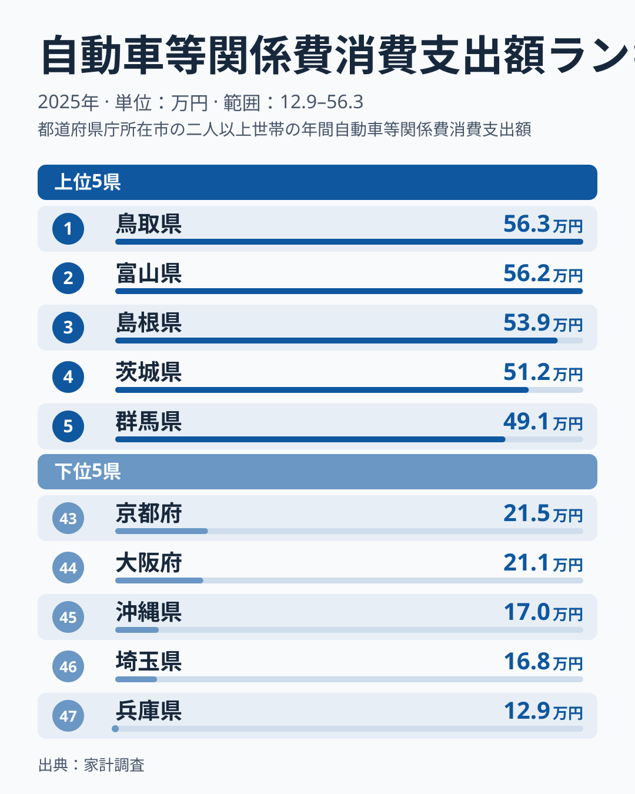
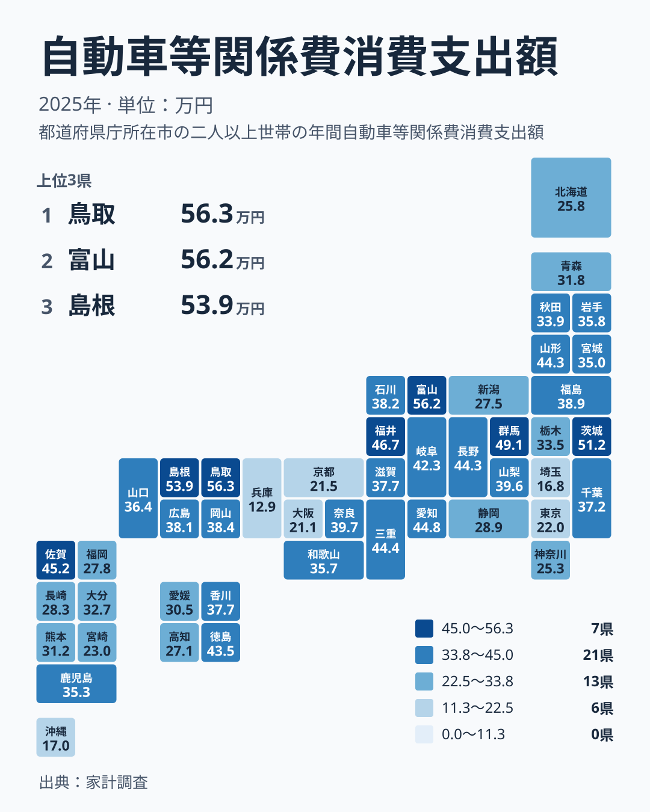

家計簿の中で、クルマにかかるお金はどれくらいの重さを持っているでしょうか。2025年の家計調査で、自動車等関係費への支出が最も多かったのは鳥取県で、562,591円でした。最も少なかったのは兵庫県で、129,362円です。同じ年、同じ国の中で、これほどの開きがあります。

この記事では、都道府県ごとの支出額を並べたうえで、その差がどこから生まれるのかを仮説として考えます。数字の大小だけを見るのではなく、読者の暮らしにとって何を意味するのかまで整理します。なお、実データにあるのは支出額と順位だけです。原因にあたる部分は、確かめられた事実ではなく、あくまで考えられる背景として読んでください。

## 上位と下位の顔ぶれを見る

まず、上位5県と下位5県を一枚の図で確認します。

<source-link href="/ranking/automobile-related-group-consumption-expenditure">自動車等関係費への支出ランキングをもっと見る</source-link>

上位は、1位の鳥取県が562,591円、2位の富山県が562,198円、3位の島根県が538,972円です。鳥取県と富山県はほぼ並んでいます。続いて4位の茨城県が512,133円、5位の群馬県が490,556円です。上位の県では、年間でおおむね50万円前後がクルマ関連の支出になっています。

下位は、47位の兵庫県が129,362円、46位の埼玉県が168,048円、45位の沖縄県が169,637円です。さらに44位の大阪府が210,872円、43位の京都府が215,148円と続きます。1位の鳥取県と47位の兵庫県を比べると、4倍を超える開きがあり、下位の県の支出は上位の半分にも届きません。

上位には鳥取県、島根県、富山県のように、大きな都市圏を抱えない県が目立ちます。下位には兵庫県、大阪府、京都府、埼玉県のように、大きな都市圏を抱える府県が並びます。この並びからは、支出額が住んでいる地域の暮らし方と関わっている可能性がうかがえます。ただし、所得や保有台数のデータはここにないため、理由までは断定できません。

> [!NOTE]
> 正式な統計名は「自動車等関係費消費支出額」で、家計調査にもとづく世帯あたりの年間支出額です。クルマの購入費だけでなく、ガソリン代や保険料などの維持費も含む考え方の項目です。購入費は年によって大きく動きやすいため、単年の順位は買い替えの有無に左右されうる点に注意してください。

## 地理分布から見えるもの

次に、47都道府県の分布を地図で見ます。

地図では、支出の大きい県と小さい県が地方ごとに混ざり合っている様子が見て取れます。地方のくくりで見ると、同じ地方の中でも順位が大きく分かれる例があります。

中国地方では、鳥取県が1位、島根県が3位と上位に並びます。一方で、同じ中国地方の岡山県は17位の384,279円、広島県は19位の380,886円、山口県は23位の364,169円と、中位に落ち着いています。中国地方の中でも、県による違いは小さくありません。

関東にも同じ現象があります。茨城県は4位の512,133円、群馬県は5位の490,556円と上位に入ります。ところが埼玉県は46位の168,048円、東京都は42位の220,116円で、下位寄りに位置しています。同じ関東でも、県によってクルマ関連の支出に大きな差があることがわかります。

近畿でも差があります。ここでは三重県を近畿に含める区分で見ます。三重県は9位の444,293円、奈良県は14位の396,545円と上位から中位より上にありますが、兵庫県は47位、大阪府は44位、京都府は43位です。同じ近畿の中に、支出の大きい県と小さい府県が同居しています。

## 考えられる背景: 「どこに住むか」との関係

では、この差はどこから来るのでしょうか。手元の実データは支出額と順位だけで、内訳や保有状況はわかりません。そのため、以下はいずれも仮説として読んでください。

一つ目の仮説は、台数の違いです。鉄道やバスが日常の移動を支える地域では、クルマを持たない世帯が多いのかもしれません。反対に、通勤や買い物にクルマが欠かせない地域では、複数台を持つ世帯が多く、ガソリン代や保険料などが積み上がっていると考えられます。

二つ目は、駐車場の事情です。都市部では駐車場を借りる費用が重いと言われますが、それでも都市部の支出額が低いのは、そもそもクルマを持たない世帯が多いためである可能性があります。ただし、この点を確かめるデータは今回ありません。

三つ目は、買い替えのタイミングです。購入費は一度に大きな金額が動くため、その年に買い替えた世帯が多い県では、順位が押し上げられた可能性があります。

これらを踏まえると、支出の高低には、クルマを日常の足として必要とするかどうかという暮らし方の違いが関わっているのではないか、という見方ができます。ただし、所得の差や運転の好みなど、他の要因を排除できるわけではありません。

> [!WARNING]
> 1位の鳥取県は562,591円、2位の富山県は562,198円で、差は400円に満たない小ささです。この程度の差で「1位だから突出している」と読むのは誤りです。また、同じ年の単年のデータなので、順位は年ごとに入れ替わる可能性があります。

## 暮らしへの含意

この結果は、引っ越しや就職を考える人にとって、一つの目安になります。

上位の県では、クルマ関連の支出が家計の中で大きな項目になっている可能性があります。鳥取県の562,591円や富山県の562,198円という水準は、年間で見ればまとまった金額です。家賃の安さだけで住む場所を決めると、移動にかかる費用が想定より膨らむことも考えられます。

反対に、下位の兵庫県や埼玉県、大阪府のような地域では、クルマ関連の支出は小さくなっています。ただし、その分を電車賃などの交通費で払っている可能性もあります。この指標だけで「安く暮らせる」と判断せず、移動にかかる費用全体で比べることが大切です。

> [!TIP]
> 順位だけでなく、金額の水準も一緒に見ると読み違いを減らせます。中位の福島県は16位で388,989円、岡山県は17位で384,279円です。中位付近は順位が一つ違っても金額の差が小さいため、順位の上下に過敏に反応しないことが役に立ちます。

## ほかの統計とあわせて

クルマの支出は、家計や暮らしの他の指標と並べると意味が深まります。[同じカテゴリの統計一覧](/category/economy)から、家計や経済に関するデータを確認できます。また、1位と2位の様子は[鳥取県のデータ](/areas/31000)や[富山県のデータ](/areas/16000)でも見られます。

## まとめ

2025年の家計調査によれば、自動車等関係費への支出が最も多い県は鳥取県の562,591円で、続く富山県は562,198円、島根県は538,972円でした。最も少ないのは兵庫県の129,362円です。

差の背景には、クルマが日常の足として欠かせない地域かどうかという暮らし方の違いがあるかもしれません。同じ地方の中でも、県によって結果が大きく異なることも確認できました。数字の大小を良し悪しで判断せず、自分の暮らす地域でクルマがどのような役割を担っているのかを考えるきっかけにしてください。

## データについて

ここで扱った「自動車等関係費消費支出額」は、家計調査による2025年の世帯あたり年間支出で、単位は円です。順位は支出額の大きい順に付けています。本文中の数値は、すべてこの統計の公表値をそのまま用いています。
