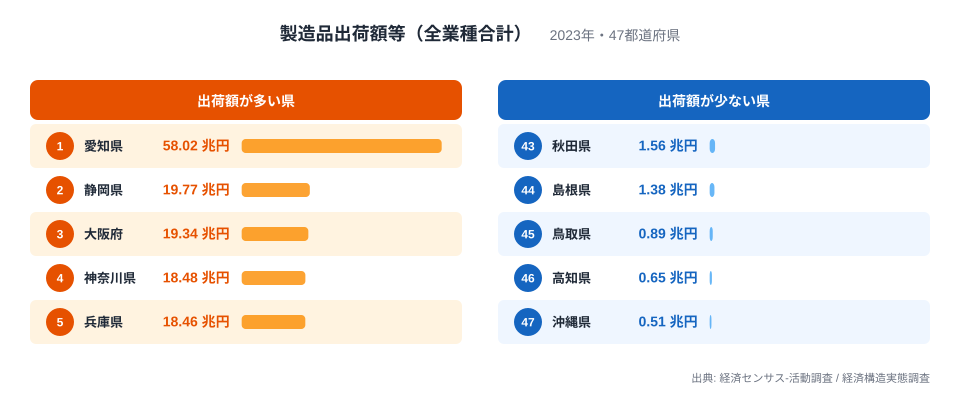
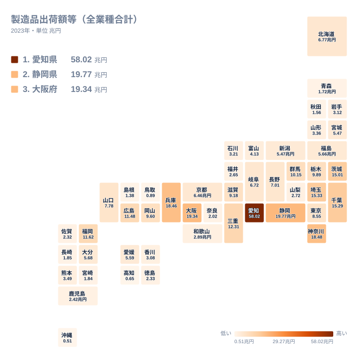
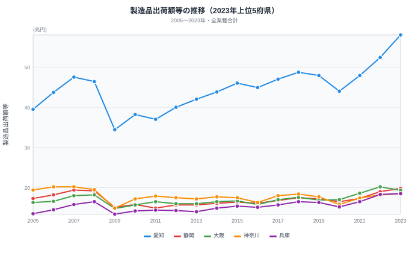

日本の自動車産業は、完成車メーカーを頂点に、数多くの部品サプライヤーが連なるピラミッド構造を形成しています。その集積は、都道府県の製造業の姿を大きく左右します。この記事では、自動車の県として知られる愛知県などを含む、**製造業全体**の出荷額の県別データから、勢力図を読みます。自動車関連だけの内訳や、EV化の影響は、この記事では出しません。

> [!NOTE]
> この記事の数値は、製造業全体（全業種の合計）の製造品出荷額等です。輸送用機械器具製造業だけの県別出荷額は、元の統計表から取り直して確かめられなかったため、この版では扱っていません。数値は経済センサス-活動調査と経済構造実態調査に基づきます。年の区切り（暦年か年度か）は、出典表の注記まで確認できていないので、「2023年」のように年だけで書きます。

## 製造品出荷額等ランキング──愛知は静岡の2.9倍

2023年の製造品出荷額等は、**愛知県が58.0兆円で1位**です。静岡県は2位の19.8兆円で、愛知県はその2.9倍にあたります。3位の大阪府は19.3兆円、4位の神奈川県は18.5兆円、5位の兵庫県は18.5兆円と、2位から5位は1.3兆円の幅に収まり、愛知県だけが飛び抜けています。6位から8位は、埼玉県が15.3兆円、千葉県が15.3兆円、茨城県が15.0兆円と、関東の3県が15兆円前後で並びます。

反対に少ないのは、沖縄県の0.5兆円、高知県の0.7兆円、鳥取県の0.9兆円、島根県の1.4兆円、秋田県の1.6兆円です。1位の愛知県と最下位の沖縄県の差は約115倍に達します。

愛知県の突出は、働く人の多さだけでは説明できません。製造業の従業者数は愛知県が約85.0万人で、従業者数が次に多い大阪府の約45.0万人と比べて1.9倍ですが、出荷額は静岡県の2.9倍です。出荷額を従業者数で割ると（筆者の計算）、愛知県は1人あたり約6,800万円で、大阪府の約4,300万円、静岡県の約4,800万円を大きく上回ります。付加価値額で見ても、愛知県は16.3兆円で、静岡県6.4兆円の2.5倍です。出荷額には原材料や部品の購入分も含まれますが、付加価値額でも差が開くため、見かけだけの差ではありません。

愛知県にはトヨタ自動車の本社と主力工場があり、周辺に部品メーカーが集まっています。ただしこのデータは全業種の合計なので、愛知県の出荷額のうち自動車関連がどれだけかは、この記事では示せません。

<source-link href="/ranking/manufacturing-shipment-amount">製造品出荷額等ランキングをもっと見る</source-link>

あわせて見る: [製造業従業者数ランキング](/ranking/manufacturing-employees) / [製造業付加価値額ランキング](/ranking/manufacturing-industry-added-value)

## 全国マップ──中部と、自動車の工場で知られる県

タイルマップを見ると、愛知県が突出して濃い色で、静岡県、大阪府、神奈川県、兵庫県が続きます。さらに、埼玉県、千葉県、茨城県が15兆円前後で並び、その外側に、10兆円から12兆円の県が続きます。9位の三重県が12.3兆円、10位の福岡県が11.6兆円、11位の広島県が11.5兆円、12位の群馬県が10.1兆円、13位の栃木県が9.9兆円です。

これらの県には、完成車メーカーの工場や本社が立地することで知られる県が含まれます。たとえば群馬県はSUBARU、広島県はマツダ、福岡県はトヨタ自動車九州と日産自動車九州の拠点があります。ただし、出荷額が10兆円前後であることと、自動車産業の集積の大きさは同じではありません。電子部品、化学、食料品など、ほかの産業が大きい県も同じ水準に入るからです。

一方、四国、山陰、東北北部、沖縄は淡い色が広がり、製造業全体の出荷額が小さい地域です。

> [!TIP]
> 自動車産業の地図は、完成車の工場の場所だけでは読めません。1台の車に多くの部品が使われるため、実際の集積は、部品メーカーがどこに連なるかで決まります。製造業全体の出荷額の地図は、その大まかな目安にとどまります。

## 製造品出荷額等の推移──リーマンとコロナでの減り方

上位5府県の2005年から2023年の推移を、減少額と減少率の両方で見ます。2008年に46.4兆円だった愛知県は、リーマンショック後の2009年に34.4兆円まで下がり、1年で12.0兆円、率にして約26%減りました。同じ年の減少は、静岡県が4.1兆円で約21%、神奈川県が4.6兆円で約24%、大阪府が3.4兆円で約19%、兵庫県が3.1兆円で約19%です。額では愛知県の落ち込みが飛び抜けて大きいものの、率では上位5府県がいずれも2割前後下がっていて、愛知県の約26%減は率でも5府県で最大ですが、神奈川県の約24%減と差は小さく、額の大きさは主にもともとの規模の大きさによります。

2020年のコロナ禍でも、愛知県は2019年の47.9兆円から44.0兆円へ、3.9兆円、率にして約8%減りました。神奈川県は約11%、兵庫県は約7%、静岡県は約4%の減少で、大阪府は約1%増えています。この年の減少率は、神奈川県のほうが愛知県より大きくなっています。その後は回復が続き、2023年の58.0兆円は2005年以降の最高です。

愛知県と次に多い県との差は、時間とともに広がりました。2005年は愛知県が39.5兆円、次に多い神奈川県が19.4兆円で、愛知県は2.0倍でした。2019年は愛知県が47.9兆円、次に多い神奈川県が17.7兆円で、2.7倍です。調査が切り替わる前の期間だけでも、差は強まっています。2023年は愛知県が58.0兆円、次に多い静岡県が19.8兆円で2.9倍です。愛知県だけが他県の3倍近い水準にある構図は、2005年以降ずっと変わらなかったのではなく、この約20年で強まったものです。

> [!WARNING]
> 2020年以降は、調査が年により切り替わります。2021年経済センサスは従来より幅広く事業所を把握しているため、2020年の落ち込みの大きさと、2023年の2.9倍という終点の数字は、調査の違いの影響を受けている可能性があります。調査の切り替えの影響を受けない比較は、2005年と2019年を比べた2.0倍から2.7倍への広がりです。

## まとめ

製造業全体の出荷額から、自動車で知られる県を含む勢力図を整理します。

- **愛知県の突出**：2023年は58.0兆円で、静岡県19.8兆円の2.9倍です。従業者数は大阪府の1.9倍、付加価値額は静岡県の2.5倍で、出荷額の差のほうが大きく開いています。
- **差は広がった**：愛知県と次に多い県との差は、2005年の2.0倍から2019年の2.7倍へ、調査が切り替わる前の期間だけでも広がりました。
- **落ち込みは額で大きい**：2009年に愛知県は12.0兆円減りましたが、率では上位5府県がいずれも2割前後で、突出してはいません。
- **この記事で測れないこと**：自動車関連の出荷額の県別内訳や、EV化の影響は、製造業全体のデータでは測れません。輸送用機械器具製造業の県別データを取り直せたときに、改めて確かめる必要があります。

製造業全体の中での愛知県の位置づけは[愛知58兆円一強の製造業地図](/blog/manufacturing-aichi-dominance)、付加価値で見た稼ぐ力は[製造業の稼ぐ力ランキング](/blog/manufacturing-productivity)、電子部品側の地図は[半導体・電子部品の製造地図](/blog/semiconductor-electronics-regional-map)と合わせて読むと、産業構造の全体像が見えてきます。
