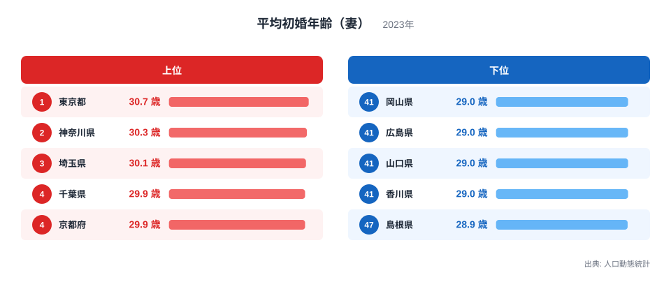
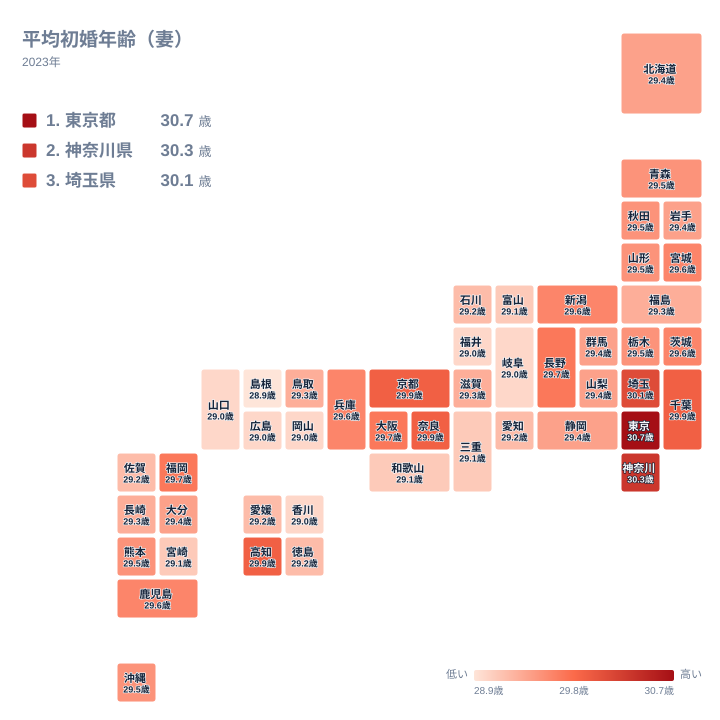

結婚する年齢は、住む場所によって変わるのでしょうか。2023年の人口動態統計で妻の平均初婚年齢を見ると、東京都は30.7歳で1位、島根県は28.9歳で47位でした。差は1.8歳です。小さな差に見えますが、並び方を丁寧にたどると、地域ごとの特徴が浮かびます。

この記事では、上位と下位がなぜその順になるのかを、地理や産業構造の面から考えます。ただし、本文で使える数値は都道府県別の値と順位だけです。理由については、あくまで仮説として述べます。

## 上位と下位の幅を図で読む

まず、上位5県と下位5県を図で確認します。

<source-link href="/ranking/average-age-of-first-marriage-wife">平均初婚年齢（妻）ランキングをもっと見る</source-link>

図から最初に読み取れるのは、最上位で値が段階的に下がることです。東京都は30.7歳で1位、神奈川県は30.3歳で2位、埼玉県は30.1歳で3位です。この3県は、1つ下がるごとに0.2歳から0.4歳ずつ値が小さくなります。

その次に来るのが、29.9歳で並ぶ千葉県、京都府、奈良県、高知県です。この4県は同じ値で、実質的に同じ位置にいます。1位の30.7歳からこのグループまでの差は0.8歳です。高知県は、上位3県に次ぐ同値グループの一角にあたります。

下位では、島根県が28.9歳で47位です。その上には、福井県、岐阜県、岡山県、広島県、山口県、香川県の6県が、いずれも29.0歳で並びます。島根県を含む下位7県の間には、0.1歳の差しかありません。

一方、29.9歳のグループから島根県の28.9歳までの差は1.0歳です。1位と47位の差1.8歳のうち、約0.8歳は上位の3県から4県で生まれています。残りの約1.0歳は、それ以外の県が並ぶ幅です。上位だけが突出しているわけではなく、全体がゆるやかに下がっています。

この形から、大都市圏が全体を押し上げている可能性が考えられます。大学や専門職の職場が集まる都市部では、学業や仕事の基盤づくりに時間をかける人が多く、結婚の時期が後ろにずれるのかもしれません。ただし、これは本記事のデータだけでは検証できない仮説です。

> [!NOTE]
> ここでの数値は、2023年に結婚した妻が、初めて結婚したときの年齢の平均です。県内に住む女性全体の平均年齢でも、既婚女性の平均年齢でもありません。また、どの県の値になるかは婚姻届の扱いなどの集計方法で決まるため、実際の居住地や勤務地と一致しないことがあります。

## 地理分布で見る首都圏と周辺

次に、47都道府県の分布を地図で見ます。

地図で目を引くのは、関東の南側の濃さです。東京都の30.7歳、神奈川県の30.3歳、埼玉県の30.1歳、千葉県の29.9歳が連なり、首都圏が一つの塊として高い水準にあります。

一方、同じ関東でも外側は様子が違います。茨城県は29.6歳、栃木県は29.5歳、群馬県は29.4歳です。値は首都圏の4都県より低く、全国の真ん中あたりに収まります。関東というくくりよりも、東京への近さが値の高さと重なっているように見えます。

首都圏の高さは、東京の労働市場とのつながりが背景にある可能性があります。埼玉県、千葉県、神奈川県は、東京へ通勤する人が多い地域と考えられます。都心に近い働き方や暮らし方が、結婚の時期にも反映されているのかもしれません。ただし、通勤の実態はこのデータからは分からず、推測にとどまります。

近畿には、県ごとの違いがはっきり出ています。京都府と奈良県は29.9歳で、首都圏の千葉県と同じ値です。これに対して、三重県と和歌山県はどちらも29.1歳でした。同じ近畿でも、府県によって位置が大きく分かれており、近畿をひとまとめに語ることはできません。

> [!TIP]
> 順位が1つ違っても、値の差が0.1歳以下という箇所が多くあります。29.9歳には4県、29.0歳には6県が並んでいます。順位の数字を大きな差と読まず、同じ値の県のまとまりとして眺めると、実態に近づきます。

## 都市と地方、どこまで言えるか

東京都の30.7歳と島根県の28.9歳を並べると、全体として都市部が高く、周辺の県が低いという傾向はあります。しかし、地方の県がすべて低いわけではありません。高知県は29.9歳で、千葉県、京都府、奈良県と同じ値です。長野県も29.7歳で、大阪府や福岡県と並んでいます。

反対に、大都市圏を抱える県が高いとも限りません。愛知県は29.2歳で、石川県、徳島県、愛媛県、佐賀県と同じ値です。大阪府の29.7歳と比べると、0.5歳低くなります。

愛知県の背景として、製造業の集積など産業の特徴が関わっている可能性は考えられます。しかし、本記事のデータでは確かめられないため、仮説にとどめます。都市だから高い、地方だから低いと単純には決められないことが、この一例からも読み取れます。

> [!WARNING]
> この指標は、初婚の妻に限った平均年齢です。結婚した人の年齢だけが対象なので、そもそも結婚する人がどれだけいるかという未婚率や、結婚件数の多さは分かりません。初婚年齢が高い県で結婚する人が多いのか少ないのかは、別の指標で確かめる必要があります。

## 狭い幅に集まる大半の県

上位の数県と下位の数県を除くと、残りの県は狭い範囲に集まっています。29.6歳には宮城県、茨城県、新潟県、兵庫県、鹿児島県の5県が並びます。29.5歳には、青森県、秋田県、山形県、栃木県、熊本県、沖縄県の6県が並びます。

どちらも、同じ値に複数の県が集まっています。北海道・東北の県が29.4歳から29.6歳に重なり、九州・沖縄の県もほぼ同じ範囲に入ります。地方ごとの差は、首都圏と他の県の差ほど大きくありません。

したがって、この指標で県ごとの個性を語るときは、順位の細かな違いよりも、首都圏の高さと、多くの県が近い値に並ぶ点をあわせて見るのが適切です。首都圏が高いのは確かですが、多くの県の差はごくわずかです。

## データについて

この記事で使った統計名は、平均初婚年齢（妻）です。出典は人口動態統計で、年は2023年、単位は歳です。全47都道府県の値を使っています。

値は小数点以下1桁で公表されており、同じ値の県が複数あります。本文では、同じ値の県は同じ水準として扱い、順位は東京都、神奈川県、埼玉県、島根県の4県についてだけ示しました。ほかの県は値で比べてください。

地域ごとの背景を詳しく知りたいときは、[東京都のデータ](/areas/13000)や[神奈川県のデータ](/areas/14000)で、ほかの指標もあわせて確認できます。人口関連の指標との組み合わせは、[同じカテゴリの統計一覧](/category/population)から探せます。

## まとめ

妻の初婚年齢は、東京都の30.7歳が最高で、島根県の28.9歳が最低でした。差は1.8歳です。そのうち約0.8歳は最上位のグループまでの幅で、約1.0歳はそれ以外の県が並ぶ幅でした。

首都圏の都県は高い水準にありますが、高知県や長野県のように、都市圏以外にも高い値の県があります。反対に、愛知県のように大都市圏を抱えても、全国の真ん中より下に位置する県もあります。順位の細かな違いよりも、同じ値の県のまとまりと全体の幅を押さえることが大切です。東京都や神奈川県のデータを起点に、周辺の県と見比べてみてください。
