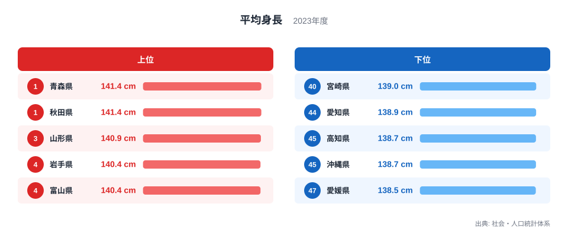
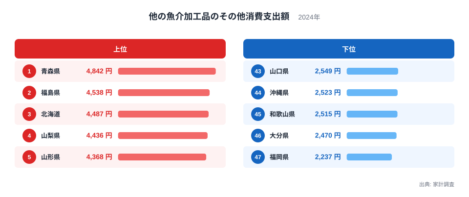
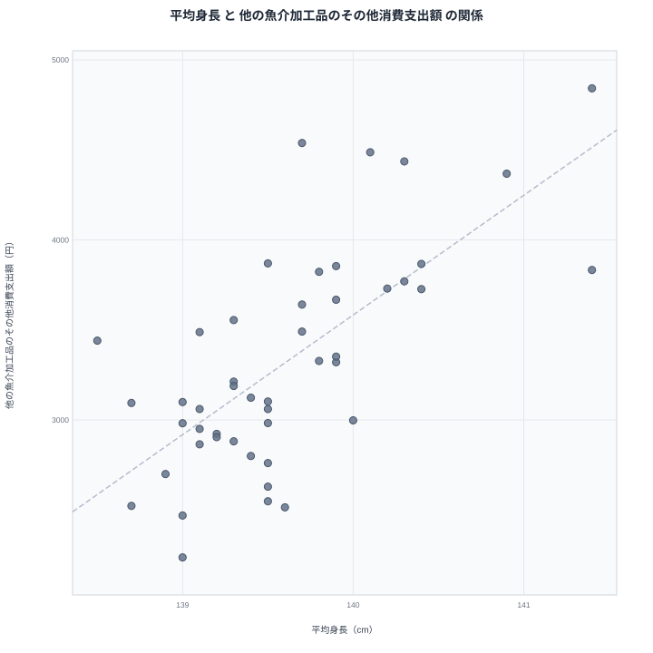

## 身長の高い県は魚介加工品にお金を使う?

都道府県のデータを並べると、「なぜこの二つが似た順位になるのか」と首をかしげたくなる組み合わせが現れます。今回取り上げるのは、平均身長と、魚介加工品のうち分類が「その他」にあたるものへの支出です。前者は子どもの体格を示す指標で、後者は家計の食費の使い方を示す指標です。一見すると関係がなさそうですが、47都道府県で重ねると、はっきりした正の相関が出ました。

本記事では、この相関を紹介するだけで終わらせません。身長が高いから魚介加工品を買うのか、魚介加工品を食べるから身長が伸びるのか、といった短絡的な読み方はいったん脇に置きます。そのうえで、両方の上位に同じ地域が並ぶ理由として何が考えられるのかを、データの範囲で整理します。

使うのは、2023年の平均身長(社会・人口統計体系)と、2024年の魚介加工品への支出(家計調査)です。調査年が異なる点は、注記でも触れます。

## 平均身長が高い県はどこか

まず平均身長のランキングを見ます。上位5県と下位5県を並べた図が次のものです。

<source-link href="/ranking/average-height-primary-school-fifth-grade-male">平均身長ランキングをもっと見る</source-link>

上位に目立つのは東北の県です。青森県と秋田県は同じ141.4cmで並び、その後ろに山形県、岩手県が続きます。上位5県のうち、北海道・東北に属するのは青森県、秋田県、山形県、岩手県の4県で、残る1県は中部の富山県です。上位が一つの地方に偏っている点が、この指標の最初の特徴です。

もう一つの特徴は、最上位と最下位の差が小さいことです。最上位の141.4cmに対し、最下位の愛媛県は138.5cmで、47県が狭い範囲にぎっしり詰まっています。そのため、順位が一つ違っても実際の身長の差はごくわずかな場合が多くなります。40位から43位までの4県は、すべて139cmという同じ表記で並んでいます。順位の上下をそのまま「体格の優劣」と読むのは避けたほうがよいでしょう。

下位には四国と九州・沖縄の県が混じります。高知県と沖縄県が並んで下位に入り、愛知県もその近くにいます。上位が東北に寄り、下位が西日本の複数の地方に散らばる、という形です。この偏りが、後で見る相関の土台になります。

> [!NOTE]
> ここでの平均身長は、小学5年生の男子を対象にした値で、単位はcmです。大人の身長ではなく、成長の途中にある年齢の子どもの平均です。成長が始まる時期の違いも数字に反映されます。また、値は小数第1位までの表記なので、同じ数字で並ぶ県が多く出ます。順位の差を過大に読まないようにしてください。

## 魚介加工品への支出が多い県はどこか

次に、魚介加工品への支出を見ます。統計上の名称は「他の魚介加工品のその他消費支出額」で、家計調査にもとづく年間の支出額です。上位と下位は次の図のとおりです。

最上位は青森県で、身長でも1位だった県が、こちらでも先頭に立っています。上位5県には青森県、福島県、北海道、山梨県、山形県が入り、5県のうち4県が北海道・東北です。身長と同じく、東北を中心に上位が固まっている様子がうかがえます。山形県は身長でも上位に入っており、二つの指標で重なる県のひとつです。

下位は西日本が中心です。最も少ないのは福岡県で、大分県、和歌山県、沖縄県、山口県が続きます。上位と下位の間には大きな開きがあり、身長が狭い範囲に収まっていたのに対して、支出は県ごとの違いがはっきり出る指標だとわかります。

魚介加工品の「その他」とは、ねり製品や塩干品などの主要な区分に入らない商品群を指します。何が含まれるかは地域の食文化によって変わるため、特定の商品の人気を直接示す数字ではありません。この点を踏まえると、上位の県は「魚をよく食べる県」というより、「この区分の商品を買う習慣が根づいた県」と読むほうが実態に近いでしょう。

> [!WARNING]
> 家計調査は標本調査で、限られた世帯を対象に集計します。県全体の食生活を正確に表すわけではなく、年によって順位が入れ替わりやすい点にも注意が必要です。さらに本記事では身長が2023年、支出が2024年と調査年が異なります。同じ年で比べたものではありません。

## 二つの指標を重ねると見える相関

二つの指標を1つの図にまとめたのが次の散布図です。横軸と縦軸にそれぞれの値をとり、1つの点が1つの都道府県を表します。

47都道府県で計算したピアソンの相関係数は0.70です。一般に、0.7前後は「かなりはっきりした正の関連がある」と受け取られる水準で、身長が高い県ほど支出も多い傾向が見てとれます。ただし、これは点の並びが右上がりの直線にどれだけ近いかを示す数字にすぎません。身長が支出を押し上げる強さや、支出が身長に与える影響の大きさを表すものではありません。

個別の県を見ても、傾向に沿う県が目立ちます。青森県は身長でも支出でも1位です。岩手県、秋田県、山形県、北海道も両方で上位に入り、右上の点は北海道・東北の県が多くを占めます。逆に沖縄県は、身長が46位、支出が44位と、どちらも下位です。

一方で、傾向から外れる県もあります。愛媛県は身長が47位ですが、支出は19位で中位より上にいます。全体としては同じ向きに動きながらも、例外は少なくありません。0.70という値は「かなり揃っている」ことを示しますが、「全部が揃っている」ことは意味しません。

> [!TIP]
> 散布図を読むときは、点が右上に集まっているかだけでなく、「どの地域の点が集まっているか」を確認してください。相関が高くても、特定の地方がまとまって右上にいるだけなら、二つの指標を結ぶ理由は地域の共通要因かもしれません。

## 相関は因果ではない: 真因は何か

ここが本記事の核心です。相関係数が0.70だからといって、魚介加工品を多く買うから背が伸びる、あるいは背が高い家庭が魚介加工品を好む、と結論づけることはできません。この二つのあいだに直接の因果があると示すデータは、今回の実データにはありません。

では、なぜ似た順位になるのでしょうか。可能性として考えられるのは、第三の要因が両方に効いているという見方です。たとえば、地域に共通する食文化や気候、世帯構成、年齢構成などです。同じ地方の県が同じ位置に固まれば、二つの指標が連動して見えることは十分にありえます。

ただし、これらはあくまで仮説です。本記事のデータだけでは、どの要因がどの程度効いているかを切り分けられません。身長には遺伝、栄養、生活習慣などが関係し、支出には価格、買い物の場所、商品の分類、地域の伝統食などが関係します。

例外の存在も見落とせません。東京都は身長が8位で、支出は12位と比較的高い水準です。一方、福岡県は身長が41位、支出が47位と両方で低く、愛媛県のように身長が最下位でも支出は中位より上の県もあります。もし魚介加工品が身長を直接左右するなら、このような県は出にくいはずです。相関が示すのは「一緒に動く傾向」であり、「一方が他方を生む仕組み」ではありません。

## 地域差をどう読むか

最後に、地域の並びを整理します。身長の上位10県は、青森県、秋田県、山形県、岩手県、富山県、宮城県、山梨県、東京都、北海道、徳島県です。このうち北海道・東北は、青森県、秋田県、山形県、岩手県、宮城県、北海道の6県です。

支出の上位10県は、青森県、福島県、北海道、山梨県、山形県、神奈川県、岩手県、新潟県、秋田県、千葉県です。こちらも北海道・東北が、青森県、福島県、北海道、山形県、岩手県、秋田県の6県を占めます。

両方の上位10県に共通するのは、青森県、山形県、岩手県、秋田県、北海道、山梨県の6県です。内訳は、5県が北海道・東北で、1県が中部の山梨県です。つまり共通県の大半は北海道・東北ですが、すべてがそうではありません。宮城県と福島県は、片方の上位10県にだけ入っています。

こうして見ると、相関の背景には北海道・東北への集中が関わっている可能性があります。ただし、データが示しているのは集中の事実までで、その理由までは示していません。身長を伸ばしたい、あるいは魚介加工品の支出を増やしたいという目的でこの結果を使うのは適切ではありません。似た動きをする指標の裏に、地域の暮らしの共通点がないかを探る手がかりとして活用するのが適しています。

より詳しく調べたい方は、[他の魚介加工品のその他への支出ランキング](/ranking/other-processed-fish-ext-consumption-expenditure)で全47都道府県の順位を確認できます。[同じカテゴリの統計一覧](/category/educationsports)では、別の指標も比較できます。特に注目した県があれば、[青森県のデータ](/areas/02000)や[秋田県のデータ](/areas/05000)で、ほかの指標との並びも見てみてください。

## データについて

平均身長は社会・人口統計体系の2023年の値で、小学5年生の男子を対象とし、単位はcmです。魚介加工品への支出は、統計名「他の魚介加工品のその他消費支出額」として家計調査から得られた2024年の値で、単位は円です。

相関係数はピアソンの相関係数で、47都道府県の値から求めた0.70を使用しています。この数値は二つの指標の直線的な関係の強さを示すもので、因果関係の有無や、一方が他方をどれだけ説明できるかを示すものではありません。調査年が異なること、家計調査が標本調査であることから、結果は傾向をつかむための参考として読んでください。
