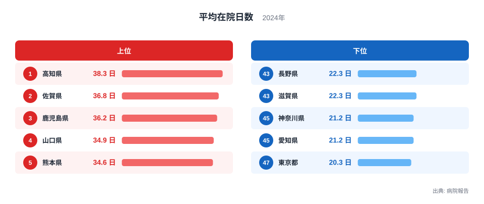
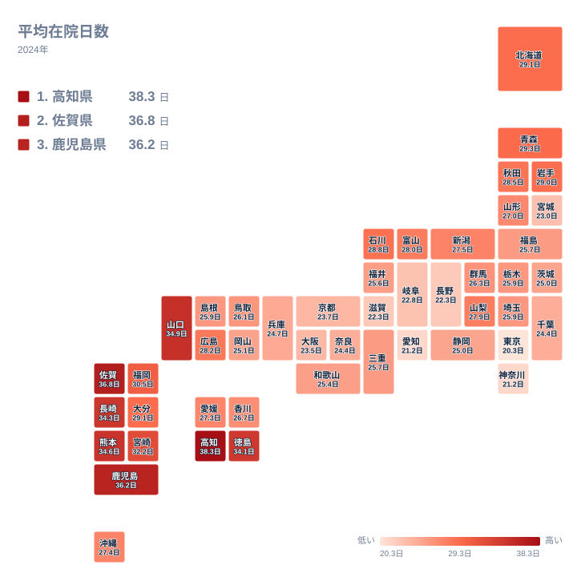

## 入院日数が最も長い県はどこか

病院に入ってから退院するまでの日数は、全国どこでも同じではありません。2024年の病院報告で平均在院日数を見ると、最も長いのは高知県の38.3日でした。最も短いのは東京都の20.3日です。同じ日本の病院でありながら、退院までの平均日数には大きな開きがあります。

ただし、この数字だけで「高知県の人は重い病気にかかりやすい」とは言えません。在院日数は、病気の重さだけでなく、病院の種類や病床の構成、退院後の受け皿など、医療提供の仕組みが重なって決まります。この記事では上位と下位の顔ぶれを確かめ、地理的な並びを眺めたうえで、データから言えることと言えないことを分けて考えます。

> [!NOTE]
> 平均在院日数は、入院している患者が平均して何日で退院しているかを表す指標です。病院報告の全体の値には、短期の治療が中心の一般病床のほか、長期の入院になりやすい療養病床や精神病床なども含まれます。県ごとの病床の構成が違えば、医療の質が同じでも数字は変わります。

## 上位と下位の顔ぶれ

まず、上位5県と下位5県を図で確認します。

<source-link href="/ranking/average-length-of-stay">平均在院日数ランキングをもっと見る</source-link>

図で最初に目に入るのは、顔ぶれの地域性です。上位5県は、1位の高知県、2位の佐賀県、3位の鹿児島県、5位の熊本県、4位の山口県で、四国、九州、中国の県が占めています。一方、下位5県は、47位の東京都、同じ21.2日で45位に並ぶ神奈川県と愛知県、同じ22.3日で43位に並ぶ長野県と滋賀県です。関東、中部、近畿にまたがっており、特定の一地方に固まってはいません。

数字の水準も対照的です。上位は38.3日の高知県から34.6日の熊本県まで、いずれも34日台後半以上です。下位は20.3日の東京都から22.3日の長野県と滋賀県までで、いずれも22日台以下に収まっています。上位と下位の間には、中位の県がひしめく大きな谷があります。

また、上位5県のほうが、値の幅がやや大きく見えます。ただし、これは上位5県と下位5県という限られた比較から見える印象にすぎません。長い側と短い側で分布の性質が本当に違うのかは、この図だけでは判断できません。

> [!WARNING]
> 同じ値の県が複数あり、同じ値の県は同順位として扱います。愛知県と神奈川県はどちらも21.2日、滋賀県と長野県はどちらも22.3日です。また、この数字は2024年の1時点の平均値です。一部の非常に長い入院が全体を押し上げることがあり、多くの患者が長く入院していることを意味するとは限りません。

## 九州に集まる長い入院を地図で見る

次に、47都道府県の分布を地図で見ます。

地図で目を引くのは、九州の県の位置です。福岡県、佐賀県、長崎県、熊本県、大分県、宮崎県、鹿児島県の九州7県は、すべて12位以内に入っています。上位の色が九州を中心に、四国の高知県や中国の山口県へ連なっている様子が読み取れます。

九州の中にも幅があります。最も長いのは佐賀県の36.8日で、最も短いのは大分県の29.1日です。九州というひとまとまりでも、県によって7日あまりの開きがあります。福岡県は30.5日で、九州の中では短いほうに入ります。九州が全体として高い水準にあるのは確かですが、一様ではありません。

もうひとつ注目したいのは、沖縄県です。九州・沖縄の区分に含まれる沖縄県は27.4日で20位にとどまり、九州の7県とは水準が異なります。九州・沖縄という大きなくくりで語ると、この違いが見えなくなります。沖縄県が外れているという事実は、九州の長さが地方全体に共通する性質ではなく、県ごとの事情の積み重ねである可能性を示します。ただし、その事情の中身は、このデータからは分かりません。

四国でも、高知県が1位、徳島県が7位である一方、愛媛県は21位の27.3日、香川県は23位の26.7日です。北海道・東北でも、青森県は10位の29.3日、岩手県は13位の29日と中位より上ですが、宮城県は41位の23日です。地方という大きなくくりより、県ごとに見る必要があります。

高知県の詳しい数字は[高知県のデータ](/areas/39000)で、佐賀県の数字は[佐賀県のデータ](/areas/41000)で確認できます。

## 長くなる背景は何か、仮説として考える

では、なぜ四国や九州に長い県が多いのでしょうか。ここからは、実データで確かめられる内容ではなく、仮説として整理します。

ひとつ考えられるのは、病床の構成の違いです。入院が長くなりやすい種類の病床が多い県では、全体の平均も長くなる可能性があります。もうひとつは、退院後の受け皿です。自宅や施設で医療や介護を受けられる体制が地域ごとに違えば、退院のタイミングも変わるかもしれません。さらに、地域の高齢者の割合や、病院が担っている役割の違いも関係している可能性があります。

しかし、これらはいずれも、今回の実データには含まれていない要素です。病床数や高齢者の割合、介護施設の数といった別の統計と突き合わせなければ、どの仮説が当たっているのかは分かりません。上位の県に共通する理由を断定するのは、このデータの範囲を超えてしまいます。

> [!TIP]
> この指標を読むときは、病床の種類の混在に注意してください。全体の平均在院日数は、短期で退院する患者の多い病床と、長期になりやすい病床をまとめた数字です。県の数字が長くても、すべての病院で入院が長いとは限りません。急性期の病院だけの日数ではないため、病院の手際の良し悪しとして読むのは避けましょう。

## 短い県の並びをどう読むか

下位に目を向けると、47位の東京都、45位の神奈川県と愛知県という大都市を含む県が並びます。東京都は20.3日、神奈川県と愛知県はどちらも21.2日です。大阪府は40位の23.5日、京都府は39位の23.7日で、大都市のある府県は下位寄りに位置しています。

ただし、「大都市だから短い」と言い切れるわけではありません。43位の長野県と滋賀県は、どちらも22.3日で、下位5県に入っています。都市の規模だけでは説明しきれないことが、このことからも分かります。

全国の真ん中あたりでは、値が近い県が密集しています。たとえば、24位の群馬県は26.3日、25位の鳥取県は26.1日、26位には栃木県、埼玉県、島根県がいずれも25.9日で並んでいます。中位は値が似ているため、順位が数位違っても、実際の差はごくわずかです。順位の上下に一喜一憂するより、値そのものを見るほうが実態に近づけます。

結局のところ、短い県の理由もまた、このデータだけでは決められません。患者の年齢、病院の機能、地域の連携の仕組みなど、複数の要素が考えられるものの、確かな根拠はこの統計の外にあります。他の社会保障の指標と合わせて見たい場合は、[同じカテゴリの統計一覧](/category/socialsecurity)から探せます。

## データについて

この記事で使った統計は、病院報告にもとづく平均在院日数です。年は2024年、単位は日です。47都道府県すべての値が公表されており、記事中の数値と順位は、その実データだけを使っています。

同じ値の県は同順位として扱い、次の順位は飛びます。たとえば北海道と大分県はどちらも29.1日で、ともに11位です。栃木県、埼玉県、島根県はいずれも25.9日で、ともに26位です。値が同じ県どうしに優劣はなく、同順位の県の間に実質的な差はありません。

## まとめ

2024年の平均在院日数は、高知県が38.3日で1位、東京都が20.3日で47位でした。上位5県は四国、九州、中国の県で、九州7県はいずれも12位以内に入っています。一方、沖縄県は20位にとどまり、九州の7県とは水準が異なります。下位には大都市を含む県が並びますが、長野県や滋賀県のように大都市圏とは言いにくい県も入っています。

この分布からは、長い県が特定の地域に偏って見えること、短い県は地方をまたいで並ぶことが読み取れます。しかし、その背景は、病床の構成や退院後の受け皿といった別の統計と合わせなければ確かめられません。数字の大小だけで医療の良し悪しを決めず、背景を丁寧に確かめながら読むことが大切です。
