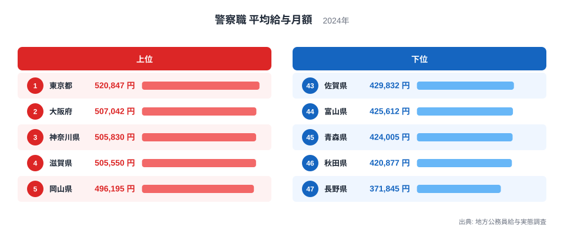
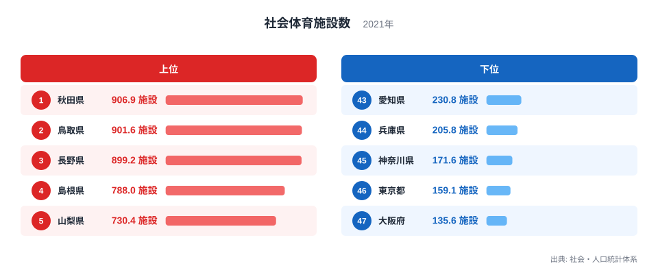
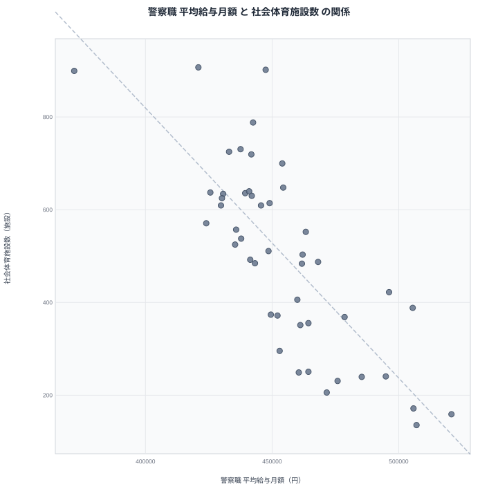

## 給与の高い県ほど体育施設が少ない、という奇妙な並び

警察職の平均給与月額が高い県と、社会体育施設の数が多い県を並べると、きれいに逆向きの関係が現れます。給与が高い県には施設が少なく、給与が低い県には施設が多い傾向です。

2つの指標の相関係数は -0.78 で、47都道府県を使って計算しています。数字だけを見ると、警察職の給与が高いことが体育施設を減らしているようにも読めてしまいます。しかし、警察職の給与と地域の体育施設が直接つながっているとは考えにくいです。

この記事では、まず両方のランキングを確認します。そのうえで散布図を読み、見かけの相関と真因を分けて考えます。相関は因果ではないという前提を、最後まで崩さずに進めます。

> [!NOTE]
> 警察職平均給与月額は、地方公務員給与実態調査にもとづく2024年の値で、単位は円です。社会体育施設数は、社会・人口統計体系にもとづく2021年の値で、単位は施設です。2つの指標は調査年が異なります。また、施設数の値は小数を含むため、人口などで調整した指標だと考えられます。

## 警察職の平均給与月額ランキング

まず警察職の平均給与月額を見ます。

<source-link href="/ranking/avg-salary-police-prefecture">警察職平均給与月額ランキングをもっと見る</source-link>

1位は東京都で520,847円です。2位は大阪府で507,042円、3位は神奈川県で505,830円、4位は滋賀県で505,550円、5位は岡山県で496,195円と続きます。上位には大都市圏の都府県が目立ちます。ただし、滋賀県や岡山県のように大都市圏の外にある県も入っています。

下位を見ると、47位は長野県で371,845円です。46位は秋田県で420,877円、45位は青森県で424,005円、44位は富山県で425,612円、43位は佐賀県で429,832円です。

注目したいのは長野県の位置です。46位の秋田県とは49,032円の差があり、下位の中でも一段低い水準にあります。それ以外の県は420,000円台から430,000円前後に集まっています。東京都と長野県の差は大きく、給与水準には地域差がはっきりあります。

> [!WARNING]
> 平均給与月額は、年齢構成や勤続年数、手当の構成に左右されます。職員の年齢が高い県は平均が上がりやすいです。したがって、この数字は職務の評価や仕事ぶりの違いをそのまま示すものではありません。長野県の低さについても、この統計だけでは理由を断定できません。

## 社会体育施設数のランキング

次に、社会体育施設数を見ます。

1位は秋田県で906.9施設です。2位は鳥取県で901.6施設、3位は長野県で899.2施設、4位は島根県で788施設、5位は山梨県で730.4施設です。上位は人口の少ない県や、地方の県が多く並びます。

下位を見ると、47位は大阪府で135.6施設です。46位は東京都で159.1施設、45位は神奈川県で171.6施設、44位は兵庫県で205.8施設、43位は愛知県で230.8施設です。上位と下位がちょうど対照的で、大都市圏が下位に集まっています。

先ほどの給与ランキングと見比べると、東京都、大阪府、神奈川県が給与では上位、施設数では下位に入っています。これが逆向きの相関を作っている中心的な部分です。一方で長野県は、給与が47位、施設数が3位で、逆向きの関係に当てはまる例です。

> [!TIP]
> 施設数のランキングは、人口あたりの値だと考えて読むのが安全です。人口が多い都市部は、施設の総数が多くても、住民1人あたりでは少なく出ます。順位を見るときは、総数なのか人口あたりなのかを先に確かめてください。

## 散布図で見る相関の強さ

2つの指標を1枚にまとめたのが散布図です。

相関係数は -0.78 です。マイナスは、一方が大きいほどもう一方が小さい傾向を表します。絶対値も大きく、傾向としてはかなりはっきりしています。47都道府県の点が、右下がりの帯にまとまって並んでいると読めます。

ただし、この数値は因果の大きさを示すものではありません。「給与が上がると施設が減る」という意味でも、「施設を増やすと給与が下がる」という意味でもありません。相関係数が教えてくれるのは、2つの指標が一緒に動く傾向の強さだけです。

散布図の端には、東京都や大阪府のような都市部の点があります。反対側には、秋田県や鳥取県のような地方の点があります。両端の点が、帯の傾きを大きく決めていると考えられます。個別の県を見ると、帯からはずれる県もあります。たとえば滋賀県は給与が4位で、施設数は388.4施設の32位です。長野県は給与が最も低いのに施設数が上位で、帯の端に位置します。

## 見かけの相関と真因を分ける

では、なぜこのような逆向きの関係が出るのでしょうか。有力な説明は、2つの指標の背後に共通の要因があるというものです。その要因とは、都市化の度合い、つまり人口の集中と地価や物価の水準です。

都市部では、物価や生活費が高いため、地方公務員の給与にも地域手当などが上乗せされやすいと考えられます。その結果、東京都や大阪府の警察職の給与は高くなります。一方で、都市部は土地が限られ、人口も多いです。そのため、人口あたりの社会体育施設は少なくなりやすいです。

この説明が正しければ、給与と施設数は互いに影響し合っていません。都市化という第三の要因が、片方を押し上げ、もう片方を押し下げているだけです。こうした関係を、見かけの相関と呼びます。

ただし、この記事のデータだけでは、都市化が真因だと証明はできません。人口や地価、手当の水準は、与えられた実データに含まれていないからです。ここで述べているのは、もっともらしい仮説であり、検証には別の統計が必要です。

地方では、公共施設が学校の体育館や公民館に近い形で広く分散しています。人口が少ない分、人口あたりの施設数は大きく出ます。この点も、秋田県、鳥取県、長野県が上位に並ぶ背景として考えられます。

## 例外が教えてくれること

都市化だけでは説明しにくい県もあります。長野県は施設数が3位で、地方の特徴をよく表しています。しかし給与は47位で、他の地方の県と比べても低いです。

仮に都市化だけで説明できるなら、地方の県は似たような給与水準になるはずです。実際には、青森県は424,005円で45位、秋田県は420,877円で46位と、長野県より高いです。長野県の371,845円は、地方の県の中でも突出して低い値です。したがって、給与の水準には、都市化以外の要素も働いていると見るべきです。

反対に、都市部でも例外があります。千葉県は給与が494,926円で6位ですが、施設数は240.6施設で41位です。埼玉県は給与が485,406円で7位、施設数は239.6施設で42位です。この2県は、帯の中心に沿った並びです。

一方、岡山県は給与が5位でありながら、施設数は422.2施設で30位と中位です。大都市圏ではない県でも、給与が高い例があります。こうした県を個別に調べると、手当の構成や職員の年齢構成といった別の事情が見つかるかもしれません。

東京都の詳しい数値は[東京都のデータ](/areas/13000)、大阪府は[大阪府のデータ](/areas/27000)から確認できます。都市部の特徴を、他の指標と合わせて見ると理解が深まります。

## 数字を使うときの注意

この記事の結論を、次のように整理できます。

- 警察職の給与と社会体育施設数には、相関係数 -0.78 の逆向きの関係があります。
- この関係は、片方がもう片方の原因であることを意味しません。
- 背後にある都市化が両方に影響している、という仮説が考えられます。
- 長野県のように、仮説だけでは説明しきれない県も残ります。

政策や議論でこうした相関を使う場合は、因果と取り違えないことが大切です。たとえば「給与を下げれば施設が増える」といった結論は、まったく成り立ちません。逆に「施設を減らせば給与が上がる」も同じです。

また、2つの指標は調査年が異なります。給与は2024年、施設数は2021年の値です。数年のずれがあるため、細かな順位の違いを読み込みすぎないほうがよいです。大きな傾向をつかむ材料として使うのが適切です。

施設数の各県の並びは、[社会体育施設数ランキング](/ranking/community-sports-facility-count-per-million)で確認できます。ほかの行財政の統計と合わせて見たい場合は、[同じカテゴリの統計一覧](/category/administrativefinancial)も参考になります。

## データについて

警察職平均給与月額は、地方公務員給与実態調査の警察職に関する平均給与月額で、2024年の値です。単位は円です。社会体育施設数は、社会・人口統計体系による2021年の値で、単位は施設です。

相関係数はピアソンの相関係数で、47都道府県のデータから計算しています。値は -0.78 です。この数値は2つの指標の直線的な関係の強さを示すもので、因果の大きさや、一方で他方を説明できる割合を表すものではありません。
