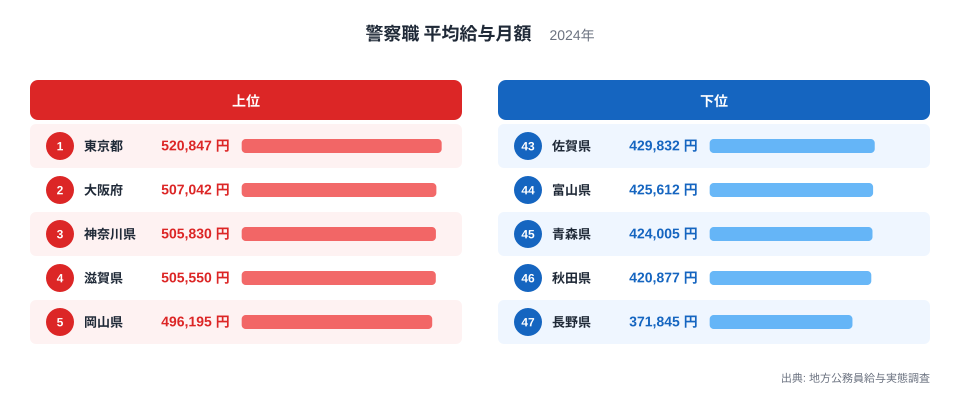
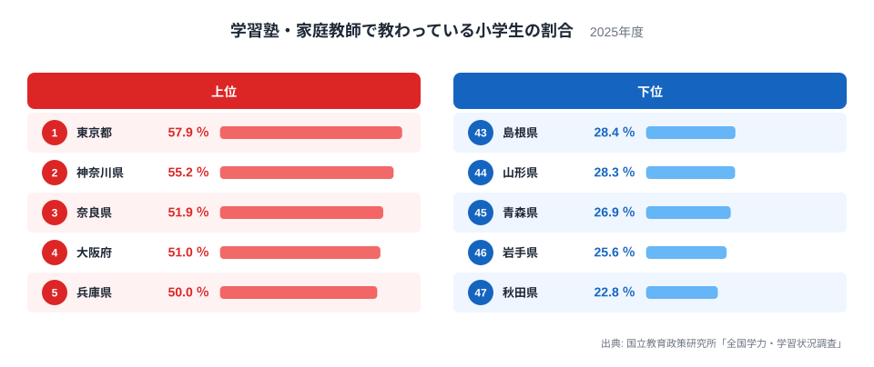
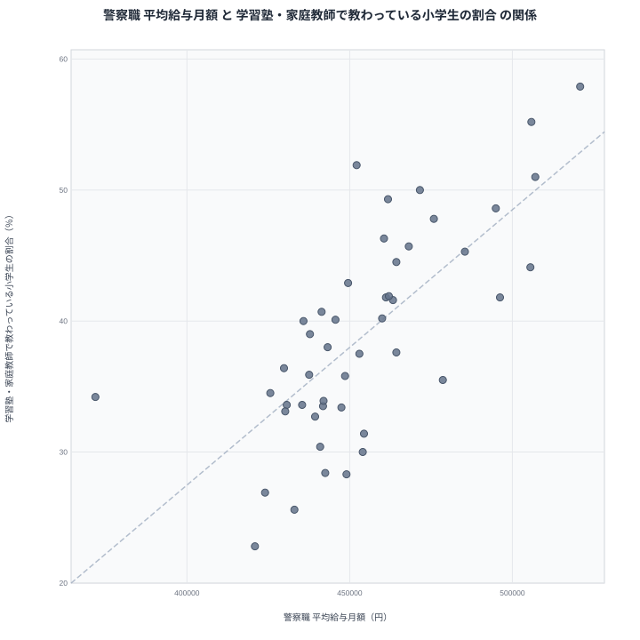

警察職の給与が高い県では、小学生も学習塾や家庭教師で多く学んでいる。並べてみると、そう言いたくなる並びが浮かびます。警察官の給与と子どもの塾通いは、本来であれば直接の関係を持たないはずの指標です。それでも順位表を見比べると、上位に同じ県名が何度も出てきます。

この記事では、警察職の平均給与月額と、学習塾・家庭教師で教わっている小学生の割合を都道府県別に比べます。関係が見えるのか、見えるとすれば何が背後にあるのかを、実データにそって整理します。結論を先に言うと、相関は確かに見えますが、警察職の給与が塾通いを生んでいるわけではありません。

## 警察職の平均給与月額は東京都が最も高い

まず警察職の平均給与月額です。地方公務員給与実態調査の2024年の結果では、最も高いのは東京都の520,847円で、1位です。2位は大阪府の507,042円、3位は神奈川県の505,830円と続きます。4位の滋賀県は505,550円、5位の岡山県は496,195円です。

一方、下位側には長野県の371,845円が47位で入ります。46位の秋田県は420,877円、45位の青森県は424,005円、44位の富山県は425,612円、43位の佐賀県は429,832円です。

<source-link href="/ranking/avg-salary-police-prefecture">警察職平均給与月額ランキングをもっと見る</source-link>

上位は東京都、大阪府、神奈川県という大都市圏の都府県が占めています。そこに滋賀県と岡山県が割って入っています。滋賀県が4位に入る点は、都市の規模だけでは説明しにくく、職員の年齢構成や手当の構成も影響していると考えられます。

下位に目を向けると、長野県の371,845円が目立ちます。46位の秋田県の420,877円とも差が大きく、下位の中でも突出して低い水準です。この理由は、このデータだけからは判断できません。調査上の集計の事情が絡んでいる可能性もあるため、順位だけで評価を下すのは避けたいところです。

> [!NOTE]
> ここでの平均給与月額は、地方公務員給与実態調査にもとづく警察職の平均値です。職員の年齢、勤続年数、役職の構成によって平均は大きく動きます。若い職員が多い県は低く、ベテランが多い県は高く出やすい性質があります。同じ仕事でも、県の給与水準そのものの差とは限りません。

## 学習塾・家庭教師で教わる小学生は東京都が57.9％

次に、学習塾・家庭教師で教わっている小学生の割合です。国立教育政策研究所の全国学力・学習状況調査の2025年の結果で、最も高いのは東京都の57.9％です。2位は神奈川県の55.2％、3位は奈良県の51.9％、4位は大阪府の51％、5位は兵庫県の50％です。

下位では、秋田県が22.8％で47位です。46位は岩手県の25.6％、45位は青森県の26.9％、44位は山形県の28.3％、43位は島根県の28.4％となっています。

上位は首都圏と近畿圏が中心です。東京都、神奈川県、大阪府、兵庫県に加え、奈良県が3位に入っている点が特徴的です。奈良県は大阪府への通勤圏に当たり、中学受験を意識する家庭が多いことが背景にあると見られます。ただし、この数字だけから家庭の事情までは読み取れません。

下位は東北地方の県が目立ちます。秋田県、岩手県、青森県、山形県がそろって下位に入りました。通える範囲に塾が少ないことや、学校の授業と家庭学習で足りていると感じる家庭が多いことなど、複数の事情が考えられます。詳しい順位は[学習塾・家庭教師で教わっている小学生の割合ランキング](/ranking/national-assessment-elementary-tutoring-rate)で確認できます。

> [!WARNING]
> この割合は児童へのアンケートにもとづく回答です。学習塾と家庭教師はひとまとめにされており、通信教材や習い事としての教室は含まれません。通う頻度や費用、学習内容の違いも見えません。そのため、割合の高低をそのまま教育熱心さの差とは読めません。

## 散布図で見ると右上がりの傾向がある

二つの指標を一枚の図に重ねてみます。横に警察職の給与、縦に塾などで学ぶ小学生の割合をとった散布図です。

全体としては、給与が高い県ほど塾などの割合も高い、という右上がりの傾向が見えます。東京都は給与が1位で塾通いの割合も1位です。大阪府は給与が2位、塾通いが4位です。神奈川県は給与が3位、塾通いが2位で、どちらも上位にそろいます。

逆の端も同じ向きです。秋田県は給与が46位、塾通いが47位です。青森県は給与が45位、塾通いが45位で、ほぼ同じ位置にいます。両端の県だけを見れば、関係は非常にきれいに見えます。

ただし、散布図の中央付近は散らばりが大きくなります。端の目立つ県に引きずられて、全体に強い関係があるように見えているだけかもしれません。次の節で、そこから外れる県を確かめます。

> [!TIP]
> 散布図を読むときは、まず外れ値と、両端の県を除いた中央の分布を分けて見ます。端の県だけで相関が決まっていないかを確かめると、見かけの関係に振り回されにくくなります。

## 順位が食い違う県から分かること

関係が見かけにすぎない証拠は、順位が大きく食い違う県にあります。

滋賀県は警察職の給与が4位で、505,550円と非常に高い水準です。ところが塾などで学ぶ小学生の割合は44.1％で13位にとどまります。岡山県も給与は5位の496,195円ですが、塾などの割合は41.8％で17位です。宮城県は給与が8位の478,622円と高めなのに、塾などの割合は35.5％で30位です。福岡県は給与が12位で、塾などの割合は37.6％の25位です。

反対に、給与は中位でも塾通いが上位の県もあります。奈良県の給与は452,130円で23位ですが、塾などの割合は51.9％の3位です。和歌山県は給与が461,781円で16位、塾などの割合は49.3％で6位に入ります。兵庫県は給与が10位、塾などの割合が5位です。

長野県も興味深い例です。給与は371,845円と最下位ですが、塾などの割合は34.2％で32位です。給与が最下位でも、塾通いは最下位ではありません。給与が低いから塾に通えないという単純な図式は成り立ちません。

給与が高くても塾通いが多いとは限らず、給与が低くても塾通いが少ないとは限りません。警察職の給与が塾通いの量を決めているなら、こうした食い違いは起きにくいはずです。

## 見かけの相関と真因を分ける

では、なぜ全体として相関が出るのでしょうか。有力なのは、第三の要因が両方を同時に押し上げているという説明です。

一つは都市化の度合いです。大都市圏では、地域ごとの物価や生活費の違いを反映した手当が給与に上乗せされやすく、公務員の給与水準が高くなる傾向があります。同じ大都市圏には、学習塾が集まり、中学受験を選ぶ家庭も多くなります。この二つは、同じ「大都市であること」から別々に生まれた結果と考えられます。

もう一つは、住まいと通学の環境です。塾が近くにあり、移動の負担が小さい地域ほど、通う子どもは増えやすくなります。東京都や大阪府、神奈川県がその典型です。東北の県では、塾の数や通いやすさが違うことが、割合の低さにつながっている可能性があります。

つまり、警察職の給与は都市の規模や地域の水準を映す鏡にすぎません。給与を上げれば塾通いが増える、あるいは塾通いが増えれば警察官の給与が上がる、という因果の矢印は、このデータからは引けません。相関は因果ではない、という原則がそのまま当てはまる例です。

さらに、二つの指標は年も出典も異なります。警察職の給与は2024年、塾などの割合は2025年の調査です。調査対象も警察職員と小学生で、互いに重ならない集団を測っています。同じ県の中で直接つながった数字ではない点にも注意が必要です。

> [!NOTE]
> 都道府県ごとの平均どうしの関係を、個々の人に当てはめてはいけません。警察職の給与が高い県の小学生が塾に通う、という意味ではありません。県単位の相関が、個人の関係を表すとは限らないのです。

## データについて

警察職の平均給与月額は、地方公務員給与実態調査の2024年の結果です。単位は円で、都道府県ごとの警察職の平均を示しています。

学習塾・家庭教師で教わっている小学生の割合は、国立教育政策研究所の全国学力・学習状況調査の2025年の結果です。単位は％で、小学生のうち、学習塾や家庭教師で教わっていると答えた児童の割合を指します。

東京都と大阪府の個別のデータは、[東京都のデータ](/areas/13000)や[大阪府のデータ](/areas/27000)で確認できます。ほかの行政・財政の統計は、[同じカテゴリの統計一覧](/category/administrativefinancial)からたどれます。

## まとめ

警察職の給与が高い県は、確かに塾に通う小学生の割合も高い傾向にあります。東京都は両方で1位、秋田県は給与が46位、塾などの割合が47位と、両端の県ではきれいにそろいます。

しかし、滋賀県や岡山県、宮城県のように、給与は高くても塾通いは中位以下の県があります。奈良県や和歌山県のように、給与は中位でも塾通いは上位の県もあります。相関の正体は、大都市圏であることという共通の背景にあると考えるのが自然です。二つの数字が並んで動くことと、一方がもう一方の原因であることは、別の話です。
