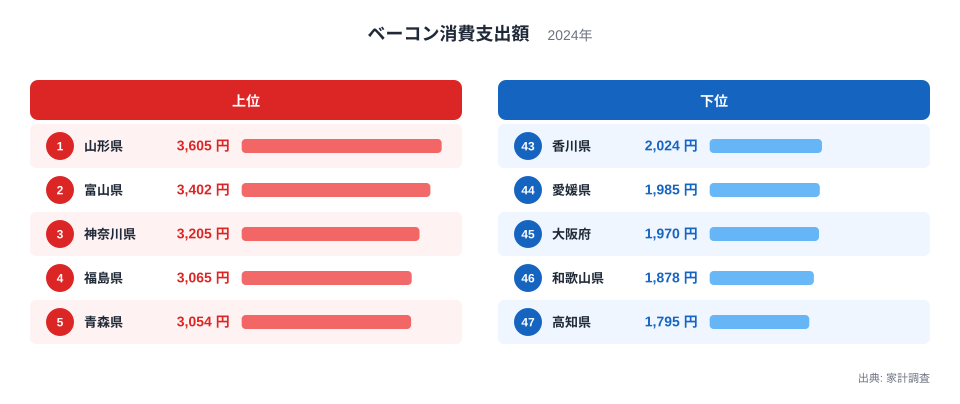
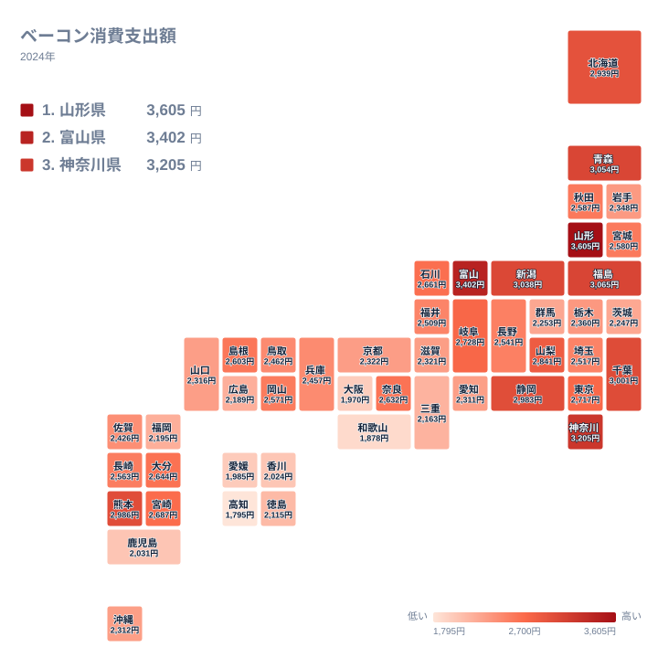

## ベーコンに最も多くお金を使う県はどこか

朝食のトーストに添える一枚、パスタの具、野菜炒めの旨味づけなど、ベーコンは日常の食卓にすっかり定着した食材です。ところが、その支出額を都道府県ごとに並べると、思いのほか大きな差が見えてきます。

2024年の家計調査で、ベーコンへの支出が最も多かったのは山形県で、3,605円でした。2位は富山県で3,402円、3位は神奈川県で3,205円です。一方、最も少なかったのは高知県の1,795円で、山形県との差は1,810円にのぼります。首位の額は最下位の額のほぼ2倍に当たります。

この記事では、上位と下位の開きを確認し、地理的な広がりを眺めたうえで、食文化・気候・産地・歴史といった視点から、差の背景を仮説として考えます。同じカテゴリの数字を広く見たい方は、[同じカテゴリの統計一覧](/category/economy)も参考にしてください。

> [!NOTE]
> ここでの「ベーコンへの支出」は、家計調査における「ベーコン消費支出額」を指します。1世帯が1年間にベーコンの購入へ使った金額で、単位は円です。購入した量ではなく、支払った金額を示す点に注意してください。厚切りか薄切りか、国産か輸入かで単価が違うため、支出の多さがそのまま消費量の多さを意味するとは限りません。

## 上位5県と下位5県の開き

まず、上位5県と下位5県を図で確認します。

<source-link href="/ranking/bacon-consumption-expenditure">ベーコンへの支出ランキングをもっと見る</source-link>

上位5県は山形県、富山県、神奈川県、福島県、青森県の順です。東北の県が3つ入り、そこに北陸の富山県と首都圏の神奈川県が加わります。下位5県は高知県、和歌山県、大阪府、愛媛県、香川県で、近畿の2府県と四国の3県が占めています。

上位5県の金額を合計すると16,331円で、1県あたりでは3,266.2円になります。下位5県の合計は9,752円で、1県あたりでは1,950.4円です。上位5県の平均は、下位5県の平均の1.67倍ほどに相当します。首位と最下位の比較だけでなく、上位グループ全体と下位グループ全体で見ても、はっきりした開きがあります。

この開きは、1年間で見れば1世帯あたり1,300円ほどの差です。大きな金額ではないものの、同じ食材で地域ごとに明確な傾向の違いが出ている点は興味深いところです。山形県の詳しいデータは[山形県のデータ](/areas/06000)、富山県については[富山県のデータ](/areas/16000)で確認できます。

> [!TIP]
> 中位の県どうしは数十円の差で密集しています。たとえば12位の岐阜県は2,728円、13位の東京都は2,717円、14位の宮崎県は2,687円で、3県の差は41円しかありません。この付近では順位が一つ違っても実質的な差はごくわずかなので、順位の上下より、上位グループと下位グループの距離に注目して読むと誤読を避けられます。

## 地理分布に見る東日本の広がり

次に、地理的な広がりをタイルマップで見てみましょう。

地図で眺めると、東北から北陸、関東の一部にかけて濃い色の県が連なっています。山形県、福島県、青森県、新潟県、富山県、神奈川県、千葉県はいずれも3,000円を超えています。新潟県は6位の3,038円、千葉県は7位の3,001円です。東日本の広い範囲で、ベーコンへの支出が厚いことがわかります。

西側では、熊本県が8位で2,986円と上位に入っています。中部・東海の静岡県も9位で2,983円と、東日本と並ぶ水準です。一方で、近畿や四国では下位が続き、徳島県は41位の2,115円、香川県は43位の2,024円です。

ただし、きれいな東西の線で割り切れるわけではありません。九州では熊本県の2,986円に対し、鹿児島県は42位の2,031円と、同じ地方の中でも大きな開きがあります。また、関東でも東京都は13位で2,717円、大都市圏の愛知県は35位で2,311円、福岡県は38位で2,195円と、大都市圏が必ずしも上位にならないことも注目点です。

> [!WARNING]
> 家計調査は、都道府県庁所在地と政令指定都市を中心とした標本調査です。そのため、県全体の平均というより、調査対象となった都市部の世帯の傾向を映している面があります。標本数が限られるので、年ごとに順位が入れ替わりやすく、1年分の結果だけで県民性を断定するのは避けるべきです。

## 食文化・気候・産地から考える差の背景

では、なぜ山形県や富山県のような県で支出が多くなるのでしょうか。実データが示すのは支出額だけなので、理由そのものは断定できません。ここでは、あくまで考え方の手がかりとして整理します。

一つ目は、食文化との結びつきです。東北や北陸は、保存のきく食材が重宝されてきた土地柄だと言われます。ベーコンは塩気と燻製の香りがあり、汁物や炒め物に少量を加えるだけで味が決まるため、日々の料理に取り入れやすい食材です。ただし、これは一般的なイメージであり、今回のデータで確かめたものではありません。

二つ目は、産地や歴史との関わりです。洋食文化が早くから入った港町では、肉の加工品が身近になる素地があります。神奈川県が3位の3,205円に入っているのは、その影響を思わせますが、推測の域を出ません。

一方、下位に並ぶ近畿や四国では、粉物の文化、魚介を中心にした食卓、だしを重んじる味付けが根づいていると言われます。こうした食習慣が、ベーコンへの支出の控えめさと関係している可能性もあります。

気候についても、寒冷な地域で保存性のある食品が選ばれやすいという見方があります。実際、北海道は10位で2,939円と上位に近い水準です。しかし、気候だけで近畿や四国の低さまでは説明できず、他の要因との切り分けには追加の分析が必要です。いずれも仮説にとどまります。

## 意外な顔ぶれが示すもの

上位の顔ぶれには意外性もあります。首位の山形県は、そばやいも煮のイメージが強い県ですが、ベーコンへの支出では全国一でした。2位の富山県も、海の幸の印象が先に立つ県です。食のイメージと実際の購入行動が、必ずしも一致しないことがわかります。

また、上位と中位の距離も見逃せません。10位の北海道は2,939円、11位の山梨県は2,841円で、差は98円です。上位10県の水準は3,000円前後に集まり、そこから緩やかに下がっていく形です。極端に突出した県があるというより、全体がなだらかに連なる中で、両端に差が出ている構図といえます。

## データについて

この記事の数値は、家計調査の2024年のベーコン消費支出額(単位は円)を使っています。全47都道府県の値が公表されており、本文の金額と順位はすべてその値に基づいています。上位5県と下位5県の平均は、図に示された各県の値から算出したものです。

家計調査の結果は標本調査であり、年ごとのぶれがあります。他の年や他の品目と比較する際は、同じ集計条件かどうかを確かめてください。

## まとめ

2024年のベーコンへの支出は、1位の山形県が3,605円、2位の富山県が3,402円、3位の神奈川県が3,205円でした。最下位の高知県は1,795円で、首位との差は1,810円です。

東北・北陸と関東の一部に厚く、近畿・四国に薄いという大まかな傾向はありますが、熊本県のように西日本で上位に入る県や、東京都や愛知県のように大都市でも中位以下の県があり、単純な東西では説明しきれません。食文化、気候、産地、歴史といった複数の要素が重なっている可能性はありますが、本記事のデータだけでは確かめられません。

数字の差は小さくありませんが、1年分の標本調査であることを踏まえ、断定ではなく傾向として受け止めるのが適切です。ほかの品目や分野との比較は、[同じカテゴリの統計一覧](/category/economy)から広げられます。
