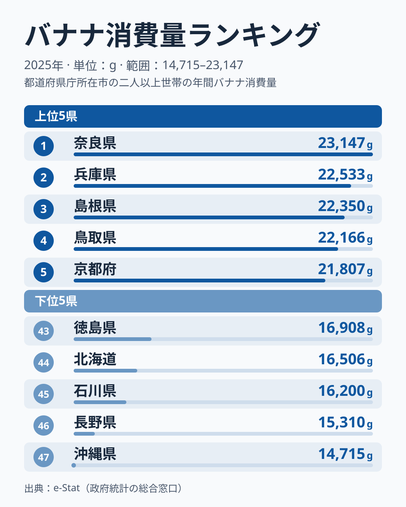

「バナナの産地に近いほどよく食べる」──そう思いがちですが、データはまったく逆の現実を示しています。2025年の都道府県別バナナ消費量ランキングでは、1位が奈良県の23,147g、最下位が沖縄県の14,715gで、約1.6倍の差があります。

注目すべきは上位の顔ぶれです。上位5位は奈良・兵庫・島根・鳥取・京都で、近畿と山陰が並びます。一方、バナナの輸入元であるアジアに地理的にもっとも近い沖縄は47位の最下位です。北海道も下位グループにとどまっています。

「なぜ近畿や山陰がバナナをよく食べるのか」「輸入元に近い沖縄で少ない理由は何か」──この記事では2025年の家計調査データをもとに、バナナ消費量の地域差の構造を解説します。

## 上位・下位の傾向：近畿と山陰が上位に並ぶ

2025年のバナナ消費量ランキングで1位になったのは奈良県で、23,147gでした。2位の兵庫県は22,533gで差は614gにとどまり、3位の島根県は22,350g、4位の鳥取県は22,166g、5位の京都府は21,807gと続き、上位5県の幅は1,340gに収まっています。1位が突出しているというより、5県が横並びで抜けている構図です。

この並びは「近畿が席巻している」とも言い切れません。近畿6府県の順位を見ると、奈良1位・兵庫2位・京都5位に対し、和歌山は15位、滋賀は22位、大阪は25位で、全国の中央に近い位置にいます。上位を占めるのは近畿の一部と、日本海側の山陰2県という組み合わせです。

奈良県には港がなく、輸入バナナが着く港町の近さでは1位を説明できません。果物をよく買う世帯が多い、スーパーや青果店で通年手に入りやすい、といった要因が考えられますが、いずれも本データだけでは確かめられません。[仮説]家計調査の標本は小さいため、買い方や世帯構成の偏りが順位に出ている可能性があります。

> [!NOTE]
> 本データは総務省「家計調査」をもとにしています。調査対象は**都道府県庁所在市の二人以上世帯**（年間購入量）です。農村部や単身世帯は含まれません。奈良県は「奈良市」、兵庫県は「神戸市」の世帯が県を代表する形で集計されるため、県全体の実態とは異なる場合があります。

上位10位には6位の山口が20,753g、7位の富山が20,691g、8位の岐阜が20,606g、9位の神奈川が20,076g、10位の愛媛が19,734gと続き、地域のまとまりは見えにくくなります。順位の差は数百g単位で、家計調査の標本の大きさを考えると、この範囲の順位差を意味のある差と読むのは控えるべきです。

<source-link href="/ranking/banana-consumption-quantity">バナナ消費量の全都道府県ランキングを見る</source-link>

## 最下位グループ：沖縄・長野・石川・北海道・徳島

最下位の沖縄県は14,715gで、1位の奈良県の約64%の消費量です。下位グループは、47位の沖縄に続いて、46位の長野が15,310g、45位の石川が16,200g、44位の北海道が16,506g、43位の徳島が16,908gの順に並びます。

長野県は内陸で、果物の地場産が豊富な県です。りんご、ぶどう、桃など季節ごとの国産果物が食卓にのぼりやすく、通年で買うバナナの出番が相対的に小さくなっている可能性があります。[仮説]ただし、これは庁所在市の家計調査データから立てた推測で、検証には果物全体の購入内訳を並べて見る必要があります。

石川県（金沢市）についても同様です。北陸では富山が7位で20,691gと高い一方、石川は45位で16,200gと大きく離れています。隣り合う県で約4,500gの差があり、同じ北陸でも食の選び方が一様ではないことがわかります。海鮮や加賀野菜など地場の食材への支出が優先される、という説明も考えられますが、[仮説]として扱うのが妥当です。

> [!WARNING]
> バナナ消費量の順位を「果物の豊かさ」とイコールに解釈するのは注意が必要です。この指標はあくまで**バナナ単品**の年間購入量です。みかん・りんご・ぶどうなど他の果物の購入を合算した「果物全体の消費量」は別の指標になります。また、家計調査は年ごとに標本が入れ替わるため、年次比較では数値が大きく動くことがあります。

## 輸入元に近い沖縄が最下位になる逆説

もっとも興味深い発見が沖縄県の位置づけです。バナナは主にフィリピンなど東南アジアから輸入されており、沖縄はその輸入元に地理的に近く、気候的にもバナナの栽培に適した地域です。

にもかかわらず、沖縄は14,715gで全国最下位でした。2025年の全国の中央に当たる24位の三重県は18,586gで、沖縄はそこから約3,900g少ない水準です。理由として、庭先や近隣での自給的な入手のように家計調査の購入量に現れない消費や、果物の中でもパイナップル・マンゴーなど南国産の別の果物が選ばれていることが考えられます。[仮説]ただし、この仮説は家計調査データだけでは証明できません。

北海道は44位で16,506gと、こちらも下位グループに入りました。北海道は食費全般の単価が高い一方で、地場産のメロンやじゃがいもなど国産の農産物が食卓の中心を占めるため、通年で輸入果物を買う量が少なくなる、という説明が考えられます。この点も[仮説]であり、検証にはほかの果物の購入量との比較が必要です。

じゃがいもの消費量についての詳しいデータは[ポテト消費量ランキング](/ranking/potato-consumption-quantity)でも確認できます。

> [!TIP]
> バナナ単品の消費量だけでなく、[アイスクリーム消費支出ランキング](/ranking/icecream-consumption-expenditure)と組み合わせて見ると、「甘いものを日常的に食べる文化圏」の輪郭が見えてきます。デザート・果物の両方をよく消費する都道府県と、どちらも少ない都道府県を比較することで、食費の「甘味配分」という切り口で地域特性を深掘りできます。

## 発見：順位は年ごとに大きく入れ替わる

2025年データから読み取れるもっとも大きな発見は、**この順位が年ごとに大きく入れ替わる**という点です。同じ指標の2024年の値と比べると、前年に首位だった兵庫は2位に下がり、上位5県に入っていなかった奈良が首位に上がりました。前年は中位だった沖縄が最下位に沈み、前年に最下位だった宮城は41位へ上がっています。

沖縄は1年で中位から最下位へ落ち、宮城は最下位から抜け出しました。県民のバナナの好みが1年でここまで変わったとは考えにくく、庁所在市の標本の小ささから来る単年のぶれが大きいと見るほうが自然です。したがって、1年の順位から「近畿はバナナ文化が強い」「沖縄は食べない」と構造を断定することはできません。

一方で、24位の三重県の18,586gを中心に、10位から35位ごろまでは18,000g前後に多くの県が密集しています。1位から5位と46位・47位だけが目立つ形で、「多い県」と「少ない県」の境界は連続的です。この密集の中で順位が数位動くのは、数十gから数百gの差にすぎません。

地域ごとの詳しい消費データや生活統計は、[奈良県の統計ページ](/areas/29000)と[沖縄県の統計ページ](/areas/47000)で確認できます。

また、食費・消費支出に関連する指標は[経済カテゴリのランキング一覧](/category/economy)でまとめて確認できます。

## まとめ

- 2025年バナナ消費量ランキングの1位は**奈良県の23,147g**、最下位は**沖縄県の14,715g**で約1.6倍の差があります
- 上位5位は奈良・兵庫・島根・鳥取・京都で、近畿全体ではなく近畿の一部と山陰が並びます（和歌山15位・滋賀22位・大阪25位）
- 「輸入元に近いほど多い」という直感に反し、沖縄は最下位、北海道も44位で下位グループです
- 下位は沖縄・長野・石川・北海道・徳島で、地場の果物や食文化が影響している可能性がありますが、いずれも[仮説]です
- 前年から奈良は上位5県の圏外から首位へ、沖縄は中位から最下位へ動いており、単年の順位から構造を断定するのは避けるべきです
