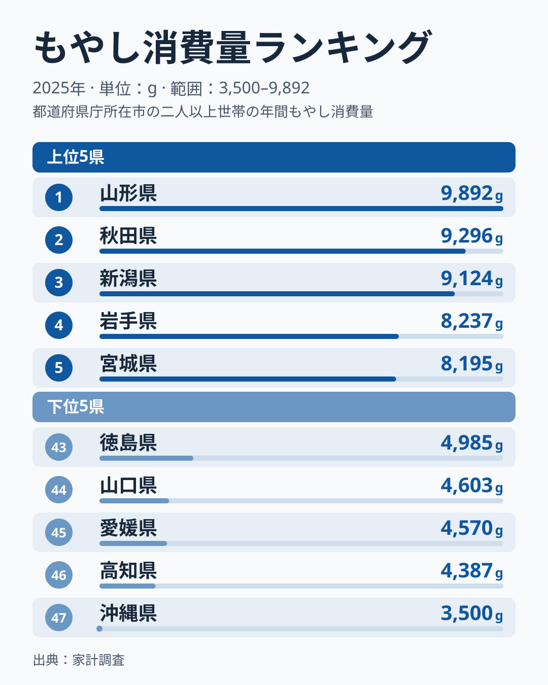
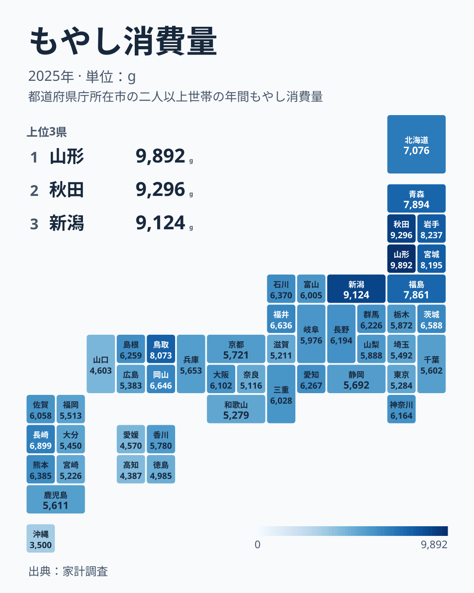

もやしは家計調査で毎年集計される品目で、都道府県別に消費量を見るとそのばらつきは決して小さくありません。2025年の家計調査によると、もやし消費量の1位は山形県で9,892グラム、最下位は沖縄県で3,500グラムでした。単純に比較すると、山形県は沖縄県のおよそ2.8倍です。ただしこれは山形市と那覇市など、県庁所在市の二人以上世帯が1年間に買った量の比で、単年の値です。この記事では、上位と下位の分布を地図で確認しながら、データで言えることと言えないことを分けて整理します。

> [!NOTE]
> ここでのもやし消費量は、山形市や那覇市など都道府県庁所在市に住む二人以上の世帯の、1世帯当たり年間購入数量をグラムで表したものです。県全体の値でも、県民1人当たりの消費量でもありません。重量ベースで、支出金額や価格ではありません。

## もやし消費量の上位5県と下位5県

まずは全体の順位から見ていきます。

<source-link href="/ranking/bean-sprouts-consumption-quantity">もやし消費量ランキングをもっと見る</source-link>

上位は山形県、秋田県、新潟県、岩手県、宮城県の順で、すべて東北地方または新潟県です。山形県のくわしい統計データは[山形県のデータ](/areas/06000)から、秋田県のくわしい統計データは[秋田県のデータ](/areas/05000)から確認できます。山形県は9,892グラム、秋田県は9,296グラム、新潟県は9,124グラムと上位3県は9,000グラム台に並び、4位の岩手県は8,237グラム、5位の宮城県は8,195グラムです。1位から5位までの幅は1,697グラムあり、上位の中でも山形県が頭ひとつ抜けていることが分かります。

下位は徳島県が43位、山口県が44位、愛媛県が45位、高知県が46位、沖縄県が47位です。徳島県、愛媛県、高知県は四国、山口県は中国地方、沖縄県は九州・沖縄にあたります。43位の徳島県は4,985グラム、44位の山口県は4,603グラム、45位の愛媛県は4,570グラム、46位の高知県は4,387グラムで、43位から46位までの4県は約600グラムの幅に収まっています。それに対して最下位の沖縄県は3,500グラムで、46位の高知県を887グラム下回っています。下位では沖縄県だけが一段低い水準にあります。

[仮説] 東北地方や新潟県で消費量が多い背景には、冬の寒さが長く続く地域ほど、通年安定して手に入るもやしが鍋料理や炒め物の具材として日常的に使われてきたことが考えられます。ただし、東北地方から離れた中国地方の鳥取県は8,073グラムで6位、九州の長崎県は6,899グラムで10位と上位に入っており、寒冷な地域という説明だけでは収まりません。この仮説は価格や調理法のデータと照らして検証したものではありません。

## 地理でみるもやし消費量の分布

上位と下位の傾向を地図で確認します。

地図が足す情報は2点あります。ひとつは、東北6県がすべて8位以内に入っていることです。青森県は7位の7,894グラム、福島県は8位の7,861グラムで、山形県から福島県までが東北に集まっています。もうひとつは、東北から新潟県にかけての濃い一帯の外で、中国地方の鳥取県だけが離れて濃く出ていることです。

反対に色が薄いのは、沖縄県、四国の徳島県・愛媛県・高知県、中国地方の山口県です。ただし四国でも香川県は5,780グラムで28位と中位にあり、四国4県が一様に低いわけではありません。大阪府は6,102グラムで21位と全国の中位に位置し、東京都は5,284グラムで38位と下位寄りですが、最下位の沖縄県とは1,784グラムの開きがあります。大都市圏だからといって極端に少ないわけではありません。

東北から新潟県にかけての上位と、四国・山口県・沖縄県の下位とで、色の濃淡が分かれていることは読み取れます。ただし、地図が示すのは地理的な近さだけです。この傾向が生まれる理由は、気候や価格、流通などさまざまな要因が考えられ、図からは特定できません。

> [!WARNING]
> 2.8倍という比は2025年の1年分、しかも県庁所在市の標本から出た値です。標本の入れ替わりや単年のぶれの影響を受けるため、順位が1つ2つ違うだけの県どうしの差は、意味のある差として読まないでください。

## 2.8倍の差は、どこが作っているのか

地域差の理由を断定する材料はこのデータにありませんが、全体の分布の形は読めます。47県の中央値は24位の富山県の6,005グラムです。1位の山形県はこの中央値の約1.65倍、最下位の沖縄県は約0.58倍にあたります。つまり、山形県が突出して多く、沖縄県が突出して少ないという両端の離れ方が、2.8倍という数字をつくっています。

分布の中身を見ると、11位の岡山県の6,646グラムから41位の滋賀県の5,211グラムまでの31県は、約1,400グラムの幅に集まっています。1位から10位までの10県と、42位から47位までの6県を除いた全国の大半は、中位に密集しているということです。大阪府は21位、東京都は38位で、どちらもこの密集帯の中にあります。

地方ごとの偏りも読み取れます。近畿では、滋賀県が41位、奈良県が42位、和歌山県が39位と下位寄りに集まっています。東北は全県が上位に入り、四国は香川県を除く3県が下位に並びます。つまり、東北の高さと、四国・沖縄の低さが、全国の差を広げる2つの要素になっています。

[仮説] もやしは重量当たりの価格が安い食材で、鍋料理や炒め物といった調理文化との結びつきが地域差に影響しているのではないかと考えられます。価格や他の野菜の消費量と比べて確かめたわけではないため、推測にとどまります。実際の消費行動には、世帯構成や購入頻度、外食の割合など、多くの要因が関わっています。

## まとめ

- もやし消費量の1位は山形県で9,892グラム、最下位は沖縄県で3,500グラムで、山形県はそのおよそ2.8倍にあたります
- 47県の中央値は24位の富山県で6,005グラムです。山形県はその約1.65倍、沖縄県は約0.58倍で、差は両端の少数の県が作っています
- 11位から41位までの31県は約1,400グラムの幅に集まり、43位から46位の4県は約600グラムに収まる一方、47位の沖縄県は46位の高知県を887グラム下回ります
- 1位から8位は東北6県と新潟県、鳥取県で占められています
- 地域差の背景には気候や調理文化の違いが[仮説]として考えられますが、統計的な検証はこれからの課題です

もやしの地域差についてさらにくわしいデータは、[同じカテゴリの統計一覧](/category/economy)からまとめて確認できます。
