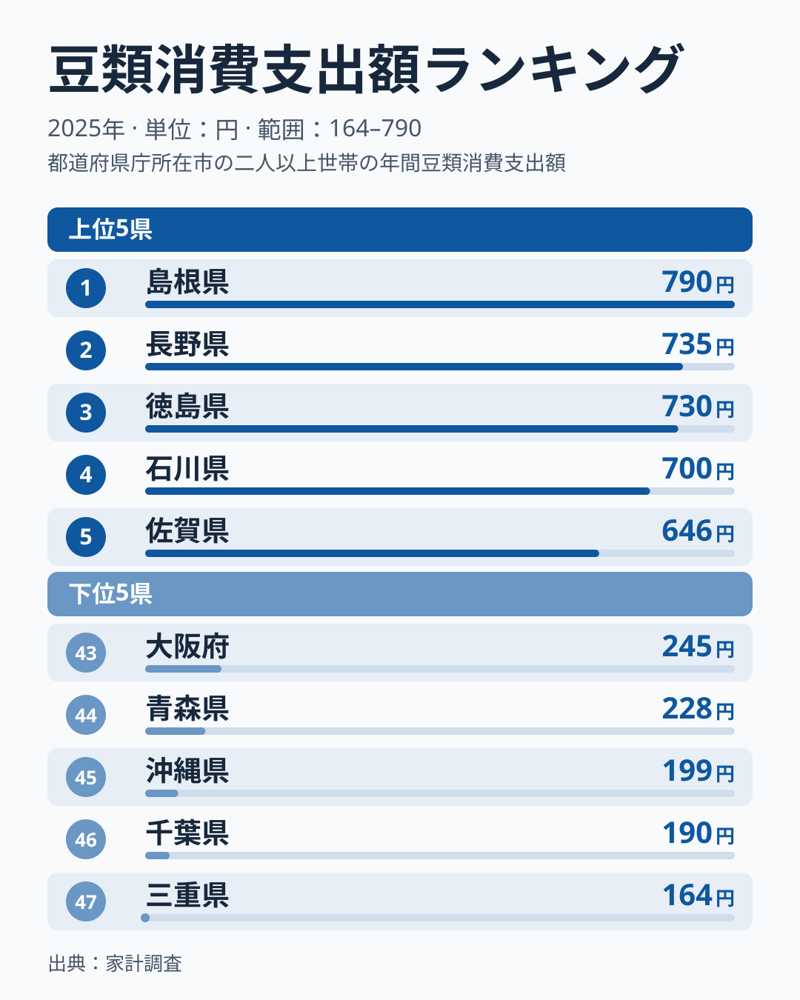
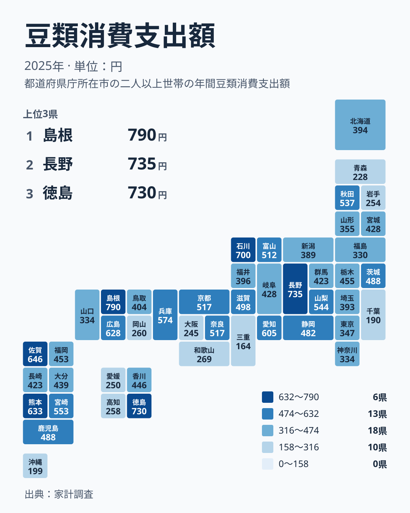

## 豆類への支出で1位になったのは島根県

豆類への支出が最も多いのはどこでしょうか。東京や大阪のような大都市を思い浮かべる方が多いかもしれません。2025年の家計調査で1位になったのは島根県で、790円でした。全国で唯一、700円台後半に届いています。

2位は長野県で735円、3位は徳島県で730円、4位は石川県で700円です。最下位の47位は三重県で164円でした。1位と最下位の間には790円と164円という開きがあり、毎日の食卓に上がる身近な食品でも、家庭の支出額は地域によって大きく違います。

<source-link href="/ranking/beans-consumption-expenditure">豆類への支出ランキングをもっと見る</source-link>

図が示すのは両端の顔ぶれです。この図に載っていない、上位と中位の境目や、中位の混み具合に注目してみます。まず上位の切れ目です。4位の石川県は700円ですが、5位の佐賀県は646円で、ここに一段の落差があります。ところが5位の先は急には下がりません。6位の熊本県は633円、7位の広島県は628円、8位の愛知県は605円と続きます。5位と中位の境目ははっきりした壁ではなく、緩やかな坂のように見えます。

中位には、金額が密集した帯があります。13位は京都府と奈良県で、ともに517円です。その先は15位の富山県が512円、16位の滋賀県が498円、17位は茨城県と鹿児島県で488円、19位の静岡県が482円と、細かく刻まれて進みます。20位の栃木県は455円、21位の福岡県は453円、22位の香川県は446円、23位の大分県は439円です。24位は宮城県と岐阜県で428円、26位は群馬県と長崎県で423円でした。

つまり、図の両端だけを見ると大きな差に映りますが、順位表の真ん中は数円から十数円刻みで県が並んでいます。この帯の中で順位が1つ違うことに、大きな意味を読み取るのは危険です。地域の個性がはっきり出ているのは、やはり上位の端と下位の端だと言えます。

> [!NOTE]
> この統計の「豆類」は、家計調査で世帯が1年間に豆類として購入した金額を、1世帯あたりで見たものです。数量ではなく支出額なので、値段の高い商品を選ぶ地域では、買う量が同じでも金額が大きく出ます。

## 上位に並ぶ県を地方ごとに見る

上位10県は、島根県、長野県、徳島県、石川県、佐賀県、熊本県、広島県、愛知県、兵庫県、宮崎県です。地方で整理すると、中部が長野県、石川県、愛知県、九州・沖縄が佐賀県、熊本県、宮崎県、中国が島根県、広島県、四国が徳島県、近畿が兵庫県です。関東と北海道・東北からは、上位10県に入った県がありません。

中部では、長野県が2位の735円、石川県が4位の700円です。詳しい値は[長野県のデータ](/areas/20000)で確認できます。中国では島根県が1位、広島県が7位の628円で、島根県の全体像は[島根県のデータ](/areas/32000)から見られます。ここで挙げた順位は事実ですが、その背景に食文化があるのかどうかは、この統計だけでは確かめられません。仮説として考えるにとどめます。

九州・沖縄は、佐賀県が646円で5位、熊本県が633円で6位、宮崎県が553円で10位です。ところが同じ地方でも、鹿児島県は488円で17位、福岡県は453円で21位、長崎県は423円で26位、大分県は439円で23位でした。さらに沖縄県は199円で45位です。同じ地方の中で、上位から下位まで大きく分かれています。

## 下位の県に共通する地方はあるのか

下位を見ると、47位が三重県で164円、46位が千葉県で190円、45位が沖縄県で199円です。44位は青森県で228円、43位は大阪府で245円でした。

この5県の所属は、近畿の三重県と大阪府、関東の千葉県、九州・沖縄の沖縄県、北海道・東北の青森県です。上位が特定の地方に偏っていないのと同じように、下位も1つの地方にまとまっていません。豆類への支出の多寡は、東日本と西日本といった単純な二分では説明できません。

もう少し下位を広げると、42位の愛媛県が250円、41位の岩手県が254円、40位の高知県が258円、39位の岡山県が260円、38位の和歌山県が269円と、250円台から260円台に県が重なっています。下位の端は、金額が近い県が連なる形です。

この結果について、外食の多さや買い物の仕方が影響している可能性を想像することはできます。ただし、この記事で使っているデータには、外食の頻度や豆腐、納豆といった品目別の内訳は含まれていません。理由を断定せず、まず「こういう並びになっている」という事実を受け止めておくのが安全です。

> [!WARNING]
> 豆類は1世帯あたりの年間支出が数百円の水準で、金額が小さい品目です。そのため、数十円の違いで順位が大きく入れ替わります。たとえば5位の佐賀県は646円、6位の熊本県は633円、7位の広島県は628円で、3県が近い金額で並んでいます。1つ順位が違うだけで「食習慣が違う」と読むのは避けてください。

## 産地と消費は必ずしも一致しない

豆類の産地と聞いて、北海道を思い浮かべる方は多いでしょう。その北海道の豆類への支出は394円で、順位は30位です。産地として知られる地域が、支出では中位より下に位置している例があります。

生産地であることと、家庭が豆類を購入することは別の話です。この事例の範囲で言えるのは、産地のイメージだけで消費額の順位は予想できないということです。産地と消費の関係を一般化するには、生産量など別のデータが必要になります。この記事ではそこまでは踏み込みません。

関東に目を向けると、茨城県が488円で17位、栃木県が455円で20位、群馬県が423円で26位、埼玉県が393円で31位、東京都が347円で34位、神奈川県が334円で35位、千葉県が190円で46位です。関東の中でも、順位には大きな幅があります。同じカテゴリの統計と合わせて見たい方は、[同じカテゴリの統計一覧](/category/economy)も参考にしてください。

> [!TIP]
> 同じ金額の県は同じ順位になり、次の順位は飛びます。京都府と奈良県はともに517円で13位なので、次の富山県は15位です。茨城県と鹿児島県は488円で17位、宮城県と岐阜県は428円で24位です。順位の数字だけでなく、金額も並べて読むと、実際の近さが分かります。

## 地理分布で見る豆類支出の地図

地図を見ると、支出の高い県が1か所に固まっていないことが分かります。島根県、長野県、徳島県、石川県、佐賀県と、上位の県は離れた場所に点在しています。濃い色の県のすぐ隣に、薄い色の県が来る場所も少なくありません。

近畿はその典型です。兵庫県は574円で9位、京都府と奈良県は517円で13位、滋賀県は498円で16位です。一方で、和歌山県は269円で38位、大阪府は245円で43位、三重県は164円で47位でした。近畿は、上位から最下位までが1つの地方の中に同居しています。

北海道・東北でも幅があります。秋田県は537円で12位ですが、宮城県は428円で24位、山形県は355円で33位、福島県は330円で37位、岩手県は254円で41位、青森県は228円で44位です。地方という大きなくくりより、県ごとの差を見るほうが実態に近づけます。

## 数字をどう読めばよいか

ここまで見てきた通り、豆類への支出は、特定の地方にまとまるわけではありません。上位にも下位にも、日本各地の県が顔を出します。北海道は産地として知られますが、支出では30位でした。この事例が示すように、イメージと統計の順位が一致するとは限りません。

読むときは、次の点に気をつけてください。

- 支出額は価格の影響を受けるため、消費量そのものではありません。
- 金額が小さい品目なので、中位の順位は小さな金額差で動きます。
- 同額の県は同順位として扱われます。

一方で、1位の島根県の790円と、47位の三重県の164円のように、端どうしを比べた差は大きなものです。中位の細かな順位より、こうした両端の違いに目を向けると、この指標の特徴が見えてきます。気になる県のデータを見比べて、自分の地域の位置を確かめてみてください。

## データについて

この記事の数値は、家計調査の「豆類消費支出額」(2025年、単位は円)です。1世帯あたりの年間支出額を、都道府県別に整理したものです。同額の県は同順位とし、その次の順位は飛ばして数えています。本文中の順位は、全47都道府県の中での順位を指します。
