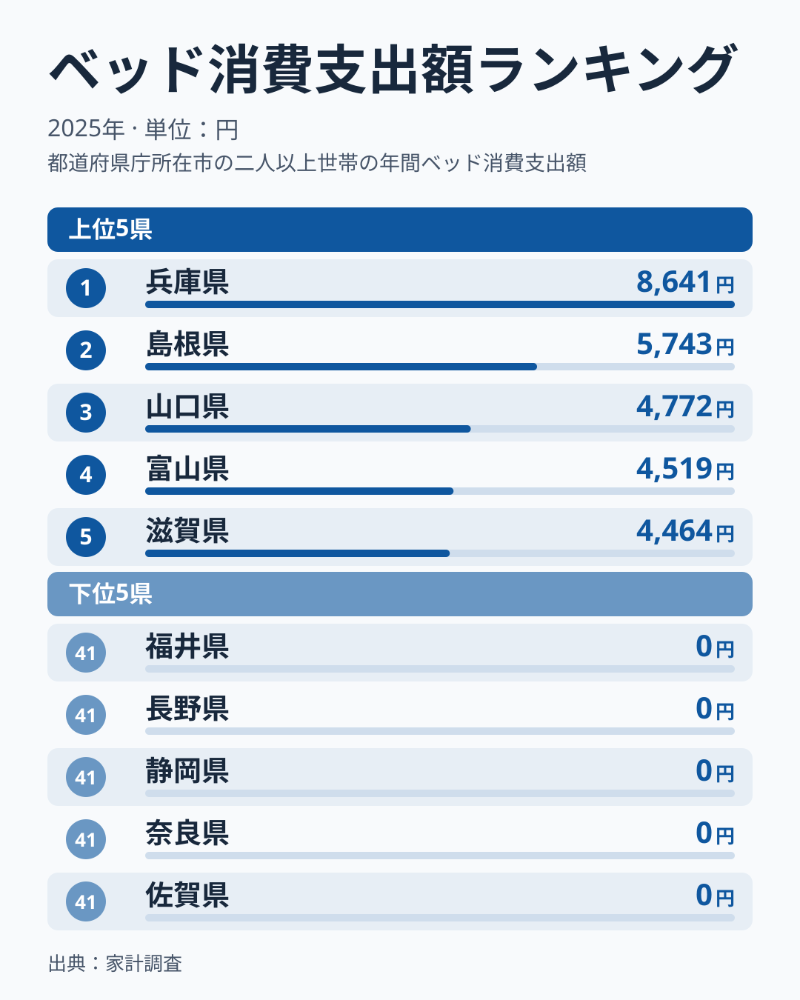
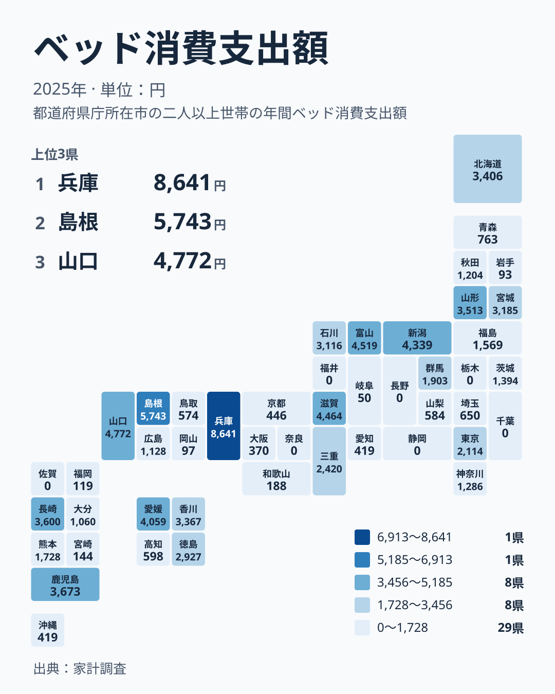

ベッドは毎年買い替えるものではありません。数年から十数年に一度の大きな買い物です。その支出を都道府県別に並べると、1位の兵庫県は8,641円、一方で栃木県、千葉県、福井県、長野県、静岡県、奈良県、佐賀県の7県は0円という大きな開きが現れます。

この差は「兵庫県の人が特別にベッドを好む」という話なのでしょうか。それとも統計の性質が生んだ見かけの差なのでしょうか。この記事では2025年の家計調査の数字をもとに、暮らしの感覚に引き寄せながら、差の読み方を考えます。

## ベッドへの支出の上位と下位

まず全体像を図で確認します。上位5県と下位5県を並べたものです。

<source-link href="/ranking/bed-consumption-expenditure">ベッドへの支出ランキングをもっと見る</source-link>

上位5県の中でも、1位の兵庫県だけが8,000円を超え、2位の島根県との間には大きな段差があります。一方、2位の島根県から5位の滋賀県までは4,464円から5,743円の間に収まっていて、兵庫県が抜けているというより、兵庫県を除く上位が一つの塊になっている形です。

上位と中位の差も目立ちます。10位の山形県は3,513円、11位の北海道は3,406円で、10位以内の下端と中位の入り口はほとんど連続しています。ところが20位の福島県は1,569円まで下がり、1位の兵庫県の8,641円とは大きく離れます。ランキングの前半に高い値が集中し、後半で一気に低くなる分布です。

下位側は、40位の岐阜県が50円、39位の岩手県が93円、38位の岡山県が97円と、100円に届かない県が続きます。そして41位には栃木県、千葉県、福井県、長野県、静岡県、奈良県、佐賀県の7県が0円で同順位として並びます。0円の県が7つあるため、最小値を使った倍率は計算できません。

> [!NOTE]
> ここでの数値は家計調査の「ベッド消費支出額」で、2025年の1年間における支出額です。単位は円で、世帯あたりの平均として集計されます。ベッドは買い替え周期が長い品目のため、調査対象の世帯が1年間に買わなければその県の値は0円になります。

## 地域で見ると何が見えるか

次に、地理的な分布を確認します。

分布を眺めると、上位に特定の地方だけが固まっているわけではありません。10位以内を地方で見ると、近畿は1位の兵庫県と5位の滋賀県、中国は2位の島根県と3位の山口県、中部は4位の富山県と6位の新潟県、四国は7位の愛媛県、九州・沖縄は8位の鹿児島県と9位の長崎県、北海道・東北は10位の山形県です。7つの地方のうち、10位以内に県が入っていないのは関東だけです。

その関東では、東京都が2,114円で17位、群馬県が1,903円で18位、茨城県が1,394円で21位、神奈川県が1,286円で22位、埼玉県が650円で27位です。栃木県と千葉県は0円で41位です。同じ地方の中でも大きくばらつきます。

地域差がきれいな地方パターンにならない点は、この指標が気候や文化といった地域性だけでは説明しにくいことを示唆します。他の経済指標との比較は[同じカテゴリの統計一覧](/category/economy)からたどれます。

> [!WARNING]
> 家計調査は限られた世帯を対象にした標本調査で、都道府県別の値は調査された世帯の購入状況に左右されます。ベッドのように購入頻度が低い品目では、1年間に1件も購入がなければ0円になります。0円は「県民が誰も買わない」という意味ではありません。

## 買う頻度の低さが効いている可能性

ここで内訳を別の切り口で分解してみます。年間の支出額は「買った世帯の割合」と「買った世帯の1回あたりの金額」の掛け算と考えられます。ベッドはこの2つのうち、前者が小さい品目だと考えるのが自然です。

兵庫県の8,641円についても、少数の世帯が高額のベッドを買い、それが平均を押し上げたという仮説が立てられます。逆に0円の7県は、調査された世帯で購入がなかったと読むと整合します。ただし、実データからは世帯ごとの購入有無までは読み取れません。あくまで有力な仮説であり、断定はできません。

中位の県も見ておきます。北海道は3,406円で11位、香川県は3,367円で12位、宮城県は3,185円で13位、石川県は3,116円で14位です。この付近は値が近接していて、順位が少し動くだけで入れ替わる水準です。順位の細かな差を、地域の特徴として読み込むのは慎重にしたいところです。

> [!TIP]
> ベッドは買い替え周期が長く、調査で捉えられる購入件数もごく限られます。1年だけの順位で地域を評価せず、毎年上位や下位に現れる県かどうかを見ると、その年の偶然と継続的な傾向を分けて考えられます。

## 暮らしの感覚に引き寄せて読む

私たちの生活に引き寄せると、この数字は「調査された世帯の中で、その年にベッドを買った人がいたか」を映していると考えられます。引っ越し、結婚、子どもの独立といった出来事が重なる世帯が含まれれば、数字は跳ね上がります。

中国地方で見ると、島根県は5,743円で2位、山口県は4,772円で3位でした。同じ地方でも広島県は1,128円で24位、鳥取県は574円で30位、岡山県は97円で38位と大きく開きます。これを気質の差とみなすより、購入の有無の差と読むほうが無理がありません。

地域の暮らしをもう少し知りたいときは、[兵庫県のデータ](/areas/28000)や[島根県のデータ](/areas/32000)で他の指標も合わせて確認してください。住まいや世帯の状況と並べると、ベッドへの支出が単独の数字ではなく、暮らし全体の一部として見えてきます。

下位では、福岡県が119円で37位、大阪府が370円で34位、愛知県と沖縄県がともに419円で32位です。同じ金額の県は同順位として並び、次の順位は34位に飛びます。順位の差が数十円という県も多く、その差に意味を読み取る必要はあまりありません。

## ベッド選びと家計にどう生かすか

では、この統計から読者が得られる実用的な示唆は何でしょうか。結論は、「自分の県の順位を気にしすぎなくてよい」ということです。ベッドを買うかどうかは、寝具の傷み具合、住まいの広さ、家族の変化といった個別の事情で決まります。

家計の面では、ベッドは単価が大きいぶん、購入の年に家計が一気に動く品目です。平均額で見ると数千円でも、実際に買う世帯にとってははるかに大きな出費になります。平均値は「皆が少しずつ使っている額」ではなく、「買った世帯と買わなかった世帯をならした額」だと理解しておくと、数字に振り回されません。

上位の兵庫県、島根県、山口県、富山県、滋賀県の結果を見て「この地域はベッド需要が旺盛だ」と判断するのも避けたいところです。確かめるには複数年の推移や、別の統計での家具・寝具の支出との比較が必要です。

## データについて

この記事で使った数値は、家計調査の「ベッド消費支出額」の2025年の値で、単位は円です。47都道府県すべての値を使っています。0円の県が7つあるため、これらは同順位の41位として扱い、同額の愛知県と沖縄県も同じ32位として扱っています。

本記事では実データに載っている値と順位だけを引用し、独自の平均や割合は計算していません。

## まとめ

ベッドへの支出は、兵庫県の8,641円から、栃木県、千葉県、福井県、長野県、静岡県、奈良県、佐賀県の0円まで大きく割れました。上位10県は関東を除く6つの地方にまたがり、きれいな地方パターンは見られません。

この差は、地域の嗜好よりも、買い替え周期の長い品目であることが影響している可能性があります。順位は話の入口にすぎません。数字の背景にある「その年に買った世帯がいたか」を意識して読むことで、統計を暮らしの判断に生かしやすくなります。
