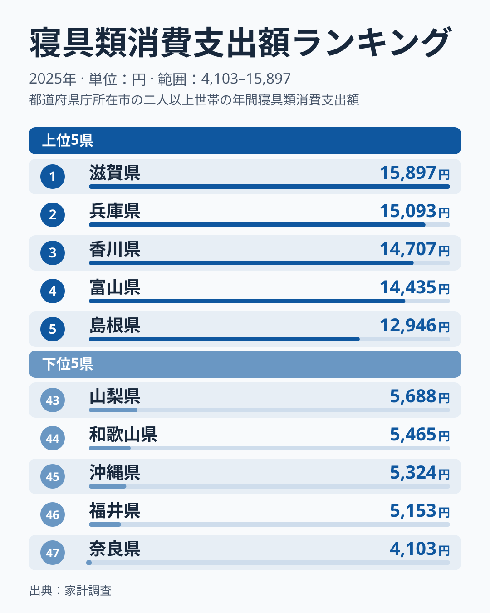
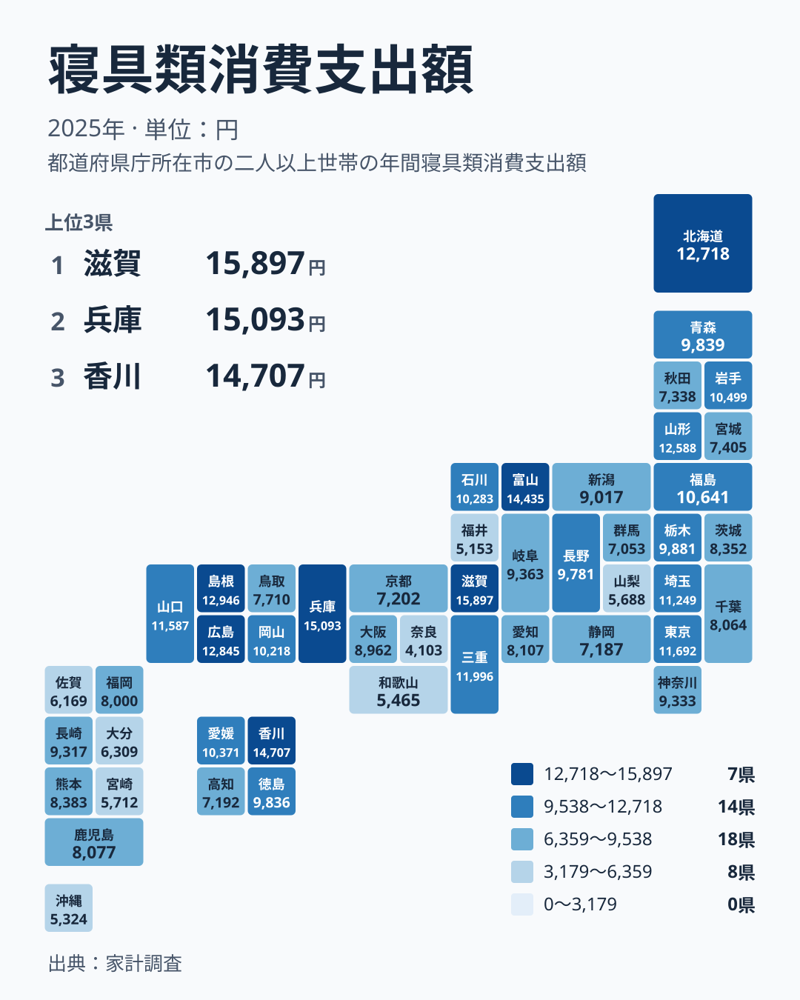

布団やマットレス、シーツ、枕。毎日使うのに、買い替えの頻度や予算には家庭ごとの差が出やすい品目です。2025年の家計調査をもとに、寝具への支出を都道府県で並べると、同じ地方の中でも大きな開きがあることが分かりました。この記事では、まず順位と分布の事実を確認し、そのうえで近畿の内部に現れた差に焦点を当てます。最後に、この数字を暮らしの判断に使うときの注意点を整理します。

## 寝具への支出が最も多いのは滋賀県

寝具への支出が最も多いのは滋賀県で、15,897円でした。2位は兵庫県で15,093円、3位は香川県で14,707円、4位は富山県で14,435円と続きます。5位の島根県は12,946円で、上位4県と5位の間に一段の差があることも読み取れます。

一方、最も少ないのは奈良県の4,103円です。46位の福井県は5,153円、45位の沖縄県は5,324円、44位の和歌山県は5,465円でした。1位の滋賀県と最下位の奈良県を比べると、約3.9倍の開きがあります。

<source-link href="/ranking/bedding-group-consumption-expenditure">寝具類への支出ランキングをもっと見る</source-link>

図の上位5県は、近畿の滋賀県と兵庫県、四国の香川県、中部の富山県、中国の島根県です。上位は一つの地方に固まらず、西日本を中心に複数の地方から入っています。

下位5県を見ると、近畿の奈良県と和歌山県、中部の福井県、九州・沖縄の沖縄県が並びます。ここで押さえたいのは、近畿と中部の県が上位にも下位にも現れていることです。地方という大きなくくりでは、寝具支出の高低を説明しにくいことになります。

とくに近畿は、1位の滋賀県と47位の奈良県を同時に抱えています。同じ近畿の中で、これほど位置が離れる指標は多くありません。この食い違いは、県ごとの暮らしの条件の違いを疑う手がかりになります。ただし、この記事のデータだけで原因を特定することはできません。

> [!NOTE]
> この指標は、家計調査で把握した、1世帯が1年間に寝具類へ支出した金額です。家計調査は全国の限られた世帯を対象にした標本調査で、都道府県の値は主に県庁所在市などの世帯の平均として読みます。県全体の暮らしをそのまま表した数字ではありません。

## 近畿の内部で何が起きているのか

近畿の順位をもう少し詳しく見ます。近畿には三重県、滋賀県、京都府、大阪府、兵庫県、奈良県、和歌山県の七府県があります。

- 滋賀県は1位で15,897円
- 兵庫県は2位で15,093円
- 三重県は9位で11,996円
- 大阪府は26位で8,962円
- 京都府は36位で7,202円
- 和歌山県は44位で5,465円
- 奈良県は47位で4,103円

七府県の順位は、1位から47位までのほぼ全域に広がっています。とくに滋賀県と奈良県は隣り合う県でありながら、最上位と最下位に分かれました。滋賀県の15,897円は奈良県の4,103円の約3.9倍にあたります。

この差を、人口の多い大都市圏かどうかで説明することは難しそうです。大阪府は26位、京都府は36位と中位から下位に入る一方、滋賀県と兵庫県は上位を占めています。県庁所在市の世帯を中心に集計する指標であることも踏まえると、都市の大きさだけでは並びを読み解けません。

背景として、家具や家事用品の購入額の地域差については、住宅の広さや世帯の人数との関係を指摘する見方があります。住宅が広く、世帯人員が多い地域ほど、寝具を置く余地と必要な枚数が増えるという考え方です。ただし、住宅や世帯の統計は今回の実データに含まれていないため、近畿の差をこれで説明できるかどうかは確かめられていません。

> [!WARNING]
> 寝具は、毎年必ず買うものではありません。布団の買い替えやベッドの更新は数年に一度という家庭が多く、標本調査では、その年にたまたま大きな買い物をした世帯の数が結果を左右する可能性があります。1年だけの順位を、その県の恒常的な傾向と断定しないでください。

## 地図で見る分布:関東でも位置は大きく違う

次に、地図で全体の分布を確認します。

濃い色の県は、近畿、中国、四国、中部のほか、北海道・東北にも現れます。北海道は7位で12,718円、山形県は8位で12,588円でした。中国では島根県が5位、広島県が6位と上位に二県が入っています。上位の県が特定の一地方に集まるのではなく、飛び飛びに散らばっている点が、この地図の特徴です。

関東は、地方の中での位置の違いが目立ちます。東京都は10位で11,692円と上位に入る一方、群馬県は39位で7,053円と下位に近い位置です。同じ関東でも、上位から下位までの幅が広く、地方名だけでは県の位置を言い当てられません。

この分布から分かるのは、都市部か地方かという単純な二分法や、地方別のまとめだけでは、寝具支出を整理しにくいことです。大都市を抱える都府県でも順位はばらつき、地方の県でも上位に入る県と下位に沈む県があります。そのため、地図は傾向を断定するためではなく、ばらつきの大きさを確認するために使うのが適切です。

> [!TIP]
> 寝具のように買い替え周期が長い品目は、年ごとの振れが大きくなりやすい性質があります。順位の隣り合う県の差は小さく、順位が一つ二つ違っても実質的な差とは限りません。順位だけでなく金額の開きにも目を向け、1位と最下位のような大きな差に注目して読むのが安全です。

## 暮らしの判断にどう使うか:年ごとの振れを意識する

この指標を暮らしの判断に使うときに最も大切なのは、標本調査の年ごとの振れを意識することです。寝具は数年に一度の買い物であるため、調査対象の世帯にその年たまたま買い替えをした家庭が多いか少ないかで、県の平均額が動きます。

たとえば、奈良県の4,103円が低いのは、寝具にお金をかけない県民性を示すとは限りません。その年に買い替えをした調査世帯が少なかっただけという可能性が残ります。逆に、滋賀県の15,897円が高いことも、その県の家庭が恒常的に寝具へ多く支出していると断定する根拠にはなりません。

自分の家庭の寝具費を見直すときは、県の平均額と単純に比べないことです。自分の家庭が何年ごとに買い替えているのかを基準に、一年あたりに均した支出で考えると、数字の振れに惑わされにくくなります。

滋賀県や兵庫県の家計を詳しく知りたい方は、[滋賀県のデータ](/areas/25000)や[兵庫県のデータ](/areas/28000)で、ほかの暮らしの指標も合わせて確認してください。ほかの家計項目は、[同じカテゴリの統計一覧](/category/economy)から探せます。

## 順位の読み方と、今後の確認点

今回の結果を整理すると、次のようになります。

- 首位は滋賀県の15,897円、2位は兵庫県の15,093円で、近畿の二県が上位を占めました。
- 3位の香川県は14,707円、4位の富山県は14,435円で、四国と中部の県も上位に入りました。
- 最下位は奈良県の4,103円、46位は福井県の5,153円で、近畿と中部の県が下位にも並びました。
- 近畿の七府県は、1位の滋賀県から47位の奈良県まで広く散らばりました。

この結果から言えるのは、寝具支出の高低は地方という大きなくくりでは整理しにくく、同じ近畿の中でも大きく割れるということです。住宅の広さや世帯の人数といった暮らしの条件が関わっている可能性はありますが、今回のデータはそれを裏付けるものではありません。

今後は、数年分の推移を並べて、一時的な買い物の影響を取り除いたうえで比べる必要があります。また、住宅の延べ床面積や世帯人員の統計と突き合わせれば、どの要因が効いているのかを、より確かな形で検討できるはずです。

## データについて

この記事で使った数値は、家計調査の寝具類消費支出額で、2025年の1世帯当たりの年間支出を円で表したものです。都道府県別の値は、主に県庁所在市などの世帯を対象に集計されています。そのため、県内の郡部や小さな市町村の暮らしは、結果に十分反映されない場合があります。順位は金額の大きい順に付けています。
