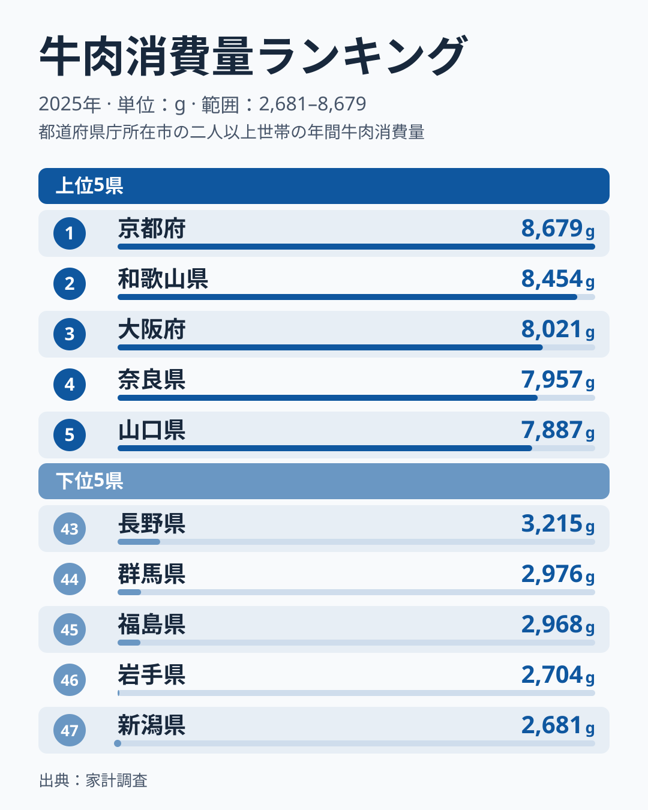
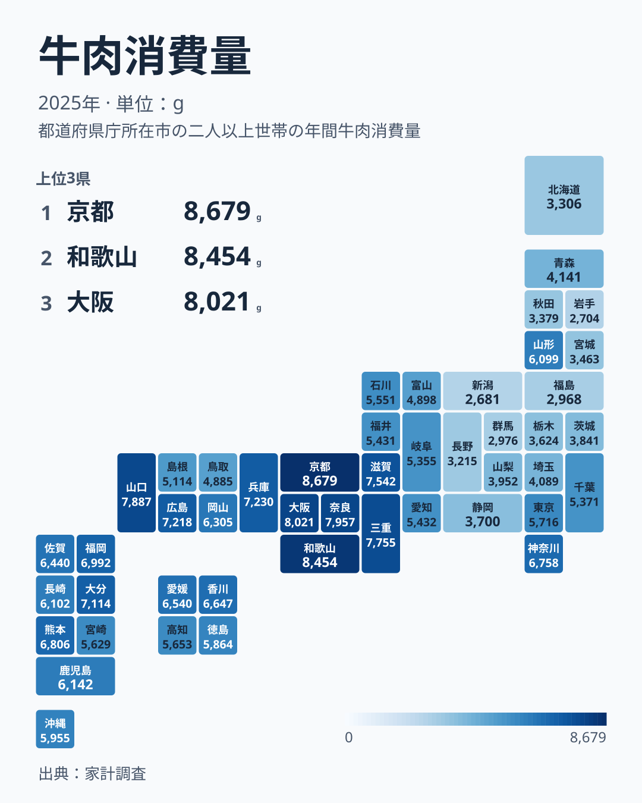

「牛肉は西、豚肉は東」とよく言われますが、最新のデータでも当てはまるのでしょうか。総務省の家計調査で、県庁所在市の二人以上世帯が2025年に1年間で買った牛肉の量を見ると、1位は[京都府](/areas/26000)の8,679gでした。最下位は[新潟県](/areas/15000)の2,681gで、差は3.2倍です。昨年首位だった兵庫県は7,230gの8位に下がりましたが、上位10県が近畿以西で占められる構図は変わりませんでした。

この記事では、2025年の上位と下位を確かめたうえで、首位が入れ替わっても西高東低が続いているのかを、同じ指標の過去のデータで確かめます。理由まではデータだけでは言い切れないため、仮説として分けて書きます。

> [!NOTE]
> 本データは家計調査の「牛肉」の購入数量で、対象は各都道府県の県庁所在市(政令市を含む)の二人以上世帯です。県全体の平均ではありません。外食や、ハムなどの加工肉は含まず、家庭で買う生の牛肉の数量だけを指します。

## 2025年の上位5県と下位5県

<source-link href="/ranking/beef-consumption-quantity">牛肉消費量ランキングをもっと見る(全47都道府県)</source-link>

上位5県は、京都府が8,679g、和歌山県が8,454g、大阪府が8,021g、奈良県が7,957g、山口県が7,887gです。6位以下も三重県が7,755g、滋賀県が7,542g、兵庫県が7,230g、広島県が7,218g、大分県が7,114gと続きます。上位10県を地方で数えると、近畿が7県、中国が2県、九州が1県で、近畿の存在感が際立っています。関東以北の都道県が最初に現れるのは13位の神奈川県で、6,758gです。東京都は23位の5,716gでした。

下位5県は、47位の新潟県が2,681g、46位の岩手県が2,704g、45位の福島県が2,968g、44位の群馬県が2,976g、43位の長野県が3,215gです。最下位の新潟県は1位の京都府の約31%にとどまります。下位10県に広げると北海道、東北の岩手・福島・秋田・宮城、北関東の群馬・栃木、信越の新潟・長野、そして静岡県が並び、東日本の広い範囲が下位に集まっています。

西日本のなかでも均一ではありません。山陽側の山口県は5位、広島県は9位ですが、山陰側の島根県は31位の5,114g、鳥取県は33位の4,885gで、同じ中国地方でも位置が大きく離れています。題の問いに答えるなら、西高東低は成り立っていますが、中心は西日本全体ではなく近畿です。山陰の2県のように、西日本でも下位寄りの県があります。

## 首位は動いても、西日本の外には出ない

同じ指標を2007年から2025年まで並べると、1位の県は年ごとに入れ替わっています。2018年以降の1位は次のとおりです。

- 2018年 奈良県
- 2019年 大阪府
- 2020年 京都府
- 2021年 奈良県
- 2022年 大分県
- 2023年 京都府
- 2024年 兵庫県
- 2025年 京都府

2007年から2025年までの19年間に1位になったのは9府県で、京都府が5回、和歌山県・広島県・奈良県が各3回、三重県・愛媛県・大阪府・大分県・兵庫県が各1回です。前年と同じ県が1位だったのは、18回の入れ替わりのうち2回だけでした。それでも19年分の1位はすべて近畿以西の県で、関東以北の都道県が1位になった年は一度もありません。

2024年から2025年の動きは大きく、2024年の順位表と比べると、京都府は9番目から首位へ、和歌山県は15番目から2番目へ、神奈川県は27番目から13番目へ上がりました。一方、兵庫県は首位から8番目へ、愛媛県は3番目から15番目へ、福井県は13番目から28番目へ下がっています。東京都も17番目から23番目へ下がりました。

> [!WARNING]
> 家計調査は県庁所在市の二人以上世帯を対象にした標本調査です。[仮説] 標本が限られるため年ごとの偏りが順位に出やすく、単年の1位は「その年に牛肉をよく買った世帯が多かった」程度に読むのが安全です。検証には各市の標本世帯数と複数年の平均が必要で、この記事のデータだけでは確かめられません。

単年の順位が揺れるなかで、顔ぶれの常連はいます。2018年から2025年の8年間に上位10県へ入った回数を数えると、奈良県と大阪府は8年すべて、広島県と京都府と山口県は7回、滋賀県は6回でした。首位の県は入れ替わっても、上位の層を作るのは近畿と山陽の府県だという点が、この指標の安定した特徴です。

## 下位は東日本に固まり、新潟が定位置

地図で見ると、近畿から中国、九州にかけての広い範囲が上位の側にあり、東北から北関東、信越にかけてが下位の側に並びます。東北で最も高いのは山形県の20位、6,099gで、青森県は34位の4,141g、宮城県は40位の3,463g、秋田県は41位の3,379g、福島県は45位、岩手県は46位です。首都圏は東京都が23位、千葉県が29位の5,371g、埼玉県が35位の4,089gで、神奈川県の13位だけが突出しています。

最下位の顔ぶれも固定的です。2007年から2025年の19年間で最下位になったのは新潟県が8回、群馬県が4回、長野県が4回、岩手県が2回、茨城県が1回でした。2025年に新潟県が最下位になったのは、昨年の39番目、3,766gから大きく下がった結果で、年ごとの揺れの一例でもあります。それでも最下位に現れる県は、すべて東日本です。

[仮説] 東日本では牛肉より豚肉や鶏肉を主役にする家庭が多いことが、牛肉の購入量の差につながっている可能性があります。ただし、本データは牛肉の数量だけで、豚肉や鶏肉との県別の比較はしていません。確かめるには、下位の県で豚肉の購入量が上位に来るかを照合する必要があります。あわせて見る: [豚肉消費量ランキング](/ranking/pork-consumption-quantity) / [牛肉消費支出額ランキング](/ranking/beef-consumption-expenditure)

首都圏の内部でも差があります。神奈川県は13位、東京都は23位、千葉県は29位、埼玉県は35位で、同じ首都圏でも牛肉の購入量はそろっていません。東京都の値は県庁所在市として集計された東京都区部の世帯のものです。

## まとめ

- 2025年の1世帯あたり牛肉消費量は京都府の8,679gが1位、最下位は新潟県の2,681gで、差は3.2倍でした
- 昨年首位だった兵庫県は8位に下がりましたが、上位10県は近畿7・中国2・九州1と、近畿以西で占められています
- 2007年から2025年の19年間の1位はすべて近畿以西の県で、前年と同じ県が1位だったのは2回だけです
- 2018年以降の8年間で上位10に毎年入ったのは奈良県と大阪府でした
- 最下位は新潟県の8回をはじめ、群馬県・長野県・岩手県・茨城県と東日本の県に限られています
