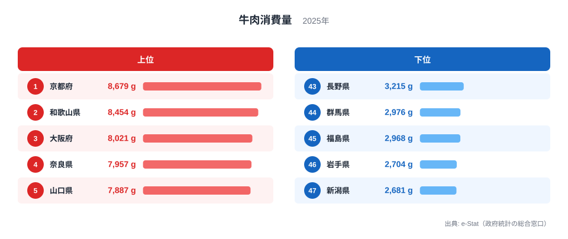
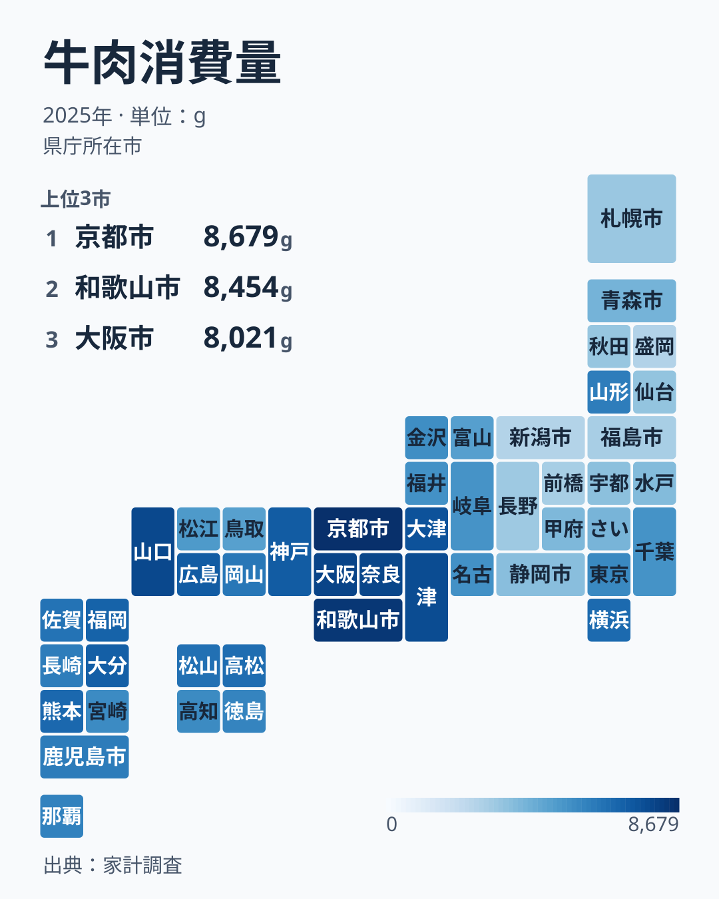

「和牛の名産地に住んでいれば、牛肉をよく食べているはずだ」——この直感は、データを見ると裏切られます。総務省「家計調査」の2025年データによると、1世帯あたりの年間牛肉購入量が最も多いのは京都府の8,679gで、最も少ないのは新潟県の2,681gです。開きは約3.2倍。神戸ビーフを擁する兵庫県は7,230gで8位にとどまり、「前沢牛」で知られる岩手県は2,704gで46位でした。

興味深いのは首位の動きです。2024年の首位は兵庫県の7,899gでしたが、2025年の兵庫県は8位に下がり、2021年から5年間で首位に立った県は奈良・大分・京都・兵庫と4県に及びます。本記事では2025年の47都道府県の顔ぶれと、首位が毎年のように入れ替わる理由、そして産地と消費地のズレを読み解きます。

> [!NOTE]
> データは総務省「家計調査」の都道府県庁所在市・二人以上世帯における年間牛肉購入量（g）です。県全体の値ではなく、県庁所在市の値を都道府県の代表として扱っています。家庭での購入量なので、外食や惣菜として食べる牛肉は含みません。

## 牛肉消費量ランキングの全体像 — 京都と新潟で約3.2倍の開き

2025年の1位は京都府の8,679g、47位は新潟県の2,681gで、倍率は約3.2倍です。同じ日本でも、家庭に買われる牛肉の量は県庁所在市によって3倍以上違います。

<source-link href="/ranking/beef-consumption-quantity">47都道府県の牛肉消費量ランキングを詳しく見る</source-link>

上位は京都府の8,679g・和歌山県の8,454g・大阪府の8,021g・奈良県の7,957g・山口県の7,887gの順で、6位以下は三重の7,755g・滋賀の7,542g・兵庫の7,230g・広島の7,218g・大分の7,114gと続きます。下位は新潟の2,681g・岩手の2,704g・福島の2,968g・群馬の2,976g・長野の3,215gです。

上位10県の内訳は、近畿が7府県（京都・和歌山・大阪・奈良・三重・滋賀・兵庫）、中国が2県（山口・広島）、九州が1県（大分）で、すべて西日本です。下位10県は、3,700gで38位の静岡を除くと東北4県（宮城・秋田・福島・岩手）、北関東2県（栃木・群馬）、甲信越2県（長野・新潟）、北海道が占めます。この記事では、静岡県を含めて中部地方の東側から北の都道県を「東日本」と呼びます。牛肉消費の「西高東低」は、2025年も上位と下位の顔ぶれにそのまま表れています。

ただし西日本のなかでも均一ではありません。2025年は山口県が5位、広島県が9位ですが、岡山県は17位、山陰の島根県は5,114gで31位、鳥取県は4,885gで33位です。2007年から2025年の19年分で、上位10県に入った回数を数えると、広島県が18回、山口県が12回、岡山県が2回で、島根県と鳥取県は0回です。西高東低の中心は西日本全体というより近畿と、中国地方の広島・山口です。

## 首位は5年で4県が入れ替わった — 兵庫は8位に

前年の首位は兵庫県でしたが、2025年は京都府が首位を取り戻しました。2021年以降の年ごとの首位と最下位を並べると、動きの大きさがわかります。

- 2021年は、首位が奈良県の10,415g、最下位が群馬県の3,627g
- 2022年は、首位が大分県の9,628g、最下位が群馬県の2,969g
- 2023年は、首位が京都府の8,471g、最下位が新潟県の2,618g
- 2024年は、首位が兵庫県の7,899g、最下位が岩手県の2,417g
- 2025年は、首位が京都府の8,679g、最下位が新潟県の2,681g

首位は毎年入れ替わり、5年間で奈良・大分・京都・兵庫の4県です。入れ替わりやすさは、1位と2位の差の小ささにも表れています。2018年から2025年の1位と2位の差は26gから473gで、2位の値に対して0.3%から4.8%しかありません。2022年は1位の大分県が9,628g、2位の大阪府が9,602gで、差は26gでした。上位の数県がほぼ同じ量で並んでいるので、わずかな増減で首位が入れ替わります。最下位も群馬・新潟・岩手の間で動いており、倍率は2.9倍から3.3倍の範囲に収まります。変わっているのは顔ぶれで、「西が上位、東が下位」という大きな構図は変わっていません。

兵庫県の購入量は、2023年の6,815gから2024年に7,899gへ増えて首位に立ち、2025年は7,230gで8位でした。2024年に上位だった愛媛県は2025年に6,540gで15位、福岡県は6,992gで11位へ下がっています。逆に和歌山県は2024年の6,570gから2025年は8,454gへ増え、2位に上がりました。1年で10位以上動く県が珍しくありません。

> [!WARNING]
> 家計調査は、県庁所在市の限られた世帯への調査です。1年ごとの順位は、少数の世帯の買い方に左右されて振れやすいと考えられます[仮説]。検証には複数年の平均を取る必要があります。1位の県がそのまま「日本一の牛肉好き」とは言い切れません。

首位の入れ替わりを、地域の食文化の変化と読むのは早計です。同じ指標を2007年から2025年までの19年分並べると、1位になったのは9府県で、京都府が5回、和歌山県・広島県・奈良県が各3回、三重県・愛媛県・大阪府・大分県・兵庫県が各1回です。前の年と同じ県が続けて1位になったのは、18回の年の替わり目のうち2回だけでした。それでも19年分の1位はすべて近畿以西の県で、関東以北の都道県が1位になった年は一度もありません。

首位が入れ替わるなかで、上位の層には常連がいます。2018年から2025年の8年間に上位10県へ入った回数を数えると、奈良県と大阪府は8年すべて、広島県・京都府・山口県は7回、滋賀県は6回でした。首位の県は動いても、上位の層を作るのが近畿の府県と広島・山口だという点が、この指標の安定した特徴です。

## 産地と消費地のズレ — 神戸・松阪・前沢

ここで、和牛ブランドの産地と消費量の関係を見ます。2025年の順位は次のとおりです。

- 松阪牛（三重県）── 牛肉消費量 6位の7,755g
- 神戸ビーフ（兵庫県）── 牛肉消費量 8位の7,230g
- 前沢牛（岩手県）── 牛肉消費量 46位の2,704g

三重と兵庫は上位に入りましたが、1位ではありません。岩手は46位で、47位の新潟とほぼ同水準です。2024年は兵庫が首位、岩手が最下位の2,417gで、産地と消費の一致と食い違いが両極に出ましたが、2025年は兵庫も首位ではなくなりました。ブランド産地であることと、地元の家庭が多く買うことは、別の軸だとわかります。地域別の食肉消費の違いは、[鶏肉消費量ランキング](/ranking/chicken-consumption-quantity)など他の食肉と比べるとより立体的に見えます。

> [!TIP]
> 前沢牛・松阪牛のような高級ブランド和牛は、大消費地の料理店や百貨店向けに出荷される比率が高いと言われます。産地に住んでいても日常的に買うとは限らず、生産と購入は別の軸です。

岩手県の暮らしを見るなら[岩手県のプロフィール](/areas/03000)、前年に首位だった[兵庫県のプロフィール](/areas/28000)と比べると、同じ「牛と縁の深い県」でも食卓の姿が異なることが見えてきます。

## 地図で見る下位の固まり — 東日本と、最下位の常連・新潟

地図で見ると、近畿から中国・四国、九州にかけての広い範囲が濃い側にあり、東北から北関東、信越にかけてが淡い側に並びます。東北で最も多いのは山形県の6,099gで20位、青森県は4,141gで34位、宮城県は3,463gで40位、秋田県は3,379gで41位、福島県は45位、岩手県は46位です。首都圏は東京都が5,716gで23位、千葉県が5,371gで29位、埼玉県が4,089gで35位で、神奈川県の13位だけが上に離れています。東京都の値は県庁所在市として集計された東京都区部の世帯のものです。

最下位の顔ぶれも固定的です。2007年から2025年の19年間で最下位になったのは、新潟県が8回、群馬県と長野県が各4回、岩手県が2回、茨城県が1回で、すべて東日本の県です。2025年の新潟県は、2024年の3,766gで39位から2,681gの47位へ下がっており、最下位の常連であると同時に、1年で順位が大きく揺れる例でもあります。

地図の濃淡は1年分の値で、単年の順位は前の節のとおり揺れます。それでも19年分の1位がすべて近畿以西、最下位がすべて東日本だったことと合わせると、地図に出ている東西の境目は1年限りの偶然ではないと読めます。

## なぜ「西高東低」になるのか — 牛食文化と豚肉との競合

牛肉消費の東西差を生む要因は一つではありませんが、いくつかの構造が考えられます。

第一に、歴史的な牛食文化の濃淡です。関西を中心とする西日本では、すき焼きやしゃぶしゃぶなど牛肉料理が家庭に定着し、「肉といえば牛肉」という習慣が受け継がれてきたと言われます。2025年に近畿の7府県がすべて上位10位に入った背景に、この文化がある可能性があります[仮説]。

第二に、東日本における豚肉との競合です。下位に並ぶ東北・北関東・甲信越は、家庭の食肉消費に占める豚肉の比率が高いとされます。牛肉の少なさは「肉を食べない」ことではなく、「主役が牛から豚に置き換わっている」ことを示している可能性があります[仮説]。

手元で確かめられる範囲を見ておきます。同じ家計調査の2025年の豚肉購入量では、牛肉が最下位の新潟県は27,092gで豚肉は1番目、長野県は23,777gで4番目で、この仮説に合います。一方、岩手県は21,002gで30番目、群馬県は21,530gで23番目、福島県は22,291gで15番目と、牛肉の下位県がそろって豚肉の上位にいるわけではありません。牛から豚への置き換わりは、下位県の一部には当てはまっても、東日本全体を説明するものではないと読むのが慎重です。

> [!NOTE]
> 「西は牛、東は豚」という対比は、食肉別データでもしばしば語られます。本記事は牛肉単体のデータに基づくため、豚肉・鶏肉を含めた構成は別途検証が必要です。食肉全体に関心があれば[経済カテゴリのランキング一覧](/category/economy)も参考になります。

第三に、価格と入手性です。牛肉は豚肉・鶏肉より高価で、家庭の購入頻度は所得や物価、小売の構成にも左右されます。ただし、東日本にも例外はあります。神奈川県は13位の6,758g、山形県は20位の6,099gで、「東日本は必ず少ない」と一括りにはできません。

これらは単独で東西差を説明するものではなく、食文化・代替肉・価格が重なった結果として「西高東低」が現れていると見るのが妥当でしょう。数値の分布は[牛肉消費量ランキング](/ranking/beef-consumption-quantity)で確認できます。

## まとめ

- 2025年の牛肉消費量は1位が京都府の8,679g、最下位が新潟県の2,681gで、開きは約3.2倍です。
- 首位は2021年から奈良・大分・京都・兵庫・京都と動き、5年で4県が入れ替わりました。兵庫は2024年の1位から8位の7,230gへ下がりました。
- 上位10県は近畿7・中国2・九州1とすべて西日本で、下位10県は静岡を含めすべて東日本。19年間の1位はすべて近畿以西、最下位はすべて東日本の県で、順位は動いても「西高東低」は変わりません。
- ただし中国地方でも、19年間で上位10位に入ったことがない島根・鳥取があり、中心は近畿と広島・山口です。
- 松阪牛の三重は6位、神戸ビーフの兵庫は8位、前沢牛の岩手は46位。和牛ブランドの産地と家庭の消費量は一致しません。
- 食肉の地域差は[鶏肉消費量ランキング](/ranking/chicken-consumption-quantity)や関連記事[鶏肉消費量の解説](/blog/chicken-consumption-quantity)と合わせて読むと、より立体的に理解できます。
