酒税の段階的な改正は、まず価格に出ました。消費者物価指数（2020年=100）で10月の前月比を見ると、ビールは2020年10月に4.3%、2023年10月に4.0%下がり、いわゆる新ジャンル（ビール風アルコール飲料）は2020年10月に12.8%、2023年10月に11.0%上がっています。家計調査の購入単価（支出額÷購入数量）も同じ向きです。2020年10月は、ビールの前年同月比が直前3か月の平均プラス3.9%から直後3か月の平均マイナス5.8%へ、発泡酒（家計調査では新ジャンルを含む品目）がマイナス2.5%からプラス8.3%へ動きました。

購入数量は、動きがもう少し複雑です。発泡酒の1世帯あたり年間購入数量は、2019年の27.15リットルから2025年の18.40リットルへ32%減り、ビールは19.42リットルから25.11リットルへ29%増えました。2020年のコロナ禍のピーク（発泡酒31.35リットル、ビール20.44リットル）を基準にすると、発泡酒は41%減、ビールは23%増です。2024年には、ビールが24.46リットル、発泡酒が20.41リットルと、ビールが発泡酒を再び上回りました（2010年に発泡酒の品目の範囲が変わって以降では初めてです）。ただし、月ごとの前年同月比は、前年の別の事情に大きく引きずられます。2020年は前年の消費税率引き上げ、2023年は前年10月の値上げ前後の動きが基準にあるためです。

問いは「発泡酒・第3のビールの増税は、消費者の行動をどう変えるか」です。この記事の答えは、価格は税の向きにはっきり動き、購入量は長い目で見て発泡酒が減りビールが増えたものの、改正の前後の買い時期のずれは、同じ時期の値上げやコロナ禍と切り分けられない、というものです。天候の影響は検討していません。2026年10月の税率の一本化後の動きは、まだ観測できません。数字はすべて全国・二人以上の世帯（農林漁家世帯を含む）の月次または年次の値で、都道府県別の値とは混ぜません。

## 酒税は2020年と2023年の10月に、ビールが下がり新ジャンルが上がった

酒税の段階は、国税庁の資料にあります。平成29年度の税制改正で、ビール系飲料の税率を段階的に変えて、2026年10月に1キロリットルあたり155,000円（350ミリリットル換算で54.25円）へ一本化することが決まりました（国税庁[「発泡性酒類の段階的な税率変更に係る品目及び税率適用区分の表示方法の手引き」](https://www.nta.go.jp/taxes/sake/pdf/0023008-027.pdf)、令和5年8月）。変更は、2020年10月、2023年10月、2026年10月の3段階です。

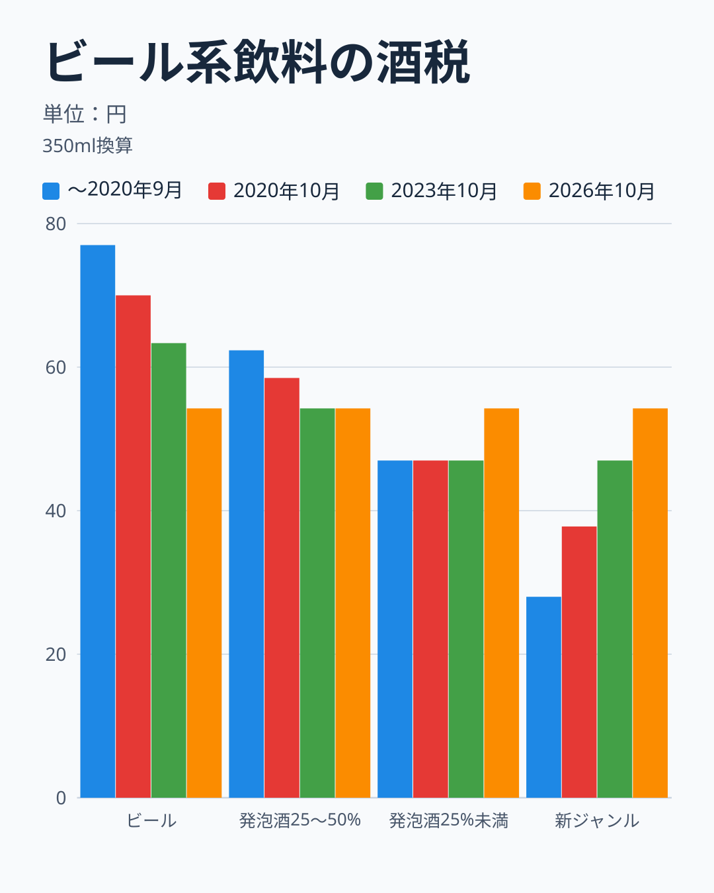

350ミリリットル換算の税額は、ビールが2020年9月までの77.00円から、2020年10月に70.00円、2023年10月に63.35円、2026年10月に54.25円へ下がります。発泡酒のうち麦芽比率25%以上50%未満のものも、62.34円から58.49円、54.25円と、3回とも下がります。麦芽比率25%未満の発泡酒は46.99円のまま2026年10月に54.25円へ上がります。いわゆる新ジャンルは、28.00円から2020年10月に37.80円へ、2023年10月に46.99円へ上がります。2023年10月には、新ジャンルの多くが麦芽比率25%未満の発泡酒と同じ区分・同じ税率になり、2026年10月には全体が54.25円にそろいます。

つまり、ビールと麦芽比率25〜50%の発泡酒は3回とも減税、新ジャンルは3回とも増税、麦芽比率25%未満の発泡酒は2026年10月まで据え置きです。家計調査の「発泡酒」には、このうち新ジャンルが含まれます。統計局の資料（第23回消費統計研究会、2023年11月20日、[資料1](https://www.stat.go.jp/info/kenkyu/skenkyu/pdf/20231120_01.pdf)）によると、2020年改定の品目名は「発泡酒・ビール風アルコール飲料」でした。2023年10月に新ジャンルが発泡酒に統合されたため、2025年の改定で名称が「発泡酒」に統一されています。この記事では、家計調査の品目を「発泡酒（新ジャンルを含む）」と書きます。

> [!NOTE]
> 家計調査の「発泡酒（新ジャンルを含む）」の中には、減税された麦芽比率25〜50%の発泡酒、据え置きの麦芽比率25%未満の発泡酒、増税された新ジャンルの3つが混ざっていて、家計調査ではこれらが分かれていません。品目全体の価格や購入量の向きは、3つの購入の比率で決まります。新ジャンルだけの増税の反応を、この記事では直接測れません。

## 小売価格は、改正月に税の向きに動いた

税の改正が価格に出たかを、家計調査とは独立に、消費者物価指数で確かめます。消費者物価指数は、同じ品質の商品の小売価格を追う指数で、品目に「ビール」「発泡酒」「ビール風アルコール飲料」があります。ビール風アルコール飲料は、いわゆる新ジャンルです。

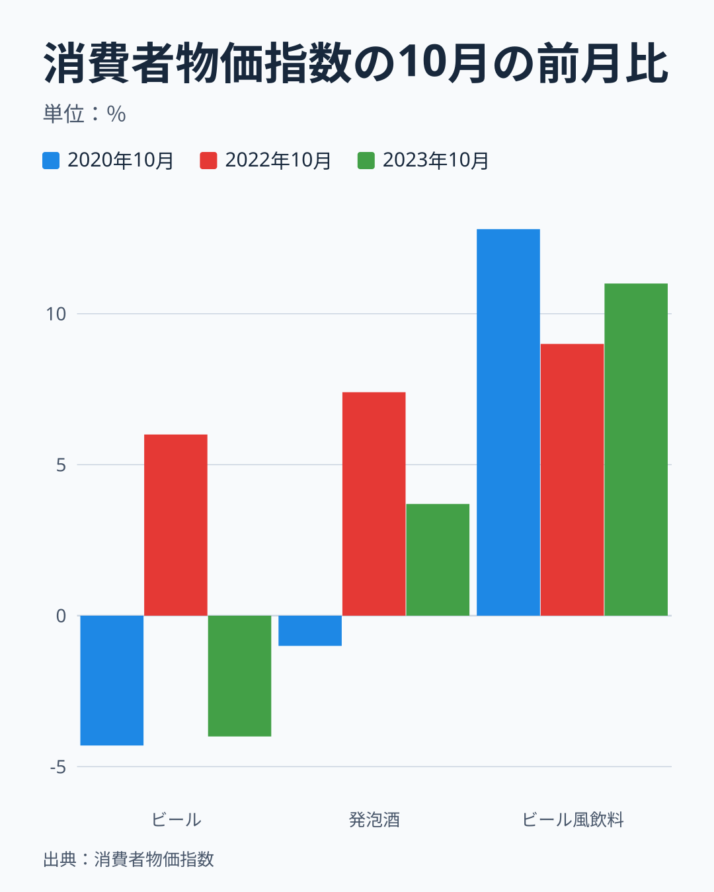

ビールの指数は、2020年9月の101.0から10月の96.7へ4.3%下がり、2023年は9月の101.2から10月の97.2へ4.0%下がりました。ビールの減税（350ミリリットルあたり、2020年は7.00円、2023年は6.65円）に消費税10%を加えると、ビールの購入単価から換算した1缶約195円の3.9%、3.8%にあたり、指数の下がり方（4.3%、4.0%）とほぼ一致します。ビール風アルコール飲料（新ジャンル）は、2020年9月の95.3から10月の107.5へ12.8%、2023年9月の114.6から10月の127.2へ11.0%上がりました。発泡酒は、2020年10月に1.0%下がり、2023年10月に3.7%上がっています。この指数の「発泡酒」は新ジャンルを含まず、減税の区分と据え置きの区分だけなので、2023年10月の上昇は税の向きと一致しません。原因はこの記事では確かめていません。

税の改正がなかった2022年10月にも、価格は動いています。ビールの指数は2022年9月の95.2から10月の100.9へ6.0%、発泡酒は99.2から106.5へ7.4%、ビール風アルコール飲料は107.0から116.6へ9.0%上がりました。大手メーカーが相次いで価格を改定したと報じられた時期ですが、公式発表との照合は、この記事では行っていません。ただし、消費者物価指数が、この月の3品目の値上がりを確かめています。以降の月次の前年同月比には、この2022年10月の値上がりが、基準として入っています。

## 長い目で見ると、発泡酒が減り、ビールが増えた

25年の長い流れを確認します。

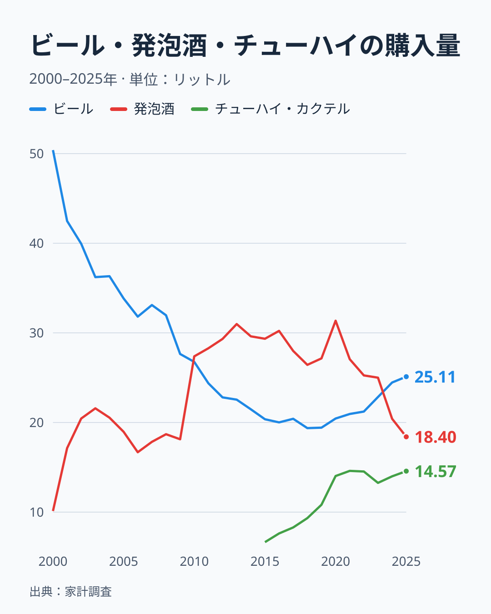

ビールの年間購入数量は、2000年の50.39リットルから2016年の20.01リットルまで下がり、2018年の19.37リットルで底を打ったあと、2019年の19.42リットル、2020年の20.44リットル、2023年の22.84リットル、2025年の25.11リットルへ増えました。発泡酒は、2000年の10.12リットルから増え、2010年に27.38リットルへ段差を描いて、2020年の31.35リットルでピークを付け、2025年は18.40リットルです。2020年の発泡酒は、前年の27.15リットルから15.5%増で、コロナ禍で家での飲酒が増えた年の動きと重なっています。2019年を基準にすると、2025年は発泡酒が32.2%減、ビールが29.3%増です。

2010年の段差は、発泡酒の購入数量が2009年の18.13リットルから1年で51%増え、同じ年に「他の酒」の支出額が5,004円から2,703円へほぼ半減した変化です。2つの支出額の合計は11,142円から11,486円とほぼ連続しているので、品目の範囲が変わった可能性が高い、というのが[仮説]です。この記事の主役は2019年以降ですが、2009年以前の発泡酒の水準を、それ以降と直接比べないでください。

2020年以降の発泡酒は、2021年に13.7%減（27.06リットル）、2022年に6.7%減（25.25リットル）、2023年に1.0%減（25.00リットル）、2024年に18.4%減（20.41リットル）、2025年に9.8%減（18.40リットル）と、毎年減っています。ビールは、2021年以降、2.5%増、1.3%増、7.6%増、7.1%増、2.7%増と、毎年増えています。発泡酒に対するビールの購入数量の比は、2019年に0.72、2020年に0.65でしたが、2024年は1.20、2025年は1.36と逆転しました。この逆転は、[ビールの支出が7月から12月に動いた記事](/blog/beer-peak-month-july-to-december)でも、支出額の月別パターンとあわせて取り上げています。

チューハイ・カクテルは、2015年に別の品目になり、年間購入数量は2015年の6.65リットルから2021年の14.60リットルへ増え、その後は13.26リットルから14.57リットルの範囲で横ばいです。2023年から2025年の発泡酒の減少（6.60リットル）に対して、チューハイ・カクテルの増加は1.31リットルで、その約2割にあたります。減った発泡酒の大部分が、チューハイ・カクテルに移ったわけではありません。ノンアルコール飲料など、この図にない品目への移動は検討していません。

次の「発泡酒・ビール風アルコール飲料消費量」ランキングは県庁所在市の値で、本文の全国値とは別の数字です。

<source-link href="/ranking/happoshu-consumption-quantity">発泡酒・ビール風アルコール飲料消費量ランキングをもっと見る</source-link>

## 購入単価の差は、税の差の縮小と同じ程度に縮んだ

家計調査の年間の購入単価（支出額÷購入数量、1リットルあたり）で、ビールと発泡酒の価格の差を見ます。

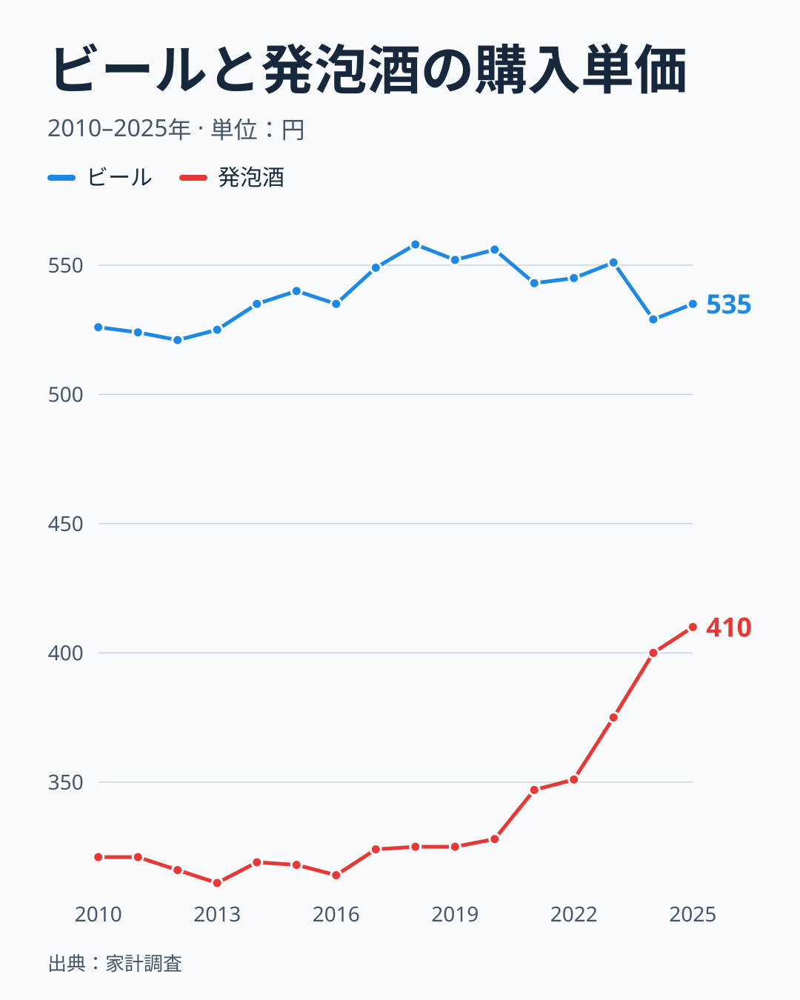

2010年から2019年まで、ビールは521円から558円、発泡酒は311円から325円の範囲で、2つの比（発泡酒÷ビール）は0.58から0.61で安定していました。2019年はビールが552円、発泡酒が325円で、差は227円です。2020年はビールが556円、発泡酒が328円でした。2023年はビールが551円、発泡酒が375円、2025年はビールが535円、発泡酒が410円で、比は0.77、差は125円です。差は2019年から2025年で102円縮み、ビールの価格は3%下がり、発泡酒（新ジャンルを含む）は26%上がりました。

酒税は従量税なので、価格の比より差で比べるのが素直です。ビールと新ジャンルの1リットルあたりの税額の差は、2019年の140円（ビール220円、新ジャンル80円）から、2023年10月以降の46.75円（ビール181円、新ジャンル134.25円）へ93.25円縮みました。消費税10%を含めると約103円です。ビールと麦芽比率25%未満の発泡酒の差は、85.75円から46.75円へ39円縮み、消費税を含めて約43円です。購入単価の差の縮小（102円）は、新ジャンルの購入が多いほど、前者の約103円に近づきます。品目内の購入の比率は分からないので、これは目安です。新ジャンルの購入が大半なら、税の差の縮小と価格の差の縮小は整合します。麦芽比率25〜50%の発泡酒を含む品目全体では、税の差の縮小は約17.5〜103円の加重平均になるので、観測の102円は上端に近く、「税の差の縮小だけで説明できる」とまでは言えません。

## 支出額で見ると、総額はほぼ同じで、買える量が減った

購入量と単価に加えて、1世帯あたりの年間支出額で、ビール、発泡酒、チューハイ・カクテルの3つを並べます。

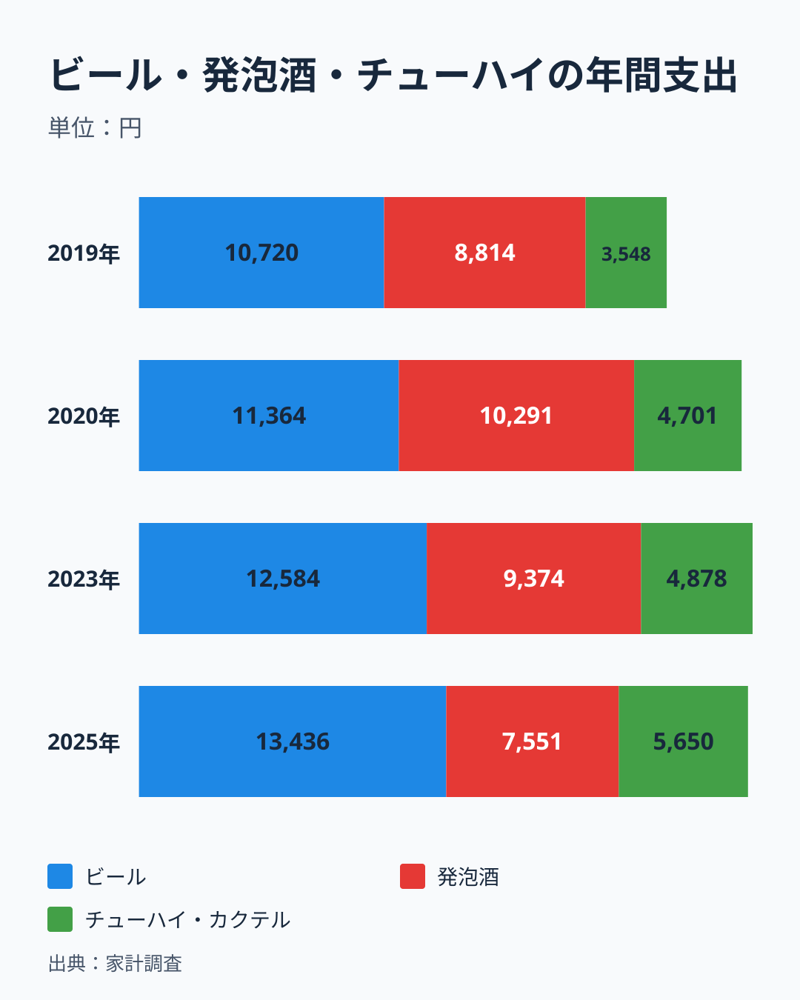

ビールの年間支出は、2019年の10,720円から2020年の11,364円、2023年の12,584円、2025年の13,436円へ増え、2020年から2025年で18.2%増です。発泡酒は、2019年の8,814円から2020年に10,291円へ増えたあと、2023年に9,374円、2025年に7,551円へ減り、2020年から2025年で26.6%減りました。チューハイ・カクテルは、3,548円から4,701円、4,878円、5,650円へ増え、2020年から2025年で20.2%増です。3つの合計は、2020年の26,356円から2025年の26,637円へ、1.1%の増加にとどまります。酒類全体の支出額は、2019年の40,721円から2025年の45,406円へ11.5%増えましたが、コロナ禍で増えた2020年（46,276円）と比べると1.9%減です。

ビールと発泡酒の2つに絞ると、支出額の合計は、2020年の21,655円から2025年の20,987円へ3.1%減っただけです。一方で、購入数量の合計は51.79リットルから43.51リットルへ16.0%減りました。支出額がほぼ同じで、買える量が減ったことになります。2つを合わせた平均の購入単価は、2020年の418円/リットルから2025年の482円/リットルへ15.4%上がりました。この上昇には、価格の高いビールの構成が増えたことと、発泡酒の購入単価が328円から410円へ上がったことの両方が含まれます。

ただし、この変化の全部を税で説明することはできません。2020年から2025年は、物価全体が上がった時期でもあります。ビールと発泡酒の購入量が減り、チューハイ・カクテルの支出が増えたことは、飲む酒の選び方の変化（健康志向や、飲む機会の変化など）も含みうる動きです。この記事のデータは、「同じ予算で、買える量が減った」ところまでを示しています。

## 2020年10月: 購入単価は税の向きに動き、数量は前年の消費税の影響に引きずられた

最初の改正月、2020年10月の前後を、月次で見ます。まず購入単価の前年同月比です。

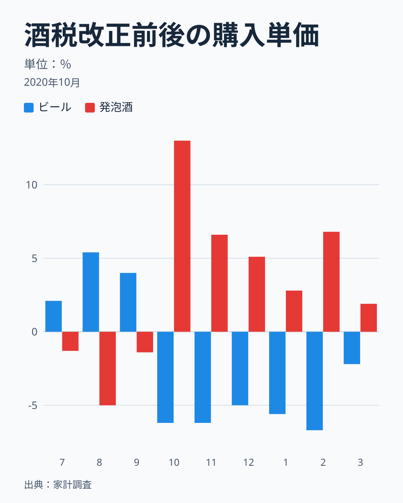

ビールの購入単価の前年同月比は、2020年7月がプラス2.1%、8月がプラス5.4%、9月がプラス4.0%でした。改正月の10月にマイナス6.2%へ下がり、11月がマイナス6.2%、12月がマイナス5.0%、2021年1月がマイナス5.6%、2月がマイナス6.7%、3月がマイナス2.2%と、半年続けて前年を下回りました。発泡酒（新ジャンルを含む）は、7月がマイナス1.3%、8月がマイナス5.0%、9月がマイナス1.4%から、10月にプラス13.0%へ上がり、11月がプラス6.6%、12月がプラス5.1%、1月がプラス2.8%、2月がプラス6.8%、3月がプラス1.9%でした。向きは、ビールの減税と新ジャンルの増税に一致しています。

この前年同月比には、前年の消費税の影響が入っています。2019年10月に酒類の消費税率が8%から10%に上がったため、2020年7〜9月の前年同月比には、約1.9%（1.10÷1.08）の税率の上乗せが入り、10月以降には入りません。直前の水準が実際より約1.9ポイント高く出ているので、ビールの直前から直後への変化（約マイナス9.7ポイント）は、これを除くと約マイナス7.8ポイントです。2年前の同じ月（2018年）と比べると、10月から12月の購入単価は、ビールがマイナス3.6%、マイナス6.4%、マイナス4.6%、発泡酒がプラス11.3%、プラス10.0%、プラス6.6%で、向きは同じです。

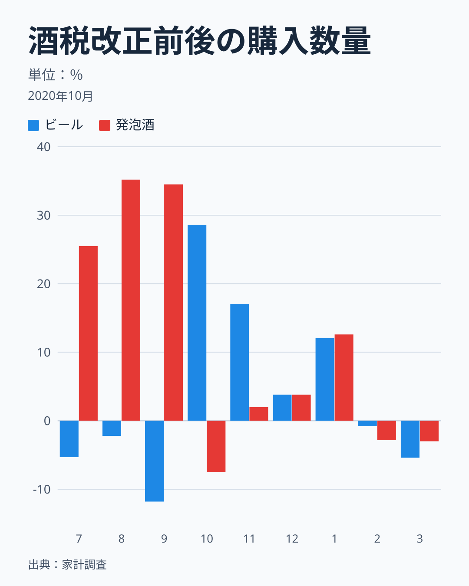

購入数量の前年同月比は、ビールが2020年9月にマイナス11.8%、10月にプラス28.6%、発泡酒が9月にプラス34.5%、10月にマイナス7.5%です。「ビールは9月に買い控えて10月にまとめ買い、発泡酒は9月に駆け込んで10月に控えた」ように見えますが、前年の基準に注意が必要です。2019年9月はビールがプラス37.3%、発泡酒がプラス29.4%、2019年10月はビールがマイナス20.6%、発泡酒がマイナス17.0%で、消費税率引き上げの駆け込みと反動が出た月です。2020年9月のビールの減少は、前年9月の駆け込みが高い基準になったためで、10月のビールの増加は、前年10月の反動が低い基準になったためと読めます。

> [!WARNING]
> 前年同月比は、前年の同じ月が基準です。2019年9月・10月（消費税率の引き上げ）と、2022年9月・10月（値上げの前後）は、ビールと発泡酒の購入数量が大きく動いた月で、翌年の同じ月の前年同月比が、反対向きに大きく出ます。この記事では、前年同月比と2年前比を並べて、前年の特殊な月の影響を確かめます。

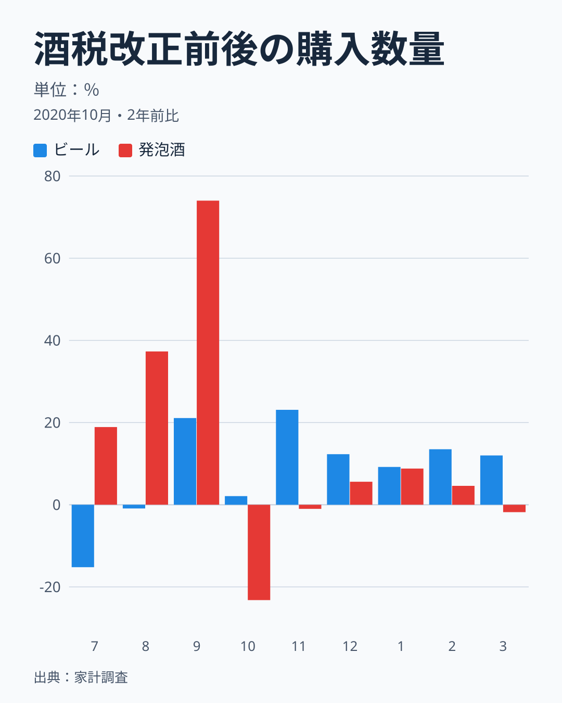

2年前の2018年と比べると、ビールは2020年9月がプラス21.1%、10月がプラス2.1%、11月がプラス23.1%、12月がプラス12.3%で、10月に特別な増加は見えません。発泡酒は、9月がプラス74.0%、10月がマイナス23.2%、11月がマイナス1.0%、12月がプラス5.6%でした。発泡酒は、新ジャンルが増税される10月の直前の9月に大きく増え、10月に大きく減っています。ただし、2020年は新型コロナで家での飲酒が増えた年で、7月から9月の発泡酒も、2年前比で18.9%増、37.3%増、74.0%増と大きく伸びています。9月だけの増加ではなく、夏から続く増加で、その分を除くと、増税の直前の上乗せは、これより小さくなります。

## 2023年10月: 前年の値上げを外すと、数量の反応は読み取りにくい

2回目の改正月、2023年10月です。購入単価の前年同月比から見ます。

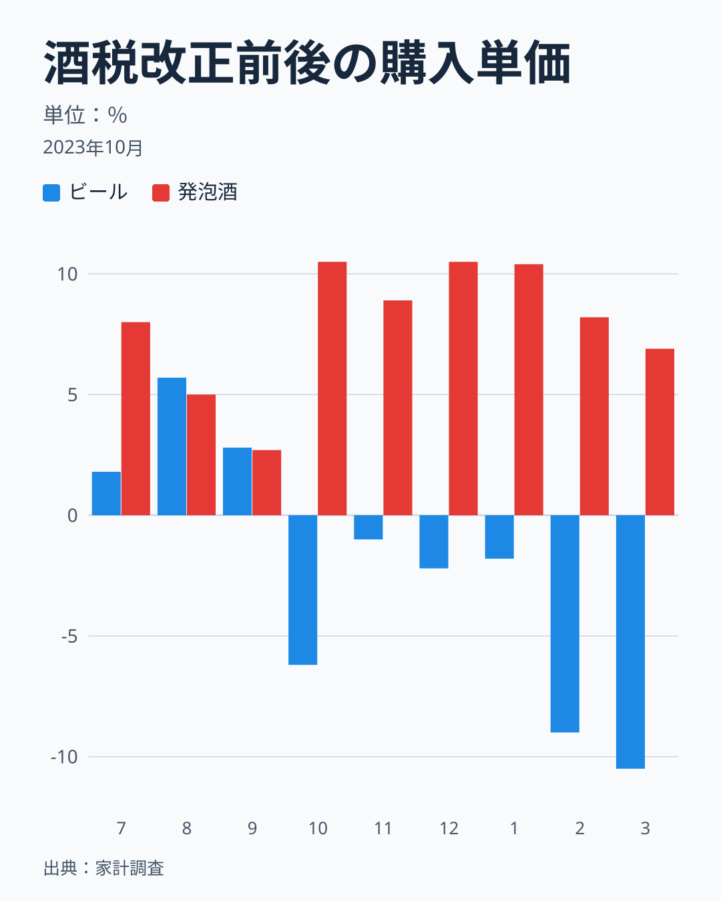

ビールの購入単価の前年同月比は、2023年7月がプラス1.8%、8月がプラス5.7%、9月がプラス2.8%から、10月にマイナス6.2%へ下がり、2024年2月がマイナス9.0%、3月がマイナス10.5%でした。発泡酒は、7月がプラス8.0%、8月がプラス5.0%、9月がプラス2.7%から、10月がプラス10.5%、11月がプラス8.9%、12月がプラス10.5%、1月がプラス10.4%、2月がプラス8.2%、3月がプラス6.9%です。ただし、この前年同月比も、前年の事情が入ります。2022年10月の値上げ（購入単価は、ビールがプラス4.0%、発泡酒がプラス4.9%）が、2023年7〜9月の前年同月比には含まれ、10月以降には含まれません。直前3か月の平均から直後3か月の平均への変化は、ビールがプラス3.4%からマイナス3.1%への約6.5ポイントの低下、発泡酒がプラス5.2%からプラス10.0%への約4.8ポイントの上昇ですが、この2022年の値上げの分が、ビールの低下を大きく、発泡酒の上昇を小さく見せています。

2年前（2021年）の同じ月と比べると、値上げの影響は、直前も直後も含まれます。ビールの購入単価は、2023年7月がプラス2.1%、8月がプラス4.5%、9月がプラス4.1%から、10月がマイナス2.4%、11月がマイナス4.1%、12月がマイナス1.2%、2024年1月がマイナス0.5%、2月がマイナス4.2%、3月がマイナス6.5%へ下がりました。発泡酒は、7月がプラス7.0%、8月がプラス6.7%、9月がプラス1.6%から、10月がプラス15.9%、11月がプラス18.7%、12月がプラス16.0%、1月がプラス17.8%、2月がプラス15.6%、3月がプラス13.7%でした。直前3か月の平均から直後3か月の平均への変化は、ビールがプラス3.5%からマイナス2.6%への約6.1ポイントの低下、発泡酒がプラス5.1%からプラス16.9%への約11.7ポイントの上昇です。向きは税の変更に一致し、消費者物価指数の動き（ビール4.0%低下、新ジャンル11.0%上昇）とも整合します。

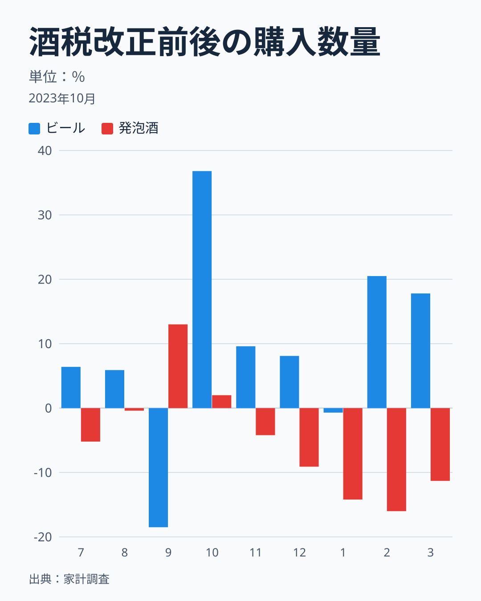

購入数量の前年同月比は、ビールが2023年9月にマイナス18.5%、10月にプラス36.8%、発泡酒が9月にプラス13.0%、10月にプラス2.0%、その後はマイナス4.2%（11月）からマイナス16.0%（2月）へ減りました。しかし、この前年同月比も、前年の基準が特殊です。2022年9月は、ビールが前年同月比プラス42.1%、発泡酒がプラス24.0%、2022年10月は、ビールがマイナス13.1%、発泡酒がマイナス35.5%でした。9月に購入が増えて10月に減る、値上げの前後の形です。

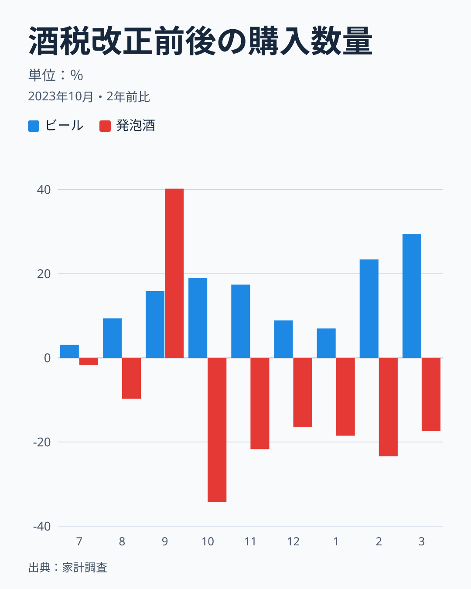

2年前（2021年）の同じ月と比べると、発泡酒は2023年9月がプラス40.2%、10月がマイナス34.2%、11月がマイナス21.7%、12月がマイナス16.4%、2024年1月がマイナス18.5%、2月がマイナス23.4%、3月がマイナス17.4%でした。一見すると、税率が上がる直前の駆け込みと直後の反動が、はっきり出ているように見えます。しかし、2021年の同じ月を1としたときの発泡酒の水準は、2022年9月が1.24、2022年10月が0.65、2023年9月が1.40、2023年10月が0.66です。2023年10月の水準は、2022年10月にすでに下がっていた水準とほぼ同じで、2年前比の10月のマイナス34.2%の大半は、その水準が続いたものです。2023年9月は、2022年9月の水準（1.24）をさらに13%上回っており、この13%（前年同月比プラス13.0%）が、値上げの前後の動きに上乗せされた、税の改正による駆け込みの増分の目安です。ただし、発泡酒は2021〜2023年に年1〜14%ずつ減る傾向があり、天候も検討していないので、上限や下限を示す値ではありません。

ビールは、2年前比で、2023年9月がプラス15.9%、10月がプラス19.0%、11月がプラス17.4%、12月がプラス8.9%、2024年1月がプラス7.0%、2月がプラス23.4%、3月がプラス29.4%で、2年前より1〜3割多い水準が続いています。9月から10月にかけて、増減の段差は見えず、前年同月比のマイナス18.5%（9月）とプラス36.8%（10月）は、2022年9月・10月の基準の影響だったと読めます。ビールについては、2023年10月の減税の前に買い控えた、という動きは、この数字には出ていません。

## 改正月の動きは、ふだんの揺れの何倍か

こうした動きが、ふだんの揺れの範囲を超えているかを確かめます。ビールの前年同月比と発泡酒の前年同月比の差（または2年前比の差）を、直後3か月の平均と直前3か月の平均で比べ、その差の変化を「ふだんの揺れ」と比較しました。ふだんの揺れは、直後3か月の先頭の月が2016年4月から2019年5月の38の窓（直前3か月と直後3か月の計6か月）の標準偏差で、酒税改正と消費税率引き上げより前の、穏やかな期間です。2年前比では、基準の月に2014年4月の消費税率引き上げが入る窓があります。窓は1か月ずつずれて重なっているので、独立な窓は、6か月おきの7つ程度です。

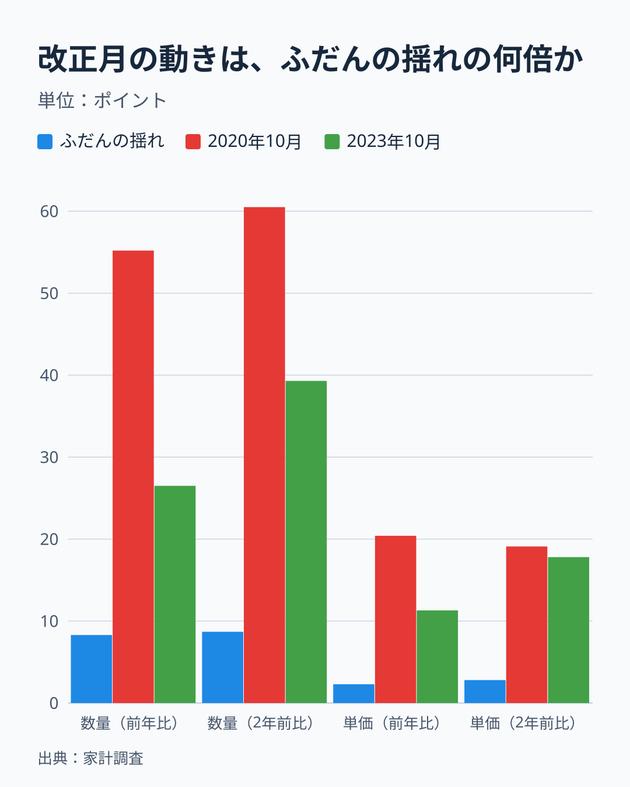

購入数量では、ふだんの揺れが前年比で8.3ポイント、2年前比で8.7ポイントです。2020年10月の窓の変化は、前年比で55.2ポイント、2年前比で60.5ポイントで、ふだんの揺れの6.6倍と7.0倍でした。2023年10月は、前年比で26.5ポイント（3.2倍）、2年前比で39.3ポイント（4.5倍）です。購入単価では、ふだんの揺れが前年比で2.3ポイント、2年前比で2.8ポイントで、2020年10月が20.4ポイント（8.7倍）と19.1ポイント（6.9倍）、2023年10月が11.3ポイント（4.8倍）と17.8ポイント（6.4倍）でした。穏やかな期間の窓の変化の絶対値の最大は、前年比の数量で17.7ポイント、単価で5.7ポイントで、改正月の窓の値は、これを大きく上回ります。

ただし、この「ふだんの揺れ」は、穏やかな2016〜2019年だけで作った基準です。コロナ禍と値上げの時期を含む2021年4月から2022年6月に始まる15窓で同じ値を計算すると、標準偏差は数量で14.6ポイント、単価で7.4ポイント、絶対値の最大は数量で35.2ポイント、単価で20.6ポイントに達します。2020年10月の直前3か月は、コロナ禍で発泡酒が大きく伸び、ビールとの差が大きくマイナスに偏っていました。改正月の窓の大きさは、穏やかな期間の基準では「偶然の揺れでは説明しにくい」と言えます。拡張した窓の基準と比べると、2023年10月は、前年比の数量（26.5）と単価（11.3、17.8）は範囲に収まり、2年前比の数量（39.3）だけが最大をわずかに上回り、2020年10月の単価（20.4、19.1）は拡張した窓の最大（20.6）とほぼ同じです。2020年10月の数量（55.2、60.5）だけは、拡張した窓の最大（35.2）も上回ります。

つまり、改正月に、ビールと発泡酒の相対的な動きが、穏やかな時期のふだんの揺れの3倍から9倍の大きさで起きたことは確かです。ただし、その動きが税の改正による効果か、同じ時期のコロナ禍、値上げ、前年の駆け込みの影響かを、この図だけで分けることはできません。購入単価の動きは、消費者物価指数で独立に確かめられ、税の向きに一貫しています。購入数量の動きは、前年の事情に引きずられます。

## 発泡酒が減り続けたのは、税だけで説明できるか

発泡酒の年間購入数量は、2019年から2023年の4年で8%、2020年から2023年の3年で20%減り、2023年から2025年の2年で26%減りました。2020年の31.35リットルは、コロナ禍の巣ごもりで増えた分を含み、その反動で2021年に13.7%、2022年に6.7%減っています。2020年から2023年の減少は、コロナ禍の増加が元に戻った動きと、2020年10月の新ジャンルの増税、2022年の値上げが重なった結果という見方があり、[仮説]ですが、3つの寄与を分ける方法は、この記事にはありません。

2023年10月以降の減少（2024年に18.4%減、2025年に9.8%減）は、2023年までより大きい減少で、2023年10月の改正と時期が一致します。新ジャンルの税率が46.99円へ上がり、発泡酒の購入単価が375円から410円へ上がった時期でもあります。ただし、2024年と2025年には、ビールの価格が相対的に安くなったこと、物価全体の上昇、飲酒習慣の変化も同時に起きていて、税の寄与だけを取り出す方法は、この月次データにはありません。2025年の分類改定で、2024年以前の値は統計局が新分類へ接続した値で、2024年の18.4%減もその接続を経ています。

## 2026年10月の一本化の前に

2026年10月には、ビール、発泡酒、新ジャンルが54.25円にそろいます。ビールは63.35円から約9円の減税、麦芽比率25%未満の発泡酒と新ジャンルは46.99円から約7円の増税です。この記事を書いている2026年11月9日の時点で、家計調査の月次データは2026年8月分まで登録されており、2026年9月分（増税前の月）と10月分（改正月）は、まだ観測できません。公表の予定は、統計局の公表予定で確かめる必要があります。

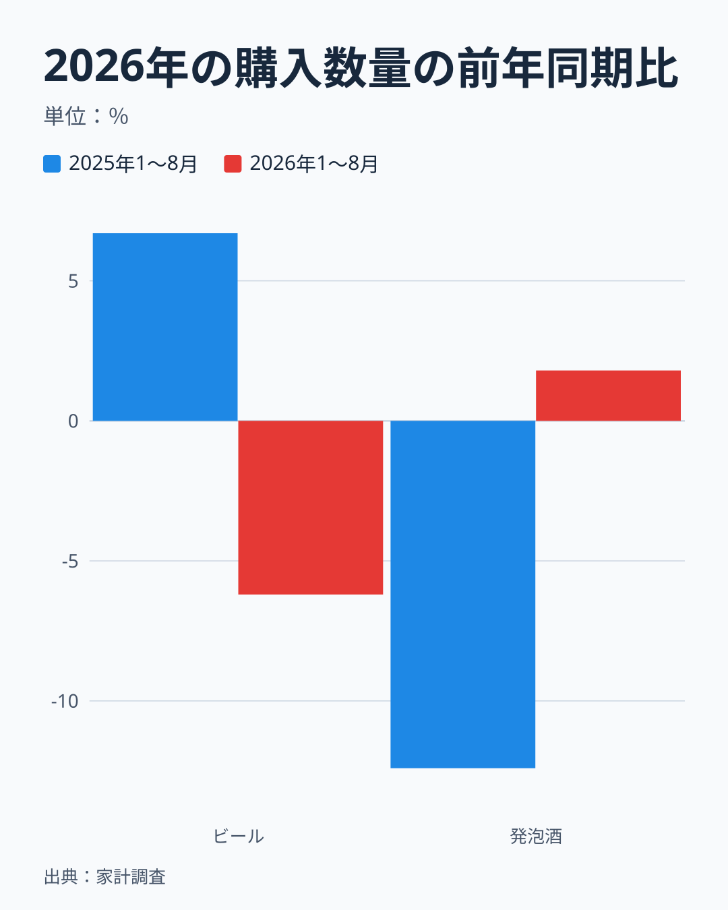

2026年1月から8月の購入数量を、前年の同じ期間と比べると、ビールは6.2%減、発泡酒は1.8%増でした。2025年の同じ期間は、ビールが6.7%増、発泡酒が12.4%減で、向きが逆になっています。2025年までの流れ（ビールが増え、発泡酒が減る）が、2026年の1〜8月には止まったように見えます。この理由は、このデータからは分かりません。標本の誤差か、一本化を前にしたビールの買い控えか、発泡酒の底打ちかを分けるには、2026年9月と10月以降のデータが必要です。1〜8月の値は年計ではなく、前年の同じ8か月との比較だけが意味を持ちます。

## まとめ: 価格は税の向きに動き、数量の反応は切り分けにくい

問いへの答えを整理します。

- **価格**: 消費者物価指数は、改正月（2020年10月・2023年10月）に、ビールが4.3%・4.0%下がり、新ジャンルが12.8%・11.0%上がりました（発泡酒の指数は新ジャンルを含まず、2023年10月の上昇は税の向きと一致しません）。家計調査の購入単価の前年同月比も、ビールで下がり、発泡酒（新ジャンルを含む）で上がり、2年前比でも同じ向きです。動きの大きさは、穏やかな時期のふだんの揺れの約5〜9倍でした。税額の差の縮小は、ビールと新ジャンルで1リットルあたり約103円（消費税込み）、麦芽比率25%未満の発泡酒とでは約43円で、購入単価の差の縮小（102円）は、新ジャンルの購入が大半なら整合する大きさです。
- **買う時期**: 2年前の同じ月と比べると、発泡酒は、増税の直前の月に大きく増え、直後に減りました（2020年9月プラス74.0%、10月マイナス23.2%）。ただし2020年は夏から増加が続いていて、2023年は値上げの前後（2022年9月・10月）の水準が持ち越されています。2023年9月の駆け込みの増分は、前年比でプラス13.0%が目安で、ビールの買い控えは見えません。税の改正による買い時期のずれを、他の要因から切り分けることはできませんでした。
- **長い目**: 発泡酒の年間購入数量は、2019年の27.15リットルから2025年の18.40リットルへ32%減り（2020年のコロナ禍のピーク比では41%減）、ビールは19.42リットルから25.11リットルへ29%増えました（同23%増）。2024年にビールが発泡酒を再び上回っています。
- **支出額**: ビール＋発泡酒の年間支出額は2020年から2025年で3.1%減にとどまりましたが、購入数量は16.0%減りました。ビール・発泡酒・チューハイ・カクテルの3つの合計は1.1%増で、同じ予算で買える量が減りました。
- **限定**: 家計調査の発泡酒には、減税・据え置き・増税の3つの区分が混ざり、新ジャンルだけの反応は測れません。2010年に発泡酒の品目の範囲が変わった可能性があり、2025年の分類改定の接続値を含みます。コロナ禍、消費税率の引き上げ、2022年の値上げ、天候（未検討）が同じ時期に重なり、税の改正だけの効果は切り分けられません。月次の値は標本の誤差が大きく、2026年10月の一本化後は未観測です。

次に確かめたいのは、2026年9月以降の動きです。一本化の直前の買い控えと駆け込み、直後の反動が出るか、その後に発泡酒の減少が止まるかを、同じ方法（前年同月比と2年前比、ふだんの揺れとの比較）で確かめられます。ビールと発泡酒の県別の違いは[ビールと発泡酒の県別の記事](/blog/beer-vs-happoshu-shift)で、家計調査の食費の全体像は[食費・家計消費のテーマ](/themes/household-food-spending)で読めます。

## データについて

出典は総務省統計局の「家計調査」家計収支編の、二人以上の世帯（農林漁家世帯を含む）・全国の、ビール（品目分類の3X4）と発泡酒（同3X7）、チューハイ・カクテル（同3X8）の月次と年次の支出額・購入数量と、消費者物価指数（2020年基準・全国）の品目別の月次の指数です。家計調査は2025年改定の品目分類の表で、2024年以前の値は統計局が新分類に接続した値です。購入単価は、支出額を購入数量（リットル）で割った値で、物価指数ではなく、その月に家計が実際に買った商品の平均です。税込みの名目額です。

酒税の税額は、国税庁の資料（令和5年8月）にある350ミリリットル換算の値を転記したもので、2026年10月の値は法令で決まっている予定の税額です。2023年10月に新ジャンルが発泡酒と同じ税率の区分に移る扱いも、同じ資料に基づきます。1リットルあたりの税額は、350ミリリットル換算の値を0.35で割った値（ビール77.00円は220円/リットル）で、消費税10%を含める計算は1.1を掛けています。

前年同月比は、前年の同じ月と比べた増減率、2年前比は、2年前の同じ月と比べた増減率です。「3か月の平均」は、月ごとの前年同月比の単純平均です。ふだんの揺れは、ビールと発泡酒の前年同月比（または2年前比）の差について、直後3か月の平均と直前3か月の平均の差を、2016年4月から2019年5月に始まる38の窓で求めた標準偏差です。年の途中の月は、前年の同じ期間との比較にだけ使い、年計の代わりには使っていません。本文に出てくる、図に入っていない値（年間の増減率、比、2022年の月ごとの値、2019年の値、窓の平均、消費者物価指数の水準、拡張した窓の値など）は、補助値の一覧として図のデータとあわせて控えてあります。
