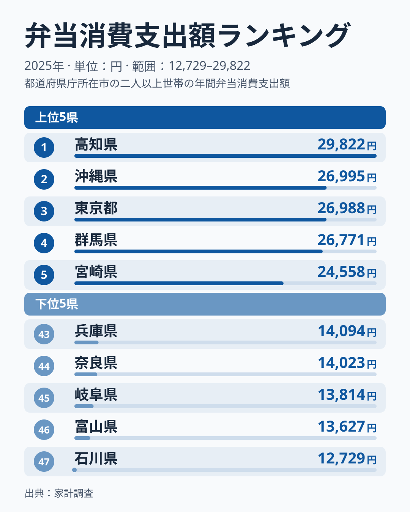
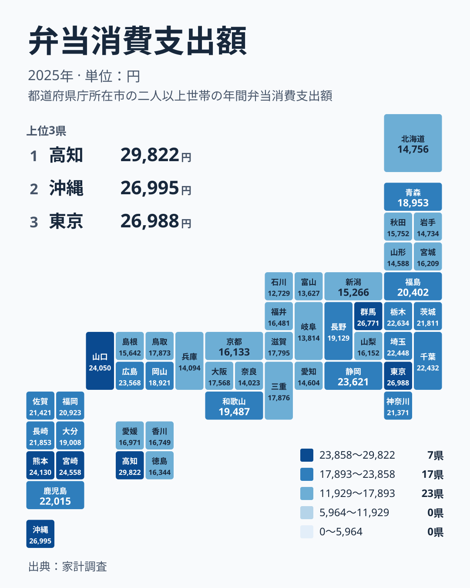

弁当は、コンビニやスーパー、専門店で手軽に買える食事です。昼食や夜食、行楽や仕事の場面で、日常的に利用している人も多いでしょう。ところが、1年間にどれだけ弁当へお金を使うかを都道府県別に並べると、地域によってはっきりした差があります。

この記事では、2025年の家計調査にもとづく弁当への支出額(単位は円)を取り上げます。まず順位の両端を確かめ、次に地方ごとの傾向を整理します。そのうえで、差の背景として考えられることを、仮説であると断ったうえで述べます。数値はすべて、あらかじめ集計された実データだけを使っています。

## 弁当への支出は高知県が最多、石川県が最少

2025年に弁当への支出額が最も多かったのは高知県で、29,822円でした。2位は沖縄県の26,995円、3位は東京都の26,988円、4位は群馬県の26,771円、5位は宮崎県の24,558円と続きます。

一方、最も少なかったのは石川県で、12,729円でした。46位は富山県の13,627円、45位は岐阜県の13,814円、44位は奈良県の14,023円、43位は兵庫県の14,094円です。

<source-link href="/ranking/bento-consumption-expenditure">弁当への支出ランキングをもっと見る</source-link>

図の両端を見比べると、1位の高知県は29,822円、47位の石川県は12,729円です。同じ日本で、同じように弁当が買える環境にあっても、家計が弁当に回す金額はこれだけ違います。1位の金額は、最下位の金額の2倍を大きく超えています。

上位5県を地方でみると、四国の高知県、九州・沖縄の沖縄県と宮崎県、関東の東京都と群馬県です。大都市を抱える県だけが上位を占めているわけではなく、地方の県が混じっている点が目を引きます。弁当への支出の多さは、単純な都会と地方の差だけでは説明しきれません。

下位5県は、中部の石川県、富山県、岐阜県と、近畿の奈良県、兵庫県です。中部の3県が最下位から45位までを占め、近畿の2県がその上に続く形になっています。

> [!NOTE]
> ここでの弁当への支出額は、家計調査で世帯が1年間に弁当へ支払った金額を指します。店で買った弁当や配達された弁当の購入が中心です。自宅で作って持参する弁当の材料費は、弁当ではなく食材の支出として別に扱われるため、この数字には含まれません。

## 全国の地理分布から見えるもの

次の図は、47都道府県の支出額を地図の配置に合わせて色分けしたものです。

関東では、東京都が3位、群馬県が4位、栃木県が10位、埼玉県が11位、千葉県が12位、茨城県が15位、神奈川県が17位です。いずれも上位から中位の前半に収まっています。関東は全体として、弁当への支出が厚い地方だといえます。

九州・沖縄も似た傾向です。沖縄県が2位、宮崎県が5位、熊本県が6位、鹿児島県が13位、長崎県が14位、佐賀県が16位、福岡県が18位、大分県が22位でした。大分県を除けば、いずれも上位20位以内に入っています。

反対に、北海道・東北は中位から下位に寄っています。福島県が19位、青森県が23位、宮城県が33位、秋田県が36位、北海道が39位、岩手県が40位、山形県が42位です。近畿は幅が広く、和歌山県が20位、三重県が25位、滋賀県が27位、大阪府が28位、京都府が35位、兵庫県が43位、奈良県が44位でした。

つまり、弁当への支出は地方単位でゆるやかな傾向を持ちつつも、同じ地方の中で順位が大きく離れる例が少なくありません。中部でも、静岡県が8位である一方、富山県は46位、石川県は47位です。地方という単位だけで、各県の事情を言い表すことはできません。

> [!TIP]
> 順位だけでなく、金額の間隔にも注目すると読み違いを防げます。たとえば2位の沖縄県は26,995円、3位の東京都は26,988円で、ほぼ並んでいます。この付近の順位は、わずかな差で入れ替わりうるものとして読むのが無難です。

## 高知県と沖縄県が上位にある背景を考える

首位の高知県と2位の沖縄県は、いずれも大都市圏の外にある県です。この2県が上位に並ぶことは、弁当への支出が都市部だけの現象ではないことを示しています。

なぜこの2県で多いのかは、今回のデータからは分かりません。以下は仮説の一例にすぎず、検証したものではありません。たとえば、持ち帰りや仕出しの食事を使う機会が多い地域では、弁当への支出が増えるかもしれません。惣菜や弁当を扱う店が身近にあるかどうかも、影響する可能性があります。

確かなのは、この2県の金額が全国の中でも突出して高いという点だけです。背景を探るには、外食費や調理食品など別の統計とあわせて見る必要があります。それぞれの県の統計は、[高知県のデータ](/areas/39000)と[沖縄県のデータ](/areas/47000)で確認できます。

## 下位の中部・近畿の県の位置づけ

下位に並ぶ石川県、富山県、岐阜県は、いずれも中部の県です。奈良県と兵庫県は近畿に属します。5県の金額は、石川県の12,729円から兵庫県の14,094円までに収まっています。

下位の県で支出が少ない理由も、統計からは言えません。一つの見方として、弁当を買わずに自宅で食事を済ませる世帯が多い可能性は考えられます。ただし、これを裏づける数字は今回の実データにはありません。

分かるのは、順位の下位が特定の一つの地方に集まっているわけではないことです。中部の3県が最下位付近にあり、近畿の2県が続く一方、同じ中部でも静岡県は8位、長野県は21位に入っています。県ごとの違いが大きく、地方の名前だけでは性格を決められません。

> [!WARNING]
> この指標は、家計調査という標本調査にもとづいています。県によって調査対象の世帯数が限られるため、年ごとのぶれが大きくなる場合があります。1年分の順位だけで、その県の食文化や暮らしぶりを決めつけるのは避けてください。

## 弁当と他の食費は合算できない

弁当は、外食や調理食品などとは別の項目として集計されています。そのため、弁当への支出が少ない県でも、外食や惣菜への支出が少ないとは限りません。逆に、弁当が多い県が食費全体で多いとも限りません。

この記事の数字は、あくまで弁当という一つの項目の差を示したものです。食の違いを広く論じるには、他の項目の値を同じ年・同じ単位でそろえて比べる必要があります。他の統計は、[同じカテゴリの統計一覧](/category/economy)から探せます。

## データについて

この記事で使った統計は、家計調査にもとづく弁当消費支出額です。2025年の年間支出額を、単位は円で都道府県別に集計しています。集計の対象は47都道府県で、順位は支出額の多い順です。

数字の比較にあたっては、次の点に注意してください。

- 金額は世帯あたりの年間支出額であり、人口全体の消費量ではありません。
- 調査は標本にもとづくため、県によって誤差の幅が異なります。
- 順位が近い県どうしは、実質的に同水準とみるのが無難です。

## まとめ

2025年の弁当への支出は、高知県が29,822円で1位、沖縄県が26,995円で2位、東京都が26,988円で3位でした。最下位は石川県の12,729円で、上位と下位の差は大きく開いています。

関東と九州・沖縄では、多くの県が上位に入りました。一方で、中部の石川県、富山県、岐阜県と、近畿の奈良県、兵庫県は下位に並んでいます。

差の背景には、食の習慣や暮らし方が関わっているのかもしれませんが、この記事のデータだけでは確かめられません。背景として考えられる程度に受け止めつつ、自分の住む県や出身の県の位置を確かめてみてください。
