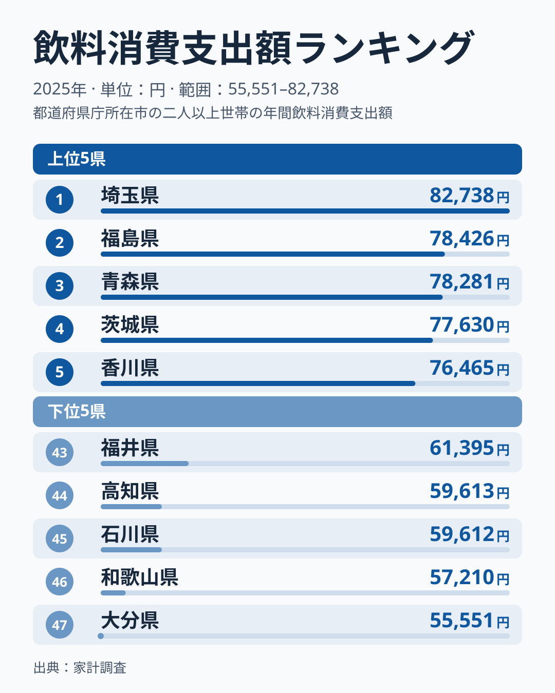
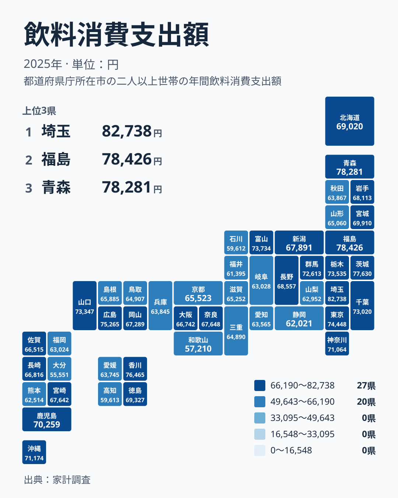

毎日の食卓や休憩時間に欠かせない飲み物ですが、1年間にいくら使うかは、住む場所によって違いがあります。2025年の家計調査で飲料への支出が最も多かったのは埼玉県で、82,738円でした。最も少なかったのは大分県で、55,551円です。

この記事では、飲料への支出が多い県と少ない県を並べ、地方ごとの広がりと、食文化や気候との関わりを考えます。分野全体の統計を見たい方は、[同じカテゴリの統計一覧](/category/economy)も参考にしてください。

> [!NOTE]
> ここでいう飲料は、家計調査の「飲料消費支出額」で、1世帯あたりの年間支出額です。茶類やコーヒー・ココアなどの品目を含みますが、酒類は別の品目として集計されるため、この数字には入っていません。ビールや日本酒の多さを示す指標ではない点に注意してください。

## 上位と下位の顔ぶれ

まず、上位と下位を並べた図を見てください。

<source-link href="/ranking/beverages-group-consumption-expenditure">飲料への支出ランキングをもっと見る</source-link>

1位は埼玉県で82,738円です。2位は福島県で78,426円、3位は青森県で78,281円、4位は茨城県で77,630円、5位は香川県で76,465円でした。上位5県のうち、関東は埼玉県と茨城県の2県、北海道・東北は福島県と青森県の2県、四国は香川県の1県です。2位の福島県と3位の青森県は、78,426円と78,281円で近い値です。

一方、下位は47位の大分県が55,551円、46位の和歌山県が57,210円、45位の石川県が59,612円、44位の高知県が59,613円、43位の福井県が61,395円です。石川県と高知県は1円しか違いません。

下位5県は、九州・沖縄の大分県、近畿の和歌山県、中部の石川県と福井県、四国の高知県と、地方がばらけています。この範囲では、特定の地方に下位が固まる様子は見られません。理由はこのデータからは分かりませんが、県ごとに異なる事情があるのかもしれません。

最上位と最下位の比は、82,738円と55,551円です。1年間の飲料への支出が、これだけ開いていることになります。

詳しい数字は、トップの[埼玉県のデータ](/areas/11000)や、2位の[福島県のデータ](/areas/07000)のページでも確認できます。

## 地方ごとに見る広がり

次に、地理的な広がりを見ます。タイルマップで、色の濃淡がどう分布しているかを確かめてください。

関東は、埼玉県が1位、茨城県が4位、東京都が7位、栃木県が9位、千葉県が11位、群馬県が12位、神奈川県が14位です。関東の7都県はすべて14位以内に収まっていて、地方全体として高い水準にあります。

北海道・東北では、福島県が2位、青森県が3位、宮城県が16位、北海道が18位、岩手県が20位です。山形県は31位、秋田県は34位でした。同じ地方でも、順位には大きな幅があります。

中部は、富山県が8位、長野県が19位、新潟県が21位と中位から上位に分かれます。岐阜県が38位、山梨県が40位、静岡県が42位、福井県が43位、石川県が45位と、下位に並ぶ県もあります。愛知県は37位です。

近畿は、奈良県が22位、大阪府が26位、京都府が29位、滋賀県が30位、三重県が33位、兵庫県が35位、和歌山県が46位で、全体に中位から下位に寄っています。

中国では、広島県が6位、山口県が10位、岡山県が24位、島根県が28位、鳥取県が32位です。上位に入る県と中位の県が混ざっています。

九州・沖縄は、沖縄県が13位、鹿児島県が15位、宮崎県が23位、長崎県が25位、佐賀県が27位です。福岡県は39位、熊本県は41位、大分県は47位で最下位でした。同じ地方の中でも、13位から47位まで広く散らばっています。

四国は、香川県が5位、徳島県が17位、愛媛県が36位、高知県が44位です。こちらも上位から下位まで幅があります。

> [!TIP]
> 上位5位の82,738円から76,465円までは、順位で見ると5つ分ですが、金額の幅は限られています。一方、下位の47位から43位も55,551円から61,395円の範囲です。地図の色の差は順位に基づくので、色ほど金額の差は大きくない場合があります。濃淡は、必ず金額と合わせて読んでください。

## 食文化・気候から考える

なぜこれほど差が出るのでしょうか。以下は一般的に考えられる仮説であり、このデータから因果関係を断定するものではありません。

まず、気候です。夏の暑さが厳しい地域では、冷たい飲み物の消費が増えやすいと考えられます。ただ、今回の上位には北海道・東北の福島県や青森県も入っています。気候だけでは説明しにくい結果です。日常的な飲み方や買い方の違いが関わっている可能性もありますが、それを示すデータはここにはありません。

次に、買い物の環境です。関東の県では、スーパーやドラッグストア、自動販売機が身近にあり、ペットボトル飲料などを買う機会が多いという見方があります。これはあくまで仮説の一つです。埼玉県が1位で、東京都が7位、千葉県が11位、神奈川県が14位という並びだけでは、この見方が正しいとは言えません。

三つ目は、家庭での飲み物の作り方です。茶葉から淹れて飲む家庭では、市販の飲料への支出が小さくなるかもしれません。この指標は、飲む量ではなく、買った金額で測られていることを忘れないでください。

香川県が5位に入っている点も気になるところですが、データだけでは理由を確かめられません。世帯の年齢構成や共働き世帯の多さなど、別の要因が隠れている可能性もあります。

## 関連品目との対比で読む

飲料の中身も押さえておきます。家計調査では、茶類、コーヒー・ココア、その他の飲料などが別の品目になっています。県ごとの傾向は、品目によって異なる可能性があります。

今回の飲料全体の順位は、これらをまとめた結果です。飲料全体で上位の県が、すべての品目で上位とは限りません。品目ごとの順位は、サイトの品目別ランキングで確認できます。

また、酒類は別に集計されるので、お酒の支出と飲料の順位は直接つながりません。同じ「飲み物」でも、見る品目によって地図は変わります。飲料の順位だけで、その県の飲み物の好みを語るのは早計です。

> [!WARNING]
> 家計調査は標本調査で、都道府県単位では調査した世帯数が限られます。そのため、順位が近い県同士の差は、誤差の範囲にとどまることがあります。たとえば、44位の高知県と45位の石川県は1円しか違いません。小さな順位差を、本当の違いとして読まないようにしてください。

## 上位と下位の差をどう受け止めるか

最後に、全体を整理します。1位の埼玉県は82,738円、最下位の大分県は55,551円で、同じ国内でも飲料への支出には開きがあります。

要点は次の通りです。

- 上位は埼玉県、福島県、青森県、茨城県、香川県です。
- 関東の7都県は、すべて14位以内に入っています。
- 下位は大分県、和歌山県、石川県、高知県、福井県で、地方はばらばらです。
- 同じ地方の中でも、順位が大きく割れる例が多く見られます。

こうした差の背景には、気候、買い物の環境、家庭での飲み方、世帯の構成など、さまざまな要因が考えられます。ただし、どれが効いているかは、このデータだけでは確かめられません。家計調査の数字は、飲む量そのものではなく、お金をかけた量を表します。この点を意識して読むと、順位の意味が正しく見えてきます。

## データについて

この記事の数値は、家計調査の2025年の結果にもとづく、飲料消費支出額です。単位は円で、1世帯あたりの年間支出額を表します。順位は、金額の高い順に付けています。

細かい集計方法は調査の公表資料で確認してください。比較するときは、同じ年の同じ品目どうしを並べることが大切です。
