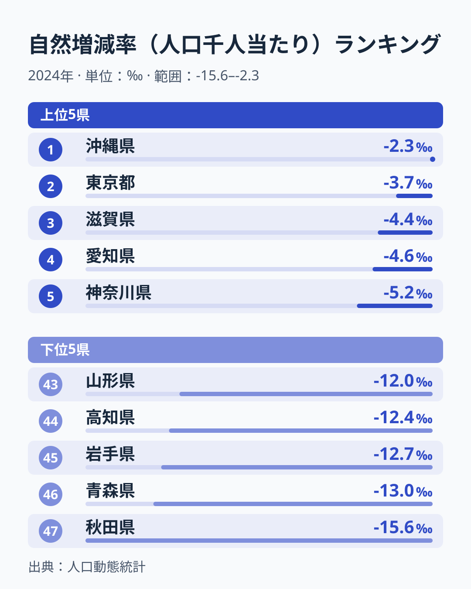
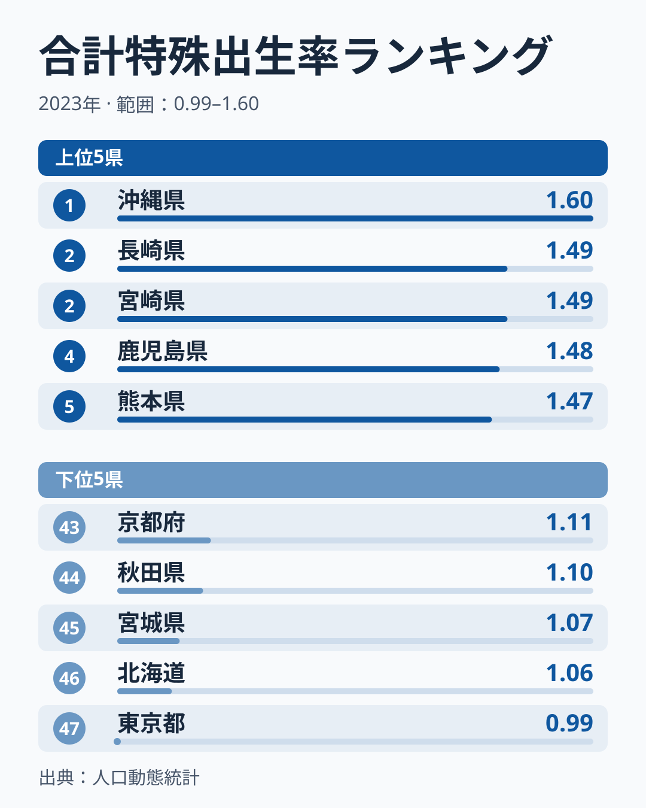
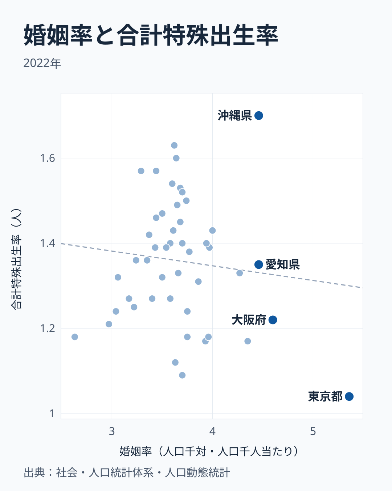

「東京は婚姻率が全国で最も高いのに、合計特殊出生率は0.99で全国最下位」──同じ東京で、結婚は多いのに子どもは少ないように見えます。この食い違いは、何を意味するのでしょうか。

**2023年、都道府県の値を合計した出生数は約72.7万人、死亡数は約157.5万人でした。** 差し引き約84.8万人の人口が1年で自然に減った計算です。2024年には自然増の都道府県が1つもなく、2021年まで自然増だった[沖縄県](/areas/47000)も2022年に自然減へ転じました。

この記事では、まず自然増減と出生率の県別の姿を確かめ、次に婚姻率と出生率を47都道府県で並べて、東京の食い違いがどこから来るのかを、データで言える範囲で読みます。先に答えの一部を書くと、婚姻率と出生率は分母が違う指標で、47都道府県を並べると両者にはほとんど関係が見られません。

> [!NOTE]
> 出生数・死亡数・合計特殊出生率・婚姻率・平均初婚年齢・第1子出生時の母の平均年齢は人口動態統計、未婚者割合は国勢調査の値で、自然増減率と従属人口指数は社会・人口統計体系から取った値です。最新年は指標ごとに違い、自然増減率は2024年、出生数・死亡数・合計特殊出生率・平均初婚年齢・第1子出生時の母の平均年齢は2023年、婚姻率と従属人口指数は2022年、未婚者割合は2020年です。

## 全47都道府県で自然増はゼロ──沖縄も自然減に

自然増減率は、出生数から死亡数を引いた差を人口千人当たりで表した値です。2024年に最も自然減が小さかったのは[沖縄県](/areas/47000)のマイナス2.3‰で、東京都のマイナス3.7‰、滋賀県のマイナス4.4‰、愛知県のマイナス4.6‰、神奈川県のマイナス5.2‰が続きます。上位5都県でもすべて自然減で、増えている県は1つもありません。沖縄県は2021年にはプラス0.9‰で、2022年にマイナス0.5‰となり、その後も減少の幅が広がっています。

反対に最も自然減が大きかったのは[秋田県](/areas/05000)で、人口千人当たり15.6人の自然減でした。青森県のマイナス13.0‰、岩手県のマイナス12.7‰、高知県のマイナス12.4‰、山形県のマイナス12.0‰と、東北の4県と高知県が並びます。秋田県は、出生と死亡の差だけで見ると、2024年に人口の減り方が最も速い県です。

[東京都](/areas/13000)の自然減は全国で2番目に小さい水準です。ただし、これは出生率が高いからではありません。2023年の東京都は出生が約8.6万人に対して死亡が約13.7万人で、差し引き約5.1万人の自然減でした。自然増減率の分母は人口全体なので、高齢者の割合が小さい都県ほど、人口に対する死亡数が少なくなり、自然減の比率が小さく出ます。[仮説] 年齢構成が若いことが東京の自然減率を小さくしている。検証するには、年齢調整した死亡率や、年齢別の人口構成との突き合わせが必要です。なお、他地域からの転入は社会増減に数えられ、自然増減には含まれません。

<source-link href="/ranking/natural-increase-rate">自然増減率ランキングをもっと見る</source-link>

あわせて見る: [出生数ランキング](/ranking/births) / [人口増減率ランキング](/ranking/population-growth-rate)

## 合計特殊出生率ランキング──東京だけが1を下回る

合計特殊出生率は、15〜49歳の女性の年齢ごとの出生率を足し合わせた値で、その年の出生の水準が続いた場合に、1人の女性が一生の間に産む子どもの数の目安になります。女性の年齢ごとに率を出してから足すので、人口に若い人が多いか少ないかの影響を受けにくい指標です。

2023年の合計特殊出生率は、沖縄県の1.60が全国1位です。2位は長崎県と宮崎県の1.49、4位は鹿児島県の1.48、5位は熊本県の1.47で、上位5県は沖縄県を除いてすべて九州の県です。

下位に目を移すと、東京都が0.99で最下位です。全国で唯一、合計特殊出生率が1を下回りました。2023年の年齢ごとの出生の水準が続けば、東京の女性1人が一生の間に産む子どもの数は、平均で1人に届かない計算です。次に低いのは北海道の1.06、宮城県の1.07、秋田県の1.10、京都府の1.11と続き、東京の0.99だけが1を割っています。

下位5都道府県には、東京都、札幌市を抱える北海道、仙台市を抱える宮城県、京都市を抱える京都府と、大きな都市を抱える都道府県が4つ入ります。秋田県は大都市を持たない県ですが、出生率でも下位に入り、自然減も全国で最も大きい県です。出生率の低い県は、大都市の県と、人口減少の速い県の両方にまたがっています。

<source-link href="/ranking/total-fertility-rate">合計特殊出生率ランキングをもっと見る</source-link>

## 婚姻率が最も高い東京が出生率は最下位──2つの率は分母が違う

婚姻率の最新年は2022年なので、この節は2022年どうしで比べます。2022年の婚姻率は東京都が人口千人当たり5.36で最も高く、大阪府の4.60、愛知県と沖縄県の4.46が続きます。一方、2022年の合計特殊出生率は東京都が1.04で47位です。散布図では、東京都が右下に1つだけ離れて位置しています。

47都道府県全体で見ると、婚姻率が高い県ほど出生率も高い、という関係はほとんど見られません。2022年の相関係数（筆者の計算）はマイナス0.11で、ほぼ無相関です。東京都を除いて計算し直してもプラス0.08で、やはり関係はほとんどありません。沖縄県は婚姻率4.46と出生率1.70がどちらも上位ですが、宮崎県は婚姻率が3.62と中位なのに出生率は1.63で2位です。婚姻率の順位から出生率の順位は読めません。

この食い違いの一部は、2つの率の分母の違いから生じている可能性があります。婚姻率は1年間の婚姻件数を、子どもや高齢者も含む人口全体の千人当たりにした値です。そのため、結婚する年代の人が人口に占める割合が高い都道府県ほど、結婚のしやすさが同じでも婚姻率は高く出ます。これに対して合計特殊出生率は、上の節のとおり女性の年齢ごとの率を足した値で、人口の年齢構成の影響を受けにくい指標です。

東京都の従属人口指数（15〜64歳の人口100人当たりの、子どもと高齢者の数）は2022年に50.9で、47都道府県で最も低い値でした。働く年代の人の割合が最も高い都道府県ということです。ただし従属人口指数は15〜64歳という広い年代でくくった指標で、結婚する年代の人の割合そのものではなく、代わりの目安にとどまります。47都道府県で従属人口指数と婚姻率を並べると、相関係数（筆者の計算、2022年）はマイナス0.82で、従属人口指数が低い県ほど婚姻率が高いという強い関係があります。[仮説] 東京の婚姻率の高さは、結婚する年代の人が多いことで押し上げられている部分がある。検証するには、20〜39歳の人口当たりの婚姻件数を都道府県別に計算し直し、東京の順位がどう変わるかを見る必要があります。

したがって、このデータから「東京では結婚しても子どもを持たない」と言うことはできません。婚姻率と出生率は数える相手が違うため、2つの順位の食い違いの一部は、指標の作り方から生じている可能性があります。東京の出生率の低さそのものについては、住居費の高さや長時間労働、保育の受け皿といった要因が挙げられることがありますが、この記事のデータだけではどれが効いているかを特定できません。[仮説] 子どもを持つための費用と時間の負担が大都市で重い。検証するには、世帯の住居費や通勤時間、保育所の待機児童数を県別に並べ、出生率との関係を見る必要があります。

> [!WARNING]
> 散布図は、同じ2022年の都道府県の値を並べたものです。相関係数は県どうしの値の並び方を表すだけで、結婚と出生のあいだの因果関係を示すものではありません。また、県の値はその県に住む人全体の平均で、個々の夫婦が何人の子どもを持つかとは別のものです。

<source-link href="/ranking/marriages-per-total-population">婚姻率ランキングをもっと見る</source-link>

あわせて見る: [従属人口指数ランキング](/ranking/dependent-population-index)

## 未婚と晩婚──東京の位置は男女と年代で変わる

結婚に関わる指標を、国勢調査と人口動態統計の県別の値でもう少し見ます。ここでも数値は都道府県の値で、全国の値は扱いません。

2020年の国勢調査で、45〜49歳の男性の未婚者割合は、青森県が29.7%、岩手県が29.5%、埼玉県が28.8%と高く、最も低い滋賀県でも21.8%でした。東京都は24.6%で、高いほうから35番目と、高い側には入りません。一方、45〜49歳の女性の未婚者割合は、東京都が19.4%で、北海道と並んで2番目に高い値でした。30〜34歳で見ても、男性の東京都は39.9%で47都道府県で2番目に低く、女性の東京都は35.1%で7番目に高い値です。東京は「結婚しない人が多い都道府県」と一言でまとめられず、男性と女性で位置が逆になります。

晩婚化は、東京の時系列で確かめられます。東京都の平均初婚年齢は、1975年に夫27.6歳・妻25.5歳でしたが、2023年には夫32.3歳・妻30.7歳になりました。夫は4.7歳、妻は5.2歳遅くなっています。東京都は1975年も2023年も、夫・妻ともに全国で最も遅い都道府県です。2023年に最も早いのは、夫が宮崎県と島根県の30.0歳、妻が島根県の28.9歳です。

第1子を産んだときの母の平均年齢も、2023年は東京都が32.5歳で全国で最も高く、最も低い宮崎県は29.7歳でした。宮崎県は2023年の出生率でも1.49で2位の県です。47都道府県で第1子出生時の母の平均年齢と合計特殊出生率を並べると、相関係数（筆者の計算、2023年）はマイナス0.73で、第1子を産む年齢が高い県ほど出生率が低いという関係があります。[仮説] 第1子を産む年齢が遅いと、2人目・3人目を持つ時間が短くなり、出生率が下がる。検証するには、母の年齢別の第2子・第3子の出生数を県別に比べる必要があります。

あわせて見る: [第1子出生時の母の平均年齢ランキング](/ranking/mothers-age-at-first-birth) / [未婚者割合（男性 45〜49歳）ランキング](/ranking/unmarried-ratio-male-45-49)

## まとめ──東京の食い違いから分かること

この記事で確かめたことを、データで言える範囲で整理します。

- **自然増はゼロ**：2024年は全47都道府県が自然減で、最も小さい沖縄県でもマイナス2.3‰、最も大きい秋田県はマイナス15.6‰でした。
- **出生率は東京だけが1未満**：2023年の東京都は0.99で最下位、1位の沖縄県は1.60です。下位5都道府県のうち4つが大きな都市を抱えます。
- **婚姻率と出生率はほぼ無関係**：2022年の47都道府県で相関係数はマイナス0.11でした。婚姻率は人口全体が分母なので、働く年代の人が多い東京では高く出やすい指標です。婚姻率が最も高いのに出生率が最下位という食い違いの一部は、この分母の違いによる可能性があります（20〜39歳の人口当たりで計算し直す検証は、この記事ではしていません）。
- **晩婚と出生の時期**：東京は平均初婚年齢も第1子出生時の母の平均年齢も全国で最も高く、第1子を産む年齢が高い県ほど出生率が低い関係が見られます。ただし、どちらが原因かはこのデータでは分けられません。

東京の「婚姻率が最も高いのに出生率は最下位」という姿は、結婚した人が子どもを持たないことを直接示すものではありません。出生率の低さの理由を確かめるには、結婚する年代の人口当たりの婚姻率や、母の年齢別の出生を県別に比べることが次の一歩になります。
