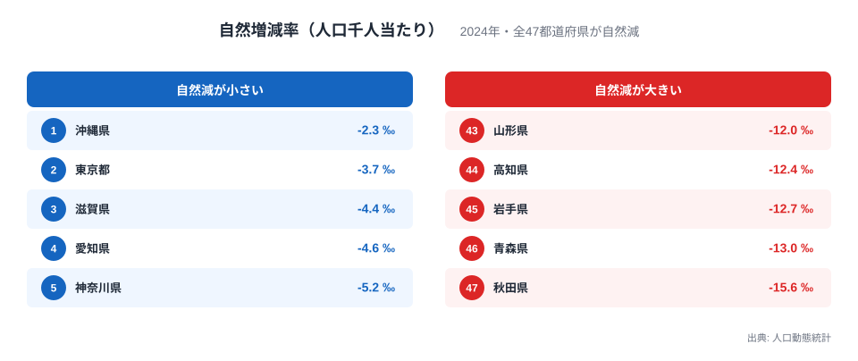
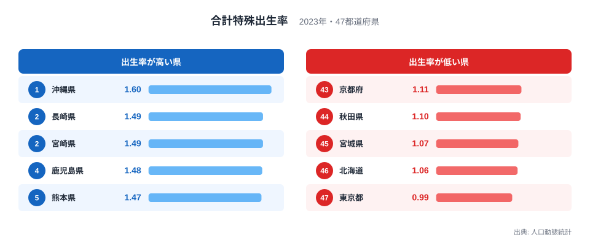

「東京は婚姻率が全国トップなのに、出生率は0.99で全国最下位」──このデータが少子化の本質的な構造を明らかにしています。

**2023年、都道府県の合計で見た出生数は約72.7万人、死亡数は約157.5万人でした。** 差し引き約84.8万人の人口が1年で自然に減った計算です。そして**2024年は全47都道府県で自然増がゼロ**でした。かつて自然増を保っていた[沖縄県](/areas/47000)も、2022年に自然減へ転じています。

なぜ東京は婚姻率が高いのに出生率が最低なのか。その答えは「結婚 → 子ども」という連鎖が大都市で機能しなくなっていることを示しています。

> [!NOTE]
> 出生数・死亡数・自然増減率・合計特殊出生率は人口動態統計（厚生労働省）、婚姻率と初婚年齢は同じく人口動態統計、未婚率は国勢調査に基づく値です。合計特殊出生率は1人の女性が一生の間に産む子どもの数の推計値で、2023年の全国値は1.20でした。都道府県の最新年は指標ごとに異なり、自然増減率は2024年、合計特殊出生率と初婚年齢は2023年、婚姻率は2022年です。

## 全47都道府県で自然増はゼロ──沖縄の転落

自然増減率は、出生数から死亡数を引いた差を人口千人当たりで表した値です。2024年に最も自然減が小さかったのは[沖縄県](/areas/47000)のマイナス2.3‰で、東京都のマイナス3.7‰、滋賀県のマイナス4.4‰、愛知県のマイナス4.6‰、神奈川県のマイナス5.2‰が続きます。上位5都府県すら全て自然減で、増えている県は1つもありません。

反対に最も自然減が大きかったのは[秋田県](/areas/05000)で、人口千人当たり15.6人の自然減でした。青森県のマイナス13.0‰、岩手県のマイナス12.7‰、高知県のマイナス12.4‰、山形県のマイナス12.0‰と、東北の県と高知県が並びます。秋田県は全国で最も速いスピードで人口が縮小している県です。

[東京都](/areas/13000)の自然減は全国で2番目に小さい水準です。ただし、これは出生率が高いからではありません。2023年の東京都は出生が約8.6万人に対して死亡が約13.7万人で、差し引き約5.1万人の自然減でした。若い世代が多く集まる都市は、人口に対する死亡数が地方より少なく、自然減の比率が小さく見えるのです。[仮説] 年齢構成が若いことが東京の自然減率を小さくしている。検証するには、年齢調整した死亡率や、年齢別の人口構成との突き合わせが必要です。なお、他地域からの転入は社会増減に数えられ、自然増減には含まれません。

<source-link href="/ranking/natural-increase-rate">自然増減率ランキングをもっと見る</source-link>

あわせて見る: [出生数ランキング](/ranking/births) / [人口増減率ランキング](/ranking/population-growth-rate)

## 合計特殊出生率ランキング──東京0.99の意味

人口を維持するのに必要な「人口置換水準」は約2.07です。しかし日本全体の合計特殊出生率は2023年に**1.20**で、置換水準の6割にも満たない状態でした。

**全47都道府県で、人口を自力で維持できる水準に届いた県はゼロ**です。沖縄県の1.60は全国トップですが、置換水準の2.07には遠く及びません。2位は長崎県と宮崎県の1.49、4位は鹿児島県の1.48、5位は熊本県の1.47で、上位は沖縄県を除いてすべて九州の県です。

下位に目を移すと、東京都が0.99で最下位です。全国で唯一、合計特殊出生率が「1」を下回りました。これは東京で暮らす女性が、統計上は1人未満の子どもしか産んでいない計算です。次に低いのは北海道の1.06、宮城県の1.07、秋田県の1.10、京都府の1.11と続き、東京の0.99が突出していることが分かります。

> [!TIP]
> 出生率が高い県は九州に集まり、低い県は東京と、札幌・仙台・京都という大きな都市を抱える道府県、そして東北の秋田県に並びます。地方のほうが出生率は高いと言えますが、若い世代が都市部に流出するため、出生率が高い地方でも人口を維持できていません。

<source-link href="/ranking/total-fertility-rate">合計特殊出生率ランキングをもっと見る</source-link>

## 東京の逆説──婚姻率トップなのに出生率最下位の構造

ここが少子化の本質です。東京都の婚姻率は2022年に人口千人当たり5.36で全国1位でした。ところが合計特殊出生率は最下位の0.99です。

欧米の先進国では、結婚していない親から生まれる子ども（婚外子）が出生の3〜6割に達する国も珍しくありません。一方、日本では婚外子の割合が2%台と極めて低く、出生のほぼすべてが婚姻関係の中で起きています。

これは「**結婚すれば子どもが生まれる**」という連鎖が成立している社会構造を意味します。だとすれば、東京の婚姻率の高さはなぜ出生率に結びつかないのか。

[仮説] 住居費の高さ、長時間労働、保育所の不足といった、子どもを持つための経済的・環境的ハードルが大都市で重い。東京に集まる若い世代は結婚はしても、子どもを持つことをためらう可能性があります。検証するには、世帯の住居費や通勤時間、保育の待機状況を県別に並べ、出生率との関係を見る必要があります。この記事のデータだけでは原因を特定できません。

<data-source url="https://www.e-stat.go.jp/dbview?sid=0000010101" label="e-Stat 社会・人口統計体系"></data-source>

<source-link href="/correlation?x=total-fertility-rate&y=marriages-per-total-population">出生率×婚姻率の相関をインタラクティブに確認する</source-link>

## 少子化の真因──「産まない」ではなく「結婚しない」構造

東京の逆説は例外ですが、日本全体で見ると「**結婚しない → 子どもが生まれない**」という連鎖が少子化の主因です。

50歳時点の未婚割合（国立社会保障・人口問題研究所の人口統計資料集による。45〜49歳と50〜54歳の未婚率の平均）は、男性で1980年の2.6%から2020年の28.3%へ、女性で4.5%から17.8%へ上昇しました。かつて「結婚して当たり前」だった社会は、いまや男性の3割近くが結婚しないまま50歳を迎える社会へと変わっています。

都道府県別に見ても、2020年の男性の45〜49歳未婚率は青森県が29.7%、岩手県が29.5%、埼玉県が28.8%と高く、最も低い滋賀県でも21.8%あります。地方でも都市でも、男性の5人に1人以上が結婚していない水準です。

晩婚化も進んでいます。1975年に夫27.0歳・妻24.7歳だった平均初婚年齢は、2023年には夫31.1歳・妻29.7歳になりました。**夫は4.1歳、妻は5.0歳**遅くなっています。東京都では夫32.3歳・妻30.7歳と全国で最も遅くなっています。30歳を超えてから出産を始めると、2人目・3人目を望んでも時間的・体力的な制約が大きくなります。

> [!WARNING]
> 「未婚率が高い = 本人が結婚を望んでいない」ではありません。国立社会保障・人口問題研究所の出生動向基本調査では、未婚者の多数が「いずれは結婚するつもり」と答えています。経済的余裕の不足、長時間労働、出会いの機会の減少など**社会構造の要因**が結婚と出産のハードルを上げていると考えられますが、この記事のデータだけでは因果は確認できません。

<data-source url="https://www.e-stat.go.jp/dbview?sid=0000010201" label="e-Stat 社会・人口統計体系（未婚者割合）"></data-source>

## まとめ──「結婚支援だけでは足りない」理由

東京の逆説（婚姻率高・出生率最低）と全国の構造（未婚率上昇 → 出生率低下）を重ね合わせると、少子化対策に必要なことが見えてきます。

「結婚支援だけでは足りない」──東京がそれを示しています。結婚した夫婦が安心して子どもを持てる環境──経済的支援、働き方改革、住居政策、保育環境の整備──が揃って初めて出生率の改善が期待できます。

そして地方は「出生率が高くても若者が流出する」という別の壁を抱えています。人口維持には出生率の改善と同時に、若者が地域に残る・戻る経済的インセンティブが必要です。
