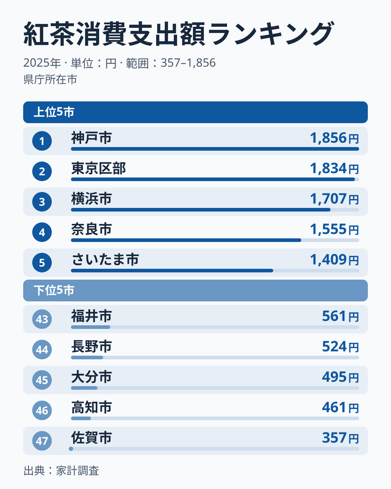
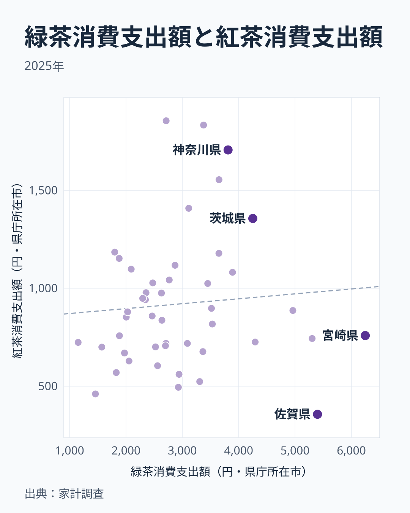

「紅茶は都会の飲み物」という印象を持つ人は多いかもしれません。総務省の家計調査で、都道府県庁所在市の二人以上世帯が1年間に紅茶へ使った金額を見ると、2025年の上位5県は兵庫・東京・神奈川・奈良・埼玉で、すべて関東と近畿にあります。一見すると印象どおりです。

ところが大阪府は19位、福岡県は31位で、大都市を抱える府県でも順位は大きくばらつきます。この記事では、紅茶の支出が「大都市かどうか」でどこまで説明できるのか、そして緑茶をよく買う県ほど紅茶を買わないのかの2つを、47都道府県のデータで確かめます。年収との関係と、量・単価の違いは姉妹記事の[紅茶を飲む県ほど年収も高いのか](/blog/black-tea-income-gap)で扱っています。

> [!NOTE]
> 対象は都道府県庁所在市(東京都は区部)の二人以上の世帯で、金額は1世帯当たりの年間支出額です。「兵庫県1856円」は神戸市の世帯の値で、県全体の値ではありません。この記事で「大都市」と呼ぶのも、県庁所在市そのものの規模のことです。

## 上位5県と下位5県

<source-link href="/ranking/black-tea-consumption-expenditure">紅茶消費支出額ランキングをもっと見る</source-link>

1位は[兵庫](/areas/28000)の1856円、最下位は佐賀の357円で、差は5.2倍です。上位は兵庫・東京・神奈川・奈良・埼玉、下位は福井・長野・大分・高知・佐賀と並びます。47県の中央値は859円で、1位は中央値の約2.2倍にあたります。

上位10県まで広げると、関東4県(東京・神奈川・埼玉・茨城)、近畿4県(兵庫・奈良・和歌山・京都)、中国の岡山県、東北の宮城県です。下位10県は九州・四国・中部などに散らばっていて、特定の地方に固まってはいません。ただし5位の埼玉県1409円と6位の茨城県1357円の差は52円しかなく、家計調査の市別の値は単年でぶれやすいため、「上位5県」という区切りは図の都合と考えてください。

## 大都市ほど高い傾向はあるが、例外が多い

「大都市なら紅茶をよく買う」は、どこまで当たっているのでしょうか。ここでは、県庁所在市が東京都区部か政令指定都市である16都道府県(北海道・宮城・埼玉・千葉・東京・神奈川・新潟・静岡・愛知・京都・大阪・兵庫・岡山・広島・福岡・熊本)を「大都市の県」として、残りの31県と比べました。

大都市の16都道府県の紅茶消費支出額の中央値は1035.5円で、残り31県の中央値758円を上回ります。上位10県のうち7県(兵庫・東京・神奈川・埼玉・京都・岡山・宮城)はこの16都道府県に入っています。大都市の県ほど紅茶への支出が多い傾向は、確かにあると言えます。

一方で、例外もはっきりしています。大阪府は942円で19位、福岡県は726円で31位、静岡県は744円で30位、新潟県は707円で35位と、大都市の県でも中央値の859円前後かそれより下にとどまる県があります。反対に、政令指定都市を持たない県庁所在市でも、奈良県が1555円で4位、茨城県が1357円で6位、和歌山県が1185円で7位に入っています。傾向はあっても、都市の規模だけで順位が決まるわけではありません。

開港地として知られる兵庫(神戸)と神奈川(横浜)が1位・3位に入っているため、港町の喫茶の文化と結びつける見方もあります。[仮説] ただし、データで確かめられるのは「この2県が高い」ことだけです。同じく港町の長崎市を県庁所在地に持つ長崎県は887円で22位で、港のある県がそろって上位というわけではありません。

## 緑茶が強い県では紅茶が弱いのか

紅茶が「わざわざ選ぶ嗜好品」だとすれば、緑茶を日常的に買う県ほど紅茶の出番が少ないという代替関係も考えられます。そこで同じ2025年の緑茶消費支出額と、47県の紅茶消費支出額を並べてみました。

<source-link href="/ranking/green-tea-consumption-expenditure">緑茶消費支出額ランキングをもっと見る</source-link>

相関係数は0.08で、向きとしてはわずかに正ですが、ほぼ無相関でした。緑茶の支出額が最も多い宮崎県は6247円ですが、紅茶は759円で28位です。緑茶が2番目に多い佐賀県は5399円で、紅茶は最下位の357円です。静岡県は緑茶が5304円、紅茶は744円で30位、福岡県は緑茶が4293円、紅茶は726円で31位です。緑茶の上位5県のうち4県は、紅茶が中央値の859円を下回っています。ここだけを見れば代替関係があるようにも見えます。

ところが、茨城県は緑茶が4251円と多いうえに紅茶も6位で、神奈川県は緑茶が3812円、紅茶は3位、奈良県は緑茶が3651円、紅茶は4位です。緑茶と紅茶の両方を多く買う県が存在します。反対に、紅茶が46位の高知県は緑茶も1458円と少なく、緑茶が全国で最も少ない沖縄県は1151円ですが、紅茶は724円で32位と中位です。緑茶の多寡で紅茶の順位を説明することはできません。

代わりに見えてくるのは、緑茶と紅茶を合わせた支出のうち紅茶にどれだけ回すかの違いです。兵庫県は緑茶2713円と紅茶1856円のうち紅茶が約41%で、47県で最も高い割合でした。佐賀県は緑茶5399円と紅茶357円のうち紅茶が約6%で、47県で最も低い割合です。宮崎県は約11%、静岡県は約12%と、緑茶の多い県では紅茶の割合が低くなります。お茶全体への支出の多さよりも、その中で紅茶を選ぶかどうかが、紅茶の順位を左右している可能性があります。

> [!WARNING]
> 相関係数0.08は2025年の1年分の市別の値で見た結果です。単年の市別データは標本が小さく、順位の細部は年によって入れ替わる可能性があります。また相関が無いことは、県ごとの事情で代替が起きていないことまでは意味しません。

## わかったことと、確かめられなかったこと

確認できたことは次のとおりです。

- 県庁所在市が政令指定都市か東京都区部の16都道府県は、紅茶の支出の中央値が残りの31県より高く、上位10県のうち7県を占めます。ただし大阪・福岡・静岡・新潟のように中位以下の県もあり、都市の規模だけでは順位は決まりません。
- 緑茶消費支出額との相関は0.08で、緑茶が強い県ほど紅茶が弱いという関係は全国では見られません。
- 緑茶と紅茶を合わせた支出に占める紅茶の割合は、兵庫県の約41%から佐賀県の約6%まで大きく異なります。

確かめられなかったのは、なぜ兵庫や奈良のような県で紅茶の割合が高いのかです。支出額は飲んだ量でも単価でもないため、量と単価の違いは姉妹記事で確かめています。

飲み物の地域差としては、[コーヒー消費のランキング記事](/blog/coffee-consumption-prefecture-gap)と見比べると、家庭での紅茶とコーヒーの位置づけの違いが見えてきます。パン食の多い県との関係は、[パンとお米の支出を比べた記事](/blog/bread-vs-rice-expenditure)も参考になります。
