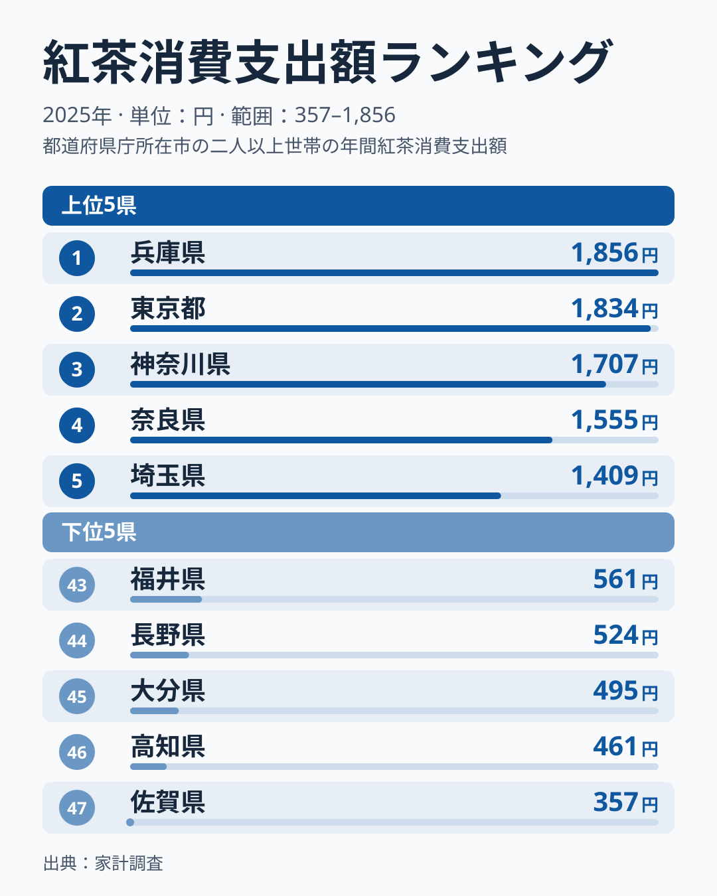
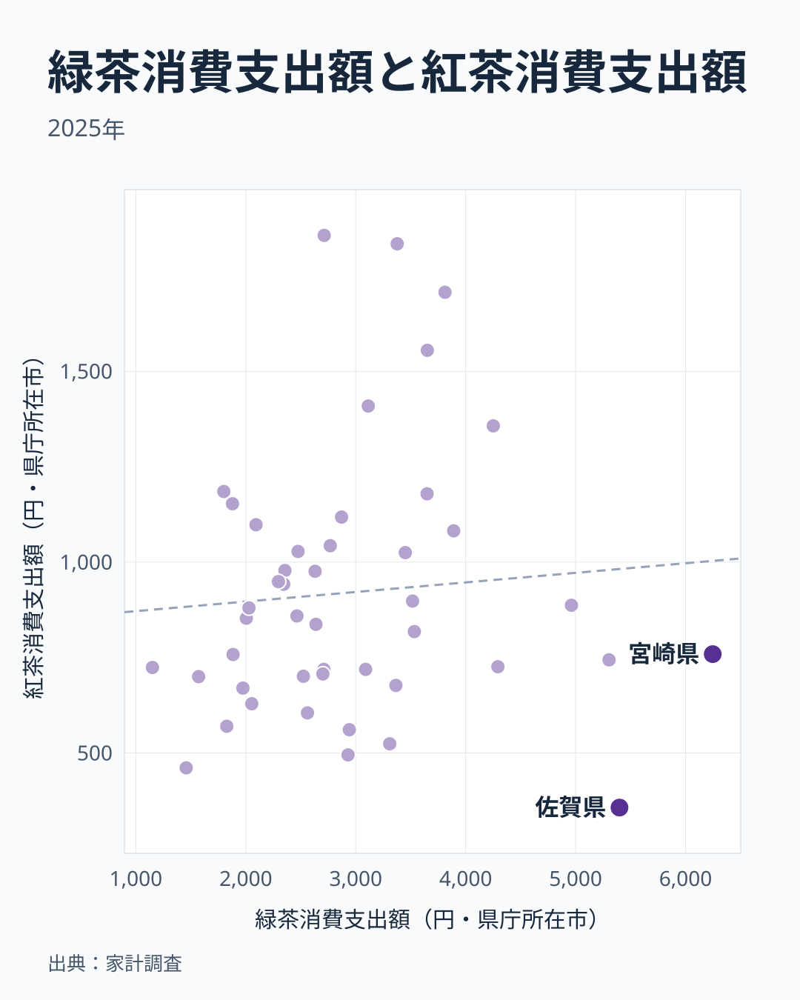

紅茶消費支出額は、総務省の家計調査に基づく「都道府県庁所在市の二人以上世帯が1年間に紅茶に使った金額」を示す指標です。2025年のデータでは、1位の兵庫県が1856円、最下位の佐賀県が357円と、その差は5.2倍にのぼります。

上位5県が関東と近畿に集まっているため、「紅茶は大都市の飲み物」と考えたくなります。ところが大阪府は19位、愛知県は14位、福岡県は31位で、大都市でも順位は大きくばらつきます。この記事では、上位・下位の顔ぶれを確認したうえで、緑茶や年収との関係をデータで確かめ、わかったことと確かめられなかったことを分けて整理します。

> [!NOTE]
> 対象は都道府県庁所在市(東京都は区部)の二人以上の世帯で、金額は1世帯当たりの年間支出額です。県全体の消費傾向とは異なる場合があります。また、支出額は飲んだ量ではありません。

## 上位5県と下位5県

<source-link href="/ranking/black-tea-consumption-expenditure">紅茶消費支出額ランキングをもっと見る</source-link>

上位は[兵庫](/areas/28000)が1856円、東京が1834円、神奈川が1707円、奈良が1555円、埼玉が1409円です。1位と2位の差は22円しかなく、順位の差は誤差の範囲かもしれません。家計調査の市別の値は標本が小さく、単年でぶれやすいためです。47県の中央値は859円なので、1位は中央値の約2.2倍、5位の埼玉県でも約1.6倍にあたります。

上位グループの境界もはっきりしていません。5位の埼玉県1409円と6位の茨城県1357円の差は52円で、4位と5位の差(146円)よりずっと小さくなっています。「上位5県」という区切りは図の都合であり、茨城県、和歌山県1185円、京都府1179円、岡山県1153円まで連続して高い値が続きます。上位10県の内訳は関東4県(東京・神奈川・埼玉・茨城)、近畿4県(兵庫・奈良・和歌山・京都)、中国の岡山県、東北の宮城県です。

下位は佐賀が357円、高知が461円、大分が495円、長野が524円、福井が561円です。佐賀・大分は九州、高知は四国、長野・福井は中部で、地方はばらばらです。佐賀県の357円は中央値の約4割にとどまり、1位の兵庫県とは1500円近い開きがあります。

## 大都市なら上位とは限らない

「大都市圏は紅茶を買いやすい」という見方は、東京・神奈川・埼玉・兵庫・奈良という上位5県だけを見ると成り立ちそうです。しかし47県全体では反例が目立ちます。大阪府は942円で19位、愛知県は1028円で14位、千葉県は1025円で15位、福岡県は726円で31位です。大阪府は中央値の859円をわずかに上回る程度で、愛知県や千葉県も上位10県の最低ライン(宮城県1118円)に届いていません。

反対に、大都市を抱えない茨城県が1357円で6位、和歌山県が1185円で7位に入っています。つまりこのデータから言えるのは「大都市だから高い」ではなく、「関東・近畿の特定の県が高い」という範囲にとどまります。なぜ兵庫県や奈良県のような県が突出するのかは、都市の規模だけでは説明できません。

開港地として知られる兵庫(神戸)と神奈川(横浜)が1位・3位に入っているため、洋食や喫茶の文化が影響しているという見方もあります。ただし、データで確かめられるのは「この2県が高い」ことだけです。長崎県は22位の887円、北海道は16位の978円で、他の港のある県が揃って上位というわけではありません。港町という共通点を理由に挙げるには、サンプルが少なすぎます。

## 緑茶が強い県では紅茶が弱いのか

紅茶が「わざわざ選ぶ嗜好品」だとすれば、緑茶を日常的に飲む県ほど紅茶の出番が少ないという代替関係も考えられます。そこで同じ2025年の緑茶消費支出額と、47県の紅茶消費支出額を並べてみました。

<source-link href="/ranking/green-tea-consumption-expenditure">緑茶消費支出額ランキングをもっと見る</source-link>

相関係数は0.08で、ほぼ無相関でした。緑茶の支出額が最も多い宮崎県は6247円ですが、紅茶は759円で28位です。緑茶が2番目に多い佐賀県は5399円で、紅茶は最下位の357円です。静岡県は緑茶が5304円、紅茶は744円で30位、福岡県は緑茶が4293円、紅茶は726円で31位です。緑茶を多く買う県の多くは、紅茶が中央値の859円以下に収まっています。ここだけを見れば代替関係があるようにも見えます。

ところが、茨城県は緑茶が4251円と多いうえに紅茶も6位で、神奈川県は緑茶が3812円、紅茶は3位、奈良県は緑茶が3651円、紅茶は4位です。緑茶と紅茶の両方を多く買う県が存在します。反対に、紅茶が46位の高知県は緑茶も1458円と少なく、緑茶が全国で最も少ない沖縄県は1151円ですが、紅茶は724円で32位と中位です。緑茶の多寡で紅茶の順位を説明することはできません。一部の九州の県で両者が逆方向に動くことは確認できますが、全国に通じる法則ではありません。

もう一つ、茶類全体への支出額に対する紅茶の比率を計算すると、兵庫県は1856円を12167円で割って約15%、佐賀県は357円を15127円で割って約2%でした。兵庫県は茶類全体の支出額が全国の下位3分の1にあたる低めの水準ですが、その中での紅茶の比重が大きくなっています。佐賀県は茶類全体では上位に入るのに、紅茶の比重が小さい県です。紅茶の順位は、お茶全体をどれだけ買うかよりも、お茶の中で紅茶をどれだけ選ぶかに左右されているようです。

## わかったことと、確かめられなかったこと

ここまでの内容を、データで確認できた範囲と、できなかった範囲に分けておきます。

確認できたことは次のとおりです。

- 上位5県は兵庫・東京・神奈川・奈良・埼玉で、すべて関東か近畿にあります。
- 大阪府は19位、愛知県は14位、福岡県は31位など、大都市でも順位は高くありません。
- 緑茶消費支出額との相関は0.08で、緑茶が強い県ほど紅茶が弱いという関係は全国では見られません。
- 紅茶は茶類全体の支出額に占める割合が、兵庫県の約15%から佐賀県の約2%まで大きく異なります。

確かめられなかったことは次の2点です。

- 店舗の多さが購入のしやすさにつながるのではないかという見方。店舗数のデータは手元になく、検証していません。
- 所得の高さが単価の高い紅茶の購入を押し上げるという見方。姉妹記事の[紅茶を飲む県ほど年収も高いのか](/blog/black-tea-income-gap)では、年収との関係は弱い正の相関にとどまり、年収の高い県と紅茶の支出が多い県の顔ぶれも大きくは重なりませんでした。年収だけでは説明できません。

> [!WARNING]
> 紅茶はティーバッグとリーフで1杯あたりの単価が大きく異なる場合があり、支出額が高くても飲む量が多いとは限りません。量で見ると順位が変わる県もあるため、[紅茶消費量との違い](/blog/black-tea-income-gap)も合わせて確認してください。単年の市別データのため、順位の細部は年によって入れ替わる可能性があります。

## まとめ

- 1位: 兵庫県 1856円
- 最下位: 佐賀県 357円
- 倍率: 約5.2倍
- 地域パターン: 上位5県はすべて関東・近畿。ただし大阪19位、愛知14位、福岡31位と大都市でも順位はばらつく
- 緑茶との関係: 相関係数0.08でほぼ無相関。代替関係は全国では確認できない
- 特筆点: 紅茶が茶類全体に占める比率は兵庫県が約15%、佐賀県が約2%と大きく異なる

飲み物の地域差としては、[コーヒー消費のランキング記事](/blog/coffee-consumption-prefecture-gap)と見比べると、家庭での紅茶とコーヒーの位置づけの違いが見えてきます。パン食の多い県との関係は、[パンとお米の支出を比べた記事](/blog/bread-vs-rice-expenditure)も参考になります。
