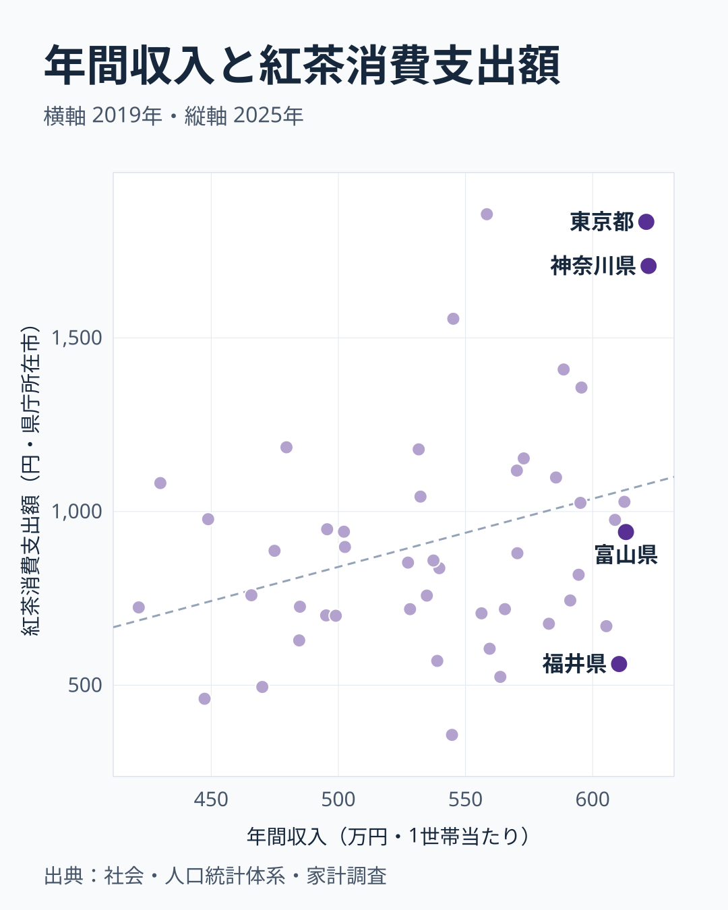
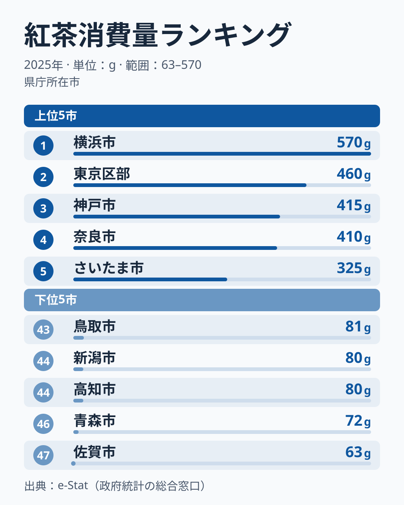

紅茶は必需品ではなく嗜好品なので、「お金に余裕がある県ほどよく買うのでは」と考える人も多いはずです。そこで、総務省「家計調査」の紅茶消費支出額(2025年)と、1世帯あたり年間収入(2019年・社会・人口統計体系)を都道府県ごとに突き合わせました。

答えを先に書くと、47都道府県の相関係数は0.32で、やや弱い正の相関にとどまりました。紅茶への支出が多い上位10県のうち、年収でも上位10県に入っていたのは神奈川・東京・茨城の3県だけです。この記事では、年収の高い県と紅茶をよく買う県がどこで食い違うのか、そして支出額ではなく量と単価で見ると県の買い方がどう分かれるのかを確かめます。紅茶の支出が大都市に集まるのかと、緑茶との関係は、姉妹記事の[紅茶は大都市の飲み物か?](/blog/black-tea-expenditure-ranking)で扱っています。

> [!NOTE]
> 紅茶消費支出額と紅茶消費量は、都道府県庁所在市の二人以上世帯の1世帯当たりの値です。たとえば「神奈川県1,707円」は横浜市の世帯の値です。年間収入は全国家計構造調査(2019年)による都道府県別の1世帯当たりの年間収入で、個人の年収ではありません。対象の範囲も年も、紅茶の値とはそろっていません。

## 年収との相関は0.32にとどまる

横軸に年間収入、縦軸に紅茶消費支出額をとって47都道府県を並べると、右上がりの傾向はわずかに見えるものの、点は大きく散らばっています。相関係数0.32は、年収が高い県ほど紅茶の支出額がやや高い傾向がうかがえる、という程度の弱い関係です。

年間収入が最も高い神奈川県は6,220千円で、紅茶消費支出額も1,707円と高く、紅茶の上位10県に入ります。東京都も6,211千円で、紅茶は1,834円でした。この2都県だけを見れば「年収が高いほど紅茶を買う」と言えそうです。

ところが年収の高い県を順に見ていくと、紅茶の順位はそろいません。富山県は年間収入が6,131千円と高い水準ですが、紅茶消費支出額は941円で、47県の中央値859円をわずかに上回る程度です。福井県は6,104千円で紅茶は561円、岐阜県は6,054千円で紅茶は670円と、どちらも中央値を下回りました。年収の上位10県のうち4県は富山・愛知・福井・岐阜の中部の県ですが、愛知県の1,028円を除くと、紅茶の支出は中央値前後かそれ以下にとどまります。

反対に、紅茶消費支出額が47県で最も多い兵庫県は年間収入が5,584千円で、年収の上位10県には入っていません。和歌山県は紅茶が1,185円で紅茶の上位10県に入りますが、年間収入は4,796千円と、47都道府県の中では低いほうです。年収の高さと紅茶の支出は、県ごとに見るとかなりずれています。

<source-link href="/ranking/annual-income-per-household">1世帯あたり年間収入ランキングをもっと見る</source-link>

## 紅茶の上位10県と年収の上位10県

紅茶消費支出額の上位10県は兵庫・東京・神奈川・奈良・埼玉・茨城・和歌山・京都・岡山・宮城でした。上位と下位の顔ぶれは、姉妹記事の[紅茶は大都市の飲み物か?](/blog/black-tea-expenditure-ranking)と[紅茶消費支出額ランキング](/ranking/black-tea-consumption-expenditure)で確かめられます。一方、年間収入の上位10県は神奈川・東京・富山・愛知・福井・滋賀・岐阜・茨城・千葉・三重です。両方に入るのは神奈川県、東京都、茨城県の3県だけで、3県とも関東にあります。

食い違いの形には特徴があります。紅茶の上位10県のうち、兵庫・奈良・和歌山・京都の4府県は近畿にありますが、年収の上位10県に近畿から入っているのは滋賀県と三重県だけで、どちらも紅茶の上位10県には入っていません。逆に、年収の上位10県に並ぶ富山・愛知・福井・岐阜の中部の4県も、紅茶の上位10県に1つも入っていません。年収の地図と紅茶の地図では、高い県の集まる場所がずれていると言えます。

上位10県どうしで比べると、重なりは関東の3県に限られ、年収の上位に並ぶ中部の4県と、紅茶の上位に並ぶ近畿の4府県は重なりません。ただし家計調査の市別の値は1年分だけではぶれやすいため、上位10県の顔ぶれは年によって入れ替わる可能性があります。重なりが3県という数字は、2025年の紅茶の値と2019年の年収で見た場合の結果として読んでください。

## 量で見ると神奈川が1位、単価は宮城が高い

支出額は「量×単価」なので、量で見直すと別の姿が見えます。紅茶消費「量」の1位は神奈川県の570g、2位は東京都の460g、3位は兵庫県の415g、4位は奈良県の410g、5位は埼玉県の325gです。上位5県は支出額の上位5県と同じ顔ぶれです。ただし6位以下では食い違いが出て、長崎県と千葉県は量では上位10県に入りますが、支出額では上位10県に入りません。下位は43位鳥取県81g、44位新潟県80g、45位高知県80g、46位青森県72g、47位佐賀県63gでした。

支出額と消費量の順位が大きく食い違うのは中位の県です。宮城県は消費量が35位の113gですが、支出額は1,118円で上位10県に入ります。1gあたりの単価を支出額÷消費量で計算すると、宮城県は1,118円÷113gで約9.89円/gです。消費量が全国1位の神奈川県は1,707円÷570gで約2.99円/gでした。47都道府県の単価を同じ計算で並べると、宮城県の約9.89円/gが最も高く、神奈川県の約2.99円/gは大分県の約2.96円/gに次いで低い水準でした。神奈川県は大量の紅茶を比較的安く買い、宮城県は少量を高めの単価で買っていると読めます。

茨城県も順位の差が大きい県です。支出額は1,357円で上位10県に入りますが、消費量は26位の149gにとどまり、単価は約9.11円/gと宮城県に近い高さです。年収の上位10県に入る神奈川県と茨城県を比べると、支出額はどちらも上位でも、神奈川県は量で、茨城県は単価で支出額を押し上げている形になっています。同じ「紅茶への支出が多い県」でも、買い方は県によって分かれます。

> [!TIP]
> ここでの単価は、支出額÷消費量で求めた参考値です。家計調査の紅茶には茶葉・ティーバッグなどが含まれうるものの、この数字からは品目の中身を区別できません。単価の差を商品の選び方の違いとそのまま読むのは避けてください。

<source-link href="/ranking/black-tea-consumption-quantity">紅茶消費量ランキングをもっと見る</source-link>

## 年収で説明しきれない差をどう読むか

ここまでの結果をまとめると、年収との相関は弱く、年収の高い中部の県の多くは紅茶では中位以下、紅茶の上位には年収が中位以下の近畿の府県が並びます。データから言えるのは、年収だけでは紅茶の支出の地域差を説明しにくいということです。

ただし、この比べ方には次の限界があります。

- 年収は2019年、紅茶消費支出額は2025年の値で、年がそろっていません。
- 年収は全国家計構造調査の都道府県別の値、紅茶は県庁所在市の二人以上世帯の値で、対象範囲が異なります。
- 紅茶消費支出額は1年分の市別の値で、ぶれの影響を受けやすい指標です。

[仮説] 紅茶の購入は、喫茶店やカフェの多さ、商品の選びやすさ、嗜好といった所得以外の要因にも左右される可能性がありますが、この記事のデータでは検証できません。

> [!WARNING]
> 相関係数0.32は、対象範囲と年が異なる2つの指標を並べた参考値です。相関があるからといって、年収が紅茶の購入の直接の原因とは言い切れません。

## データについて

紅茶消費支出額・紅茶消費量は総務省統計局「家計調査」(都道府県庁所在市、二人以上世帯、2025年)、1世帯あたり年間収入は総務省統計局「社会・人口統計体系」に収録された全国家計構造調査(2019年)の数値をe-Stat経由で取得し、都道府県コードで突き合わせて集計しています。

飲み物の支出の地域差は、[コーヒー消費のランキング記事](/blog/coffee-consumption-prefecture-gap)とも見比べられます。本記事の関連カテゴリ: [経済カテゴリ](/category/economy)
