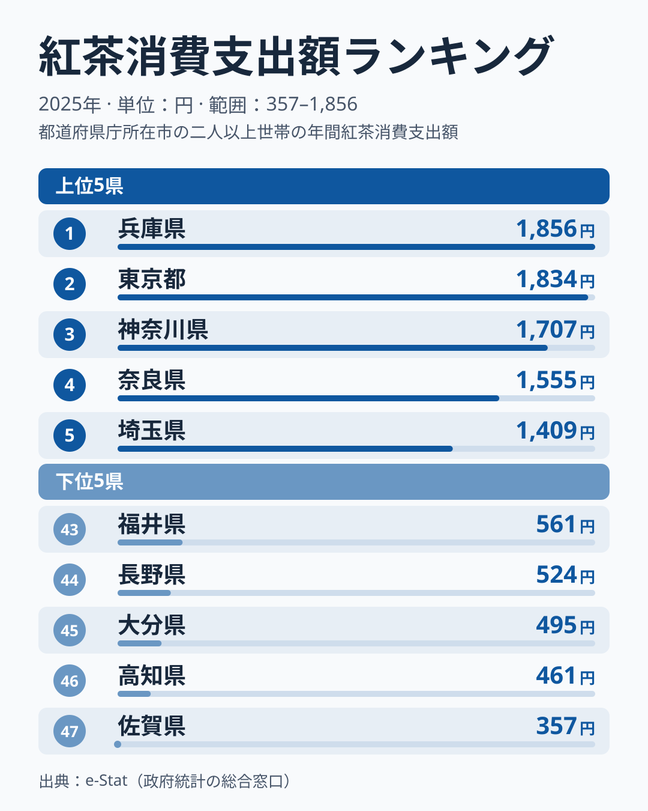
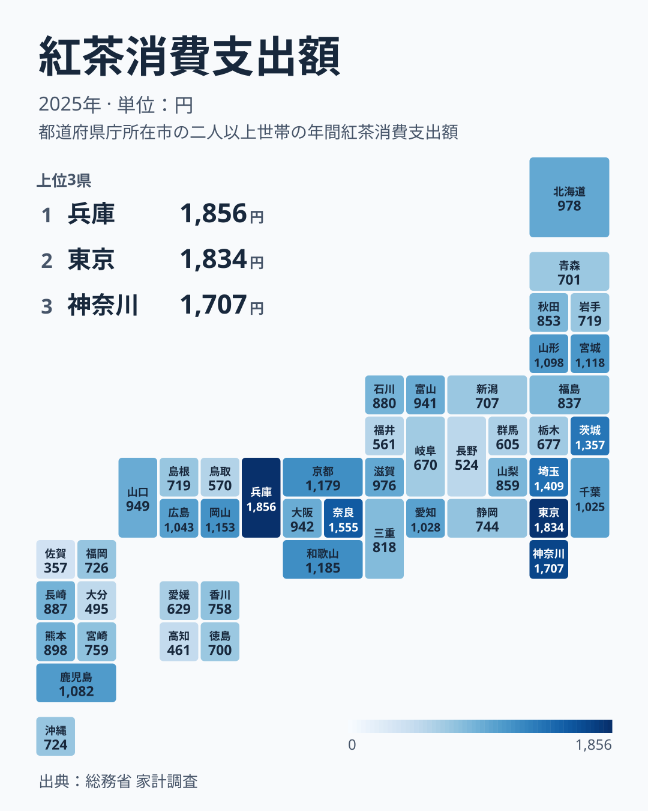
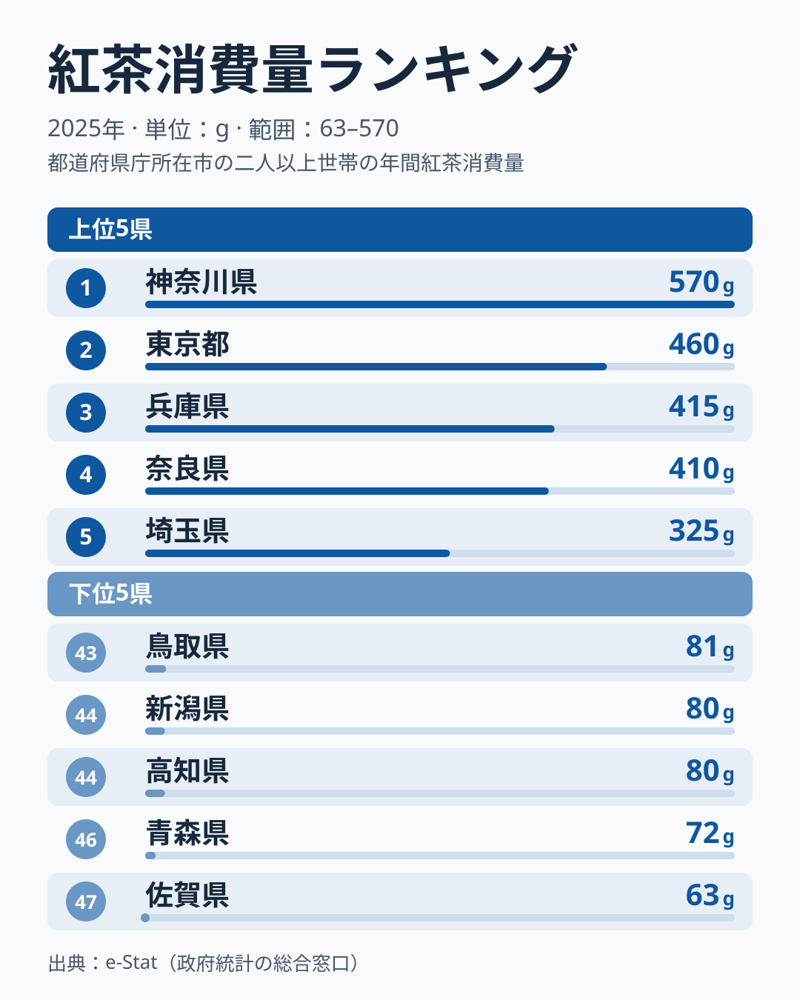
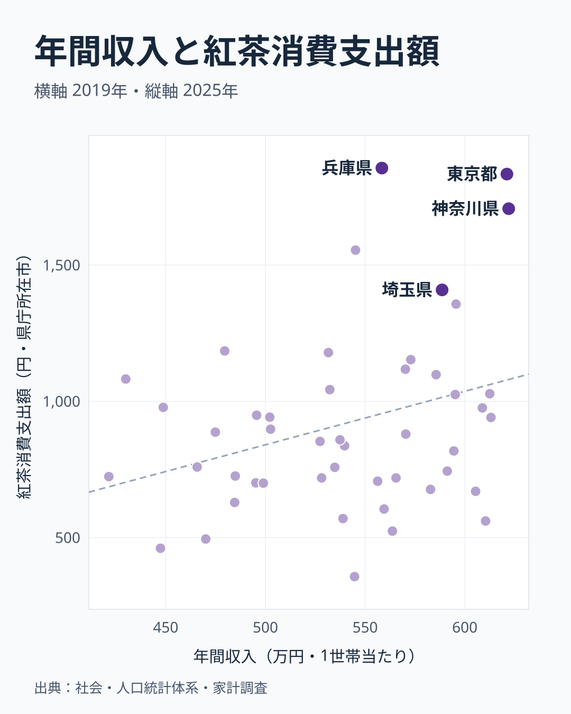

紅茶消費支出額は、総務省「家計調査」で都道府県庁所在市の二人以上世帯が1年間に紅茶へ使った金額を示す指標です。2025年のデータでは、1位の[兵庫県](/areas/28000)が1,856円、最下位の[佐賀県](/areas/41000)が357円で、その差は5.2倍にのぼります。

紅茶は必需品ではなく嗜好品なので、「お金に余裕がある県ほどよく飲むのでは」と考える人も多いはずです。そこで1世帯あたり年間収入(2019年・社会・人口統計体系)と紅茶消費支出額を都道府県コードで突き合わせてみたところ、47都道府県の相関係数は0.32というやや弱い正の相関にとどまりました。また、紅茶消費支出額の上位10県のうち年収でも上位10県に入っていたのはわずか3県でした。

この記事では、紅茶消費支出額の上位・下位の顔ぶれ、消費「量」との違い、そして年収との関係が実際どこまで一致するのかを、47都道府県のデータで確認していきます。

## 紅茶消費支出額ランキング — 1位は兵庫、最下位は佐賀

上位5県は兵庫県1,856円、東京都1,834円、神奈川県1,707円、奈良県1,555円、埼玉県1,409円と続きます。1位の兵庫県と2位の東京都はほぼ並んでいます。東京・神奈川・埼玉は関東で固まっていますが、1位の兵庫県を筆頭に、4位奈良県、7位和歌山県1,185円、8位京都府1,179円と、近畿の府県が上位10県のうち4つを占めているのが目立ちます。

下位5県は43位福井県561円、44位長野県524円、45位大分県495円、46位高知県461円、47位佐賀県357円でした。上位と下位を比べると、紅茶消費支出額は関東と近畿に偏って高く、低い県は複数の地方に散らばっているという分布になっています。

> [!NOTE]
> 紅茶消費支出額は家計調査のデータで、対象は47都道府県すべてではなく「都道府県庁所在市」の二人以上世帯です。県内の農村部や小都市の消費傾向まではこの数字だけでは分かりません。家計調査の市別の値は1年分だけではぶれやすいため、順位の細かな差よりも、上位と下位の大きな開きに注目してください。

<source-link href="/ranking/black-tea-consumption-expenditure">紅茶消費支出額ランキングをもっと見る</source-link>

## 地理でみる紅茶消費 — 近畿・関東はなぜ多いのか

地図で見ると、紅茶消費支出額の上位10県は近畿4県(兵庫・奈良・和歌山・京都)、関東4県(東京・神奈川・埼玉・茨城)、中国1県(岡山)、北海道・東北1県(宮城)で、近畿と関東で8県を占めます。一方の下位10県は関東2県(栃木・群馬)、中部3県(岐阜・福井・長野)、四国2県(愛媛・高知)、九州・沖縄2県(大分・佐賀)、中国1県(鳥取)と、5つの地方に分かれています。

> [!WARNING]
> 近畿や東京・神奈川が紅茶で上位に入りやすいことはデータから確認できますが、その理由を喫茶文化や洋菓子文化と断定するのは早計です。[仮説] 都市部は喫茶店・カフェの店舗密度が高く、それが家庭での紅茶購入にもつながっている可能性がありますが、検証には都道府県別の喫茶店数データとの突き合わせが必要です。

あわせて見る: [緑茶消費支出額ランキング](/ranking/green-tea-consumption-expenditure)・[コーヒー消費支出額ランキング](/ranking/coffee-consumption-expenditure)

## 消費量ランキングとの違い — 量の神奈川、単価の宮城

紅茶消費「量」で見ると、1位は神奈川県570g、2位東京都460g、3位兵庫県415g、4位奈良県410g、5位埼玉県325gです。上位5県は支出額と同じ顔ぶれで、量が多い県は支出額でも上位に入っています。下位は43位鳥取県81g、44位新潟県80g、45位高知県80g、46位青森県72g、47位佐賀県63gでした。

支出額と消費量の順位が大きく食い違うのは中位の県です。宮城県は消費量が35位の113gですが、支出額は10位の1,118円です。1gあたりの単価を支出額÷消費量で計算すると、宮城県は1,118円÷113gで約9.89円/gです。消費量が全国1位の神奈川県は1,707円÷570gで約2.99円/gでした。本文で挙げた県の中では、神奈川県は大量の紅茶を比較的安く買い、宮城県は少量を高めの単価で買っていると読めます。47都道府県すべての単価を並べて比べたわけではないため、全国での単価の順位までは断定しません。

茨城県も順位の差が大きい県です。支出額は6位の1,357円ですが、消費量は26位の149gにとどまります。[仮説] 量を多く飲む県は大容量の安価な商品、少量の県は単価の高い商品を選びやすい可能性がありますが、購入する商品の種類までは確かめられません。

> [!TIP]
> ここでの単価は、支出額÷消費量で求めた参考値です。家計調査の紅茶には茶葉・ティーバッグ・飲料などが含まれうるものの、この数字からは品目の中身を区別できません。1年分の市別の値でぶれもあるため、単価の差を商品の選び方の違いとそのまま読むのは避けてください。

<source-link href="/ranking/black-tea-consumption-quantity">紅茶消費量ランキングをもっと見る</source-link>

## 発見 — 年収との相関は0.32にとどまる

1世帯あたり年間収入(2019年)と紅茶消費支出額(2025年)を47都道府県で突き合わせると、相関係数は0.32でした。相関係数は1に近いほど強い関係、0に近いほど無関係を意味するので、0.32は「弱い正の相関」にとどまります。

上位の重なりも小さくなっています。紅茶消費支出額の上位10県は兵庫・東京・神奈川・奈良・埼玉・茨城・和歌山・京都・岡山・宮城です。このうち年間収入でも上位10県に入っていたのは、神奈川県、東京都、茨城県の3県だけでした。年間収入が最も高い神奈川県は6,220千円で、紅茶消費支出額も3位の1,707円と上位です。一方、紅茶消費支出額1位の兵庫県は年間収入が5,584千円で、年収では上位10県に入っていません。逆に福井県は年間収入が6,104千円と高い水準ですが、紅茶消費支出額は561円で43位にとどまります。

では、なぜ年収と紅茶の支出額が食い違うのでしょうか。データから言えるのは次の点です。

- 年収は2019年、紅茶消費支出額は2025年の値で、年がそろっていません。
- 年収は「1世帯当たり」、紅茶は「都道府県庁所在市の二人以上世帯」で、対象範囲が異なります。
- 紅茶消費支出額は1年分の市別の値で、ぶれの影響を受けやすい指標です。

この関係は、年収が高い県ほど紅茶の支出額がやや高い傾向がうかがえる程度で、所得だけでは地域差を説明しにくいといえます。[仮説] 紅茶の購入は、喫茶店やカフェの多さ、商品の選びやすさ、嗜好といった所得以外の要因にも左右される可能性がありますが、この記事のデータでは検証できません。

> [!WARNING]
> 紅茶消費支出額(家計調査・2025年・都道府県庁所在市の二人以上世帯)と1世帯あたり年間収入(社会・人口統計体系・2019年)は、対象範囲と年がそもそも異なります。相関係数0.32という数字も、この違いを踏まえた上での参考値として見てください。相関があるからといって、年収が紅茶消費の直接の原因とは言い切れません(相関≠因果)。

<source-link href="/ranking/annual-income-per-household">1世帯あたり年間収入ランキングをもっと見る</source-link>

## まとめ

- 紅茶消費支出額(2025年)は兵庫県1,856円で全国1位、最下位は佐賀県357円で5.2倍の差があります。2位の東京都は1,834円で、上位は接戦です。
- 地理的には近畿(兵庫・奈良・和歌山・京都)と関東(東京・神奈川・埼玉・茨城)が上位に集中し、下位は5つの地方に分かれています。
- 消費「量」では神奈川県が570gで全国1位です。1gあたりの単価は、本文で挙げた県の中では神奈川県が約2.99円/g、宮城県が約9.89円/gで、宮城県は消費量35位でも支出額は10位です。
- 1世帯あたり年間収入との相関係数は0.32で、弱い正の相関にとどまります。
- 支出額上位10県のうち年収でも上位10県に入るのは3県のみで、所得だけでは説明しにくい地域差が見られます。

## データについて

紅茶消費支出額・紅茶消費量は総務省統計局「家計調査」(都道府県庁所在市、二人以上世帯)、1世帯あたり年間収入は総務省統計局「社会・人口統計体系」(2019年)の数値をe-Stat経由で取得し、都道府県コードで突き合わせて集計しています。

本記事の関連カテゴリ: [経済カテゴリ](/category/economy)
