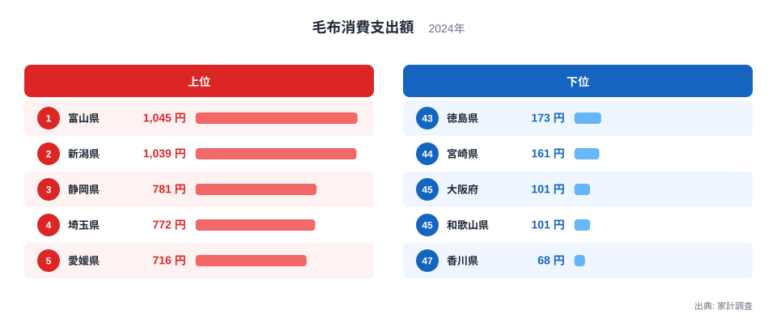
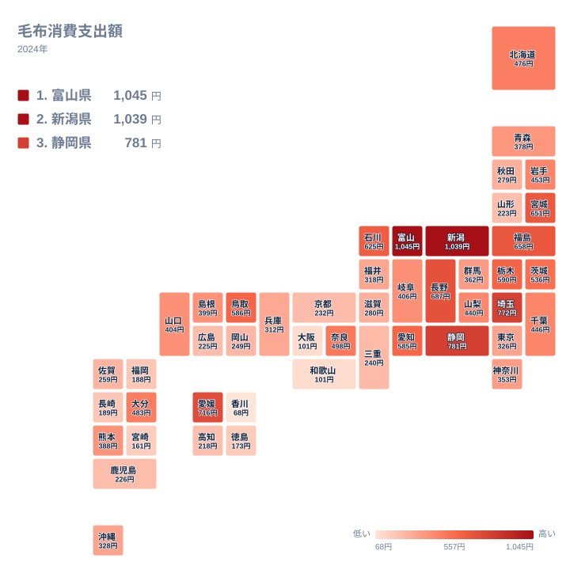

冬の寒さをしのぐ道具として、毛布は多くの家庭にあります。ところが、1年間に毛布へ使うお金は県によって大きく違います。2024年の家計調査では、1位の富山県が1,045円、最下位の香川県が68円でした。この記事では、その差がどこから生まれるのかを、気候や住まい、買い替えの習慣といった観点から考えます。

## 毛布への支出、上位と下位はどこか

まず、上位5県と下位5県を図で確認します。

<source-link href="/ranking/blanket-consumption-expenditure">毛布への支出ランキングをもっと見る</source-link>

1位は富山県で1,045円です。2位は新潟県で1,039円と、わずか6円差で並んでいます。3位は静岡県で781円、4位は埼玉県で772円、5位は愛媛県で716円でした。上位2県が3位以下を大きく引き離しており、突出しているのは中部の日本海側ではなく、富山県と新潟県という2つの県です。

一方、下位は香川県が68円で47位です。45位の大阪府と46位の和歌山県はどちらも101円で、同額で並んでいます。44位は宮崎県で161円、43位は徳島県で173円でした。最大の富山県と最小の香川県を比べると、約15倍という開きがあります。

毛布は1枚買えば何年も使えるため、1年間の支出額は「その年にたまたま買い替えた世帯がどれだけいたか」に左右されます。それでも、上位と下位の差がこれだけ大きいのは、単なる偶然では片づけにくい水準です。

> [!NOTE]
> ここでの数値は、家計調査における「毛布消費支出額」で、1世帯あたりの年間支出額（円）です。毛布の枚数や使用量ではありません。単価の高い毛布を1枚買った世帯と、安い毛布を何枚も買った世帯は、同じ金額になることがあります。

## 雪国の冬が支出を押し上げるのか

上位2県の富山県と新潟県は、どちらも中部に属し、冬の寒さと雪の多さで知られる県です。暖房を使っていても、布団の中や寝室の寒さ対策として毛布を重ねる家庭は多いと考えられます。冬が長いほど、毛布を使う期間も長くなり、傷みやすく、買い替えの機会も増えるでしょう。

同じ中部では、石川県が625円で9位、長野県が687円で6位、静岡県が781円で3位に入っています。中部の9県のうち、福井県は318円で29位、岐阜県は406円で20位、愛知県は585円で12位、山梨県は440円で19位でした。つまり中部でも、上位に入る県と中位にとどまる県があり、地方全体で同じ傾向になるわけではありません。

北海道・東北を見ると、福島県が658円で7位、宮城県が651円で8位、岩手県が453円で17位、北海道が476円で16位です。ところが秋田県は279円で32位、山形県は223円で39位、青森県は378円で24位にとどまります。寒冷地といっても、必ずしも毛布への支出が多いわけではありません。

この点は、寒さの度合いだけでは説明がつかないことを示しています。北海道や東北北部では、断熱性の高い住宅や強い暖房が普及しており、毛布よりも羽毛布団や電気毛布、室温管理で寒さをしのぐ割合が高い可能性があります。毛布が必要になる寒さと、毛布で補う必要がある寒さは別物です。

> [!TIP]
> 「寒い県ほど毛布を買う」と単純に読まないことが大切です。住宅の断熱や暖房の方式によって、毛布の出番は変わります。寒さが厳しい地域ほど、毛布以外の寝具や暖房に支出が回る可能性も考えてください。

## 地理分布で見る地域の偏り

次に、47都道府県全体の分布を地図で確認します。

地図を見ると、色の濃い県が一か所に固まっているわけではありません。中部の富山県と新潟県が最上位ですが、関東の埼玉県が772円で4位、四国の愛媛県が716円で5位に入っており、上位は地方をまたいで散らばっています。

関東では、茨城県が536円で13位、栃木県が590円で10位、千葉県が446円で18位、群馬県が362円で25位、神奈川県が353円で26位、東京都が326円で28位です。埼玉県を除くと、中位から下位寄りの県が多くなっています。

近畿は全体に低めです。奈良県が498円で14位と健闘していますが、兵庫県は312円で30位、滋賀県は280円で31位、京都府は232円で36位、三重県は240円で35位です。大阪府と和歌山県は、先に述べたとおり101円で並んで下位にいます。

九州・沖縄では、大分県が483円で15位、熊本県が388円で23位、沖縄県が328円で27位です。一方で、佐賀県は259円で33位、鹿児島県は226円で37位、長崎県は189円で41位、福岡県は188円で42位、宮崎県は161円で44位と低い県が目立ちます。温暖な地域では、毛布の必要性そのものが小さいことが背景にあると考えられます。

> [!WARNING]
> 家計調査は標本調査で、県庁所在地を中心とした限られた世帯が対象です。毛布のような単価の低い品目は、少数の世帯の購入で平均が大きく動きます。順位が1つ違うだけの県どうしは、実質的な差とみなさないほうが安全です。

## 食文化や産地ではなく、暮らしと買い方の差として読む

食品とは違い、毛布は産地や郷土の食文化と直接結びつく品目ではありません。そのため、この指標は気候だけでなく、住まいの形、寝具の選び方、買い物の習慣といった暮らしの差が混ざった結果として現れます。

関連する品目と対比すると、毛布は羽毛布団や電気毛布と役割が重なる一方で、価格帯も使用期間も異なります。毛布は比較的手に取りやすい価格で、重ね掛けや季節の入れ替えなど、気軽に買い足されやすい寝具です。だからこそ、暖房が行き届いた地域では需要が小さくなり、寒さを手軽にしのぎたい地域では需要が大きくなる傾向があると考えられます。

富山県と新潟県が並んで上位に立つ背景には、冬の寒さに加えて、家庭で寝具を季節ごとに入れ替える習慣が根づいている可能性があります。ただし、これは統計から直接確かめられる事実ではなく、あくまで読み解きの仮説です。

香川県が68円で最下位になった点も、瀬戸内の穏やかな気候と結びつけて考えたくなります。ただ、同じ四国の愛媛県は716円で5位、高知県は218円で40位、徳島県は173円で43位と、県ごとにばらつきが大きく、地方の気候だけでは整理できません。中国では鳥取県が586円で11位、山口県が404円で21位、島根県が399円で22位、岡山県が249円で34位、広島県が225円で38位と、こちらも差があります。

各県の詳細は、[富山県のデータ](/areas/16000)や[新潟県のデータ](/areas/15000)から確認できます。ほかの暮らしの支出と合わせて見たいときは、[同じカテゴリの統計一覧](/category/economy)も役に立ちます。

## 毛布への支出から見えること

今回の結果から言えるのは、毛布への支出が気候だけで決まる単純な指標ではないということです。上位には富山県、新潟県、静岡県、埼玉県、愛媛県と、雪国も太平洋側も関東も四国も入り混じっています。下位にも、香川県、和歌山県、大阪府、宮崎県、徳島県と、地域的な共通点は見つけにくい顔ぶれが並びました。

それでも、1位の富山県と最下位の香川県の差が約15倍あるのは事実です。この差には、冬の寒さ、住宅の性能、暖房の使い方、寝具の好み、そして買い替えのタイミングが、少しずつ重なって表れていると考えられます。

読むときは、単年の数字であることにも注意が必要です。2024年だけを見て県の特徴と断定せず、複数年の推移も合わせて確認すると、より確かな傾向がつかめます。順位の近い県どうしの差は小さく、むしろ上位と下位という大きな隔たりに注目するのが、この統計の素直な読み方です。

## データについて

この記事で使った数値は、家計調査の「毛布消費支出額」（2024年、単位は円）です。1世帯あたりの年間支出額を都道府県別に比べたもので、毛布の購入枚数や保有枚数を示すものではありません。倍率は、実データにある最大の富山県1,045円と、最小の香川県68円の比を指しています。
