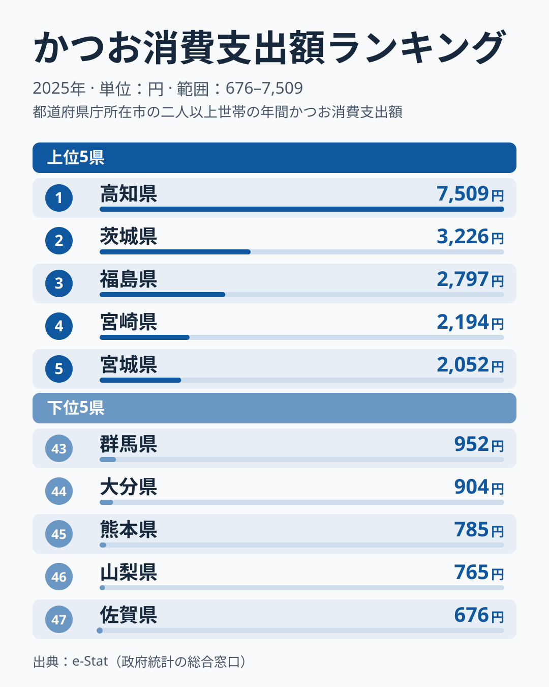
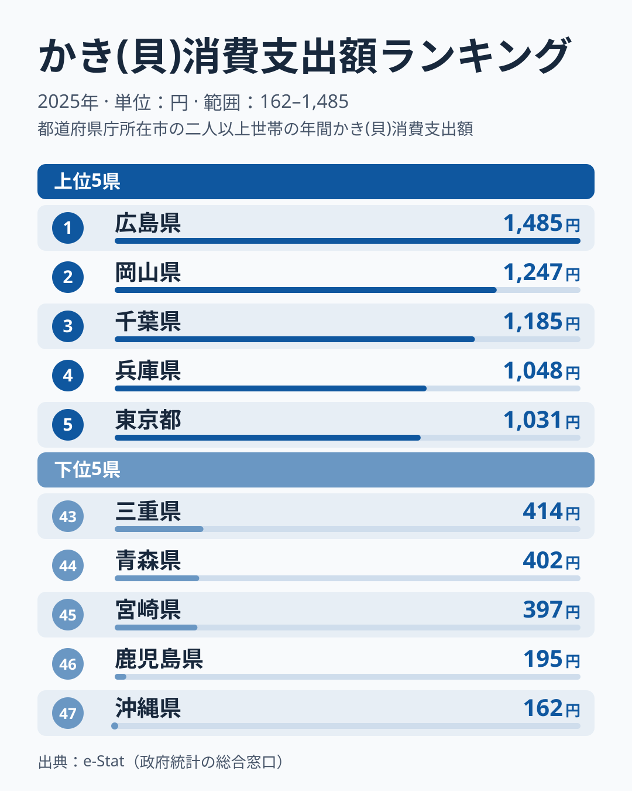

同じ「魚介」でも、どこで多く食べられているかは魚種によってまったく違います。総務省の家計調査（2025年）で都道府県庁所在市の消費支出額を見ると、かつおは太平洋沿岸で強く、かきは瀬戸内海沿岸で強いという、対照的な地図が浮かび上がります。

かつお消費支出額の1位は高知県で7,509円。最下位の佐賀県676円と比べると11.1倍もの開きがあります。一方かき(貝)消費支出額の1位は広島県で1,485円、最下位の沖縄県162円とは9.2倍の差です。地図に並べてみると、かつおとかきの上位5県は1県も重なりません。この記事では漁獲量や養殖規模といった「産地」の情報は使わず、家計が実際に支出した金額という「消費地」のデータだけから、2つの魚介が描く魚食の地図を読み解きます。

> [!NOTE]
> 消費支出額は総務省「家計調査」による都道府県庁所在市（政令指定都市含む）の1世帯あたり年間支出額です。実際の漁獲量や消費量そのものではなく、あくまで「その都市の世帯が支出した金額」である点に注意してください。調査対象の世帯数が限られるため、市ごとの値は単年でぶれやすく、1年の順位だけで地域の食文化を断定することはできません。実際、かつおの6位から11位は6県が76円の幅に収まり、かきも4位兵庫県と5位東京都の差は17円です。

## かつお消費支出ランキング｜上位5県はすべて太平洋沿岸

かつお消費支出額の上位を見ると、1位[高知県](/areas/39000)7,509円が突出しています。2位の茨城県3,226円を大きく引き離しており、これは高知の郷土料理「かつおのタタキ」が、藁焼きで炙って家庭の食卓にも定着していることの表れという見方もできます。3位以下は福島県2,797円、宮崎県2,194円、宮城県2,052円と続き、上位5県はすべて太平洋に面しています。

<source-link href="/ranking/bonito-consumption-expenditure">かつお消費支出額ランキングをもっと見る</source-link>

6位から11位を見ると、徳島県2,037円、香川県1,994円、静岡県1,989円、大阪府1,968円、奈良県1,966円、岩手県1,961円と、2,000円前後で数十円差の団子状態になります。徳島・静岡・岩手は太平洋側ですが、香川・大阪・奈良は太平洋に面していないため、11位まで広げると「太平洋沿岸ライン」だけでは説明しきれなくなります。カツオは黒潮に乗って太平洋を北上する回遊魚で、初鰹は高知や和歌山など南から水揚げされ、戻り鰹は三陸沖まで北上します。この回遊ルートに沿った県が上位に並ぶ傾向はありますが、6位以降の差はわずかで、順位の入れ替わりは単年のぶれの範囲に収まる可能性があります。山形県が13位1,904円と、回遊ルートから外れていても上位寄りに入っている点も、同じ読み方が必要です。一方、日本海側の新潟県32位、富山県26位、石川県36位、福井県40位は、いずれも25位より下です。

一方で最下位グループは、47位佐賀県676円、46位山梨県765円、45位熊本県785円、44位大分県904円、43位群馬県952円です。内陸の山梨・群馬と、九州の佐賀・熊本・大分が並び、42位沖縄県968円、41位福岡県1,021円まで広げると、下位7県のうち5県が九州・沖縄になります。九州は水産県が多いにもかかわらず、かつおの消費支出は低い部類に入るのが興味深い点です。`[仮説]` 九州北部の近海がカツオの主要な回遊ルートから外れていることや、地元で消費される主力魚種（ぶり・あじ・さばなど）が別にあることが背景にあると考えられますが、本データだけでは検証できません。ただし宮崎県は4位2,194円と九州で唯一上位に入っており、九州全体を一括りにはできません。

## かき(貝)消費支出ランキング｜瀬戸内海勢が上位に並ぶ

かき(貝)消費支出額のランキングは、かつおとは対照的な地理分布を見せます。1位は[広島県](/areas/34000)1,485円で、これは広島湾が国内有数のカキ養殖の産地であることと関係しているとみられます。2位は岡山県1,247円で、3位は千葉県1,185円、4位は兵庫県1,048円、5位は東京都1,031円です。続く6位の香川県960円まで含めると、上位6県のうち広島・岡山・兵庫・香川の4県が瀬戸内海に面しています。

<source-link href="/ranking/oyster-consumption-expenditure">かき(貝)消費支出額ランキングをもっと見る</source-link>

注目すべきは、3位の千葉県と5位の東京都が上位5県に入っている点です。7位以降も岩手県918円、奈良県898円、山形県877円、鳥取県877円、大阪府854円、宮城県798円と続き、産地の湾に近い県だけでなく、首都圏や近畿の大消費地が多く並びます。`[仮説]` 人口の多い都市圏は全国から産地のカキが集まる流通の窓口になりやすく、支出額が押し上げられている可能性があります。ただし本データには流通経路が含まれないため、検証には別の統計が必要です。なお、三陸のカキ産地を抱える岩手県は7位、宮城県は12位で、「三陸のカキ産地」として際立つ集中は2025年の順位には表れていません。

> [!WARNING]
> かきは冬が旬の食材とされます。`[仮説]` 年間の支出額は調査年の冬の天候や相場で動きやすく、順位が1年で入れ替わる可能性があります。本記事は月次データを使っていないため、季節の偏りは検証していません。1年の差を過信せず、数十円差の順位は目安として読んでください。

最下位グループを見ると、47位沖縄県162円、46位鹿児島県195円が突出して低く、45位宮崎県397円、44位青森県402円、43位三重県414円、42位佐賀県423円、41位熊本県427円と続きます。45位の宮崎と、200円を下回る鹿児島・沖縄との間には大きな断絶があります。かきは水温が低い海域でよく育つ貝であるため、鹿児島・沖縄のような温暖な地域では地元産のカキがほとんど流通せず、消費文化自体が根付きにくいという見方もできます。一方で最北の県の一つである青森県が44位402円と沈んでいる点は、単純な「南ほど低い」という傾向では説明できません。青森は陸奥湾のホタテなど他の貝類の産地としての存在感が強く、貝の消費が別の種類に向かっている可能性を示唆します。

> [!TIP]
> 支出額は購入量と単価の積なので、金額の差は「食べる量の違い」だけを表しません。この記事の数字では、かつおは1位高知県が7,509円と2位の2倍超ですが、かきは1位広島県1,485円と2位岡山県1,247円の差が238円にとどまります。順位の差が大きいところと小さいところを分けて読むのがコツです。

## 発見: かつおとかきは「入れ替わる」地図を描く

かつお・かきの対照は、上位5県に限れば太平洋沿岸（かつお）と瀬戸内海沿岸・首都圏（かき）に分かれます。ただし、かつおは6位以降に大阪府・奈良県（太平洋に面さない）が入り、かきは上位5県の時点で千葉県・東京都（瀬戸内海に面さない）が入るため、面する海だけでは説明しきれません。また1位の突出度は対称ではありません。かつおは1位高知7,509円が2位茨城3,226円を大きく引き離すのに対し、かきは1位広島1,485円と2位岡山1,247円の差が小さく、突出度そのものにも差があります。この記事は家計の支出額という「消費地」のデータだけを使っているため、産地との一致・不一致はここでは判断できません。

かつお上位5県（高知・茨城・福島・宮崎・宮城）とかき上位5県（広島・岡山・千葉・兵庫・東京）を見比べると、重なる県が1つもありません。かつお上位5県のかきの順位は、高知29位・茨城38位・福島35位・宮崎45位・宮城12位で、宮城を除くとすべて中位以下です。逆にかき上位5県のかつおの順位は、広島27位・岡山34位・千葉17位・兵庫18位・東京12位で、かつおの上位に入った県はありません。上位10県まで広げて重なるのは、香川県のかつお7位・かき6位と、奈良県のかつお10位・かき8位の2県だけです。

香川県は両方で上位に入る数少ない県ですが、その理由は本データでは説明できません。なお、かつお節・削り節は家計調査では別の品目で、この指標には含まれません。逆に広島県はかつおが27位1,522円と中位にとどまり、「魚介の消費量が多い県」がそのまま「あらゆる魚種で上位」になるわけではないことを示しています。

`[仮説]` かつおとかきの消費地図がここまで分かれるのは、養殖と天然回遊という生産構造の違いが大きいと考えられます。かきは特定の湾（広島湾・松島湾など）で集中生産される養殖主体の食材であるのに対し、かつおは黒潮ルートに沿って広く分布する天然回遊魚です。検証には、他の養殖魚種（ぶりなど）と天然回遊魚種（さんま・さば等）の地理分布を比較する追加分析が必要です。

もう1つの発見は、九州・沖縄の中に「両方低い県」と「かつおが相対的に高い県」が分かれる点です。福岡はかつお41位・かき40位、熊本は45位・41位、佐賀は47位・42位、長崎は35位・34位、沖縄は42位・47位と、かつお・かき双方の消費額が低い一方、宮崎は4位・45位、鹿児島は22位・46位と、かつおは宮崎が上位、鹿児島が中位なのに、かきは大きく順位を下げます。大分はかつお44位に対しかき22位と、この2グループのどちらにも当てはまりません。`[仮説]` 前者は九州が「魚を食べない」わけではなく、地元で獲れる別の魚種（あじ・さば・ぶりなど）に消費が向かっている可能性がありますが、本データでは検証できません。宮崎・鹿児島の分岐は、かつおが黒潮の回遊ルートに沿った太平洋沿岸で強いという構図と整合的です。

## まとめ

- かつお消費支出額1位は高知県7,509円、最下位は佐賀県676円で11.1倍の差
- かき消費支出額1位は広島県1,485円、最下位は沖縄県162円で9.2倍の差
- かつおは上位5県（高知・茨城・福島・宮崎・宮城）がすべて太平洋沿岸で、6位以降は香川・大阪・奈良なども並ぶ
- かきは瀬戸内海勢（広島・岡山・兵庫・香川）に加え、千葉・東京の首都圏が上位5県に入る
- 両ランキングの上位5県は1県も重ならず、産地の生産構造（天然回遊 vs 養殖）の違いが背景にある可能性がある

あわせて[外食・回転寿司の消費支出ランキング記事](/blog/sushi-dining-consumption-expenditure)を見ると、魚介の食べ方の違いがわかります。
