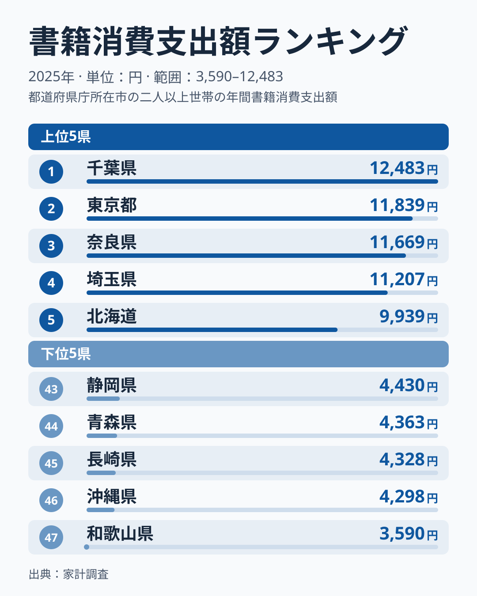
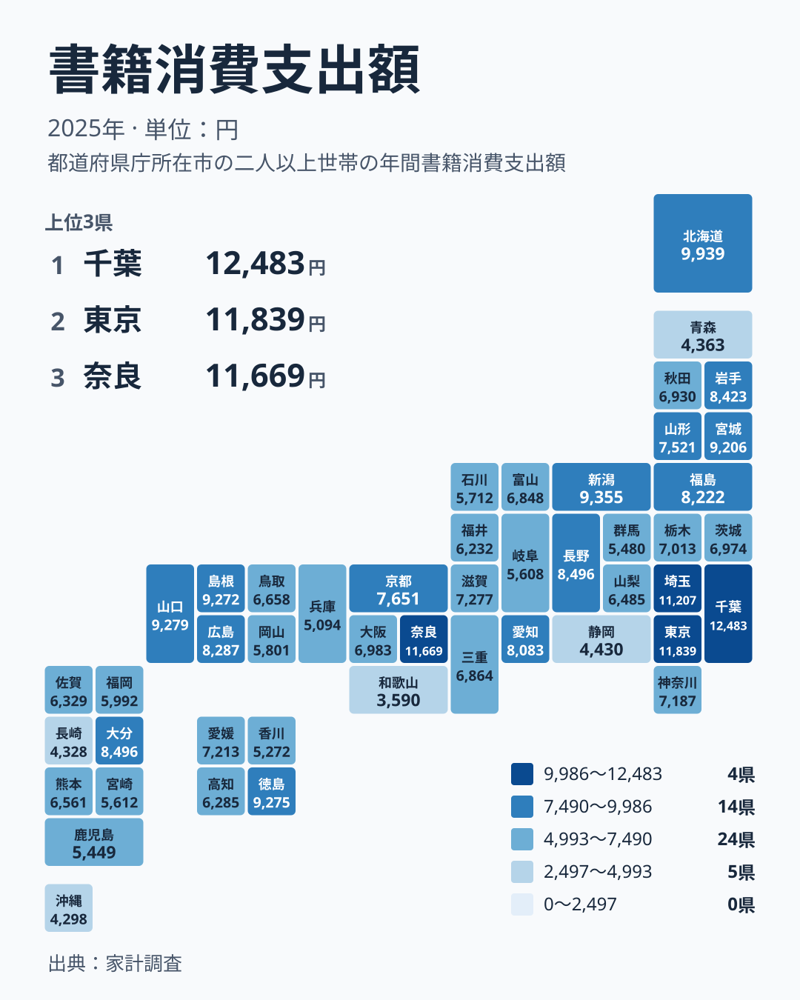

本を買う金額は、住む場所によってどれくらい変わるのでしょうか。2025年の家計調査で、書籍への支出が最も多かったのは千葉県で12,483円でした。最も少なかったのは和歌山県で3,590円です。最大と最小の開きは、数字の上でははっきり見えます。この記事では、その差が暮らしの中で何を意味するのかを、順位の並びから読み解きます。

## 書籍への支出は千葉県が1位、和歌山県が47位

まず全体の姿を図で確認します。上位5県と下位5県を並べたものです。

<source-link href="/ranking/books-consumption-expenditure">書籍への支出ランキングをもっと見る</source-link>

上位には、千葉県が12,483円で1位、東京都が11,839円で2位、奈良県が11,669円で3位、埼玉県が11,207円で4位、北海道が9,939円で5位と並びます。1位から4位までは1万円を超えており、5位の北海道とのあいだにも段差があります。上位は、首都圏の県と奈良県が占める形です。

下位は、和歌山県が3,590円で47位、沖縄県が4,298円で46位、長崎県が4,328円で45位、青森県が4,363円で44位、静岡県が4,430円で43位です。下位5県は4,000円台前半に集まっていますが、最下位の和歌山県だけは3,590円と、さらに一段低い水準です。

最大の千葉県と最小の和歌山県を比べると、12,483円と3,590円で、およそ3.5倍の開きがあります。ただし、これは1世帯あたりの年間の書籍代という家計調査の数字です。読書量そのものの差とは限らない点は、後の節で整理します。

> [!NOTE]
> 書籍消費支出額は、家計調査にもとづく、書籍の購入に使った金額です。単位は円で、2025年の値です。調査は世帯への聞き取りにもとづくため、ここでの数字は「購入に使ったお金」であり、読んだ冊数や読書時間を直接表すものではありません。

## 首都圏に集まる上位と、その背景

上位4県のうち、千葉県、東京都、埼玉県は関東です。奈良県は近畿です。関東の千葉県、東京都、埼玉県は、いずれも1万円を超えています。大きな書店や駅ビル、通勤ルートの途中で本に出会える環境が、支出を押し上げている可能性があります。

関東の中でも、順位には幅があります。神奈川県は7,187円で21位、栃木県は7,013円で22位、茨城県は6,974円で24位、群馬県は5,480円で39位です。同じ関東でも、書籍への支出が上位に入るのは千葉県、東京都、埼玉県の3つで、他の県は中位から下位に並びます。「首都圏だから多い」と一括りにはできないことが分かります。

東京都は11,839円で2位です。詳しい数字は[東京都のデータ](/areas/13000)で確認できます。千葉県の内訳は[千葉県のデータ](/areas/12000)にまとめています。両県を見比べると、都心に近い暮らしと本の購入の関係を考えやすくなります。

近畿の奈良県は、11,669円で3位です。大阪府は6,983円で23位、京都府は7,651円で17位、和歌山県は47位で、近畿のなかでも幅があります。奈良県の高さは、通勤や通学で都市部へ出る習慣、教育にかける関心など、複数の要因が重なった結果かもしれません。

## 地図で見る、書籍への支出の地理分布

続いて、全国の分布をタイルマップで見ます。

地図にすると、関東の一部が濃く、九州・沖縄と近畿の一部が薄いという構図が見えます。九州・沖縄では、沖縄県が4,298円で46位、長崎県が4,328円で45位です。一方で、大分県は8,496円で12位、熊本県は6,561円で29位、福岡県は5,992円で34位、鹿児島県は5,449円で40位です。同じ地方でも順位の幅が大きく、地方の名前だけで傾向を決めつけることはできません。

意外なのは、必ずしも大都市圏でない県が上位に入っていることです。新潟県は9,355円で6位、山口県は9,279円で7位、徳島県は9,275円で8位、島根県は9,272円で9位、宮城県は9,206円で10位です。6位から10位までは9,200円台から9,300円台にひしめき、値の差はごくわずかです。

中国地方を見ると、山口県が7位、島根県が9位、広島県が14位、鳥取県が28位、岡山県が35位です。地方としては同じ中国でも、山口県や島根県のように上位の県もあれば、岡山県のように中位より下の県もあります。書籍への支出は、地域の規模よりも、日々の暮らしの習慣に左右されている側面がありそうです。

> [!WARNING]
> 家計調査は標本調査です。県庁所在地など限られた世帯を対象にした数字であり、県全体の姿を正確に映すとは限りません。順位が近い県の差は、誤差の範囲である可能性があります。たとえば長野県と大分県は、どちらも8,496円で並んでいます。

## 生活への含意:本の買い方が違うのかもしれない

数字の差は、本をどこで、どのように買うかの違いにも結びついていそうです。書店が身近にある地域では、ふらりと立ち寄って買う機会が増えます。逆に書店が遠い地域では、買う回数は減るかもしれません。ただし、通信販売や電子書籍が広がれば、この差は縮まっていくはずです。

支出が少ない県を、読書をしない県と見るのは早計です。図書館を多く使う習慣がある地域や、中古本や貸し借りを使う地域では、購入額が少なくなります。電子書籍の購入が別の費目に入っていれば、書籍の購入額には表れません。つまり、少ない数字の裏に、別の読書の形がある可能性を残しておくべきです。

静岡県は4,430円で43位、兵庫県は5,094円で42位、香川県は5,272円で41位です。いずれも大都市や工業地帯を抱える県ですが、書籍代は下位に位置します。人口の多さや経済の規模が、そのまま書籍への支出に結びつくわけではないことが分かります。

東北を見ると、宮城県が9,206円で10位、岩手県が8,423円で13位、福島県が8,222円で15位、山形県が7,521円で18位、秋田県が6,930円で25位、青森県が4,363円で44位です。同じ東北でも、青森県だけが下位に沈みます。北海道・東北の中では、宮城県と北海道が上位で、青森県が離れて低い構図です。

> [!TIP]
> 順位だけでなく、実際の金額も一緒に見るのが読み解くコツです。11位から12位のように同額で並ぶ場合や、6位から10位のように差がわずかな場合は、順位の違いに大きな意味はありません。一方で、1位から4位と5位のあいだには、はっきりした段差があります。

## 中位の県が示す、暮らしの多様性

中位に目を向けると、別の見え方があります。愛知県は8,083円で16位、京都府は7,651円で17位、滋賀県は7,277円で19位、愛媛県は7,213円で20位です。大都市圏の中心に近い県でも、書籍への支出は1位から4位ほど突出していません。

中部では、新潟県が6位で最も高く、長野県が8,496円で11位、愛知県が16位と続きます。富山県は6,848円で27位、山梨県は6,485円で30位、福井県は6,232円で33位、石川県は5,712円で36位、岐阜県は5,608円で38位、静岡県は43位です。中部は、上位から下位まで幅広く散らばっています。

沖縄県は4,298円で46位です。地理的に本の流通が不利になりやすい環境や、暮らしの中心にある費目の違いが影響している可能性があります。ただし、データだけでは理由を断定できません。分かるのは、書籍への支出が少ない県が、全国の下位に位置するという事実までです。

## 自分の暮らしに引き寄せて読む

この統計を暮らしに引き寄せると、本を買う機会が多い環境ほど支出が増えやすい、という見方ができます。書店に通いやすい、通勤で本屋の前を通る、家族で本を買う習慣がある。そうした日常が積み重なって、年間の金額に表れます。

反対に、本にお金をかけない地域でも、読書が少ないとは限りません。図書館、電子書籍、貸し借りなど、お金を使わずに本を楽しむ方法は多くあります。この統計は、購入額という一つの切り口にすぎません。

同じ分野の他の指標も合わせて見ると、暮らしの全体像がつかみやすくなります。[同じカテゴリの統計一覧](/category/economy)から、ほかの家計の数字も探してみてください。教育費や娯楽費と並べると、書籍代が家計の中でどんな位置にあるのかが見えてきます。

## データについて

この記事で使った数字は、家計調査にもとづく書籍消費支出額で、2025年の値です。単位は円で、全47都道府県の値と順位を使っています。順位は金額の大きい順です。同額の県が並ぶ場合も、データ上の順位をそのまま記載しています。

倍率は、最大の千葉県12,483円と最小の和歌山県3,590円の比を指しています。それ以外の差や割合は、この記事では計算していません。
