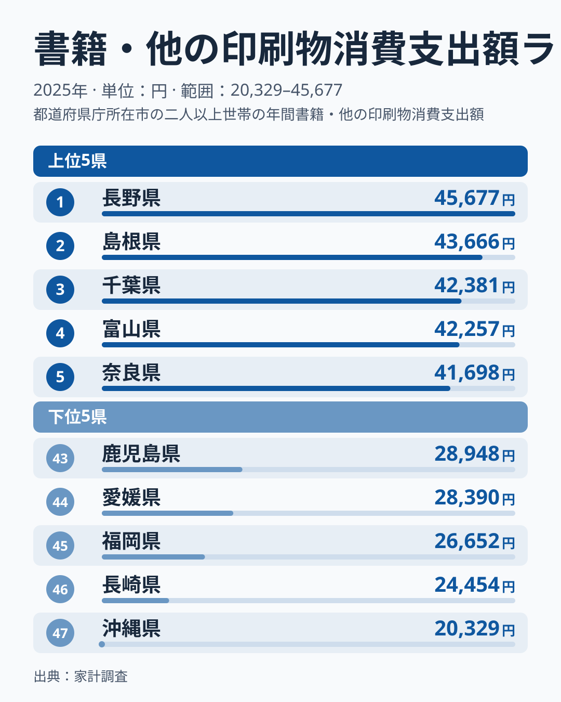
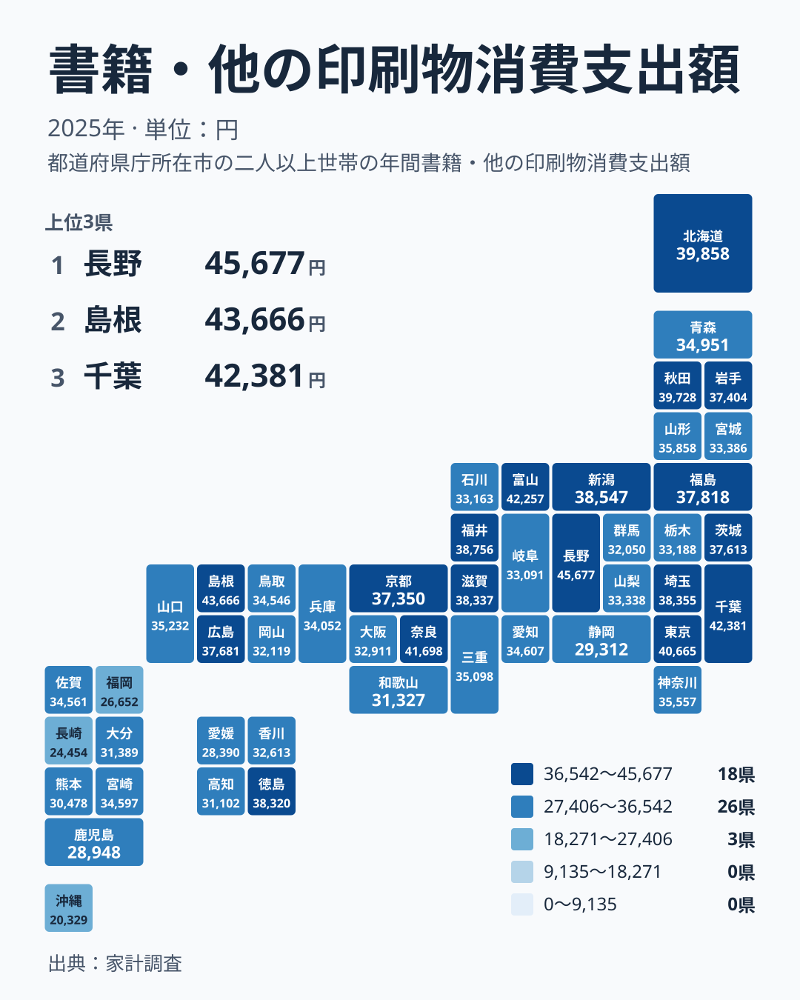

本にどれだけお金を使うかは、住む場所によって大きく変わります。2025年の家計調査では、書籍・他の印刷物への支出が最も多いのは長野県で、45,677円でした。最も少ないのは沖縄県で、20,329円です。この記事では、この差がどのような形で分布しているのかを、データで言える範囲に絞って読み解き、暮らしの側から何が言えるかを考えます。

## 書籍・他の印刷物への支出の上位と下位

まずは上位5県と下位5県を図で確認します。

<source-link href="/ranking/books-printed-matter-group-consumption-expenditure">書籍・他の印刷物への支出ランキングをもっと見る</source-link>

上位は長野県、島根県、千葉県、富山県、奈良県の順です。長野県は45,677円、島根県は43,666円、千葉県は42,381円、富山県は42,257円、奈良県は41,698円で、上位5県はいずれも4万円台に収まっています。所属する地方は中部、中国、関東、中部、近畿とまたがっており、特定の地方だけで固まっているわけではありません。

下位は沖縄県が20,329円、長崎県が24,454円、福岡県が26,652円、愛媛県が28,390円、鹿児島県が28,948円です。最下位の沖縄県と46位の長崎県の間には大きな開きがありますが、上位でも1位の長野県と5位の奈良県の間にほぼ同じ程度の開きがあります。つまり、この指標は上位の側も下位の側も、同じくらいの幅でばらけています。どちらか一方だけが飛び抜けている、という形ではありません。

最大の長野県と最小の沖縄県を比べると、2倍以上の開きがあります。同じ日本で暮らしていても、本への年間の支出額が倍以上になる地域があるわけです。ただし、この数字だけでは理由までは語れません。以降は、分布の形と地域ごとの散らばり方を順に見ていきます。

> [!NOTE]
> この指標は家計調査の「書籍・他の印刷物消費支出額」で、2025年の年間支出額を円で示しています。書籍だけでなく、その他の印刷物への支出も合わせた項目です。雑誌や新聞を別の区分で扱う集計もあるため、「本だけ」の金額と受け取ると読み違えます。電子書籍の購入がどこに分類されるかも、この数字だけでは分かりません。

## 地理分布から見える散らばり

次に、地図の上での分布を見ます。

地図を眺めると、色の濃い県と薄い県が地方ごとにきれいに分かれているわけではないことが分かります。結論を先に言えば、この指標は地方というくくりでは説明しきれません。

象徴的なのは関東です。千葉県は3位で42,381円、東京都は6位で40,665円と上位に入ります。一方で、群馬県は37位で32,050円にとどまります。同じ関東の中で、上位と下位寄りの県が同居しています。

九州・沖縄にも同じことが言えます。宮崎県は25位で34,597円と中位ですが、沖縄県は47位で20,329円です。地方の内側での最大と最小の落差が、地方どうしの違いと同じくらい大きいため、地方名で「本をよく買う地域」「あまり買わない地域」と括ることはできません。

> [!TIP]
> 順位だけでなく金額の幅も見てください。中位の県は金額が密集しているため、順位が1つ違っても実態はほとんど変わりません。意味のある差は、順位が10位ほど離れたときや、上位と下位の両端を比べたときに現れます。

## 都市規模では説明できない順位のばらつき

本の支出は大都市ほど多い、と思われがちです。しかしデータを見ると、そう単純ではありません。東京都は6位で40,665円と上位です。ところが神奈川県は20位で35,557円、愛知県は24位で34,607円、大阪府は34位で32,911円、福岡県は45位で26,652円です。大都市圏を含む県の順位はばらついており、都市であることがそのまま上位を意味してはいません。

一方で、長野県は1位、島根県は2位、富山県は4位、秋田県は8位と、大都市圏とはいえない県が上位に並びます。ここで確認できるのは、大都市圏の順位がそろわないことと、地方の県が上位に入っていることの2点までです。

背景として、図書館や書店の身近さ、世帯の構成、在宅時間などが関わっているかもしれません。ただし、これらは今回のデータには含まれておらず、裏付けはありません。仮説として頭に置く程度にとどめてください。

> [!WARNING]
> 家計調査は標本調査で、都道府県別の値は調査対象の世帯数が限られるため、ぶれが大きくなりやすい点に注意が必要です。1位と2位のように近い順位の違いは、誤差の範囲に収まる可能性があります。通信販売や電子書籍での購入がこの数字にどう反映されるかも、この指標だけでは分かりません。

## 分布の形から読む生活への含意

順位を10位刻みで追うと、分布の形が見えてきます。10位は新潟県で38,547円、20位は神奈川県で35,557円、30位は山梨県で33,338円、40位は高知県で31,102円です。

この並びで読みどころになるのは、下がり方が一定ではないことです。1位から10位あたりまでと、10位から20位にかけては金額が大きく下がります。これに対して20位以降は、30位、40位と進んでも下がる幅がほぼ変わらず、なだらかに縮んでいきます。つまり、中位から下位にかけては、順位が10個違っても金額の差はほとんど広がらない、緩やかな坂になっています。

そして最後の7位分ほどで、再び急に落ち込みます。静岡県は42位で29,312円、福岡県は45位で26,652円、長崎県は46位で24,454円、沖縄県は47位で20,329円です。全体を通して見ると、緩やかな中位の坂の両端が、上にも下にも離れて見える形です。両端の開きが全体の散らばりにどれだけ寄与しているかは、このデータだけでは計算できないため、そう見えるという範囲にとどめます。

生活の側に引き寄せると、支出額の低さは読書量の少なさと同じとは限りません。図書館の利用や貸し借りは、この指標に表れにくいためです。自分の住む県の位置を知りたい人は、[長野県のデータ](/areas/20000)や[島根県のデータ](/areas/32000)で、ほかの指標と並べてみてください。さらに、[同じカテゴリの統計一覧](/category/economy)を見れば、家計の別の項目とあわせて確かめられます。

中位の県に住んでいる人にとっては、順位の上下は気にしすぎなくてかまいません。意味のある違いは、上位や下位の両端に近い県で出てきます。

## データについて

ここで使った数値は、家計調査の「書籍・他の印刷物消費支出額」の2025年の値で、単位は円です。47都道府県の全件を比べています。本文中の順位は、この値を大きい順に並べたものです。

読み方の基本は、1つの県の数字を絶対視せず、順位と金額の両方を見ることです。上位の長野県、島根県、千葉県、富山県、奈良県は、いずれも4万円台です。下位の沖縄県、長崎県、福岡県は、2万円台にとどまります。この二つのグループの間に、本への支出の大きな開きがあります。

今回は2025年の1年分だけを扱っているため、長野県の1位が毎年続くのかどうかまでは分かりません。傾向をつかむには、複数年の推移を確認する必要があります。それでも、2025年の時点で、本への支出に大きな地域差があることはデータから確かめられます。

## まとめ

2025年の書籍・他の印刷物への支出は、長野県が45,677円で1位、島根県が43,666円で2位、千葉県が42,381円で3位でした。最下位は沖縄県の20,329円で、長崎県の24,454円、福岡県の26,652円が続きます。最大と最小の間には2倍以上の開きがあります。

上位の側も下位の側も同じくらいの幅でばらけており、片側だけが突出しているわけではありません。東京都は6位、大阪府は34位で、大都市圏の順位はそろいません。同じ地方の中でも順位に幅があるため、地方や都市規模だけで支出の高低を説明することはできません。数字を読むときは、標本調査の限界と、電子書籍や図書館の利用がこの指標に表れにくい点に気をつけながら、自分の暮らしに引き寄せて考えてみてください。
