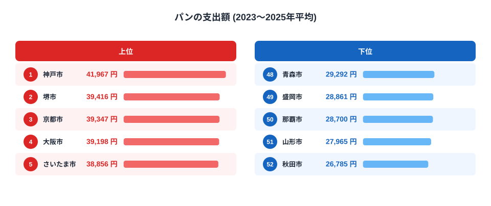
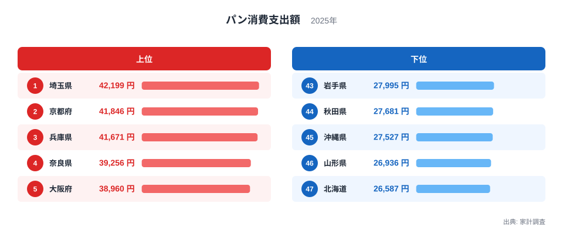
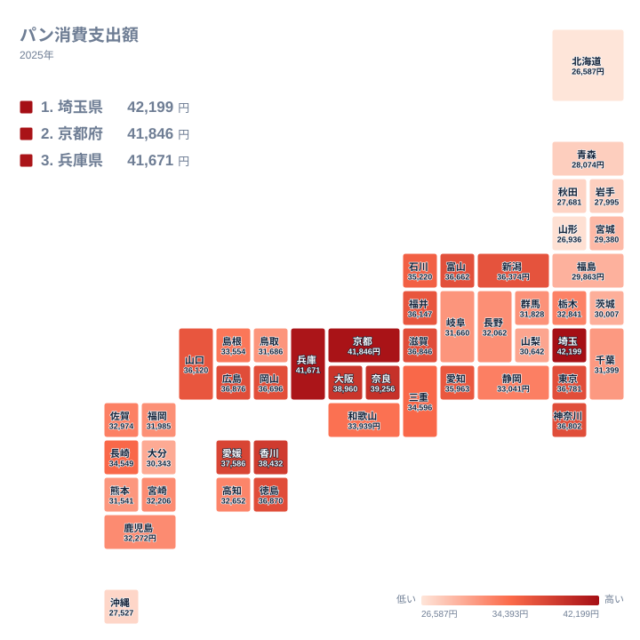

「2023〜2025年の平均で全国第3位にランクインしている京都市の食品は?(パン・米・麺類)」──と出題されるクイズの答えは、**パン**です。家計調査の「パン」への年間支出額(二人以上の世帯)を、県庁所在市と政令指定都市の52市で並べ、2023年・2024年・2025年を単純平均すると、1位は神戸市の41,967円、2位は堺市の39,416円、3位が京都市の39,347円でした。全国の二人以上世帯の平均34,242円より、京都市は5,105円、約1.15倍多く使っています。同じ52市・3年平均で選択肢の米と麺類も並べると、京都市は、米が25位の30,173円(首位は浜松市の39,473円)、麺類が34位の20,271円(首位は山形市の26,372円)で、3位に入るのはパンだけです。

ただし「パンの日本一はどこか」は、どの集計を見るかで答えが変わります。52市の3年平均では神戸市ですが、都道府県別ランキングと同じ2025年の県庁所在市で並べると、1位は埼玉県のさいたま市で42,199円、2位は京都府の41,846円、3位は兵庫県の41,671円です。堺市は政令指定都市ですが大阪府の県庁所在市ではないため、都道府県別の順位には入りません。この記事では、52市の3年平均、年ごとの動き、2025年の都道府県別、地図の順に読み解きます。

> [!NOTE]
> この数字は個数や重さの消費量ではなく、**支出額**です。二人以上の世帯が1年間にパンへ支払った金額で、買った量ではありません。量(g)で比べたいときは、同じ家計調査の購入数量を並べた[パン消費量ランキング](/ranking/bread-consumption-quantity)で確かめられます。分類表では「パン」の下に食パンと「他のパン」があり、あんパン・カレーパン・メロンパンなどは他のパンです。サンドウィッチやコロッケパン、ハンバーガーなどの調理パンは別の品目「主食的調理食品」で、乾パンは菓子類、ピザも主食的調理食品なので、パンには含まれません(出典: 総務省統計局「家計調査 収支項目分類及びその内容例示」2025年1月改定)。単価の高いパンを買う世帯が多い地域は、買う量が同じでも支出額は高く出ます。

## 52市の3年平均──神戸市が抜け、堺市と京都市が続きます

まず、県庁所在市と政令指定都市の52市を、2023〜2025年の単純平均で並べた図です。

上位5市は、神戸市41,967円、堺市39,416円、京都市39,347円、大阪市39,198円、さいたま市38,856円です。1位の神戸市は2位の堺市と2,551円離れていますが、2位から5位の4市は560円の範囲に収まっています。京都市は、2位の堺市と69円差、4位の大阪市と149円差の位置にいて、堺市・京都市・大阪市の3市は218円の範囲に並んでいます。神戸市は兵庫県の県庁所在市、堺市は大阪府にある政令指定都市です。

下位5市は、秋田市26,785円、山形市27,965円、那覇市28,700円、盛岡市28,861円、青森市29,292円で、東北の県庁所在市4市と沖縄県の那覇市です。1位の神戸市と最下位の秋田市の差は15,182円で、1.57倍になります。全国平均の34,242円を上回るのは52市のうち24市で、上位5市は平均を4,614円から7,725円上回り、下位5市は平均を4,950円から7,457円下回っています。

地域で見ると、上位10市は近畿の6市(神戸市・堺市・京都市・大阪市・大津市・奈良市)、関東の2市(さいたま市・東京都区部)、中国地方の2市(広島市・岡山市)です。ここでの近畿は、家計調査の区分に従った滋賀・京都・大阪・兵庫・奈良・和歌山の2府4県で、三重県は含みません。近畿の7市のうち、6市は9位以内に入っていて、和歌山市だけが、15位の36,188円です。近畿の市がそろって高いわけではなく、和歌山市のように平均を1,946円上回る程度の市もあります。

[仮説] 近畿の市でパンへの支出が高いのは、パンを買う量が多いか、単価の高いパンを買う世帯が多いことが一因かもしれません。ただし支出額は購入数量と単価の積で、この図だけでは分けられません。量が多いのか単価が高いのかは、同じ家計調査の購入数量を県庁所在市で並べた[パン消費量ランキング](/ranking/bread-consumption-quantity)を、支出額の順位と見比べて初めて検証できる仮説です。本記事では数量の値を確かめていないため、理由を断定しません。

## 単年の順位は動く──6位、9位、2位と動いた京都市、平均では3位に

3年平均は三つの年の値を平均したものなので、年ごとに見ると顔ぶれはかなり違います。京都市の支出額は、2023年が38,654円で52市の6位、2024年が37,542円で9位、2025年が41,846円で2位でした。2024年から2025年で4,304円増えており、2025年の上昇が3年平均を押し上げています。

金額はいずれも名目で、物価の変化は調整していません。年ごとの増減には、パンの価格の変化も含まれています。他の上位市も同じように動いています。堺市は2023年に36,633円で12位でしたが、2024年は42,954円で2位に上がり、1位の神戸市43,047円とは93円差でした。2025年は38,660円で6位です。さいたま市は2023年が9位、2024年が12位で、2025年に42,199円で1位になりました。2024年の36,887円から5,312円の増加です。一方、神戸市は2023年・2024年が1位、2025年が3位で、3年とも41,000円を超えていて、最大と最小の差は1,864円にとどまります。大阪市も、8位・3位・5位と動きながら、振れ幅は1,640円です。

> [!WARNING]
> 家計調査は標本調査で、市ごとの標本世帯は限られます。年ごとの値には標本の偏りによる振れが含まれ、3年平均にすると均されますが、完全には消えません。ここで見ているのは数百円から数千円の差で、「この街が日本一」「この県はパンを買わない」と1回の順位で断定せず、複数年の水準で読んでください。

3年間の最大と最小の差を比べると、神戸市は1,864円、大阪市は1,640円と小さいのに対し、京都市は4,304円、さいたま市は5,312円、堺市は6,321円と大きく動いています。3位の京都市と4位の大阪市の149円差は、京都市自身の年ごとの振れ幅4,304円よりずっと小さい差です。52市の3年平均で3位という順位が示すのは、神戸市に次ぐ上位グループにいるという意味までです。堺市や大阪市との順序までは確かではありません。なぜ年によって増減したのかは、支出額だけでは分かりません。

## 同じパンでも集計で日本一が変わる──52市と都道府県別の違い

次に、サイトの都道府県別ランキングと同じ、2025年の県庁所在市の値を47都道府県で並べた図です。

<source-link href="/ranking/bread-consumption-expenditure">パン消費支出額ランキングをもっと見る</source-link>

上位5県は、埼玉県42,199円、京都府41,846円、兵庫県41,671円、奈良県39,256円、大阪府38,960円です。上位3県は528円の範囲に収まり、4位の奈良県とは2,415円離れています。下位5県は、北海道26,587円、山形県26,936円、沖縄県27,527円、秋田県27,681円、岩手県27,995円で、1位と最下位の差は1.59倍です。各県の値は県庁所在市の二人以上世帯の値で、埼玉県ならさいたま市、京都府なら京都市、兵庫県なら神戸市の家計を指します。県全体の平均ではありません。

同じ52市のデータで「範囲」と「年の取り方」を変えて並べ直すと、日本一と京都市の順位がどう変わるかが分かります。

- 52市の3年平均では、1位が神戸市、2位が堺市、3位が京都市です。
- 県庁所在市でない5市を除いた47市の3年平均では、1位が神戸市の41,967円、2位が京都市の39,347円、3位が大阪市の39,198円です。
- 52市の2025年だけで見ると、1位がさいたま市の42,199円、2位が京都市の41,846円、3位が神戸市の41,671円です。
- 47市の2025年だけ(都道府県別ランキングと同じ集計)でも、上位3市の顔ぶれと順序は同じです。

首位が神戸市からさいたま市に変わるのは、年の取り方の違いです。神戸市は3年とも高い水準を保ち、さいたま市は2025年に大きく伸びました。一方、京都市の順位を分けるのは、堺市を含めるかどうかです。堺市は3年平均で京都市を69円上回っているため、3位になるのは堺市を含む52市の場合です。

県庁所在市でない政令指定都市は、川崎市・相模原市・浜松市・堺市・北九州市の5市です。52市の3年平均で見ると、このうち上位10位に入るのは2位の堺市だけで、相模原市は18位、川崎市は20位、浜松市は27位、北九州市は33位です。つまり、3年平均では、都道府県別の順位に入らないことで京都市の順位に影響する市は堺市だけです。パンの「日本一」は、範囲と年を添えて初めて比べられます。同じように範囲で首位が入れ替わる例は、餃子の支出でも見られます。[宇都宮と浜松、餃子日本一はどっち?](/blog/frozen-gyoza-spending-prefecture-gap)で、52市と都道府県別の違いを読んでいます。

## 地図で見る地域の偏り──上位は近畿と四国、東北と北海道は下位寄り

2025年の地図では、値の高い県が近畿と四国に目立ちます。近畿は京都府が2位、兵庫県が3位、奈良県が4位、大阪府が5位、滋賀県が10位の36,846円と上位に並びますが、和歌山県は22位の33,939円で中位です。四国は香川県が6位の38,432円、愛媛県が7位の37,586円、徳島県が9位の36,870円と高い一方、高知県は27位の32,652円です。関東も一様ではなく、埼玉県が1位、神奈川県が11位の36,802円、東京都が12位の36,781円ですが、栃木県は26位、群馬県は32位、千葉県は36位、茨城県は39位の30,007円と、中位から下位寄りの県もあります。

値の低い県が並ぶのは、東北と北海道です。東北6県は福島県の40位の29,863円、宮城県の41位、青森県の42位、岩手県の43位、秋田県の44位、山形県の46位と、すべて40位以下です。北海道は47位で、最下位です。沖縄県も45位の27,527円と低く、九州では長崎県の21位の34,549円が最も高い順位でした。**近畿だから高い、東北だから低いという単純な括りは成り立たず**、同じ地方の中でも県庁所在市ごとに差があります。

[仮説] 近畿や四国で高く、東北や北海道で低いのは、朝食や昼食の主食にパンを選ぶ頻度の地域差や、米やパン以外の主食(麺類など)の食べ方の違いが関係しているのかもしれません。ただし、この仮説を確かめるには、同じ県の購入頻度や購入先、主食の選択を調べた別の統計が必要です。パンと米の支出の関係は、2024年のデータを使った[パン王国と米どころ、なぜ真逆?](/blog/bread-vs-rice-expenditure)で扱っています。

## まとめ

- クイズの答えはパンです。52市の2023〜2025年の単純平均では、3位の39,347円が京都市です。1位は神戸市の41,967円、2位は堺市の39,416円です。京都市は、米が25位、麺類が34位なので、選択肢の中で3位に入るのはパンだけです。
- 52市の1位の神戸市と最下位の秋田市の差は15,182円で、1.57倍です。京都市は全国平均を5,105円上回っています。
- 京都市の年ごとの順位は、6位・9位・2位と大きく動きました。3位と4位の149円差は、京都市自身の年ごとの振れ幅4,304円より小さいため、順序までは確かではありません。
- 集計を変えると日本一が変わります。2025年の県庁所在市(都道府県別)ではさいたま市が42,199円で1位、京都市が2位、神戸市が3位です。
- 堺市は大阪府の県庁所在市ではないので、都道府県別の順位には入りません。堺市を除くと、3年平均でも京都市は2位です。
- 2025年の47都道府県では、1位の埼玉県と最下位の北海道の差が1.59倍です。上位は近畿と四国、下位は東北と北海道に偏りますが、同じ地方でも差があります。

食に関する他の指標は、テーマの[食卓と家計の支出](/themes/household-food-spending)でまとめて確認できます。

## データについて

総務省統計局「[家計調査](/survey/kakei-chousa)」(品目別、二人以上の世帯の年間支出額)です。52市の金額と年ごとの値は、e-Stat「家計調査 品目分類(2025年改定)」の年次の金額(統計表ID 0004023605)から、県庁所在市と政令指定都市の「パン」を取得しました。3年平均は2023・2024・2025年の単純平均を四捨五入しており、全国の平均も同じ方法です。選択肢の米(品目「米」)と麺類(品目「麺類」)の順位も、同じ表から同じ方法で作りました。金額は名目で、物価の変化は調整していません。県庁所在市でない政令指定都市の5市は、川崎市・相模原市・浜松市・堺市・北九州市です。2025年の都道府県別の値は、県庁所在市の二人以上世帯の年間パン支出額で、ランキングページの値と同じものです。品目「パン」の範囲は、総務省統計局「家計調査 収支項目分類及びその内容例示」(2025年1月改定)に従っています。
