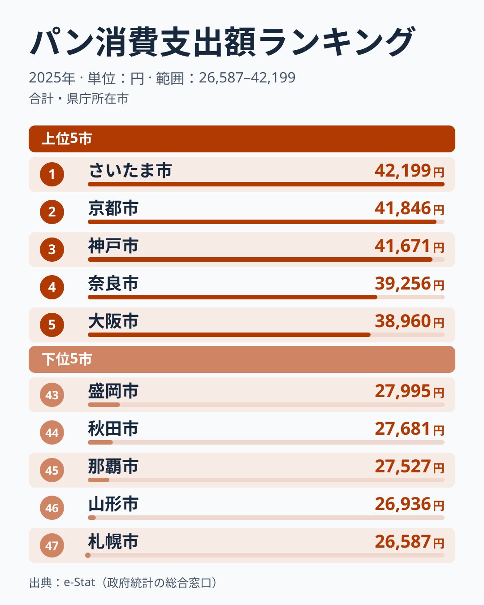
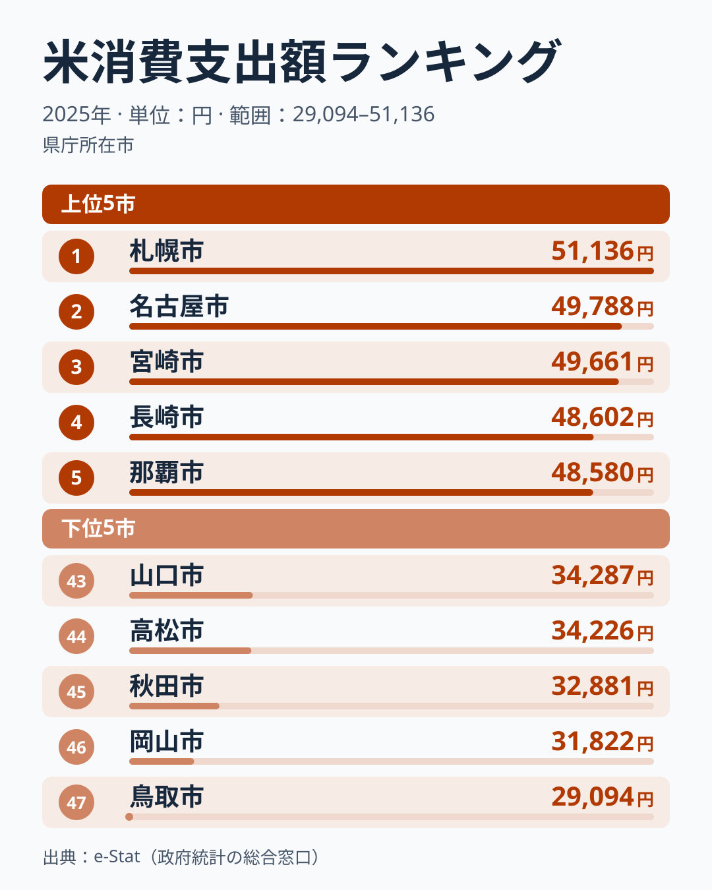

「ご飯派」か「パン派」か。主食への支出を家計調査で比べると、ここ数年で大きな変化が起きています。47市の値を単純平均すると、2023年は米が20,295円、パンが33,268円で、47市のすべてでパンへの支出が米を上回っていました。ところが2025年は米が41,235円、パンが33,769円となり、47市のうち39市で米がパンを上回りました。

米への支出は2年でほぼ2倍になりました。一方で、家庭が買った米の量（購入数量）の47市平均は2023年の56.9kgから2025年の59.7kgへとほとんど変わっていません。この記事では、2025年のパンと米の支出額ランキングを並べ、支出の逆転がどの県でどう表れているかを確かめます。

> [!NOTE]
> この数値は総務省「家計調査」の1世帯（二人以上）あたり年間支出金額（品目別）です。購入量ではなく金額のため、価格の変化も反映されます。値は都道府県庁所在市の調査値で、本文の県名はその県の県庁所在市を指します。

## パン消費額ランキング — 近畿が上位に並ぶ

<source-link href="/ranking/bread-consumption-expenditure">パン消費支出額ランキングをもっと見る</source-link>

2025年のパン消費支出額は、埼玉県が42,199円で1位でした。2位は京都府で41,846円、3位は兵庫県で41,671円、4位は奈良県で39,256円、5位は大阪府で38,960円です。上位5県のうち4府県が近畿の府県で、2024年も兵庫県が最も多く、大阪府がそれに続いており、近畿が上位にいました。[兵庫県](/areas/28000)や[京都府](/areas/26000)では、パン屋や喫茶店のモーニングが身近だという話がよく聞かれますが、この記事のデータからはパン屋の数や外食の習慣までは確かめられません。

下位は、北海道が26,587円で47位、山形県が26,936円で46位、沖縄県が27,527円で45位、秋田県が27,681円で44位、岩手県が27,995円で43位でした。北海道と東北の4道県が下位に並びます。1位の埼玉県と47位の北海道の差は1.59倍です。

パンの支出は、米と違ってこの2年で大きく動いていません。47市平均は2023年が33,268円、2024年が34,361円、2025年が33,769円で、ほぼ横ばいです。

> [!TIP]
> パンの支出額には「食パン」だけでなく「他のパン」（菓子パン・調理パンなど）も含まれます。パンの支出が横ばいなので、2025年の米とパンの逆転は、パンが減ったからではなく米の支出が増えたことで起きています。

## 米消費額ランキング — 北海道が1位、パンでは最下位

<source-link href="/ranking/rice-consumption-expenditure">米消費支出額ランキングをもっと見る</source-link>

2025年の米消費支出額は、北海道が51,136円で1位でした。2位は[愛知県](/areas/23000)で49,788円、3位は[宮崎県](/areas/45000)で49,661円、4位は長崎県で48,602円、5位は沖縄県で48,580円です。北海道はパンでは47位で、2つのランキングで最も対照的な位置にいます。沖縄県も米は5位、パンは45位でした。

下位は、鳥取県が29,094円で47位、岡山県が31,822円で46位、秋田県が32,881円で45位、香川県が34,226円で44位、山口県が34,287円で43位です。1位の北海道と47位の鳥取県の差は1.76倍で、パンの1.59倍より大きくなっています。中国・四国の4県（鳥取・岡山・香川・山口）が下位に並びました。米の購入量そのものは[米消費量ランキング](/ranking/rice-consumption-quantity)で確かめられます。

米の支出が増えた理由は、購入量と並べると見えてきます。47市平均の支出額を47市平均の購入量で割ると、1kgあたりに払った金額の目安は2023年の約357円から2024年の約446円、2025年の約691円へと上がりました。買う量はほとんど変わらず、1kgあたりに払う金額がおよそ2倍になったことが、支出の倍増の中身です。

> [!WARNING]
> 家計調査は「購入した金額」を集計したものであり、農家の自家消費米や贈答・縁故米は対象外です。1kgあたりの金額は平均どうしを割った目安で、銘柄や購入先の違いは区別できません。

## パン上位の県は米で中位、米上位の県はパンで下位

同じ県の順位を2つのランキングで突き合わせると、対照的な県が目立ちます。

- **埼玉県**: パン1位 → 米25位
- **京都府**: パン2位 → 米15位
- **兵庫県**: パン3位 → 米22位
- **北海道**: 米1位 → パン47位
- **沖縄県**: 米5位 → パン45位
- **香川県**: パン6位 → 米44位

ただし、すべての県がこの形に分かれるわけではありません。47都道府県の値でパンと米の支出額の相関係数を計算すると、2025年は-0.10、2024年は-0.13で、パンが多い県ほど米が少ないという関係はごく弱いものでした。鳥取県のようにパンは33位、米は47位と、どちらも少ない県もあります。北海道や埼玉県のような対照的な県は目を引きますが、全体の傾向とまでは言えません。

[仮説] 近畿の府県でパンの支出が多いのは、喫茶店のモーニングなどパンの食習慣が身近だからかもしれません。ただしこれは、パン屋の数や朝食の内容といった別のデータで確かめる必要があります。

> [!NOTE]
> 相関係数は-1から1の値をとり、0に近いほど関係が弱いことを表します。ここで示したのは支出額どうしの関係で、「パンを買うから米を買わない」といった因果を示すものではありません。

## まとめ

- 2025年のパン消費支出額1位は埼玉県で42,199円、最下位は北海道で26,587円、差は1.59倍
- 2025年の米消費支出額1位は北海道で51,136円、最下位は鳥取県で29,094円、差は1.76倍
- 米の支出の47市平均は2023年の20,295円から2025年の41,235円へほぼ2倍になり、47市のうち39市で米がパンを上回った
- 米の購入量はほぼ横ばいで、1kgあたりに払った金額の目安が約357円から約691円へ上がった
- 北海道は米が1位でパンが47位と対照的だが、パンと米の支出の相関は-0.10と弱い
