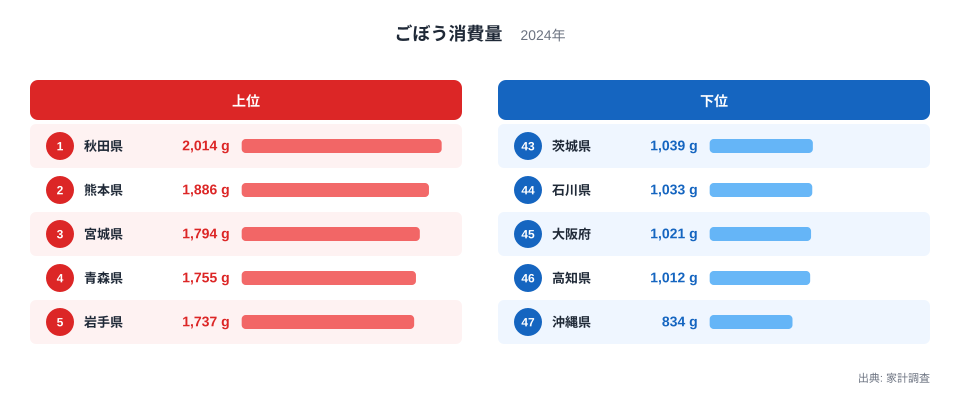
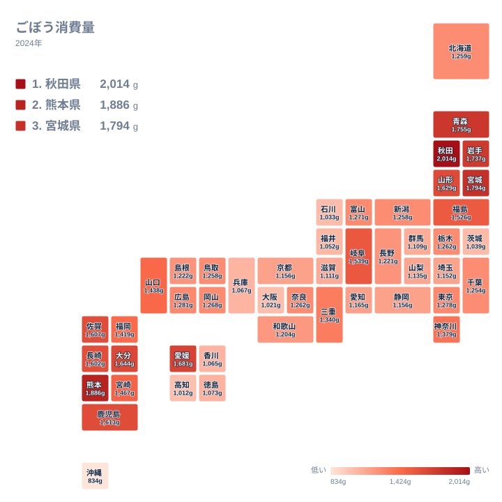

## ごぼうを一番食べているのはどこか

きんぴら、けんちん汁、炊き込みごはん、豚汁。ごぼうは和食の脇役として、日本の食卓に長く根づいてきた根菜です。ただ、その買われ方は全国で同じではありません。家計調査の2024年の結果を見ると、県ごとにはっきりした差があります。

1位は秋田県で2,014gです。2位は熊本県で1,886g、3位は宮城県で1,794gと続きます。一方で最下位の沖縄県は834gにとどまります。1位と最下位では、1世帯が1年間に買うごぼうの量に大きな開きがあります。

この記事では、上位に並ぶ県と下位に並ぶ県を比べながら、なぜここまで差が出るのかを食文化・気候・産地といった観点から考えます。ただし、背景の説明の多くは、手元のデータだけでは検証できない仮説です。その点は本文中でもそのつど断っていきます。

> [!NOTE]
> この記事で扱う「ごぼう消費量」は、家計調査で1世帯が1年間に購入した重量(2024年、単位はg)です。購入時の重さなので、皮や泥、切り落とす部分を含んだ量です。実際に食べた量そのものではありません。外食や、惣菜・弁当に入ったごぼうは基本的に含まれず、家庭で素材として買った分を見る指標です。

## 上位5県と下位5県を比べる

まず、上位と下位の顔ぶれを図で確認します。

<source-link href="/ranking/burdock-consumption-quantity">ごぼう消費量ランキングをもっと見る</source-link>

上位は、秋田県の2,014g、熊本県の1,886g、宮城県の1,794g、青森県の1,755g、岩手県の1,737gです。このうち4県が東北で、そこに九州の熊本県が割って入る形です。東北の北部から中部にかけて、ごぼうがよく買われていることが分かります。

下位に目を向けると、最下位の沖縄県が834gです。その手前に、46位の高知県が1,012g、45位の大阪府が1,021g、44位の石川県が1,033g、43位の茨城県が1,039gと続きます。47位の沖縄県と46位の高知県の間には、他の順位間より大きな開きがあります。下位の4県は互いにかなり近い値で、沖縄県だけが一段低いという構図です。

上位と下位の差は、好みの問題だけでは説明しにくいところがあります。寒い地域で根菜を煮込む習慣があるか、別の食材が日常の食卓の中心になっているかなど、土地の事情が重なっている可能性があります。ただし、これらは理由の候補であり、この統計だけで確かめられるものではありません。

## 東北の食文化とごぼうの関係

上位を占める東北では、ごぼうを使う料理が冬の食卓に根づいています。秋田県は2,014gで全国1位です。きりたんぽ鍋にはささがきにしたごぼうが使われることが多く、鶏の出汁とごぼうの香りが合わさる鍋は秋田の代表的な郷土料理として知られています。

宮城県は1,794gで3位です。芋煮や豚汁のように、根菜を入れた汁物が親しまれている地域です。青森県は1,755gで4位、岩手県は1,737gで5位です。山形県も1,629gで8位に入っており、芋煮の文化が強い地域として知られています。

東北は寒い季節が長く、土の中で育つ根菜は貯蔵もしやすい食材です。冬に畑の作物が少なくなる時期でも、保存のきく根菜は貴重な食べ物だったと考えられます。こうした暮らしの積み重ねが、現在の購入量にも表れているのかもしれません。

秋田県の詳しいデータは[秋田県のデータ](/areas/05000)で確認できます。ごぼう以外の指標も合わせて見ると、食生活の特徴がより立体的に分かります。

> [!TIP]
> ごぼうの数字を読むときは、「何gを買ったか」が「何を買ったか」とセットであることに注意してください。泥付きのごぼうは重さの一部が土ですし、洗いごぼうやカット済み・ささがきパックでは同じ重さでも食べられる部分の割合が違います。県ごとに売られている形態の主流が違えば、同じ重さでも実際の料理の量は変わります。順位の差を、そのまま食べた量の差と受け取らないようにしましょう。

## 九州の強さと熊本県という例外

九州にも、ごぼうをよく購入する県が目立ちます。2位の熊本県は1,886gで、東北以外で最も高い値です。そのほか、愛媛県は1,681gで6位、大分県は1,644gで7位、鹿児島県は1,613gで9位、佐賀県は1,607gで10位、長崎県は1,602gで11位です。愛媛県は四国ですが、九州の県と並んで上位に入っています。

九州では、煮しめや炊き込みごはん、鶏肉と根菜を煮込む料理が家庭で作られていると言われます。熊本県でも、ごぼうが家庭の煮物に幅広く使われている可能性があります。熊本県の他の指標は[熊本県のデータ](/areas/43000)でも確認できます。

ここで興味深いのは、東北と九州という気候の違う地域が、どちらも上位にいることです。東北は寒さが理由として思い浮かびやすい一方、九州は温暖です。気候だけで説明するのは難しく、煮物を中心とした家庭料理の型など、別の要因も関わっているのではないかと考えられます。

福岡県は1,419gで16位、宮崎県は1,467gで14位です。九州の中でも大きな都市圏を抱える福岡県は、上位の県よりやや低い位置にあります。都市部では外食や総菜の利用が多く、家庭で素材から買う量が少なくなるという影響も考えられますが、このデータだけでは裏付けられません。

## 地図で見る「東北と九州」の分布

次に、47都道府県の分布を地図で見てみます。

地図で眺めると、色の濃い地域は東北に固まっています。さらに九州にも濃い地域が連なります。反対に、関東の周辺から近畿、北陸にかけては中位から下位が目立ち、日本の中央部は比較的購入量が少ない傾向です。

関東を見ると、神奈川県は1,379gで17位、東京都は1,278gで20位、千葉県は1,254gで28位、埼玉県は1,152gで35位、茨城県は1,039gで43位です。茨城県はごぼうの産地としても知られていますが、家計調査の購入量では下位にあります。生産量が多いことと、地元の家庭で多く買われることは、必ずしも一致しないことが分かります。

近畿では、奈良県が1,262gで23位、和歌山県が1,204gで31位、京都府が1,156gで33位、滋賀県が1,111gで37位、兵庫県が1,067gで40位、大阪府が1,021gで45位です。大阪府は全国でも少ない側に入ります。外食や加工食品の選択肢の多さが関係している可能性はありますが、この統計では確かめられません。

> [!WARNING]
> ごぼうは、洗いごぼう、泥付き、カット済み、水煮、総菜など、売られ方が多様な食材です。家計調査の購入量が、どの形態をどこまで同じ重さで数えているかは、この記事のデータからは分かりません。県ごとの流通や好まれる形態の違いが、数字に混ざっている可能性があります。生産地の多い県で購入量が少ない茨城県の例のように、産地や食文化と数字が結びつかないケースもあります。

## 沖縄県はなぜ少ないのか

最下位の沖縄県は834gで、ほかの県より一段低い水準です。この低さの理由は、このデータからは特定できません。以下は、検証できていない仮説として読んでください。

沖縄の伝統的な料理では、ゴーヤー、島らっきょう、大根、にんじん、昆布、豚肉などがよく使われます。ごぼうが本土の煮しめやきんぴらほど中心的な食材ではない可能性があります。また、温暖な気候で一年中さまざまな野菜が手に入ることが、根菜への依存度を下げているのではないかという見方もあります。

どちらの仮説も、今回の数字そのものから確認できるものではありません。流通や価格、調理習慣といった要素は、別の統計や聞き取りで確かめる必要があります。

高知県も1,012gで46位と低い水準です。高知県は温暖で、野菜の種類が豊富な地域として知られています。ごぼうの代わりに、地元で多く作られる野菜が食卓の中心になっているという見方もできますが、これも仮説にとどまります。温暖な地域が下位に目立つ傾向は確かにありますが、因果関係までは言えません。

## 中位の県と同じ値の県

中位の県は、値が密集しています。栃木県と奈良県は同じ1,262gで、ともに23位です。北海道は1,259gで25位、新潟県と鳥取県は同じ1,258gで、ともに26位です。値の差がごくわずかなので、順位だけを見ても県の特徴は読み取りにくい範囲です。

愛知県は1,165gで32位、静岡県と京都府は同じ1,156gで、ともに33位です。大きな都市圏を持つ県が中位から下位に並ぶ傾向はありますが、都市化との関係を示す根拠は、この記事のデータにはありません。

その一方で、岐阜県は1,539gで12位、福島県は1,526gで13位と、上位グループに入る県もあります。福島県は東北に属し、上位グループの南端に位置します。岐阜県は中部地方ですが、保存を意識した料理が伝わる地域だと言われており、そうした背景が関わっている可能性があります。

ごぼうと比べると、大根やにんじんは全国どこでも手に入りやすく、地域差が出にくい食材です。ごぼうは香りが強く、下ごしらえに手間がかかるため、食べ慣れた地域とそうでない地域の差が出やすいのかもしれません。ただし、下ごしらえの習慣が購入量にどれだけ影響しているかは、確かめられていません。

同じ分野の他の統計を見たい方は、[同じカテゴリの統計一覧](/category/economy)も参考になります。食料品の購入量を並べて見ると、地域の食生活の違いがより明確になります。

## データについて

この記事で使ったのは、家計調査の「ごぼう消費量」(2024年)です。単位はgで、47都道府県の値が公表されています。数値は世帯が1年間に購入した重量であり、外食や加工品に含まれるごぼうは基本的に含まれません。同じ値の県は同順位として扱い、次の順位を飛ばしています。

地域差を読むときは、次の点に気をつけてください。

- 重量ベースの購入量なので、泥付きか洗いごぼうか、カット済みかといった形態の違いが混ざります
- 購入量の多さは、必ずしも生産量の多さを意味しません
- 中位の県は値が近く、わずかな差で順位が入れ替わります

## まとめ

2024年のごぼう消費量は、1位の秋田県が2,014g、最下位の沖縄県が834gでした。上位には東北の秋田県、宮城県、青森県、岩手県が並び、九州の熊本県も2位に入っています。

東北は寒冷な気候のなかで根菜を使う食文化が根づき、九州は煮物や炊き込みごはんなどの家庭料理にごぼうが定着している可能性があります。一方、沖縄県や高知県のように温暖な地域で購入量が少ない理由は、手元のデータだけでは説明できません。

ごぼうの消費量は、気候、郷土料理、売られ方など、さまざまな要素が重なって決まる指標だと考えられます。自分の住む県がどの位置にあるかを確かめながら、食卓の一品の背景を考えてみると、普段の食事が少し違って見えてくるかもしれません。
