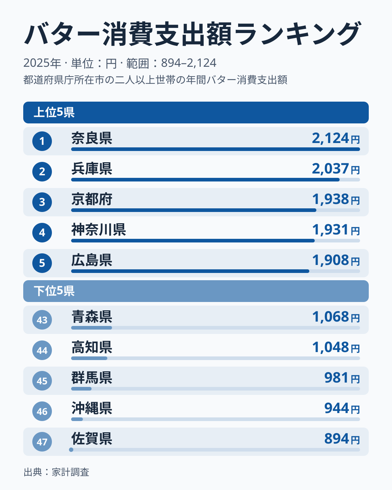
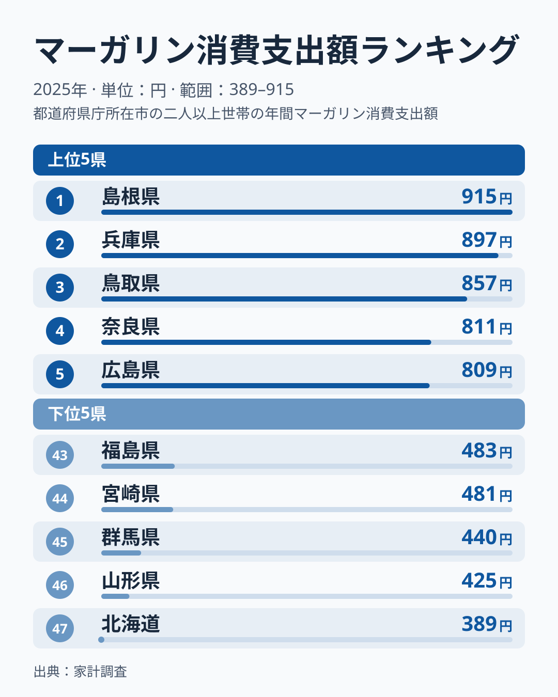

同じ「パンに塗るもの」でも、バターとマーガリンでは家計が支出する県がずいぶん違います。2025年の家計調査（二人以上世帯）を都道府県庁所在市別に見ると、バター消費支出額は奈良県が2,124円で1位、マーガリンは島根県が915円で1位でした。

上位5県を並べると、バターは奈良・兵庫・京都・神奈川・広島、マーガリンは島根・兵庫・鳥取・奈良・広島です。兵庫・奈良・広島の3県は両方で上位5県に入ります。それでも47県全体で順位の相関を計算すると約0.3にとどまり、強く連動してはいません。たとえば北海道はバターが8位の1,693円なのに、マーガリンは最下位の389円です。なぜ同じ油脂で、これほど顔ぶれが割れる県があるのでしょうか。この記事では、両者の支出額ランキングを重ね合わせて、重なる県と逆になる県を整理します。

> [!NOTE]
> 家計調査は都道府県庁所在市（および政令指定都市）の二人以上世帯が対象です。県全体の平均ではなく「県庁所在市」の消費傾向である点に注意してください。

## バター消費支出額ランキング

バター消費支出額の1位は奈良県で2,124円、最下位は佐賀県の894円でした。倍率にすると2.4倍です。上位5県は奈良・兵庫・京都・神奈川・広島で、近畿の3府県に神奈川と広島が加わります。バターは牛乳を原料とする動物性油脂で、製菓・製パンでの風味の良さから「こだわりの調理」に使われる傾向があります。洋菓子やパンの消費文化が強い都市圏ほど、家庭でもバターを買う土壌があると考えられます。

下位5県は青森・高知・群馬・沖縄・佐賀の順で、東北・四国・北関東・九州・沖縄に散らばっています。地理的なまとまりは見えにくく、単年の家計調査ではぶれも大きいため、下位の理由をひとつの食文化に結びつけることはできません。

<source-link href="/ranking/butter-consumption-expenditure">バター消費支出額ランキングをもっと見る</source-link>

## マーガリン消費支出額ランキング

マーガリン消費支出額の1位は島根県で915円、最下位は北海道の389円でした。倍率は2.4倍で、バターとほぼ同じ開きです。上位5県は島根・兵庫・鳥取・奈良・広島で、中国地方の3県に近畿の2県が入ります。バターの上位5県と共通するのは兵庫・奈良・広島の3県で、京都と神奈川の代わりに島根と鳥取が入ってきます。

マーガリンは一般にバターより手頃な価格で、日常的にパンへ塗る「実用品」としての性格が強い油脂です。島根・鳥取のようにバターの順位が低い県でマーガリンが上位に来るのは、価格の手頃さを重視する買い方が表れている可能性があります。下位5県は福島・宮崎・群馬・山形・北海道で、東北と北海道が3県を占めます。

<source-link href="/ranking/margarine-consumption-expenditure">マーガリン消費支出額ランキングをもっと見る</source-link>

## 重なる県と、逆になる県

両方で上位5県に入る兵庫・奈良・広島は、バターとマーガリンのどちらも多く買う県です。兵庫県はバターで2位（2,037円）、マーガリンでも2位（897円）、奈良県は1位（2,124円）と4位（811円）、広島県はどちらも5位（1,908円と809円）でした。京都府もバター3位（1,938円）、マーガリン9位（781円）と両方で10位以内に入ります。[仮説] 近畿・中国地方の都市では、パンや洋菓子の消費が多く、油脂全体の購入額が大きくなっている可能性があります。ただし支出額の地理的分布から読み取れる傾向にすぎず、パンの購入額や世帯構成との突き合わせによる検証が必要です。

一方で、順位が大きく逆転する県もあります。

- 北海道：バター8位（1,693円）、マーガリン47位（389円）で順位差39
- 鳥取県：バター41位（1,115円）、マーガリン3位（857円）で順位差38
- 長崎県：バター40位（1,127円）、マーガリン10位（777円）で順位差30
- 東京都：バター6位（1,848円）、マーガリン31位（589円）で順位差25
- 神奈川県：バター4位（1,931円）、マーガリン28位（625円）で順位差24

北海道が最もはっきりしています。バターは8位の一方、マーガリンは全国最下位でした。[仮説] 酪農が盛んな北海道ではバターが身近で、マーガリンを選ぶ理由が薄い可能性があります。ここでの北海道は札幌市の値であり、単年のぶれも含みます。東京都と神奈川県もバターは上位でマーガリンは中位以下という並びで、鳥取県と長崎県はその逆です。バターは高価格帯の嗜好品的な油脂、マーガリンは低価格帯の日用品的な油脂という「価格の異なる代替財」の関係が、地域によって異なる向きに働いているように見えます。この読み方も [仮説] であり、世帯所得データとの突き合わせが必要です。

> [!WARNING]
> バターとマーガリンの支出額は「購入量」ではなく「金額」です。バターは一般にマーガリンより単価が高いため、同じ分量を買っても支出額はバターの方が大きくなりがちです。ここでの県間格差は、購入量の差と単価の差の両方を反映した数字である点に注意してください。

兵庫県の家庭を詳しく知りたい場合は[兵庫県のエリアページ](/areas/28000)、北海道は[北海道のエリアページ](/areas/01000)もあわせてご覧ください。

> [!TIP]
> 油脂の消費傾向をより立体的に見るには、食用油全体の消費額や、[パンの消費額ランキング](/blog/bread-vs-rice-expenditure)と合わせて確認すると、地域の食文化がより見えてきます。マーガリンはパンに塗る用途が中心のため、パン消費額の地域差と重ねると見え方が変わります。

## まとめ

- バター消費支出額1位は奈良県2,124円、最下位は佐賀県894円で2.4倍差
- マーガリン消費支出額1位は島根県915円、最下位は北海道389円で2.4倍差
- バター上位は奈良・兵庫・京都・神奈川・広島、マーガリン上位は島根・兵庫・鳥取・奈良・広島で、兵庫・奈良・広島の3県が共通
- 47県全体の順位相関は約0.3で、連動は強くない
- 北海道はバター8位・マーガリン47位と、同一県内で対照的な結果
