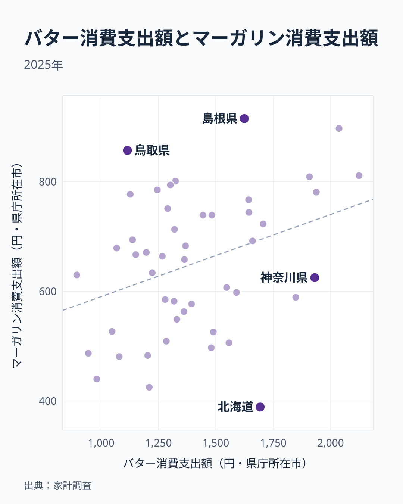

同じ「パンに塗るもの」でも、バターとマーガリンでは家計が支出する県がずいぶん違います。2025年の家計調査（二人以上世帯）を都道府県庁所在市別に見ると、バター消費支出額は奈良県が2,124円で1位、マーガリンは島根県が915円で1位でした。

上位5県を並べると、バターは奈良・兵庫・京都・神奈川・広島、マーガリンは島根・兵庫・鳥取・奈良・広島です。共通するのは兵庫・奈良・広島の3県にとどまり、47県全体で両者の支出額を突き合わせた相関も約0.34と弱いものでした。とくに北海道はバターが8位の1,693円なのに、マーガリンは最下位の389円です。なぜ同じ油脂で、これほど順位が割れる県があるのでしょうか。この記事では、両者の関係を47県全体で確かめたうえで、北海道がなぜ両極端になるのかを、手元のデータで確かめられる範囲まで追いかけます。

> [!NOTE]
> 家計調査は県庁所在市の二人以上世帯の値です。この記事の「北海道」は札幌市の値なので、マーガリンの最下位は北海道全体の傾向ではなく、札幌市の家庭の買い方や単年のぶれを映しているだけかもしれません。他の県も同様に、県庁所在市の値として読んでください。

## バター消費支出額ランキング

バターの1位奈良県2,124円と最下位佐賀県894円の差は2.4倍で、マーガリンの1位と最下位の差も同じ2.4倍です。ただし、幅が同じでも顔ぶれは同じではありません。バターの上位5県は奈良・兵庫・京都・神奈川・広島で、近畿の3府県に関東の神奈川、中国の広島が加わります。10位まで広げると東京都が6位、愛知県が7位、北海道が8位、大阪府が9位と、大都市圏を抱える都道府県が並びます。

バターはマーガリンより単価が高いとされる油脂で、[仮説] 洋菓子やパンの消費が多い大都市圏の家庭ほど、バターに支出しやすい可能性があります。ただし、この仮説で説明できるのは上位の一部です。島根県は12位と上位寄りなのに対し、鳥取県は41位、長崎県は40位と低く、都市の規模だけではバターの順位は決まっていません。

下位5県は青森・高知・群馬・沖縄・佐賀の順で、5県の地方はばらけており、地理的なまとまりは見えにくい並びです。単年の家計調査ではぶれも大きいため、下位の理由をひとつの食文化に結びつけるのは無理があります。

<source-link href="/ranking/butter-consumption-expenditure">バター消費支出額ランキングをもっと見る</source-link>

## マーガリン消費支出額ランキング

マーガリンは島根県915円が1位、北海道389円が最下位で、バターと同じ2.4倍の開きです。上位5県は島根・兵庫・鳥取・奈良・広島で、中国の3県と近畿の2県が並びます。京都府と神奈川県の代わりに、島根県と鳥取県が入る形で、マーガリンは中国地方の存在感が強い並びです。10位までに広げると、長野県が7位、山口県が8位、京都府が9位、長崎県が10位と、顔ぶれはさらに広がります。

マーガリンは一般にバターより手頃な価格とされます。鳥取県のようにバターが41位と低い県でマーガリンが3位に来るのは、価格の手頃さを重視する買い方が表れているためと考えられます（[仮説]、世帯所得や購入量のデータとの突き合わせは未実施）。下位5県は福島・宮崎・群馬・山形・北海道で、東北の福島・山形の2県と北海道が含まれます。

<source-link href="/ranking/margarine-consumption-expenditure">マーガリン消費支出額ランキングをもっと見る</source-link>

## 47県で見ると、重なりは弱い

上位5県の比較だけでは全体像が見えないため、47県すべてをバターの支出額（横軸）とマーガリンの支出額（縦軸）で並べました。ピアソンの相関係数は約0.34、順位どうしの相関（スピアマン）は約0.30で、どちらも弱い正の相関にとどまります。どちらも2つのランキングの値から計算した数字で、バターの支出が多い県ほどマーガリンも多少は多い傾向はあるものの、緩い関係です。

注目したいのは、この数字が負ではないことです。バターは高価格帯、マーガリンは低価格帯という「価格の異なる代替財」なら、片方が多い県でもう片方が少なくなる負の相関になりそうです。実際には、一方が多い県ほど他方も少し多いという逆向きの傾向で、地域ごとに代替が起きているとは読めません。散布図の中でも、奈良・兵庫・広島・京都は右上にまとまり、両方で支出が大きい県だと分かります。そこから大きく外れる県が、次に見る順位の逆転した県です。

順位が大きく開く県を挙げると、次のとおりです。

- 北海道：バターは1,693円で8位、マーガリンは389円で47位（39位差）
- 鳥取県：バターは1,115円で41位、マーガリンは857円で3位（38位差）
- 長崎県：バターは1,127円で40位、マーガリンは777円で10位（30位差）
- 東京都：バターは1,848円で6位、マーガリンは589円で31位（25位差）
- 神奈川県：バターは1,931円で4位、マーガリンは625円で28位（24位差）

差が最大なのは北海道で、東京都と神奈川県もバター寄りに、鳥取県と長崎県はマーガリン寄りに偏ります。京都府はバター3位・マーガリン9位と、どちらも10位以内に入りながらバター寄りです。

> [!WARNING]
> バターとマーガリンの支出額は「購入量」ではなく「金額」です。バターは一般にマーガリンより単価が高いため、同じ分量を買っても支出額はバターの方が大きくなりがちです。ここでの県間格差は、購入量の差と単価の差の両方を反映した数字である点に注意してください。また、相関が弱い正であることは、バターとマーガリンの間に因果や代替関係があることも、ないことも示しません。

## 北海道はなぜ両極端なのか

北海道の両極端について、手元のデータで確かめられるのは「パンの支出」との関係までです。マーガリンはパンに塗る用途が中心とされるため、パンの支出額を同じ2025年の家計調査で見ると、札幌市はパン26,587円で全国最下位の47位でした。マーガリンの最下位は、パンへの支出自体が全国で最も少ないことと同じ向きの結果です。パンの支出額とマーガリンの支出額の相関は約0.55、バターとの相関は約0.48で、いずれもバターとマーガリンの間の0.34より強い関係です。パンの支出が多い県ほど、どちらの油脂にも支出する傾向がうかがえます。

ところが札幌市は、パンが最下位なのにバターは8位です。パンの支出が少ない県のなかで、バターだけが上位に入る点が北海道の特徴です。ここから先は、データでは確かめられません。[仮説] 酪農が盛んな北海道ではバターが身近で、パンとは別の用途（料理や菓子）で買われている可能性があります。ただし、酪農が理由なら支出額は最上位になりそうですが、札幌市のバターは奈良県や兵庫県を下回る水準にとどまります。仮説と数字が噛み合わない部分が残るため、札幌市の値であることや単年のぶれも含め、結論は留保します。

パン上位5県はバターとマーガリンの上位とも重なります。パンの上位は埼玉・京都・兵庫・奈良・大阪の順で、このうち兵庫県と奈良県はバターとマーガリンの両方で上位5県に入ります。パンとバターの高い順位が重なる県が多い一方、島根県はマーガリン1位ながらパンは23位、鳥取県もマーガリン3位でパンは33位にとどまります。山陰2県のマーガリンの多さは、パンの支出だけでは足りない部分です。

あわせて見る: [パン消費支出額ランキング](/ranking/bread-consumption-expenditure)

兵庫県の家庭を詳しく知りたい場合は[兵庫県のエリアページ](/areas/28000)、北海道は[北海道のエリアページ](/areas/01000)もあわせてご覧ください。

> [!TIP]
> パンの消費額の全体像は[パンの消費額ランキング](/blog/bread-vs-rice-expenditure)で確認できます。パン、バター、マーガリンの3つを見比べると、パンの支出が最下位でも油脂の種類によって順位が変わる県があることが分かります。

## まとめ

- バター消費支出額1位は奈良県2,124円、最下位は佐賀県894円で2.4倍差
- マーガリン消費支出額1位は島根県915円、最下位は北海道389円で2.4倍差
- バター上位は奈良・兵庫・京都・神奈川・広島、マーガリン上位は島根・兵庫・鳥取・奈良・広島で、兵庫・奈良・広島の3県が共通
- 47県の相関はピアソン約0.34、スピアマン約0.30と弱い正で、代替財を示す負の相関ではない
- 北海道はバター8位・マーガリン47位。パンの支出も47位で、マーガリンの最下位とは同じ向きだが、バターの8位は仮説の段階にとどまる
