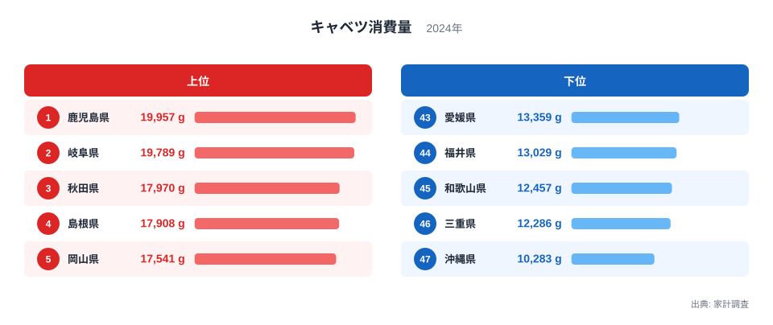
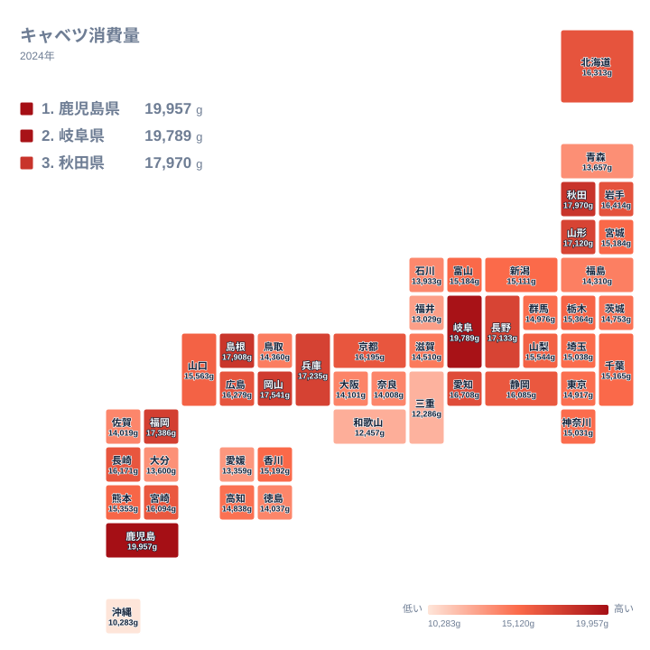

## キャベツ消費量の上位と下位

とんかつの付け合わせ、お好み焼き、餃子、野菜炒め。キャベツは日本の食卓でもっとも身近な野菜のひとつです。ところが家計調査の2024年の結果を県別に並べると、購入量には大きな開きがありました。

1位は鹿児島県で19,957gです。2位の岐阜県が19,789gで続き、両県はほぼ並んでいます。3位は秋田県の17,970g、4位は島根県の17,908g、5位は岡山県の17,541gでした。

一方、最下位は沖縄県で10,283gです。46位の三重県は12,286g、45位の和歌山県は12,457g、44位の福井県は13,029g、43位の愛媛県は13,359gとなっています。1位の鹿児島県と最下位の沖縄県の間には大きな差があります。

<source-link href="/ranking/cabbage-consumption-quantity">キャベツ消費量ランキングをもっと見る</source-link>

図を見ると、上位は1位の鹿児島県と2位の岐阜県が並び、3位の秋田県との間に段差があります。2位の19,789gから3位の17,970gへ下がったあと、4位の17,908g、5位の17,541gと、値は少しずつ下がっていきます。鹿児島県と岐阜県は差が小さく、年が変われば順位が入れ替わってもおかしくない僅差です。

下位側は様子が違います。最下位の沖縄県は10,283gで、45位の和歌山県の12,457gや46位の三重県の12,286gよりもさらに低い水準です。下位5県には近畿の三重県と和歌山県、四国の愛媛県、中部の福井県、そして九州・沖縄の沖縄県が入っており、特定の地方に偏ってはいません。

最大の鹿児島県と最小の沖縄県の比は、19,957gと10,283gの比で、およそ2倍弱にあたります。ただし、この差が食文化の違いによるものか、買い方の違いによるものかは、この1つの統計だけでは分かりません。

> [!NOTE]
> ここでの消費量は、家計調査にもとづく世帯のキャベツの購入量で、単位はgです。家庭で調理するために買った生のキャベツが中心です。外食や弁当、給食で食べた分は含まれません。とんかつ店やお好み焼き店が多い県でも、家庭の購入量が多いとは限らない点に注意してください。

## 地方の中でも順位の幅は大きい

次の図は、同じ値を都道府県の配置に沿って色分けしたものです。

この図で目を引くのは、特定の地方がまとめて濃くなったり薄くなったりしているわけではないことです。隣り合う県でも色が違う場所が多くあります。

九州・沖縄が分かりやすい例です。鹿児島県は1位ですが、同じ地方の沖縄県は47位で最下位です。佐賀県は38位、大分県は42位で、福岡県の6位とは大きく離れています。同じ地方の中でも、順位の幅は40位以上あります。

近畿でも同じことが言えます。兵庫県は7位ですが、三重県は46位です。北海道・東北では、秋田県の3位に対して青森県は41位でした。地方という大きな単位で「このあたりはキャベツをよく買う」と言い切るのは難しく、県ごとの事情を見る必要があります。

一方、関東は千葉県が25位、埼玉県が27位、神奈川県が28位、東京都が30位と、近い順位に固まっています。千葉県は15,165g、東京都は14,917gで、差はわずかです。

## 上位県の背景を考える

ここからは、データだけでは確かめられない話です。順位の背景を考えるための、一つの見方として読んでください。

鹿児島県については、温暖な気候や野菜を使う家庭料理の習慣が思い浮かびますが、今回のデータは購入量しか示していません。理由までは分からないため、断定はできません。

岐阜県は中部の内陸にあります。同じ中部では、長野県が8位で17,133g、愛知県が10位で16,708gです。上位に中部の県が複数あることは確かですが、これがキャベツの産地との近さによるものかどうかは、データからは分かりません。産地との距離を調べるには、別の統計との照合が必要です。

東北では、秋田県が3位、山形県が9位、岩手県が11位と上位に入っています。気候や保存性との関係を考える見方もありますが、これも推測の域を出ません。同じ東北でも宮城県は23位、福島県は35位、青森県は41位で、地方全体に共通する理由があるとは言いにくい結果です。

中国地方では、島根県が4位、岡山県が5位、広島県が13位、山口県が18位と、上位から中位に集まっています。鳥取県だけは34位と離れています。

> [!TIP]
> 順位の差より、実際の値の差を見ると読み違えを減らせます。たとえば宮城県と富山県は、23位と24位でどちらも15,184gです。中位は値が接近しているので、1つや2つの順位の違いに大きな意味はありません。一方、2位の岐阜県と3位の秋田県は、19,789gと17,970gで、中位の隣り合う順位より差が開いています。

## 下位県と他の野菜との対比

最下位の沖縄県は10,283gで、1位の鹿児島県の19,957gとは大きな開きがあります。データからは理由は分かりませんが、一つの見方として、沖縄ではキャベツ以外の野菜が日常的に使われている可能性があります。もしそうなら、キャベツの購入量が少なくなることもありえます。

下位の三重県は12,286g、和歌山県は12,457gです。同じ近畿でも、兵庫県は17,235g、京都府は16,195gで、大阪府の14,101gや奈良県の14,008gとも開きがあります。近畿は県ごとの差が大きい地方です。

キャベツと比べられる品目には、白菜、レタス、大根などがあります。白菜は鍋物や漬物の季節に消費が伸びる冬の野菜で、レタスは生食が中心です。一方、キャベツは生でも加熱でも使えて、季節を問わず使われます。用途が広い野菜なので、地域の差が出る要因も一つに絞りにくいと考えられます。これらの品目の県別データを見れば、キャベツと同じ県が上位に来るのかを確かめられます。

他の品目の統計は、[同じカテゴリの統計一覧](/category/economy)から探せます。

> [!WARNING]
> この統計は、世帯が買ったキャベツの重量です。そのため、カット野菜や千切りキャベツのパック、冷凍野菜、惣菜に使われたキャベツがどう扱われるかによって、結果の見え方が変わる可能性があります。加工品や惣菜の利用が多い県では、生のキャベツの購入量が少なく出ることもありえます。「キャベツを食べる量」そのものとは同じではない点に注意してください。

## 上位2県のデータを見る

1位の[鹿児島県のデータ](/areas/46000)と2位の[岐阜県のデータ](/areas/21000)は、ほかの統計と並べると食生活の特徴を読み取る手がかりになります。この2県は地理的に離れていますが、キャベツの購入量はほぼ同水準でした。

この2県だけを比べても、気候や地域が購入量にどう関わるのかは判断できません。共通点があるのか、偶然近い値になったのかも、このデータからは分かりません。確かめるには、他の統計や複数年の結果との照合が必要です。

また、購入量が多いことが、そのまま健康的な食生活や家計の豊かさを意味するわけではありません。数字は暮らしを知る手がかりのひとつとして、慎重に読み取るのがよいでしょう。

## データについて

この記事では、家計調査の2024年のキャベツ消費量を使っています。単位はgで、都道府県別の値を比較しています。順位は値の大きい順です。宮城県と富山県のように、同じ値の県が並ぶ場合があります。地方ごとの比較では、北海道・東北、関東、中部、近畿、中国、四国、九州・沖縄の7区分を使いました。

## まとめ

キャベツ消費量は、1位の鹿児島県が19,957g、2位の岐阜県が19,789gと僅差で、最下位の沖縄県は10,283gでした。上位5県には九州・沖縄、中部、北海道・東北、中国の県が入り、下位5県には近畿、四国、中部、九州・沖縄の県が入っています。

同じ地方の中でも県による順位の幅は大きく、地方という単位だけでは説明しきれません。背景には食文化や買い方など複数の要因があると思われますが、このデータだけでは確かめられません。

自分の県の順位を確かめ、隣の県や気になる県と比べてみると、食卓の見え方が少し変わるかもしれません。
