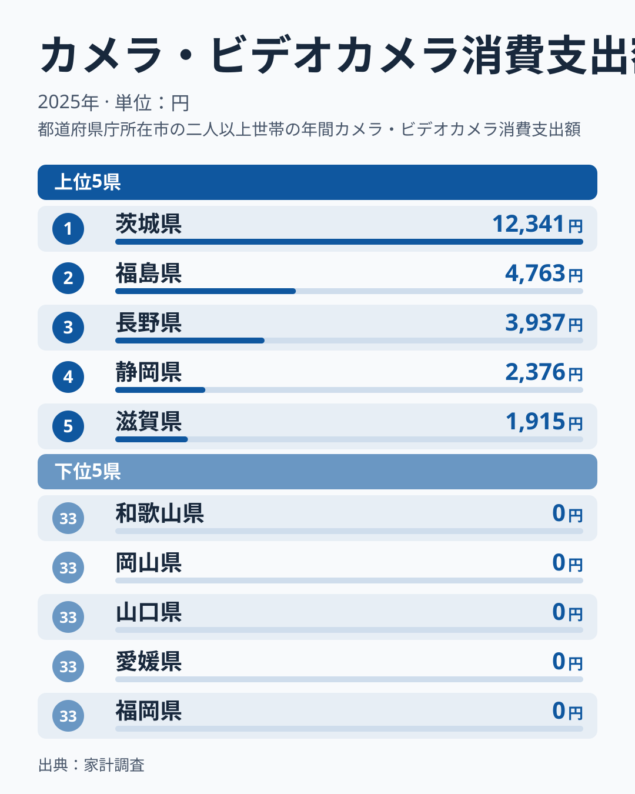
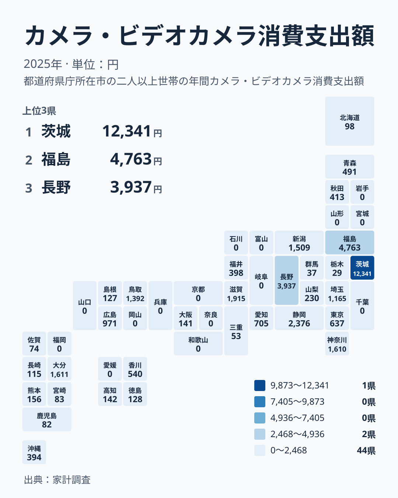

家計調査の2025年のデータで、カメラ・ビデオカメラへの支出を都道府県別に並べました。1位の茨城県は12,341円です。2位の福島県は4,763円で、1位と2位の間にも大きな開きがあります。一方、33位の岩手県から47位の福岡県までは、そろって0円です。

この差を「茨城県の人は撮影好きだ」と読んでよいのでしょうか。この記事では、順位表の裏にある数字の性質を分解し、家計や暮らしの感覚にどうつなげて読めばよいかを考えます。

## 上位は茨城県、福島県、長野県の順

まず上位と下位を図で確認します。

<source-link href="/ranking/camera-consumption-expenditure">カメラ・ビデオカメラへの支出ランキングをもっと見る</source-link>

上位5位は、茨城県の12,341円、福島県の4,763円、長野県の3,937円、静岡県の2,376円、滋賀県の1,915円です。1位の茨城県は、2位の福島県を大きく引き離しています。2位以下は段階的に下がるので、1位だけが飛び抜けた形です。

下位5位は、43位の和歌山県、44位の岡山県、45位の山口県、46位の愛媛県、47位の福岡県で、すべて0円です。同じ0円なので、この5県の間には優劣がありません。順位の数字は、0円の中では意味を持たないと考えてください。

生活の感覚に置き換えると、上位の県でも、世帯が毎年カメラにお金を使い続けているとは限りません。カメラは数年に一度の買い物です。ある年に購入した世帯が調査対象に入るかどうかで、県の平均は大きく動きます。この指標は「どの県がカメラ好きか」より、「その年に買った世帯がどれだけ目立ったか」を映していると読むほうが安全です。

## 関東の中でも大きく割れる

次に、地方という別の切り口で分解します。関東には、茨城県、栃木県、群馬県、埼玉県、千葉県、東京都、神奈川県が入ります。この中だけで見ても、値は大きくばらけます。

- 茨城県は12,341円で1位です
- 神奈川県は1,610円で7位です
- 埼玉県は1,165円で10位です
- 東京都は637円で13位です
- 群馬県は37円で31位です
- 栃木県は29円で32位です
- 千葉県は0円で36位です

同じ関東でも、全国1位の県と0円の県が同居しています。大都市圏であることや、人口が多いことが、そのまま高い支出に結びつくわけではありません。東京都は13位、大阪府は141円で22位にとどまります。

この結果は、地域の文化や気質の違いより、少数の購入が平均を押し上げる仕組みを疑わせます。もし地域性が主因なら、隣り合う県の値はもう少しなだらかに連続するはずです。実際には、茨城県の隣の栃木県は29円、千葉県は0円です。県境をまたぐと急に変わる並びは、地域の好みよりも、調査に入った世帯の偶然に近い動きです。

> [!NOTE]
> この指標の正式な統計名は「カメラ・ビデオカメラ消費支出額」で、出典は家計調査です。単位は1世帯あたりの年間支出額で、円で表します。県庁所在地など調査対象の都市の世帯を集計した値で、県全体の実態とは必ずしも一致しません。

## 地図で見ると「連続した地域差」にはならない

地理的な広がりも確認します。

色の濃い県は、関東の茨城県、北海道・東北の福島県、中部の長野県と静岡県、近畿の滋賀県に散らばっています。特定の地方がまとまって濃くなる形ではありません。西日本で見ても、中国の鳥取県は1,392円で9位、広島県は971円で11位ですが、同じ中国の岡山県と山口県は0円です。

九州・沖縄では、大分県が1,611円で6位に入ります。一方で福岡県は0円で、熊本県は156円で20位、沖縄県は394円で18位です。四国は香川県が540円で14位、徳島県が128円で23位、高知県が142円で21位、愛媛県が0円です。

このように、地図は「カメラ好きの地域」を描いていません。飛び地のように濃淡が現れるのは、年ごとの購入の偏りが県ごとに独立して出ているからと考えられます。読者が地図から得られる確かな知識は、「この年の家計調査では、どの県の世帯が購入を記録したか」という範囲に限られます。

> [!WARNING]
> 家計調査は標本調査で、県ごとの対象世帯は多くありません。カメラのように購入頻度が低い品目は、1世帯の高額購入が県の平均を大きく左右します。0円は「県内で誰も買っていない」ことではなく、「調査対象の世帯が買わなかった」ことを示します。

## 暮らしへの含意:数字を家計の判断に使うには

では、この数字を暮らしにどう生かせるでしょうか。まず、「自分の県の順位が低いから、カメラ需要が小さい」という結論は避けましょう。福岡県は0円で最下位グループですが、それは福岡県の人がカメラに関心を持たないことの証拠ではありません。

次に、高い県の値を「家計の目安」にしないことです。茨城県の12,341円は、1世帯が一年にそれだけ使うという意味ではなく、購入した世帯の金額が平均に乗った結果です。静岡県の2,376円や滋賀県の1,915円も同じ性質を持ちます。自分の予算を考えるときは、県の平均ではなく、欲しい機種の価格と買い替え周期から考えるのが現実的です。

一方で、この指標から読み取れることもあります。

- 購入が数年に一度なので、支出は年ごとに大きく入れ替わりやすいことです
- スマートフォンで撮影を済ませる家庭も多く、専用機への支出は偏りやすいことです
- 順位の差は大きくても、実際の暮らしぶりの差とは限らないことです

地域の店舗や撮影環境を考える立場でも、1年分の順位だけで需要を判断するのは危険です。複数年の推移や、他の関連支出と合わせて見る必要があります。同じカテゴリの数字は[同じカテゴリの統計一覧](/category/economy)から見比べられます。

> [!TIP]
> 少額の品目は、順位よりも「0円かどうか」と「上位に突出した値があるか」を先に見ます。中位から下位の数十円から数百円の差は誤差に近く、読み取りすぎないのがコツです。

## 上位2県のデータをさらに見る

茨城県と福島県は、1位と2位を占めながら、関東と北海道・東北という別の地方に属します。茨城県は12,341円で、同じ関東の栃木県と千葉県とは対照的です。福島県は4,763円で、同じ北海道・東北では、北海道が98円で26位、青森県が491円で15位、秋田県が413円で16位です。岩手県、宮城県、山形県は0円です。

この並びを見ると、上位の県は「地方の代表」ではなく、その県の中の個別の事情で押し上げられていると考えるのが自然です。詳しい指標の推移や他の項目は、[茨城県のデータ](/areas/08000)と[福島県のデータ](/areas/07000)で確認できます。そこで他の支出項目と並べると、カメラの値だけが飛び抜けているのか、全体的に高いのかが見えてきます。

中部では、長野県が3,937円で3位、静岡県が2,376円で4位、新潟県が1,509円で8位、愛知県が705円で12位です。同じ中部でも、富山県、石川県、岐阜県は0円で、福井県は398円、山梨県は230円です。中位の県でも、連続して並ぶというより点在しています。

## データについて

この記事の数値は、家計調査の2025年の、カメラ・ビデオカメラ消費支出額を使っています。単位は円で、都道府県ごとの値と順位は、公表された実データをそのまま用いました。

読み方の要点は3つあります。1つ目は、値が1世帯あたりの支出額であることです。2つ目は、0円の県が同順位として並ぶことです。3つ目は、1年分の値だけでは、地域の傾向を断定できないことです。

結論として、カメラ・ビデオカメラへの支出の都道府県差は、嗜好の違いというより、少数の購入が平均を動かす性質に強く左右されています。順位は話の入口として楽しみ、家計や地域の判断には、複数年のデータと合わせて使うことをおすすめします。
