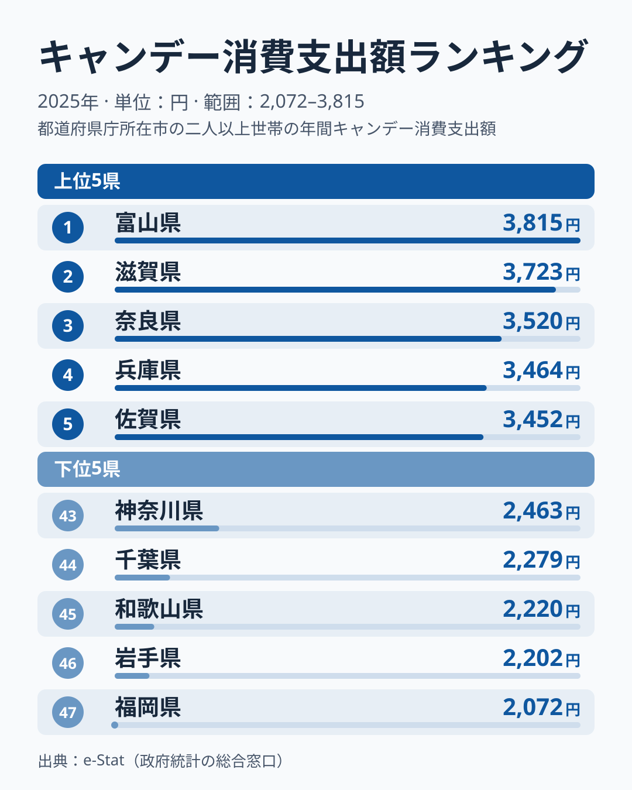
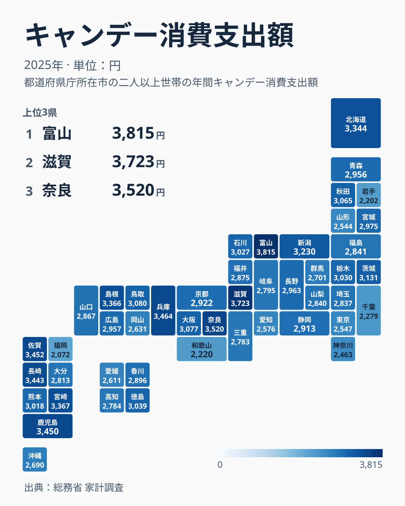

飴やキャンデーは、のどの乾燥対策や気分転換として、地域を問わず日常的に消費される菓子です。総務省の家計調査によると、1世帯当たりのキャンデー消費支出額は都道府県で差があり、2025年の全国データでは1位の富山県が3,815円、最下位の福岡県が2,072円と、その差は1.8倍です。

「寒い地域ほど飴をよく舐める」というイメージを持つ人は多いはずです。ところが2025年のデータで1位になったのは中部の富山県で、2位は滋賀県、3位は奈良県と近畿勢が続きます。北海道は10位にとどまりました。この記事では上位・下位の顔ぶれと47都道府県の分布を確かめながら、「北ほど強い」という単純な図式では説明しきれない地域パターンを探ります。

> [!NOTE]
> 「キャンデー」は家計調査では菓子類の中の一品目で、のど飴だけの支出額ではありません。そのため、この指標の高低を寒さや乾燥対策の購入量とそのまま結びつけることはできず、本記事の寒冷地仮説の検討も、あくまで支出額の地域差として読む必要があります。

## 上位と下位

<source-link href="/ranking/candy-consumption-expenditure">キャンデー消費支出額ランキングをもっと見る</source-link>

上位は富山県と滋賀県が先行し、3位の奈良県、4位の兵庫県と続きます。注目したいのは、5位の佐賀県から7位の長崎県までが3,443〜3,452円とほぼ同水準で並んでいる点です。8位の宮崎県と9位の島根県も3,366〜3,367円と1円差で、10位の北海道も3,344円と近く、この付近の順位は年によって容易に入れ替わりうる僅差です。上位10県は、近畿の3県（滋賀・奈良・兵庫）、九州の4県（佐賀・鹿児島・長崎・宮崎）、中部の富山県、中国の島根県、そして北海道で、東北の県は入っていません。「東北・北海道が強い」という寒冷地仮説は、2025年のデータでは裏付けられません。

下位は福岡県の2,072円が最も低く、次いで岩手県の2,202円、和歌山県の2,220円、千葉県の2,279円と続きます。関東では東京都が41位、神奈川県が43位、千葉県が44位と下位に寄る一方、埼玉県は31位でした。

九州の中でも位置は大きく分かれます。上位に4県が入る一方で、熊本県は19位、大分県は32位、沖縄県は37位、福岡県は47位です。全国最下位の福岡県と、上位に入る九州の4県とでは、5位の佐賀県の3,452円と福岡県の2,072円で大きな開きがあります。また近畿でも、滋賀・奈良・兵庫が上位に入る一方、和歌山県は45位で、地方単位で一括りにはできません。

[仮説] 福岡市は大型の商業施設や飲食店が多く、飴を家庭で買う代わりに、外で別の菓子や飲み物を選ぶ機会が多い可能性があります。ただし、家計調査の市別の値は標本が小さく、単年でのぶれが大きいデータです。この結果だけで福岡の構造的な傾向とは断定できず、複数年の推移と合わせて見る必要があります。上位の顔ぶれも年によって入れ替わりうるため、順位は2025年の姿として読んでください。

## 地図で見る分布

地図で見ると、濃い色（支出額が高い県）は近畿の滋賀・奈良・兵庫、九州の佐賀・鹿児島・長崎・宮崎、中部の富山に集まっています。東北地方は秋田15位、宮城20位、青森23位、福島29位と中位が中心で、山形42位、岩手46位は下位に沈みます。「北ほど飴をよく買う」という直感的な仮説は、少なくともこのデータでは支持されにくいということです。

[仮説] 地域差が生まれる理由は、本データからは分かりません。家計調査の品目データだけでは検証できないため、複数年の推移との突き合わせが必要な課題として留めておきます。

1位の[富山県](/areas/16000)と最下位の[福岡県](/areas/40000)、それぞれの地域の特徴も合わせて確認すると、支出額の背景にある暮らしぶりが見えてきます。家計調査に関連する他の品目のデータは[経済・家計カテゴリ](/category/economy)からまとめて探せます。

## まとめ

- 1位は富山県の3,815円、47位は福岡県の2,072円で、格差は1.8倍
- 上位10県は近畿3県・九州4県・富山・島根・北海道で、東北は入らない
- 九州は4県が上位に入る一方、全国最下位は福岡県で、県ごとのばらつきが大きい
- 「寒冷地ほど強い」という単純な仮説は、このデータからは裏付けられない
- 家計調査は県庁所在市の値で単年のぶれも大きいため、福岡の低さは複数年で確かめる必要がある

## データについて

このランキングは総務省「家計調査」の品目別データを基に作成しています。都道府県庁所在市（または政令指定都市）の二人以上の世帯の年間支出額を集計したもので、2025年の最新データを使用しています。県民全体の消費傾向ではなく、都市部の家計を代表する数値である点にご留意ください。
