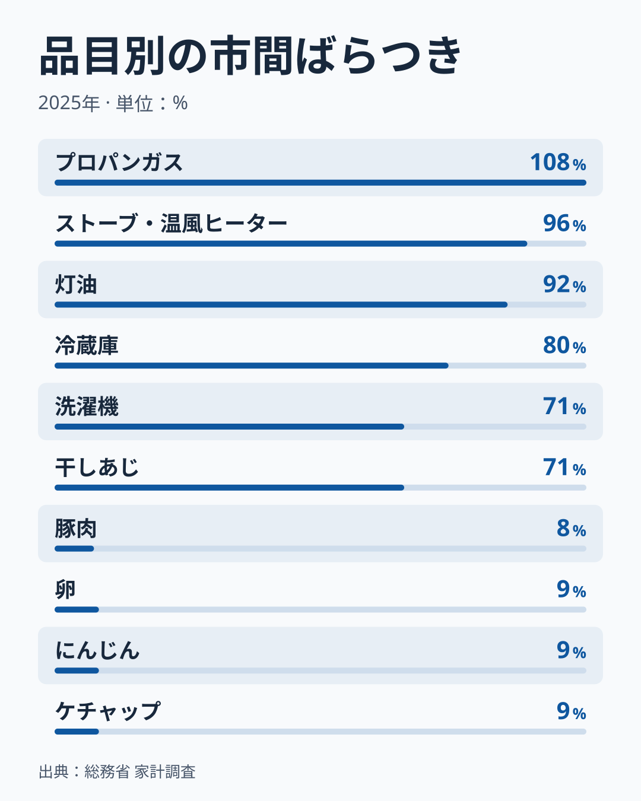
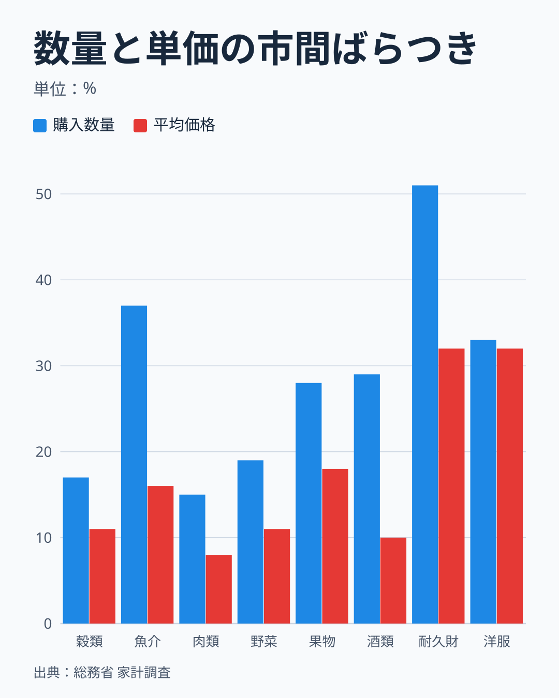
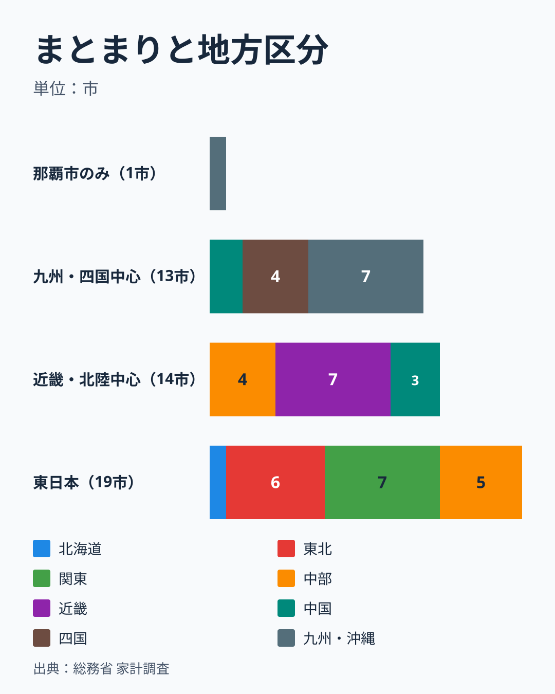
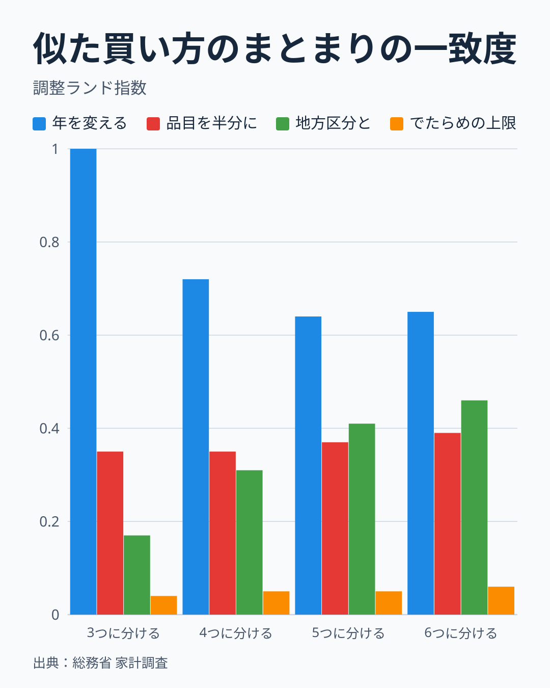
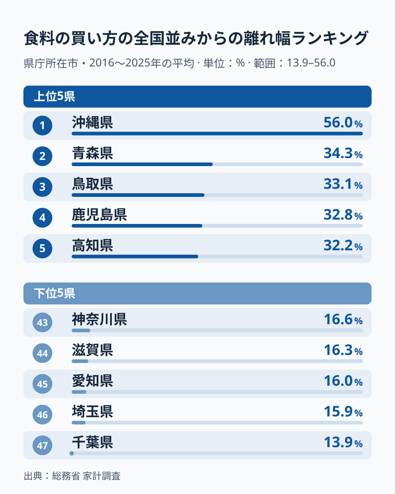

県庁所在市の世帯は、全国平均と比べて何を多く、何を高く買っているのでしょうか。47市を横に並べて答えると、次の4点になります。

- 市ごとの支出額の違いは、おもに「買った量」の違いから生じます。数量と平均価格に分けられる品目のうち、2025年に47市すべてで値がそろう171品目(消費支出の26.6%)では、支出額の市間のばらつきの80.4%が数量の違いで説明され、平均価格の違いは19.6%にとどまります。171品目のうち161品目で、数量のばらつきが平均価格のばらつきを上回りました。
- 平均価格の差は小さいものです。2016〜2025年の平均で、112の食料品目の中央値でみると、市の平均価格は全国の0.94〜1.09倍に収まり、最も高いのは東京都区部、最も低いのは青森市でした。
- 全国より多く買う品目の「共通リスト」は作れません。購入数量が全国を上回る市の数は、品目ごとに中央値で20市(47市のうち)と、半数に届きません。
- 似た買い方の市として安定して言えるのは、「那覇市が他の市から離れている」ことと、「水戸市や札幌市の側から鹿児島市や松山市の側へ連続して並ぶ」ことです。4つに分けたときの組の境界は、品目の選び方で入れ替わります。

ただし、ここで測れるのは世帯の買い物の違いです。地域の食文化や嗜好の違いと言い切ることはできません。県庁所在市ごとの標本は78世帯から290世帯で、世帯の人数や年齢、住宅の持ち家率も市によって違うためです。

## 「多く・高く」を3つの数字に分けて測る

問いの言葉は、そのままでは測れません。この記事では次のように置き換えました。

- 「多く」は購入数量です。年次の数量表にある品目を使い、グラム、ミリリットル、個など品目ごとの単位のまま扱います。
- 「高く」は平均価格です。支出額を購入数量で割った値で、1単位あたりの金額にあたります。
- 支出額は、数量と平均価格をかけ合わせたものです。

「全国平均」には、家計調査の全国の行(二人以上の世帯、農林漁家世帯を含む)をそのまま使います。47市の単純平均や、総務省が公表する52市の3年平均とは別の基準です。比べる市は県庁所在市の47市で、東京都区部、横浜市、静岡市、大阪市、福岡市を含み、同じ県の川崎市、浜松市、堺市、北九州市は含めません。

市の値を全国の値で割ったものを「対全国比」と呼びます。支出額の対全国比は、数量の対全国比と平均価格の対全国比の積になります。対数をとると足し算になるので、差の大きさを数量の分と平均価格の分に分けられます。

> [!NOTE]
> 平均価格は、支出額を数量で割って求めた算出値です。同じ品でも買う品物の中身(銘柄、部位、鮮度、容量)が違えば平均は変わるため、「同じ品物が高い」ではなく「買った品の平均が高い」と読みます。物価の地域差とは別の量です。

この分け方ができるのは、数量表に分類コードがあり、金額表で末端にあたる190品目だけです。金額表の末端は544品目あるので、残りの354品目(外食やサービスなど)は支出額でしか比べられません。分解できる190品目の支出額の合計は、全国の消費支出の30.2%にあたります。納豆は2025年の数量表に分類コードがなく、分解の対象になりません。さらに、市によっては数量が0になる19品目を除くと、本文の分解は171品目(消費支出の26.6%)になります。

## 品目で、地域差の大きさは桁違いです

<source-link href="/ranking/kerosene-consumption-expenditure">灯油の消費支出額ランキングをもっと見る</source-link>

上の図は、171品目のうち市間のばらつきが大きい6品目と小さい4品目です。ばらつきは、47市の支出額の対全国比を対数にして求めた標準偏差を、パーセントで表しました。プロパンガスは108%、ストーブ・温風ヒーターは96%、灯油は92%と、市ごとに支出額が数倍も違います。反対に豚肉は8%、卵・にんじん・ケチャップは9%で、どの市も全国とあまり変わりません。灯油消費支出額は、2025年の青森市で全国の6.1倍でした。

171品目すべてでみると、ばらつきの中央値は26%で、下から4分の1の品目が16%、上から4分の1の品目が39%でした。暖房用の燃料(灯油、ストーブ)や冷蔵庫・洗濯機のような品目で差が大きく、毎日の食卓に上る豚肉や卵のような品目で小さくなります。気候や住宅、買い替えの時期が関わると考えられますが、この分析では確かめていません。購入の頻度が低い品目は、標本の中に買った世帯がいたかどうかでも動きます。食料のなかでも魚介類は大きく、肉類は小さいという違いがあります。

この差は、1年だけの標本のゆらぎとは言えません。2016年から2025年を偶数年と奇数年に分け、それぞれの平均で47市の並び方を比べると、支出額では品目ごとの相関の中央値が0.92で、97%の品目で0.5を超えました。灯油は1.00、プロパンガスは0.99、干しあじは0.98で、年を分けても同じ市が上位に並びます。数量でも中央値は0.90でしたが、平均価格は0.72と下がります。平均価格の市間の並びは、数量ほど年をまたいで安定していません。

## 差の約8割は「量」の違いです

図は、費目群ごとに、品目の購入数量のばらつきと平均価格のばらつきの中央値を並べたものです。魚介類では数量のばらつきが37%、平均価格が16%で、穀類(17%と11%)、肉類(15%と8%)、野菜(19%と11%)、酒類(29%と10%)でも数量のほうが大きく出ます。耐久財は、炊事用電気器具、電気冷蔵庫、掃除機、洗濯機、エアコン、ストーブ・温風ヒーターの6品目の中央値で、数量が51%、平均価格が32%と両方とも大きいものの、数量が上回ります。洋服だけは数量が33%、平均価格が32%とほぼ並びました。

支出額の市間のばらつきの二乗(分散)を、数量の分と平均価格の分に分ける計算では、171品目をまとめて数量の寄与が80.4%、平均価格の寄与が19.6%です。47市の平均まわりではなく全国(対全国比が1)からの差の二乗でまとめても、数量の寄与は81.0%でほぼ同じでした。食料の122品目に絞ると数量が96.5%、食料以外の49品目では67.0%まで下がります。食料以外では平均価格の寄与が大きく、平均価格の差には買った品の中身の違いも含まれます。

この結論は、見方を変えても崩れませんでした。

- 極端な値の影響を除くため、対全国比を3分の1倍から3倍の間に切って計算すると、数量の寄与は81.8%です。切らずに、どの市でも3倍を超えない115品目だけで計算しても81.4%でした。
- 年を替えても同じです。2007年から2025年のすべての年に47市の値がそろう155品目では、数量の寄与は各年で83.4%から88.5%の範囲でした。2016年から2025年の平均に直すと91.98%、つまり約92%に上がります。単年の標本のゆらぎが小さくなるぶん、数量の寄与は大きく見えます。
- 品目の選び方でも逆転しません。数量のばらつきが平均価格を上回る品目は、食料で121/122、食料以外で40/49でした。

市の単位でまとめても、同じ姿が見えます。以下の市別の値は、2016〜2025年の平均です。112の食料品目の中央値で、市ごとの数量の対全国比は那覇市の0.72倍から新潟市の1.10倍まで広がるのに対し、平均価格は0.94倍から1.09倍に収まります。平均価格が高いのは東京都区部が1.09倍、横浜市と神戸市が1.06倍、低いのは青森市の0.94倍、秋田市と盛岡市の0.96倍で、東北北部が安い側に並びます。数量の多さと平均価格の高さが同じ市に重なるわけではなく、2つの値(対数にした比)の相関は2016〜2025年の平均で-0.20、2025年だけでは0.05でした。

なお、同じ品目で市ごとに数量と平均価格を比べると、中央値で-0.32の負の相関がありました。数量が多い市ほど平均価格が低い傾向ですが、数量の測定のぶれが平均価格の側に逆向きに現れる分を含む可能性があるため、安く買っているのか、別の品を買っているのかまでは分かりません。

## 全国より「多い」「高い」は、特徴にならない場合があります

「全国より多い」と言うには、47市の半数が全国を上回るのかを先に確かめる必要があります。購入数量が全国を上回る市の数は、171品目で最少12市から最多31市、中央値は20市でした。47市の中央値の市が全国を下回る品目は134品目、上回る品目は37品目です。30市以上が全国を下回る品目は42品目、30市以上が上回る品目は5品目でした。平均価格では、全国を上回る市の数の中央値が24市(最少6市、最多36市)で、中央値の市が全国を下回る品目は76品目、上回る品目は95品目と、数量とは逆に上回る側がやや多くなります。支出額でみても、全国を上回る市の数は中央値21市(最少12市から最多33市)で、半数に届かない点は同じです。

数量が全国を下回る側に偏る品目は、ソーセージ、女性用靴下、かつお(各35市が下回る)と男性用靴(34市)です。上回る側はワイシャツ(31市が上回る)、じゃがいも、合いびき肉、卵(各30市)でした。

この偏りは、市が全国より「少なく買う」ことの現れとは限りません。全国の行は市以外の地域も含む世帯の平均です。47市の消費支出の中央値は全国の97%で、市部の世帯は全体として全国より少し少ない金額を使っています。平均は大きな値に引かれやすいので、中央値の市が全国を下回る品目が多くなる分も含みます。したがって「全国より少ない」は市の特徴として扱わず、47市の中での位置で判断します。

ある市の「多い品目」が特徴かどうかも、その品目の47市のばらつきと比べて決めます。2025年の青森市の灯油の支出額は全国の6.1倍、ソーセージは1.2倍です。比だけ見れば灯油が圧倒的ですが、灯油は47市のばらつきが92%と大きく、ソーセージは9%と小さいため、47市のばらつきで割った位置(標準得点)は灯油が2.4、ソーセージも2.4で、同じ程度の「目立ち方」になります。外れ幅の大きい品目はどの市でも大きく外れるので、比の大きさだけで市の特徴とは言えません。

## 似た買い方の市は、東西に並びます

食料の買い方が似た市を探しました。以下の組は、2025年の1年の値で作っています。206の食料品目(2007年から2025年のすべての年に47市の値がある品目)について、品目の支出額が食料の合計に占める割合を、全国の割合で割って対数をとります。市ごとの食費の水準を除き、中身の違いだけを残した値です。これを使ってWard法で4つに分けると、那覇市だけの組、九州・四国を中心にした13市、近畿・北陸を中心にした14市、北海道と東北・関東・中部の19市に分かれました。

図は、この4つの組を地方区分(8区分)別に数えたものです。九州・四国の組には中国の2市、近畿・北陸の組には中国の3市と中部の4市が入ります。組と地方区分の一致度(調整ランド指数)は0.31で、でたらめに分けた場合の上限0.05を大きく上回ります。つまり、買い方のまとまりは、でたらめを上回る程度に地理と重なります。重なりは中程度で、地方区分そのものではありません。

実際、47市の食料の構成比の違いのうち17.6%を占める第1の軸は、市を北東から南西へ並べる軸です。この軸の値は地方区分で89%が説明され、東の端は水戸市、山形市、福島市、仙台市、札幌市、西の端は熊本市、大分市、長崎市、松山市、鹿児島市でした。この軸と相関が高い品目は、西の側で合いびき肉(0.89)、たい(0.82)、鶏肉(0.81)、さば(0.76)、牛肉(0.74)、東の側で他のきのこ(-0.84)、まぐろ(-0.79)、塩さけ(-0.74)、中華そば(-0.73)です。

品目ごとに47市の違いを地方区分で説明できる割合は、中央値で0.44でした。市の並びを入れ替えたでたらめの場合の中央値は0.14で、入れ替えの上位5%の線を83%の品目が上回ります。地方区分と関連のある品目が多い一方、中央値でも半分以上は地方区分で説明されません。

## まとまりの細部は、見方を変えると入れ替わります

4つの組をそのまま「似た買い方の都市群」と呼ぶのは早すぎます。まとまりが手法に左右されないかを3通りで確かめました。

1つめは年を変える方法です。2016年から2025年を偶数年と奇数年に分け、別々に分けた結果を比べます。3つに分けるときの一致度は1.00、4つでは0.72、5つでは0.64、6つでは0.65で、年を変えても大筋は変わりません。2つめは品目を半分に分ける方法で、無作為に2組に分けた206品目の半分ずつで別々に分けると、一致度は0.35から0.39にとどまります。使う品目が違えば、別の組ができるということです。

3つめは、食料の中身ではなく、食料や住居、光熱・水道など10費目の構成比で分ける方法です。食料の組との一致度は-0.04から0.10で、ほぼ無関係でした。食料の買い方が似ている市と、家計全体の使い道が似ている市は同じではありません。4つに分けたときの食料の組の説明率は28.3%と低く、組の境界ははっきりしません。広島市は、2025年だけで値がそろう212品目で分けると九州・四国側の組に入りますが、206品目では近畿・北陸側の組に入ります。

図の4つの組は2025年の1年で作ったものなので、年の安定も別に確かめました。2016年から2025年の平均で分けた組と、2025年の組との一致度は、3つに分けるときが0.92、4つでは0.69、5つでは0.55です。4つに分けると、2016〜2025年の平均でも那覇市は単独の組になります。

したがって、安定して言えるのは次の2点です。1つめは、東の市から西の市へ構成が連続して変わることです。第1の軸が地方区分で説明される割合は、品目を半分に分けても中央値で0.84あり、2組の得点の相関は中央値0.81でした。2つめは、那覇市が他の市から離れていることです。最も近い市までの距離は、食料の構成で47市の同じ距離の中央値の1.9倍、10費目の構成で2.5倍あります。10費目の構成の離れ幅(食料の離れ幅とは別の尺度です)も、那覇市は22.3%で中央値11.1%の約2倍あり、青森市と秋田市に次ぐ3番目の大きさです。

ただし、那覇市が単独の組になるかどうかは、品目の選び方に左右されます。品目を半分に分けて4つに分けたとき、那覇市が単独の組になるのは66.5%、3つに分けたときは26%でした。5つ以上に細かく分けた境界も、品目の選び方で動きます。

## 年をまたいでも同じ側に出るか

2025年の1年だけで「多い」と見えた品目が、本当にその市の特徴なのかは、他の年と照らして確かめます。支出額の対全国比が47市の2025年の値と同じ側(全国を上回る、または下回る)に、2016年から2024年の9年のうち何年で出るかを数えました。155品目と47市の組合せ7,285件の全体では、同じ側に出る年は平均で71%です。2025年に全国の1.25倍以上、または0.8倍以下まで離れた2,569件(全体の35%)では81%、2倍以上離れた344件では85%に上がります。

離れが大きい組合せほど同じ側に出やすいのは、特徴が本物であることを示します。ただし1.25倍以上に絞った組合せでも、同じ側に出る年の割合の平均は81%で、残りの19%は他の年に逆向きとして出ます。数量と平均価格に分けると、1.25倍以上離れた数量の組合せ(2,657件)は80%、平均価格(1,186件)は67%で同じ側に出ました。平均価格のほうが年ごとの入れ替わりが多く、単年の「高い市」は特徴として弱いと言えます。

## 全国並みの買い方の市と、特徴の強い市

図は、206の食料品目の構成比の対全国比(対数)を2016年から2025年で平均し、品目をまたいだ二乗平均平方根で「離れ幅」をはかったものです。図の県名は、その県の県庁所在市の値を表します。全国並みに近いのは千葉市の13.9%、さいたま市の15.9%、名古屋市の16.0%、大津市の16.3%、横浜市の16.6%で、東京近郊と名古屋、大津の市です。離れ幅が大きいのは那覇市の56.0%、青森市の34.3%、鳥取市の33.1%、鹿児島市の32.8%、高知市の32.2%でした。47市の中央値は24%です。

離れ幅の小さい市の順位は、入れ替わりやすいものです。最も小さい千葉市と5番目の横浜市の差は2.7ポイントしかありません。各年が10年平均から離れる幅は、構成比の対全国比で平均15%あり、年ごとのぶれが互いに独立なら10年平均のぶれは約4.7%まで下がります。千葉市や横浜市の13.9%や16.6%は、そのぶれの約3倍あるので、全国並みから少し離れていることは言えます。ただ、近い順位の市どうしの前後は読めません。2025年の1年だけで同じ離れ幅をはかっても市の順位は似ており、順位の相関は0.84でした。

地理的に近い市が、同じ買い方をするとも限りません。隣り合う県の県庁所在市22組(筆者が選んだ組で、隣接する県の組のすべてではありません)で、10年平均の構成比が、どちらも全国の1.25倍以上(または0.8倍以下)に離れながら向きが逆になる品目を数えました。206品目のうち、逆向きの品目の数は22組の平均で1.9品目で、47市のすべての組合せ1,081組の平均9.3品目より少なく、近い市は似ています。それでも22組のうち18組には1品目以上があります。最も多いのは福岡市と佐賀市、山口市と福岡市の6品目で、松山市と高知市は5品目です。ワインは福岡市が1.32倍、佐賀市が0.68倍で、ようかんは福岡市が0.80倍、佐賀市が1.87倍でした。反対に、富山市と金沢市、岐阜市と名古屋市、鳥取市と松江市、宇都宮市と前橋市には、逆向きの品目が1つもありません。

## 言えないこと

> [!WARNING]
> 食文化や嗜好の違いと書けるのは、世帯の構成や年収の違いを取り除けたときだけです。この分析では取り除いていません。

県庁所在市ごとの二人以上世帯は、世帯の人数、世帯主の年齢、持ち家率が揃っていません。2025年の世帯人員は宮崎市の2.69人から新潟市の3.15人(全国は2.87人)、世帯主の年齢は高知市の55.9歳から長崎市の64.8歳(全国は60.7歳)、持ち家率は那覇市の48.4%から津市の96.5%(全国は87.3%)まで違います。標本の大きさも神戸市の78世帯から東京都区部の290世帯(中央値90世帯)で、全国の7,261世帯とは桁が違います。市の値は、この少ない標本の平均です。

世帯人員は、食料全体の買い方の違いを、市の間ではほとんど説明しません。47市で世帯人員と食料支出の対全国比の相関を2乗すると0.012で、説明できるのは1%程度です。それでも世帯構成の違いを取り除いたわけではないので、数量の差を「地域の好み」へ置き換えることはできません。

食料以外では、市の違いが食料よりも大きく出ます。2016年から2025年の平均で、消費支出に占める食料の割合の市間のばらつきは4%ですが、住居は16%、光熱・水道は12%、交通・通信は11%、教育は26%でした。住居は那覇市が全国の1.72倍、福井市が0.75倍、光熱・水道は青森市が1.49倍、東京都区部が0.83倍です。住居は持ち家率、光熱・水道は暖房、教育は子どもの数と関連しているとみられますが、ここでは分けていません。県庁所在市の暮らしの違いを食料だけで代表することもできません。

また、数量と平均価格に分けられたのは消費支出の約3割にとどまり、その外側の外食やサービスの違いは、この記事では「何を多く買うか」の答えに入っていません。

各市の食文化の記事では、市ごとに上位の品目を詳しく読めます。たとえば、[札幌市](/blog/hokkaido-food-culture)、[青森市](/blog/aomori-food-culture)、[大阪市](/blog/osaka-food-culture)、[福岡市](/blog/fukuoka-food-culture)、[鹿児島市](/blog/kagoshima-food-culture)、[那覇市](/blog/okinawa-food-culture)の記事です。この記事の結論は、それらを並べたものではなく、47市を同じ基準に置いたときに言える部分だけをまとめたものです。

## データについて

総務省「家計調査」の二人以上の世帯(農林漁家世帯を含む)、品目分類(2025年改定)の年次表を使いました。支出額は統計表0004023605、購入数量は統計表0004023606で、世帯区分を二人以上の世帯に絞り、全国と県庁所在市47市の値を2007年から2025年まで取りました。

- 主な分析年は2025年です。年の安定を見る分析は2016年から2025年の10年(偶数年と奇数年に分けた比較を含む)と、2007年から2025年の19年を使いました。
- 分解の対象は、数量表に分類コードがあり金額表で末端の190品目のうち、2025年に47市すべての支出額と数量が正の171品目です。年を通じた分析は、2007年から2025年の全年で値がそろう155品目を使いました。
- 構成の分析は、金額表で末端にあたる食料の品目のうち、2007年から2025年のすべての年に47市の値がある206品目です。2025年だけで値がそろう品目は212品目あります。
- 比や差、寄与、標準偏差、一致度などの計算値の式と元の値は、この記事のデータに補助値として保存しています。
- 家計調査は都道府県全体の結果を集計していないため、県庁所在市の値を県全体の値として読むことはできません。県庁所在市は、東京都区部、横浜市、静岡市、大阪市、福岡市を含みます。
