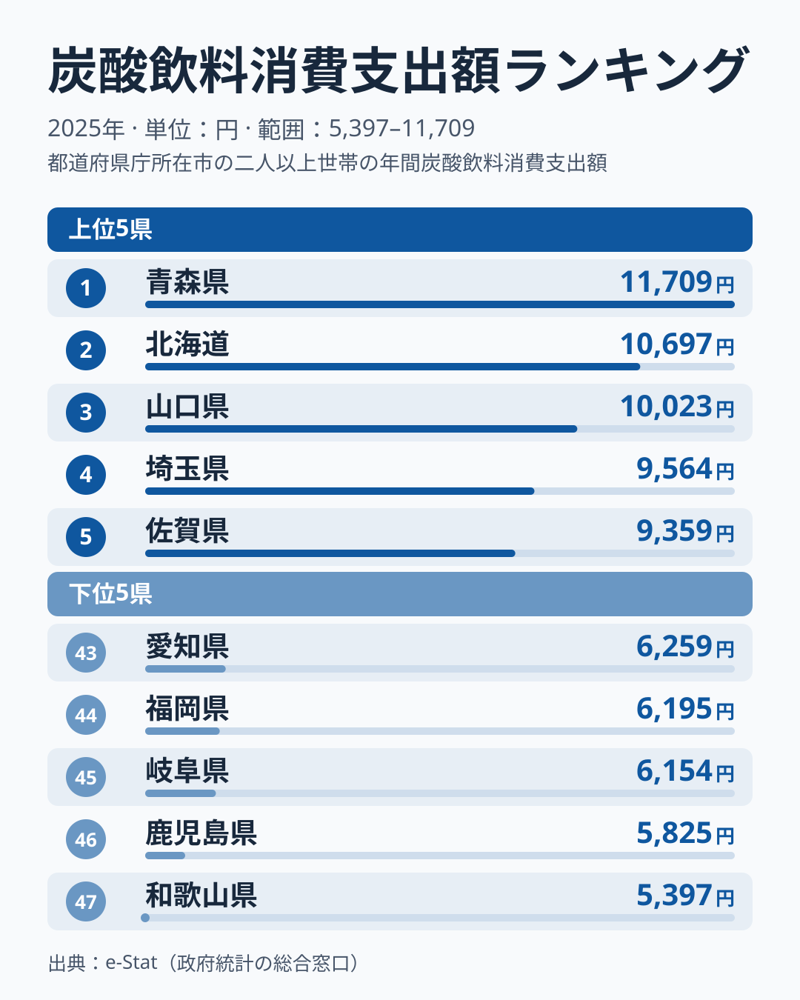

「炭酸飲料に一番お金を使う県は、暑い南国だろう」──そう思った人は、データを見ると裏切られます。2025年の家計調査（都道府県庁所在市・二人以上世帯）で、炭酸飲料消費支出額のトップに立ったのは**[青森県](/areas/02000)の11,709円**でした。2位は北海道の10,697円で、1位と2位は北の道県が占めています。一方で最下位は**[和歌山県](/areas/30000)の5,397円**。トップと最下位の差は6,312円、倍率にすると**2.17倍**（約2.2倍）にもなります。

炭酸飲料消費支出額とは、コーラやサイダーなどの炭酸入り飲料に1世帯が年間で支出した金額のことです。同じ日本でも、住む県によって倍以上の開きがあります。なぜ北の青森が炭酸飲料にこれほど使い、和歌山は使わないのでしょうか。この記事では47都道府県の地図から、その意外な構造を読み解きます。先に結論を言えば、気温の高低では支出の大小を説明できません。そして市の単年の値は大きく動くため、順位の背景を断定せず、読める範囲と仮説を分けて書きます。

> [!NOTE]
> 本データは総務省「家計調査」の品目別支出額で、各都道府県の**県庁所在市**における二人以上世帯の年間支出額です。県全体の平均ではなく、調査対象市の傾向を示す点に注意してください。金額には価格差も含まれるため、「飲んだ本数」そのものではなく「炭酸飲料に振り向けたお金」を表します。

## 炭酸飲料消費支出額ランキング 上位と最下位

まずは2025年の全体像から見ていきます。上位5県と下位5県を並べると、先頭は青森県と北海道、末尾は和歌山県と鹿児島県という構図が見えます。

上位5県は、青森県が11,709円、北海道が10,697円、山口県が10,023円、埼玉県が9,564円、佐賀県が9,359円です。**1万円を超えたのは青森県・北海道・山口県の3道県だけ**でした。1位と2位のあいだには1,012円の差があり、先頭の青森県は頭ひとつ抜けています。ただし3位以降は山口県、埼玉県、佐賀県と離れた地域の県が並び、「北日本が独占する」という単純な図にはなっていません。全47県の中央値は大阪府の8,381円で、東北6県と北海道の計7道県はいずれもこの中央値を上回りました。寒い地域が全体として高めに出ることは確かですが、上位5県の顔ぶれは地域でまとまっていません。

<source-link href="/ranking/carbonated-drink-consumption-expenditure">炭酸飲料消費支出額ランキングをもっと見る</source-link>

## 最下位グループ 差がつくのは意外と狭い範囲

下位5県は、和歌山県が5,397円、鹿児島県が5,825円、岐阜県が6,154円、福岡県が6,195円、愛知県が6,259円です。上位5県の最高値と最低値のあいだが2,350円も開いていたのに対し、**下位5県の最高値と最低値のあいだは862円しかなく、ぎゅっと詰まっています**。最下位の和歌山県と46位の鹿児島県の差は428円で、トップの青森県と2位の北海道の差1,012円の半分以下です。

つまり、47県の順位を分けているのは「先頭が抜けて高い」ことと「下位が団子状に低い」ことの両方です。中央値の8,381円を基準にすると、トップの青森県は約3,300円上、最下位の和歌山県は約3,000円下で、ほぼ対称に離れています。下位に和歌山県、鹿児島県、岐阜県、福岡県、愛知県と地方をまたぐ県が並ぶ点も、上位と同じく特定の地域に偏りません。

暑い地域ほど炭酸飲料を買うはずだという直感も、このデータでは裏づけられません。沖縄県は25位の8,083円、宮崎県は33位の7,455円、鹿児島県は46位の5,825円で、南の県はむしろ中位から下位に散らばっています。

> [!WARNING]
> このランキングは「支出額」であって「飲んだ量」ではありません。価格水準や世帯構成、地元飲料メーカーの存在など複数の要因が絡むため、下位＝飲んでいないとは限らない点に注意してください。家計調査は標本調査で、県庁所在市の標本は小さいため、年によって順位が大きく入れ替わります。ここでの分布は2025年単年のスナップショットとして読んでください。

## 発見1 東京は31位、でも隣の埼玉は4位

炭酸飲料というと若者や都市の消費イメージが強いですが、データは大都市の支出が突出しないことを示します。**東京都は31位の7,523円、愛知県は43位の6,259円、大阪府は24位の8,381円、神奈川県は20位の8,640円**で、大都市を抱える4都府県はいずれも上位10位に入っていません。

一方で、東京都を取り巻く県は高めです。**埼玉県は4位の9,564円、茨城県は10位の9,017円、栃木県は13位の8,993円、千葉県は14位の8,771円**と、東京都に隣り合う4県がそろって14位以内に入りました。東京都の7,523円との差は、埼玉県で2,041円にもなります。人口や所得の集中する都市の中心より、その周囲の県のほうが炭酸飲料に多く支出する構図です。

[仮説] 都心より周辺の県で高い背景には、自家用車で大型店へ出かけてケース単位でまとめ買いする習慣や、都心部の単身世帯の多さが関わっている可能性があります。ただし本データは支出額と世帯の合計だけで、購入場所や世帯構成別の内訳は含まないため、検証には品目別の数量データや世帯人員別の集計との突き合わせが必要です。

## 発見2 前年トップの福島は12位へ、動く順位と動かない青森

市の単年の値がどれだけ動くかは、同じランキングの過去年を見るとわかります。**福島県は2024年に全国で最も高い県でしたが、2025年は8,997円で12位に下がりました。三重県は2024年に最下位でしたが、2025年は6,804円の38位です。** 1年で最下位から9つ順位を上げた県もあれば、最高の水準から12位まで下がった県もあります。単年の順位だけで「この県は炭酸飲料を飲む」「飲まない」と言い切れない理由がここにあります。

そのなかで青森県は動きが小さく、2023年が2位、2024年が2位、2025年が1位と、3年続けて2位以内に入りました。北海道も2025年に2位で、北の2道県が安定して上位に顔を出す一方、3位以降は年ごとに顔ぶれが入れ替わっています。支出地図のうち、読み取れる安定した特徴は「青森県が常に上位にいる」ことと「暑さと支出の大小は結びつかない」ことの2点です。それ以外の順位は、標本の揺れを含むと見るのが妥当です。

炭酸飲料の支出地図は、気温のような単純な軸では並びません。47都道府県の地図を単年で眺めると、身近な品目ひとつにも地域ごとのお金の使い方の濃淡が浮かびますが、その理由まで1年のデータだけで断定することはできません。複数年のデータや数量との組み合わせが、次に確かめるべき手がかりです。

## まとめ

- **トップは青森県の11,709円**です。北海道が10,697円、山口県が10,023円で続き、上位5県は地域でまとまっていません
- **最下位は和歌山県の5,397円**です。46位の鹿児島県は5,825円で、差は428円にとどまり、下位5県は862円の幅に詰まっています
- トップと最下位の差は**2.17倍**で、同じ炭酸飲料への支出が県で2倍以上違います
- 沖縄県は25位、鹿児島県は46位で、**暑い南国ほど多く使うわけではありません**
- 東京都は31位ですが、周りの埼玉県は4位、茨城県は10位と高めです
- 福島県は2024年のトップから2025年の12位へ動いており、単年の順位から構造を断定せず、青森県のように複数年で続く特徴を見るのが確実です
